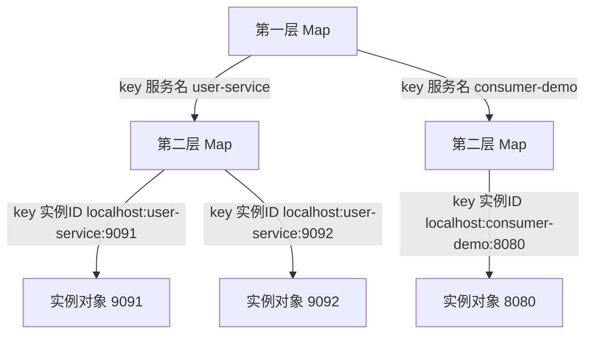
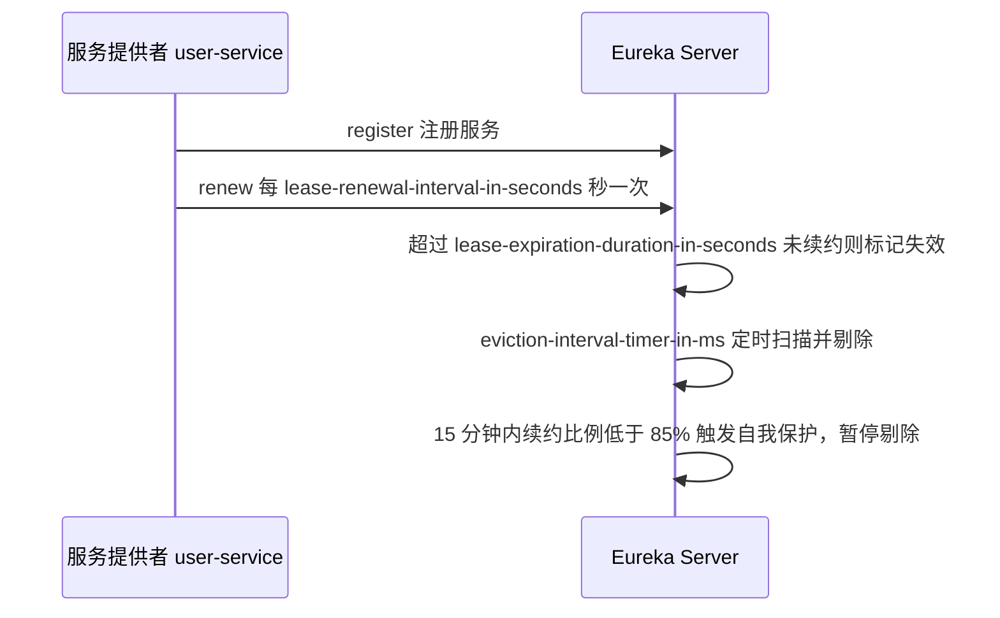

# Eureka 客户端与服务端配置：续约、剔除、自我保护与 IP 注册

服务能注册、能发现之后，紧接着冒出来的是另一类问题：注册上去的地址是 `localhost` 而不是可访问的 IP，服务停掉了却还挂在列表里，控制台顶上一行红字说 Eureka 进入了自我保护。这些现象背后都是同一批配置项在起作用。

这一节把 Eureka 客户端与服务端的常用配置一次讲清，覆盖服务地址使用 IP、心跳续约、拉取服务列表间隔、失效剔除和自我保护五项内容。

## 先给结论

- 注册中心内部用双层 Map 存实例：第一层的 key 是服务名，第二层的 key 是实例 ID，一个服务名对应多个实例。
- 想让注册地址用 IP 而不是主机名，配 `eureka.instance.prefer-ip-address: true` 加 `ip-address`。
- 续约由客户端发起，间隔用 `lease-renewal-interval-in-seconds`（默认 30 秒），失效判定用 `lease-expiration-duration-in-seconds`（默认 90 秒）。
- 失效剔除由服务端定时扫描，`eviction-interval-timer-in-ms` 默认 60000 毫秒，单位与前面两项不同，是毫秒。
- 自我保护在 15 分钟内续约比例低于 85% 时触发，保留可能已失效的实例；开发环境建议用 `enable-self-preservation: false` 关掉。

## 一、注册表长什么样

服务注册到 Eureka 之后，实例信息被保存在一个双层 Map 结构里。



第一层的 key 是服务 ID，也就是配置文件里 `spring.application.name` 的值。第二层的 key 是实例 ID，默认结构是 `主机名:服务名:端口`。值则是实例对象本身，里面保存着 host、port、状态等参与调用的字段。

这解释了为什么一个服务名能对应多个地址，也解释了为什么改配置时改的是实例 ID 的显示方式而不是服务名。

## 二、让注册地址用 IP 而不是主机名

默认情况下实例 ID 里用的是主机名，`DiscoveryClient` 取出来的 `getHost()` 返回 `localhost`。单机实验没问题，多机部署时 `localhost` 指的就是调用方自己，地址直接失效。

在 `user-service` 里加两项实例配置：

```yaml
eureka:
  client:
    service-url:
      defaultZone: http://127.0.0.1:10086/eureka
  instance:
    # 更倾向使用 ip 地址，而不是 host 名
    prefer-ip-address: true
    # 具体使用的 ip 地址
    ip-address: 127.0.0.1
```

`prefer-ip-address: true` 表达的是「在有选择的情况下优先用 IP 而不是主机名」，`ip-address` 则直接指定用哪个 IP。多网卡机器上这一项尤其重要，不指定时 Eureka 可能选到虚拟机网卡或 Docker 网桥的地址。

改完重启提供方，再打断点看 `instance.getHost()`，值就从 `localhost` 变成了 `127.0.0.1`。

注意这一项改的是**调用时取到的地址**，注册中心管理页面上实例那一列显示的仍是 `主机名:服务名:端口` 的原始格式，两边不是一回事，不要拿页面显示来判断配置有没有生效。

## 三、续约：客户端的心跳

服务注册完成后并不是一劳永逸。提供者需要定时向 Eureka Server 发一个 REST 请求，告诉它自己还活着，这个动作叫服务续约（renew）。



两个参数一起控制续约行为：

```yaml
eureka:
  instance:
    # 续约间隔，默认 30 秒
    lease-renewal-interval-in-seconds: 5
    # 服务失效时间，默认 90 秒
    lease-expiration-duration-in-seconds: 5
```

单位是秒。默认行为是每 30 秒续约一次，超过 90 秒没续约就被判定失效。课堂演示里把两个值都调成 5 秒，是为了让现象快点出现，生产环境调得太激反而会因为一次网络抖动就让实例反复上下线。

这里要分清两个概念：失效时间到了只是说这个实例**可以被**剔除，真正把它从列表里删掉的是服务端那个定时扫描任务。

## 四、消费方拉取服务列表的间隔

消费方不是每次调用都去问注册中心，它在本地缓存了一份地址列表，按固定间隔刷新：

```yaml
spring:
  application:
    name: consumer-demo
eureka:
  client:
    service-url:
      defaultZone: http://127.0.0.1:10086/eureka
    # 获取服务地址列表间隔时间，默认 30 秒
    registry-fetch-interval-seconds: 10
```

默认 30 秒刷新一次，调小能让新实例更快被调用方感知，代价是注册中心的请求量上升。这个缓存也是实例下线后仍会被短暂调用的原因之一。

## 五、服务端的失效剔除与自我保护

服务端有两件事要配，都写在 `eureka.server` 节点下，注意这是 `eureka-server` 工程的配置，不是两个客户端工程的。

```yaml
eureka:
  server:
    # 服务失效剔除时间间隔，默认 60 秒，单位是毫秒
    eviction-interval-timer-in-ms: 60000
    # 关闭自我保护模式，默认是打开的
    enable-self-preservation: false
```

**失效剔除**是一个定时任务，每隔 60 秒扫一遍注册表，把超过失效时间仍未续约的实例删掉。单位是毫秒，写成 `60000` 才是 60 秒，写成 `60` 就变成 60 毫秒，扫描会密集到影响性能。

**自我保护**是 Eureka 的一道保险。它在 15 分钟内统计续约成功的比例，一旦低于 85%，就认为可能是网络分区导致大面积心跳丢失，于是保留这些实例而不剔除，同时在页面上打出红色警告。这个设计的出发点是：误删一批本来健康的实例，比多留几个可能已经挂掉的实例伤害更大，后者还能靠调用方的超时和熔断兜住。

服务正常关闭时走的是另一条路：客户端会主动发一个下线请求，服务端直接把状态置为 `DOWN`，不必等剔除任务。只有进程被强杀、机器掉电这类非正常退出，才需要靠失效时间加剔除任务来清理。

开发环境下自我保护基本没有价值，所有服务都在本机，不存在网络分区，服务停了就是停了，留着它只会让你看到一个永远清不干净的列表。关掉之后页面上的 `Self Preservation Mode is Turn Off` 就是配置生效的标志。

## 常见误区

- **把 `enable-self-preservation` 和 `eviction-interval-timer-in-ms` 配到客户端**：这两项属于服务端，写在 `user-service` 或 `consumer-demo` 里不会有任何效果。
- **把 `eviction-interval-timer-in-ms` 写成 60**：单位是毫秒，60 表示 60 毫秒，正确写法是 `60000`。
- **以为配了失效时间服务就会立刻消失**：失效时间只判定「可剔除」，真正删除由服务端定时扫描完成，再叠加客户端 30 秒的列表缓存，感知延迟通常在分钟级。
- **看到自我保护红字就以为配置错了**：那是统计续约比例后的正常保护行为，想要复现需要反复启停服务把续约比例压到 85% 以下，存在一定概率，不必强求。
- **只在 `user-service` 配了 `prefer-ip-address`**：消费方取到的 host 才会变，但提供方注册时上报的仍然是原始实例 ID，多机部署时两边都要检查。

## 面试可能被问到的问题

1. 面试官追问：「Eureka 的注册表是什么结构？」
   答：双层 Map。第一层的 key 是服务名，也就是 `spring.application.name` 配置的值；第二层的 key 是实例 ID，默认形如 `主机名:服务名:端口`，值是实例对象。因此一个服务名可以对应多个实例，这正是负载均衡能够生效的前提。

2. 面试官追问：「怎么让 Eureka 使用 IP 而不是主机名注册？」
   答：在客户端配置 `eureka.instance.prefer-ip-address: true` 表示优先使用 IP，再用 `eureka.instance.ip-address` 指定具体地址。多网卡环境建议显式指定，避免选到虚拟机或容器的网卡地址。

3. 面试官追问：「服务续约相关的两个参数是什么，默认值是多少？」
   答：`eureka.instance.lease-renewal-interval-in-seconds` 是续约间隔，默认 30 秒，控制客户端多久发一次心跳；`eureka.instance.lease-expiration-duration-in-seconds` 是服务失效时间，默认 90 秒，超过这个时间没收到心跳就判定实例失效，等待被剔除。

4. 面试官追问：「实例下线后为什么不会立刻从服务列表消失？」
   答：链路有三段延迟：客户端每 30 秒续约一次，服务端要等 90 秒才判定失效，再等默认 60 秒一次的剔除任务才真正删除；消费方本地还有默认 30 秒的服务列表缓存。叠加起来感知延迟在分钟级，所以调用方必须配超时、重试与熔断。

5. 面试官追问：「Eureka 的自我保护机制是什么，生产环境要关吗？」
   答：Eureka 统计 15 分钟内的心跳续约比例，低于 85% 时进入自我保护，不再剔除可能已失效的实例，用来避免网络分区导致的大面积误删。生产环境一般保留，由调用方的容错机制兜底；开发环境所有服务都在本机，不存在网络分区，可以配 `eureka.server.enable-self-preservation: false` 关掉，让列表及时清理。

6. 面试官追问：「服务正常关闭和被强制杀掉，在 Eureka 上有什么不同？」
   答：正常关闭时客户端会主动发送下线请求，服务端把实例状态置为 `DOWN`，很快就能感知。被强制杀掉则没有下线请求，只能等心跳超时后由失效剔除任务清理。

## 配套资料

- 课堂笔记：`materials/code/01/2.springcloud/2.springcloud/day01/笔记/Spring Cloud 第一天课堂笔记.md`（第 13 节为 Eureka 客户端与服务端配置，含 `user-service`、`consumer-demo`、`eureka-server` 三个工程的完整配置原文与注释）
- 同章节第 9 节含 Eureka 主要功能的说明，可与本节的续约、剔除机制对照阅读
- 三个工程的成品源码未在资料包中提供，正文中的所有配置项均取自上述笔记第 13 节原文
