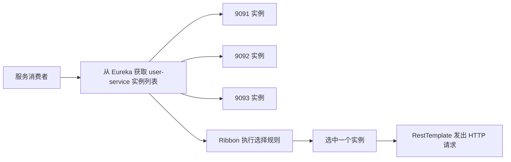

# Ribbon 负载均衡：从多个服务实例中选出一次调用目标

服务注册中心返回的并不总是一个地址。当同一个用户服务启动了 9091、9092 等多个实例后，消费者拿到的是一组可用地址。如果每次都固定访问列表中的第一个实例，其他实例就无法分担请求，集群也失去了扩容的意义。

Ribbon 解决的正是「拿到多个地址后该选谁」的问题。它位于服务消费者一侧，在真正发出 HTTP 请求前，按照负载均衡规则挑选一个实例，再把请求交给选中的目标。

## 先给结论

- 负载均衡的核心动作，是从同一服务的实例列表中选出一个地址执行调用。
- Ribbon 是客户端负载均衡器，选择逻辑运行在服务消费者进程内，不由 Eureka Server 转发请求。
- 课程使用的 Spring Cloud Greenwich.SR1 中，Eureka 客户端会配合 Ribbon 完成服务发现与实例选择。
- Ribbon 支持轮询、随机等规则，课程中的默认选择方式是轮询。
- 只有一个实例时看不出负载均衡效果，启动多个实例后，算法的价值才会显现。

## 一、为什么服务发现之后还需要负载均衡

Eureka 负责管理服务实例。服务提供者启动后，把自己的应用名、主机和端口注册到 Eureka Server；服务消费者再根据应用名拉取实例列表。注册中心回答的是「有哪些地址可用」，但不会替消费者决定「这一次访问哪个地址」。

假设 `user-service` 注册了三个实例：

```text
127.0.0.1:9091
127.0.0.1:9092
127.0.0.1:9093
```

直接取 `instances.get(0)` 虽然能完成调用，却会让第一个实例长期承担全部流量。更合理的做法是在每次请求前执行一次选择算法，让多个实例共同处理请求。

**第一，服务发现解决地址获取。** 消费者不必在代码里写死提供者的 IP 和端口，只需使用服务名查找实例。

**第二，负载均衡解决地址选择。** 当查询结果有多个实例时，Ribbon 根据规则返回其中一个 `ServiceInstance`，消费者再向该实例发送请求。

二者的职责可以用下面的调用链表示。这张图展示了消费者从注册表获取实例列表，再由 Ribbon 选择目标的过程。



关键路径是「发现列表、执行规则、访问实例」。Eureka 管理列表，Ribbon 负责选择，`RestTemplate` 负责发送请求。

## 二、Ribbon 属于客户端负载均衡

负载均衡可以放在服务端入口，也可以放在客户端。Ribbon 采用客户端负载均衡方式，每个消费者都保存一份服务实例信息，并在本地完成选择。

**服务端负载均衡**常见于网关或反向代理。调用方只访问统一入口，入口设备再把请求转发到后端实例。调用方不知道实际处理请求的是哪台机器。

**客户端负载均衡**没有独立的流量转发节点。消费者先取得实例列表，在自己的进程内选出地址，然后直接访问服务提供者。Ribbon 的算法运行在消费者端，因此它必须和服务发现机制配合，才能获得最新的可用实例。

课程工程使用 Spring Boot 2.1.5.RELEASE 和 Spring Cloud Greenwich.SR1，父级 Maven 配置通过 BOM 统一管理 Spring Cloud 组件版本。真实配置精简后如下，工程坐标已改为中性命名：

```xml
<properties>
    <java.version>1.8</java.version>
    <spring-cloud.version>Greenwich.SR1</spring-cloud.version>
</properties>

<dependencyManagement>
    <dependencies>
        <dependency>
            <groupId>org.springframework.cloud</groupId>
            <artifactId>spring-cloud-dependencies</artifactId>
            <version>${spring-cloud.version}</version>
            <type>pom</type>
            <scope>import</scope>
        </dependency>
    </dependencies>
</dependencyManagement>
```

消费者引入 Eureka 客户端后，便具备注册表拉取能力。课程笔记中的真实依赖是：

```xml
<dependency>
    <groupId>org.springframework.cloud</groupId>
    <artifactId>spring-cloud-starter-netflix-eureka-client</artifactId>
</dependency>
```

在这套版本组合中，Ribbon 与 Eureka 客户端协同工作。不能把 Ribbon 理解成注册中心，它既不保存全局注册数据，也不接收服务注册请求。

## 三、轮询与随机规则怎么理解

课程重点介绍了两种选择方式：轮询和随机。

**轮询**按顺序依次选择实例。若列表为 9091、9092、9093，连续请求的目标会呈现 9091、9092、9093、9091 的循环。它能让请求数量较均匀地分布到各实例，也是课程场景中的默认规则。

**随机**每次从列表中随机选择一个实例。短时间内可能连续选中同一个地址，因此不能把「随机」理解为每台实例一定获得相同数量的请求。请求次数足够多时，分布才更可能趋于均匀。

可以用一段简化的 Java 代码理解两种规则的差别。这段代码只表达算法思路，真正运行时由 Ribbon 的规则实现负责选择：

```java
package com.example.loadbalance;

import java.util.List;
import java.util.concurrent.ThreadLocalRandom;
import java.util.concurrent.atomic.AtomicInteger;

public class InstanceSelector {
    private final AtomicInteger position = new AtomicInteger();

    public String roundRobin(List<String> instances) {
        int index = Math.floorMod(position.getAndIncrement(), instances.size());
        return instances.get(index);
    }

    public String random(List<String> instances) {
        int index = ThreadLocalRandom.current().nextInt(instances.size());
        return instances.get(index);
    }
}
```

真实项目不会只看实例数量，还要考虑实例是否可达、注册表是否及时更新以及重试策略。负载均衡规则只负责「怎样选」，可用实例集合仍来自服务发现组件。

## 四、它怎样接到 HTTP 调用链上

课程配套 `http-demo` 工程已经使用 `RestTemplate` 发起远程调用。原始代码通过 `@Bean` 把客户端对象交给 Spring 容器管理，包名改写后如下：

```java
package com.example.http;

import org.springframework.context.annotation.Bean;
import org.springframework.context.annotation.Configuration;
import org.springframework.web.client.RestTemplate;

@Configuration
public class HttpClientConfig {

    @Bean
    public RestTemplate restTemplate() {
        return new RestTemplate();
    }
}
```

普通 `RestTemplate` 只能识别真实主机名或 IP，无法把 `http://user-service` 自动解释为 Eureka 中的应用名。Ribbon 的典型接入点是给 `RestTemplate` 增加负载均衡能力，让拦截器在请求发出前把服务名解析为具体实例地址。具体配置与调用写法会在应用部分展开。

## 常见误区

- **把 Ribbon 当成注册中心**：Ribbon 不接受注册，也不维护全局服务目录。实例列表来自 Eureka，Ribbon 只在消费者本地选择地址。
- **认为轮询等于平均负载**：轮询能均匀分配请求次数，但不同请求的处理成本可能差异很大，请求数相等不代表 CPU 或耗时完全相等。
- **认为随机一定分配均匀**：随机规则允许连续命中同一个实例，短时间样本出现倾斜是正常现象。
- **只有一个实例却验证算法效果**：单实例列表无论采用哪种规则，结果都只能是同一个地址。测试时至少要启动两个提供者实例。

## 面试可能被问到的问题

1. 面试官追问：「Ribbon 解决了什么问题？」
   答：它从同一服务的多个可用实例中选择一个目标，让消费者不必固定访问某个地址。选择完成后，HTTP 客户端直接请求被选中的实例。

2. 面试官追问：「Ribbon 是客户端负载均衡还是服务端负载均衡？」
   答：它是客户端负载均衡。实例列表和选择逻辑位于服务消费者一侧，消费者选出地址后直接发起调用。

3. 面试官追问：「Eureka 和 Ribbon 的职责有什么区别？」
   答：Eureka 负责服务注册、续约、发现和实例列表管理；Ribbon 负责在消费者拿到的实例列表中执行负载均衡选择。前者解决「地址从哪里来」，后者解决「本次用哪个地址」。

4. 面试官追问：「轮询和随机规则有什么差别？」
   答：轮询按顺序循环访问实例，请求次数通常分布得更稳定；随机每次独立选择，短时间内可能偏向某个实例。两者都以可用实例列表为输入。

5. 面试官追问：「为什么直接取实例列表的第一个元素不合理？」
   答：固定取第一个会让流量长期集中到单个实例，其他实例无法分担请求。列表顺序变化还可能造成流量突然切换，不具备明确、可控的均衡策略。

## 配套资料

- 课程笔记：`materials/code/01/2.springcloud/2.springcloud/day01/笔记/Spring Cloud 第一天课堂笔记.md`
- HTTP 调用工程：`materials/code/01/2.springcloud/2.springcloud/day01/资料/http-demo/`
- Java 源码目录：`materials/code/01/2.springcloud/2.springcloud/day01/资料/http-demo/src/main/java/`（正文中的包名已统一改为 `com.example`）
