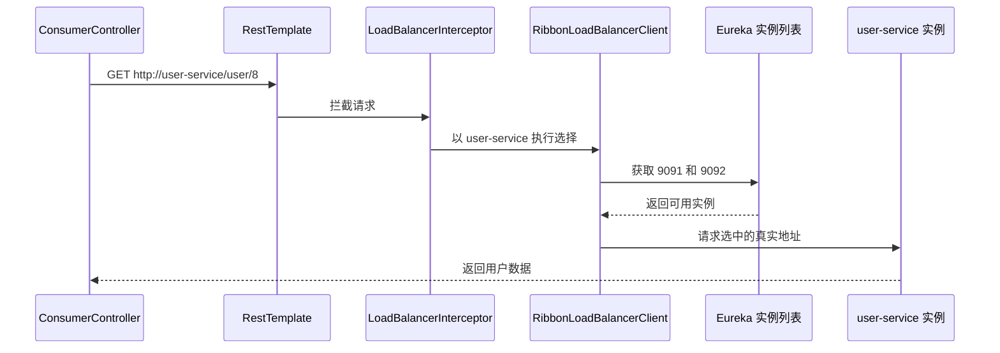

# 用 @LoadBalanced 让 RestTemplate 按服务名调用集群实例

把远程调用地址从 `http://127.0.0.1:9091/user/8` 改成 `http://user-service/user/8` 后，普通 `RestTemplate` 会把 `user-service` 当作主机名解析，通常只能得到「无法解析主机」一类错误。服务名存在于 Eureka 注册表中，并不是操作系统 DNS 能识别的域名。

Ribbon 的应用方式并不是手动调用某个选择器，而是让负载均衡拦截器进入 `RestTemplate` 的请求链。拦截器识别 URL 中的服务名，从注册表取得实例列表，选中 9091 或 9092，再用真实地址完成调用。

## 先给结论

- 服务提供者要启动至少两个实例，端口不能冲突，应用名必须保持一致。
- 在 `RestTemplate` 的 `@Bean` 方法上添加 `@LoadBalanced`，才能启用基于服务名的负载均衡调用。
- 调用地址应写成 `http://服务名/资源路径`，不再手动查询 `DiscoveryClient` 或拼接 IP、端口。
- `@LoadBalanced` 不会改变 `RestTemplate` 的业务 API，它只是为目标对象加入负载均衡拦截器。
- 课程环境的默认规则是轮询，连续请求会在 9091、9092 两个实例之间切换。

## 一、准备两个服务实例

单实例无法观察选择结果。课程把 `user-service` 分别启动在 9091 和 9092，两个进程使用相同的 `spring.application.name`，因此它们会以同一个服务名注册到 Eureka。

端口可以写成带默认值的占位符。未传入 `PORT` 时使用 9091，第二个启动配置再覆盖为 9092：

```yaml
server:
  port: ${PORT:9091}

spring:
  application:
    name: user-service

eureka:
  client:
    service-url:
      defaultZone: http://127.0.0.1:10086/eureka
```

如果使用打包后的应用，可以为两个进程分别传入端口：

```bash
java -jar user-service.jar --PORT=9091
java -jar user-service.jar --PORT=9092
```

两个实例启动后，应先到 Eureka 控制台确认 `user-service` 下同时存在 9091 和 9092。注册表里只有一个地址时，即使消费者配置完全正确，也看不到轮询效果。

## 二、给 RestTemplate 开启负载均衡

课程配套 `http-demo` 工程中的真实源码已经用 `@Bean` 创建了 `RestTemplate`。原始方法返回普通客户端，改造时只需添加 `@LoadBalanced`。包名按中性规则调整后，完整配置如下：

```java
package com.example.consumer;

import org.springframework.boot.SpringApplication;
import org.springframework.boot.autoconfigure.SpringBootApplication;
import org.springframework.cloud.client.loadbalancer.LoadBalanced;
import org.springframework.context.annotation.Bean;
import org.springframework.web.client.RestTemplate;

@SpringBootApplication
public class ConsumerApplication {

    public static void main(String[] args) {
        SpringApplication.run(ConsumerApplication.class, args);
    }

    @Bean
    @LoadBalanced
    public RestTemplate restTemplate() {
        return new RestTemplate();
    }
}
```

`@LoadBalanced` 的作用对象是 Spring 容器管理的 `RestTemplate`。如果代码在方法内部直接执行 `new RestTemplate()`，这个新对象没有经过容器后处理，也就不会带上负载均衡拦截器。

课程消费者引入了 Eureka 客户端依赖，Maven 依赖树中可以看到 `spring-cloud-starter-netflix-ribbon`。对应依赖配置为：

```xml
<dependency>
    <groupId>org.springframework.cloud</groupId>
    <artifactId>spring-cloud-starter-netflix-eureka-client</artifactId>
</dependency>
```

在课程使用的 Spring Cloud Greenwich.SR1 版本中，Eureka 客户端与 Ribbon 已完成集成，因此不必在业务代码里自行创建 `ILoadBalancer`。

## 三、用服务名替换固定地址

改造前的调用地址写死了 `localhost:9091`，消费者只能访问一个实例：

```java
@GetMapping("/{id}")
public User queryById(@PathVariable Long id) {
    String url = "http://localhost:9091/user/" + id;
    return restTemplate.getForObject(url, User.class);
}
```

再早一些的写法会通过 `DiscoveryClient.getInstances("user-service")` 查询列表，然后固定取第一个元素并拼接 URL：

```java
List<ServiceInstance> instances = discoveryClient.getInstances("user-service");
ServiceInstance instance = instances.get(0);
String url = "http://" + instance.getHost()
        + ":" + instance.getPort() + "/user/" + id;
return restTemplate.getForObject(url, User.class);
```

第二种写法摆脱了固定 IP，却依然固定访问列表中的第一个实例，选择逻辑也侵入了 Controller，因此还不是真正的负载均衡。

启用 `@LoadBalanced` 后，Controller 可以直接把服务名放进 URL：

```java
package com.example.consumer.controller;

import com.example.consumer.domain.User;
import org.springframework.web.bind.annotation.GetMapping;
import org.springframework.web.bind.annotation.PathVariable;
import org.springframework.web.bind.annotation.RequestMapping;
import org.springframework.web.bind.annotation.RestController;
import org.springframework.web.client.RestTemplate;

@RestController
@RequestMapping("/consumer")
public class ConsumerController {

    private final RestTemplate restTemplate;

    public ConsumerController(RestTemplate restTemplate) {
        this.restTemplate = restTemplate;
    }

    @GetMapping("/{id}")
    public User queryById(@PathVariable Long id) {
        String url = "http://user-service/user/" + id;
        return restTemplate.getForObject(url, User.class);
    }
}
```

这里的 `user-service` 必须和提供者的 `spring.application.name` 完全一致。大小写、连字符或拼写不一致，都会导致 Ribbon 找不到可用实例并抛出 `No instances available for user-service`。

启动消费者后，多次访问下面的地址即可验证调用结果：

```bash
curl http://localhost:8080/consumer/8
curl http://localhost:8080/consumer/8
```

若在提供者日志中打印当前端口，或者像课程演示那样调试 `RibbonLoadBalancerClient`，可以观察到目标地址在 `127.0.0.1:9091` 与 `127.0.0.1:9092` 之间轮换。

若要对照观察随机选择，可以针对服务名把规则类改为 `RandomRule`：

```yaml
user-service:
  ribbon:
    NFLoadBalancerRuleClassName: com.netflix.loadbalancer.RandomRule
```

规则配置属于消费者，因为实例选择发生在客户端。改成随机后，连续两次命中同一端口并不表示配置失效。

## 四、请求为什么能从服务名变成真实地址

`user-service` 不是可直接解析的普通域名，真正完成替换的是 Spring Cloud 的负载均衡调用链。这张图展示了 `RestTemplate` 从接收逻辑 URL 到访问真实实例的过程。



关键点在拦截器。`LoadBalancerAutoConfiguration` 会处理标记了 `@LoadBalanced` 的 `RestTemplate`，通过 `RestTemplateCustomizer` 把 `LoadBalancerInterceptor` 加入拦截器列表。请求发出时，拦截器从 URI 中取出主机部分 `user-service` 作为 `serviceId`，再调用 `LoadBalancerClient.execute`。

课程调试进入 `RibbonLoadBalancerClient` 后，可以看到被选中的 `Server`。若没有可用实例，执行逻辑会直接报错，而不会继续请求一个不存在的地址。实例存在时，Ribbon 根据规则选择目标，并用实际的主机和端口重构请求。

## 五、验证时应该看什么

仅看到浏览器返回 JSON，只能证明某一次调用成功，不能证明负载均衡已经生效。验证时应同时观察以下三项：

**第一，注册表中的实例数。** `user-service` 下必须有两个健康实例，端口分别为 9091、9092。

**第二，消费者是否注入了带 `@LoadBalanced` 的 Bean。** Controller 应使用 Spring 注入的 `RestTemplate`，不能自行创建对象。

**第三，连续请求的目标端口。** 默认轮询规则下，调试变量或提供者日志应显示两个端口交替出现。单次请求无法说明算法行为。

## 常见误区

- **把服务名当成 DNS 域名**：普通 `RestTemplate` 不认识 `user-service`，必须使用容器中带 `@LoadBalanced` 的实例。
- **在 Controller 中直接 `new RestTemplate()`**：新对象没有负载均衡拦截器，请求不会经过 Ribbon。
- **两个提供者使用不同应用名**：9091 注册为 `user-service-a`、9092 注册为 `user-service-b` 时，它们属于两个服务，无法作为同一列表参与轮询。
- **仍然固定取 `instances.get(0)`**：这只是服务发现加手动拼接，不是按规则选择实例。
- **只调用一次就判断轮询无效**：轮询是连续请求之间的选择规律，至少要请求多次并观察目标端口。

## 面试可能被问到的问题

1. 面试官追问：「`@LoadBalanced` 加在 `RestTemplate` 上做了什么？」
   答：它把该 Bean 标记为需要负载均衡增强的 HTTP 客户端。自动配置会为它加入 `LoadBalancerInterceptor`，请求时再根据服务名选择真实实例。

2. 面试官追问：「为什么 `http://user-service/user/8` 能被访问？」
   答：`user-service` 不由 DNS 解析。负载均衡拦截器把它作为 `serviceId`，从 Eureka 对应的实例列表中选出主机和端口，再发送实际请求。

3. 面试官追问：「为什么不能继续使用 `DiscoveryClient` 后固定取第一个实例？」
   答：固定取第一个会让流量集中到单个实例，也把地址选择逻辑散落在业务代码中。Ribbon 把发现、选择和请求改写放进统一调用链，业务代码只保留服务名。

4. 面试官追问：「如何证明 Ribbon 的轮询生效了？」
   答：启动同名、不同端口的至少两个实例，连续调用消费者接口，并查看提供者日志或调试 `RibbonLoadBalancerClient` 中选中的服务器。目标端口应按轮询规则切换。

5. 面试官追问：「出现 `No instances available for user-service` 应该检查什么？」
   答：检查提供者是否成功注册、应用名是否一致、消费者是否能拉取注册表，以及实例是否已被剔除。这个错误表示负载均衡器没有取得可用实例，并不等同于 Controller 路径不存在。

## 配套资料

- 课程笔记：`materials/code/01/2.springcloud/2.springcloud/day01/笔记/Spring Cloud 第一天课堂笔记.md`
- HTTP 调用示例工程：`materials/code/01/2.springcloud/2.springcloud/day01/资料/http-demo/`
- `RestTemplate` Bean 源码目录：`materials/code/01/2.springcloud/2.springcloud/day01/资料/http-demo/src/main/java/`
- `RestTemplate` 调用测试目录：`materials/code/01/2.springcloud/2.springcloud/day01/资料/http-demo/src/test/java/`
