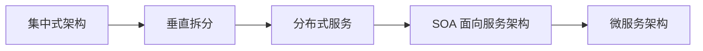
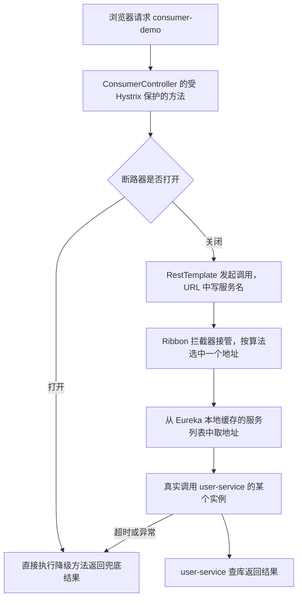

# Spring Cloud 第一天复盘：从服务注册到熔断

第一天结束的时候，脑子里往往堆着一堆散件：`@EnableDiscoveryClient`、`@LoadBalanced`、
`@HystrixCommand`、`DiscoveryClient`、`RestTemplate`、一堆 yml。每个注解单独看都懂，
合在一起却说不清一次请求到底经过了哪些组件、谁依赖谁。

把这些散件放回一条调用链上，关系立刻清楚：一次 `/consumer/8` 的请求，
要依次穿过消费端、负载均衡、注册中心、提供端，最后还要被熔断保护包住。
下面按这条链路把第一天的知识点重排一遍。

## 先给结论

- 架构演变的主线是「拆」：集中式到垂直拆分，再到分布式服务、SOA，最后到微服务，每一步都在解决上一步的耦合问题。
- 服务调用方式只有两大类：RPC 基于 socket，快但绑定技术栈；HTTP 基于 TCP，臃肿但对调用方语言和框架没有限定。
- Spring Cloud 不是单个框架，是一组组件的整合，版本以伦敦地铁站名命名，按需要引入对应 starter。
- Eureka 解决「地址从哪来」，Ribbon 解决「这么多地址选哪个」，Hystrix 解决「调不通了怎么办」。
- 三个组件的介入点分别是：注册发现发生在调用前，负载均衡发生在选地址时，熔断降级发生在调用失败或超时时。
- 高可用的最小闭环是：注册中心集群互注册、服务多实例、消费端带负载均衡与容错。

## 一、架构为什么要一步步拆开

集中式架构把所有功能堆在一个应用里，部署到一台服务器，并发上不去，也没法水平扩展。
垂直拆分按业务切成若干子系统，各自独立部署，解决了扩展问题，代价是公共代码重复。
分布式服务把复用度高的核心代码抽出来单独提供服务，结果是服务之间的调用关系变得错综复杂。
SOA 引入 ESB 统一编排服务通信，代价是 ESB 自身复杂、服务粒度偏大、所有通信都要过总线。

微服务架构相当于在 SOA 基础上做了减法：去掉 ESB，改用服务治理注册中心，服务粒度更小，
每个服务单一职责、对外暴露 REST 接口、彼此独立部署。



这条链路的每一步都是被上一步的痛点推着走的，记住「每一步解决了什么」比记住名字重要。

## 二、服务之间怎么说话

服务调用只有两种基本方式。RPC 基于 socket，速度快、效率高，典型代表是 Dubbo 和 WebService，
代价是调用双方技术栈被绑定。HTTP 基于 TCP，报文相对臃肿，但对服务提供方和调用方
没有任何技术、语言上的限定，RESTful 风格天然契合，Spring Cloud 走的就是这条路线。

Spring 提供了 `RestTemplate` 对 HttpClient、OkHttp、JDK 原生 `URLConnection` 三种客户端做了封装，
工程里注册一个 Bean 就能直接用。课程示例工程 `http-demo` 里的引导类就是这么做的
（包名已统一为中性命名）：

```java
package com.example;

import org.springframework.boot.SpringApplication;
import org.springframework.boot.autoconfigure.SpringBootApplication;
import org.springframework.context.annotation.Bean;
import org.springframework.web.client.RestTemplate;

@SpringBootApplication
public class HttpDemoApplication {

    public static void main(String[] args) {
        SpringApplication.run(HttpDemoApplication.class, args);
    }

    @Bean
    public RestTemplate restTemplate() {
        return new RestTemplate();
    }
}
```

注入之后，`getForObject` 可以直接把 JSON 响应反序列化成实体：

```java
@RunWith(SpringRunner.class)
@SpringBootTest
public class RestTemplateTest {

    @Autowired
    private RestTemplate restTemplate;

    @Test
    public void test() {
        String url = "http://localhost/user/8";
        User user = restTemplate.getForObject(url, User.class);
        System.out.println(user);
    }
}
```

## 三、工程骨架：父工程加两个服务

课程搭了三个工程：父工程做依赖管理，user-service 作为服务提供方整合通用 Mapper 查库，
consumer-demo 作为服务消费方调用查询接口并输出到浏览器。

父工程的关键是通过 `scope` 为 `import` 的方式继承 `spring-cloud-dependencies`，
这样所有 Spring Cloud 组件的版本由官方 BOM 统一仲裁，子工程引 starter 时不用写版本号：

```xml
<dependencyManagement>
    <dependencies>
        <dependency>
            <groupId>org.springframework.cloud</groupId>
            <artifactId>spring-cloud-dependencies</artifactId>
            <version>${spring-cloud.version}</version>
            <type>pom</type>
            <scope>import</scope>
        </dependency>
    </dependencies>
</dependencyManagement>
```

课程基线是 Spring Boot 2.1.5.RELEASE 与 Spring Cloud Greenwich.SR1，
这两者的版本对应关系不能随意搭配，搭错会出现各种莫名其妙的 `NoSuchMethodError`。

## 四、注册中心：把写死的地址换成服务名

最早 consumer-demo 里写的是 `http://localhost:9091/user/8`，地址硬编码，
提供方一旦做集群或者换端口，消费端就得跟着改。Eureka 就是来解决这个「地址从哪来」的问题。

Eureka Server 本身是个 Spring Boot Web 工程，加 `spring-cloud-starter-netflix-eureka-server` 依赖，
引导类加 `@EnableEurekaServer`，再配好端口和应用名即可：

```yaml
server:
  port: 10086
spring:
  application:
    name: eureka-server
eureka:
  client:
    service-url:
      defaultZone: http://127.0.0.1:10086/eureka
    register-with-eureka: false
    fetch-registry: false
```

服务提供方和消费方各引 `spring-cloud-starter-netflix-eureka-client`，引导类加服务发现注解，
配置里指向注册中心地址。消费端随后可以用 `DiscoveryClient` 按服务名取回实例列表，
也可以直接把服务名写进 URL，交给 Ribbon 解析。

Eureka Server 自身的高可用方式是互相注册：多个实例之间把自己注册到对方，
从而同步服务列表。客户端侧还有续约间隔、服务失效时间、拉取服务列表间隔等参数可调，
服务端侧有失效剔除间隔和自我保护模式。

## 五、负载均衡：Ribbon 补上最后一环

拿到实例列表之后还有个问题：`discoveryClient.getInstances("user-service").get(0)` 永远取第一个，
其余实例白白闲置。Ribbon 负责按算法挑一个，默认是轮询，也可以换成随机。

用法极简，只在注册 `RestTemplate` 时加一个注解：

```java
@Bean
@LoadBalanced
public RestTemplate restTemplate() {
    return new RestTemplate();
}
```

加了 `@LoadBalanced` 之后，`RestTemplate` 发出的请求会被负载均衡拦截器接管，
URL 里可以直接写服务名，剩下的解析与选址全部自动完成：

```java
String url = "http://user-service/user/" + id;
return restTemplate.getForObject(url, String.class);
```

## 六、容错：隔离、降级与熔断

远程调用一定会失败，Hystrix 负责把失败关进笼子。它有两件武器和一个状态机。

线程隔离给每个依赖分配独立线程池，请求不再直接访问远程服务，而是通过池中的空闲线程访问，
池子耗尽就立刻判定该依赖不可用，从而加速失败判断。服务降级则在调用超时或异常时
返回兜底结果，让线程不必继续等待。默认超时为 1000 毫秒，多数场景偏紧，一般调到 2000 毫秒：

```yaml
hystrix:
  command:
    default:
      execution:
        isolation:
          thread:
            timeoutInMilliseconds: 2000
      circuitBreaker:
        errorThresholdPercentage: 50
        sleepWindowInMilliseconds: 10000
        requestVolumeThreshold: 10
```

熔断是更高一层的控制。断路器有 Closed、Open、Half Open 三态：
关闭时正常放行，统计窗口内失败比例达到阈值后打开，打开期间所有请求直接降级，
经过休眠窗口进入半开状态放少量请求探路，探路成功就关闭，失败则退回打开。

## 七、把一天的内容串成一条链路

把上面所有组件放进一次请求里，链路是这样的：



顺着这张图复盘，每个组件的位置都很清楚：Eureka 在调用之前提供地址，
Ribbon 在调用之时决定打哪台机器，Hystrix 在调用失败或超时时兜底。
注册中心负责地址，负载均衡负责选址，容错组件负责失败，三者各管一段，互不替代。

## 常见误区

- **把 Ribbon 和 Eureka 当成二选一**：Ribbon 负责从地址列表里挑一个，Eureka 负责提供地址列表，两个组件解决的是不同环节的问题。
- **以为加了 `@LoadBalanced` 就自动注册到 Eureka**：注册靠的是 Eureka 客户端依赖和引导类注解，负载均衡只影响调用时的选址。
- **把服务降级和熔断混为一谈**：降级决定失败后返回什么，熔断决定一段时间内是否继续发起真实调用，熔断打开时通常也会执行降级逻辑。
- **沿用 Hystrix 默认 1 秒超时**：很多接口首次访问就会超过，导致服务健康也被降级，应按真实耗时调整阈值。
- **父工程不引入 `spring-cloud-dependencies` 就手写组件版本**：版本组合未经官方验证，容易出现依赖冲突。

## 面试可能被问到的问题

1. 面试官追问：「系统架构经历了哪几个阶段，微服务和 SOA 的区别是什么？」
   答：集中式、垂直拆分、分布式服务、SOA、微服务。微服务没有 ESB，改用服务治理注册中心，服务粒度更小、单一职责、对外暴露 REST 接口，部署上彼此独立。

2. 面试官追问：「RPC 和 HTTP 两种服务调用方式怎么选？」
   答：RPC 基于 socket，性能高但要求调用双方技术栈一致，适合内部高性能场景，代表是 Dubbo。HTTP 基于 TCP，报文相对臃肿，但对语言和技术没有限定，跨系统集成更灵活，Spring Cloud 采用这种方式。

3. 面试官追问：「Eureka 和 Ribbon 的分工是什么？」
   答：Eureka 负责服务注册与发现，维护服务名到实例地址列表的映射，并定期检查实例状态。Ribbon 负责客户端负载均衡，从这份列表里按轮询或随机等算法挑出一个地址发起调用。

4. 面试官追问：「消费端是怎么做到不用写死 IP 的？」
   答：服务提供方启动时把自身地址注册到 Eureka，消费端加 Eureka 客户端依赖并配置注册中心地址，调用时用服务名代替 IP，由 Ribbon 的负载均衡拦截器把服务名解析成真实地址。

5. 面试官追问：「Eureka Server 怎么做高可用？」
   答：启动多个 Eureka Server 实例，把每个实例都作为服务注册到其他实例上，实例之间互相发现并同步服务列表，同时客户端配置多个注册中心地址。

6. 面试官追问：「Hystrix 解决雪崩效应的三个手段分别是什么？」
   答：线程隔离限制单个依赖能占用的资源，服务降级在失败或超时后及时返回兜底结果避免线程长时间等待，熔断在失败比例达到阈值后暂时停止真实调用，经过休眠窗口再试探恢复。

## 配套资料

- 第一天知识点与全部代码配置：`materials/code/01/2.springcloud/2.springcloud/day01/笔记/Spring Cloud 第一天课堂笔记.md`
- `RestTemplate` 示例工程：`materials/code/01/2.springcloud/2.springcloud/day01/资料/http-demo/pom.xml`
- 用户实体源码：`materials/code/01/2.springcloud/2.springcloud/day01/资料/User.java`
- 示例库表脚本：`materials/code/01/2.springcloud/2.springcloud/day01/资料/tb_user.sql`
