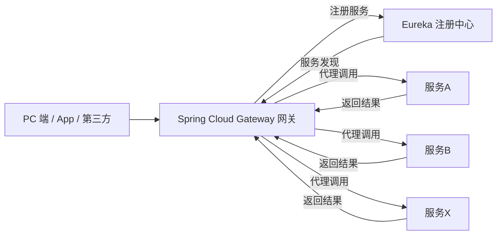

# Spring Cloud Gateway 网关：从统一入口到第一个路由规则

微服务拆开之后，地址的暴露方式成了新问题。用户服务在 9091，订单服务在 9092，内容服务在 9093，前端要记住一堆端口，任何一个服务迁移机器都要改配置，更麻烦的是每个服务都得各自实现鉴权、限流和日志。

Spring Cloud Gateway 就是用来收口的：所有外部请求先打到网关，由网关做路由转发和过滤处理，后端服务的真实地址不再对外暴露。

## 先给结论

- Spring Cloud Gateway 是 Spring 官方基于 Spring 5.0、Spring Boot 2.0 和 Project Reactor 开发的网关，用来替代已进入维护状态的 Netflix Zuul。
- 网关的两大作用是**过滤和路由**，核心实现是一系列的过滤器链。
- 网关本身也是一个微服务，需要注册到 Eureka，并通过服务名做服务发现。
- 路由由四部分组成：路由 id、目标 URI、一组断言、一组过滤器。断言为真才转发。
- 入门配置只需要一个起步依赖加一段 `routes` 配置，网关工程**不需要写任何 Controller**。

## 一、为什么需要网关

微服务数量上来之后，直接暴露每个服务地址会带来三类问题：

**第一，调用方要维护大量地址。** 服务迁移、扩容、换端口都会影响调用方，地址成了强耦合点。

**第二，安全边界被打破。** 每个服务的 IP 和端口直接暴露在外网，攻击面随服务数量线性增长。

**第三，通用逻辑重复实现。** 鉴权、限流、日志记录这类非业务功能，在每个服务里都要写一遍，改一次要发十几个包。

网关位于整个微服务架构的最前沿，相当于一道防火墙和代理器：终端只认识网关的地址，网关解析请求后代理调用具体的服务，再把结果原路返回。服务的节点信息被隐藏在网关后面，安全性随之提升。

早期的网关方案是 Netflix 的 Zuul，目前该项目已进入维护状态，不再开发新功能，Spring 官方推荐使用 Spring Cloud Gateway 作为替代。如果在实际项目中见到 Zuul，不必惊讶，两者的定位一致，都是做过滤和路由。

## 二、加入网关后的架构与核心概念

网关接入之后，请求路径发生了改变：



网关内部有三个关键组件协同工作：`DispatcherHandler` 负责接收并分发请求，`RoutePredicateHandlerMapping` 用断言匹配路由，`FilteringWebHandler` 执行过滤器链。请求进入后先匹配路由，再经过过滤器链的前置处理，然后转发到目标服务，响应回来时再经过后置处理。

需要说明的是，网关主要面向外部终端请求。微服务之间的内部调用通常用 Feign 直接按服务名调用，不会绕一圈网关，因为内部调用没有暴露风险，多一跳反而增加延迟。

理解网关需要三个概念：

**第一，路由（Route）。** 一次路由配置由 id、目标 URI、一组断言工厂和一组过滤器组成。id 可以任意命名，仅用于标识；URI 是代理的目标地址；断言决定这个请求是否命中该路由；过滤器决定转发前后要做什么。

**第二，断言（Predicate）。** 断言本质上是一个条件表达式，比如请求路径是否包含某个前缀、请求头里是否带指定参数且值匹配。断言为真，说明请求 URL 与这条路由匹配，才会被转发。

**第三，过滤器（Filter）。** 过滤器分两种：全局过滤器对全部路由生效，局部过滤器只对配置了它的那条路由生效。它们可以对请求和响应做修改处理，典型场景是请求鉴权、异常处理、记录调用耗时。

## 三、搭建网关工程

需求很明确：让网关把路径中包含 `/user` 的请求，路由到 `http://127.0.0.1:9091/user/{id}`。

创建 Maven 模块后，加入两个起步依赖：

```xml
<dependencies>
    <dependency>
        <groupId>org.springframework.cloud</groupId>
        <artifactId>spring-cloud-starter-gateway</artifactId>
    </dependency>
    <dependency>
        <groupId>org.springframework.cloud</groupId>
        <artifactId>spring-cloud-starter-netflix-eureka-client</artifactId>
    </dependency>
</dependencies>
```

第一个是网关本身，第二个是因为网关要注册到 Eureka 并从注册中心拉取服务列表。

引导类和普通 Spring Boot 工程一致，额外加上服务发现注解（包名已改为中性的 `com.example`）：

```java
package com.example.gateway;

import org.springframework.boot.SpringApplication;
import org.springframework.boot.autoconfigure.SpringBootApplication;
import org.springframework.cloud.client.discovery.EnableDiscoveryClient;

@SpringBootApplication
@EnableDiscoveryClient
public class GatewayApplication {

    public static void main(String[] args) {
        SpringApplication.run(GatewayApplication.class, args);
    }
}
```

## 四、配置路由规则

网关的全部能力都体现在配置文件里。`application.yml` 的内容如下：

```yaml
server:
  port: 10010
spring:
  application:
    name: api-gateway
  cloud:
    gateway:
      routes:
        # 路由id，可以任意
        - id: user-service-route
          # 代理的服务地址
          uri: http://127.0.0.1:9091
          # 路由断言：可以匹配映射路径
          predicates:
            - Path=/user/**

eureka:
  client:
    service-url:
      defaultZone: http://127.0.0.1:10086/eureka
  instance:
    prefer-ip-address: true
```

几个配置项的含义值得拆开看：`server.port: 10010` 是网关对外提供服务的端口；`spring.application.name: api-gateway` 是它在 Eureka 中的身份；`routes` 是一个数组，每一个 `-` 开头的是一个路由节点。

`uri: http://127.0.0.1:9091` 是代理的目标地址，这里直接写死了 IP 和端口，属于最基础的写法。后续可以改成 `lb://user-service`，让网关根据服务名从注册中心取实例，实现面向服务的动态路由。

`predicates` 下的 `Path=/user/**` 是断言，表示只要请求路径以 `/user` 开头就命中这条路由，转发时后面的路径原样拼接到目标地址之后。

`eureka.instance.prefer-ip-address: true` 让注册中心以 IP 而不是主机名来标识实例，避免容器环境下主机名解析失败。

## 五、启动与验证

依次启动 Eureka Server（10086）、服务提供方 `user-service`（9091）和网关工程（10010）。网关启动成功后，访问网关的地址：

```bash
curl http://127.0.0.1:10010/user/8
# {"id":8,"userName":"...","name":"...","age":20,...}
```

请求从 10010 进入，被网关转发到 9091 的 `/user/8`，返回的用户数据由网关原样回给客户端。整个过程网关工程里没有一行 Controller 代码，路由完全由配置驱动。

这个例子也说明网关的职责边界：它不生产数据，只做请求的中转和处理。如果把 9091 的服务停掉，再访问 10010 就会失败，因为代理的目标已经不存在。

## 常见误区

- **把 `uri` 写成 `http://user-service`**：直接用服务名当 URI，网关会把它当成普通主机名去解析。服务名形式的正确写法是 `lb://user-service`，`lb` 前缀才会触发从注册中心取实例的逻辑。
- **断言路径写漏了通配符**：`Path=/user` 只能匹配到 `/user` 本身，`/user/8` 匹配不上。通配要用 `Path=/user/**`。
- **忘记注册到 Eureka**：网关拿不到服务列表，即使配了 `lb://` 也会报找不到实例。
- **在网关工程里写业务 Controller**：网关的定位是路由和过滤，业务逻辑放在这里会让网关变成另一个单体服务。
- **忽略网关的单点风险**：所有流量都经过网关，生产环境必须做多实例部署和负载均衡，否则网关挂掉等于整个系统对外不可用。
- **认为内部服务调用也要走网关**：微服务之间用 Feign 按服务名直连即可，绕网关只会凭空增加一跳网络开销。

## 面试可能被问到的问题

1. 面试官追问：「Spring Cloud Gateway 和 Zuul 有什么区别？」
   答：Zuul 由 Netflix 开发，目前处于维护状态不再新增功能，且基于 Servlet 阻塞模型。Spring Cloud Gateway 是 Spring 官方推出的替代方案，基于 Spring 5、Spring Boot 2 和 Project Reactor，采用响应式非阻塞模型，性能更好，也是官方推荐的选择。

2. 面试官追问：「Gateway 的核心概念有哪些？」
   答：三个：路由、断言和过滤器。路由由 id、目标 URI、断言集合和过滤器集合构成；断言是匹配条件，决定请求是否命中该路由；过滤器用于在转发前后对请求和响应做处理，分为全局过滤器和局部过滤器两类。

3. 面试官追问：「`Path=/user/**` 这种断言是怎么工作的？」
   答：它是 `PathRoutePredicateFactory` 的简写配置，网关把请求路径与配置的模式做匹配，匹配成功则断言为真，请求被转发到该路由的 URI，原始路径的后缀会拼接到目标地址之后。

4. 面试官追问：「网关需要注册到 Eureka 吗？」
   答：需要。网关本身就是一个 Spring Boot 微服务，注册后才能通过服务名发现后端实例，实现动态路由。只写死 IP 地址的场景下注册与否不影响转发，但那样就失去了服务发现的能力。

5. 面试官追问：「`uri` 写成 `lb://user-service` 是什么意思？」
   答：`lb` 是 LoadBalancer 的缩写，表示这个地址不是一个具体的主机，而是一个服务名。网关会从注册中心拉取该服务的实例列表，按负载均衡规则选出一个实例再发起调用，前提是服务名已在 Eureka 中注册。

6. 面试官追问：「有了网关，微服务之间调用还需要 Feign 吗？」
   答：需要。网关主要承接外部终端流量，负责鉴权、路由和限流。微服务之间的内部调用用 Feign 更合适，直连目标服务，链路更短，也不会把内部流量压力集中到网关上。两者面向的场景不同。

## 配套资料

- 课堂笔记：`materials/code/01/2.springcloud/2.springcloud/day02/笔记/Spring Cloud 第二天课堂笔记.md`（第 3 节网关简介、第 4 节入门依赖与 `application.yml` 原文，第 5 节起为面向服务的路由与过滤器配置）
- Eureka Server 配置参考：`materials/code/01/2.springcloud/2.springcloud/day01/笔记/Spring Cloud 第一天课堂笔记.md`（第 10 节）
- 服务提供方 `/user/{id}` 接口：`materials/code/01/2.springcloud/2.springcloud/day01/笔记/Spring Cloud 第一天课堂笔记.md`（第 7 节）
- `User` 实体类：`materials/code/01/2.springcloud/2.springcloud/day01/资料/User.java`
- 本课网关工程未在资料包中提供成品源码，正文中的 `pom.xml`、`GatewayApplication` 与 `application.yml` 按课堂实录与上述笔记还原，包名已统一改为 `com.example`
