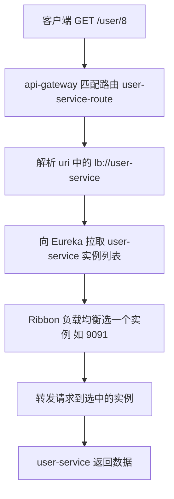

# 网关不再写死服务地址：用 lb:// 实现面向服务的动态路由

在 Spring Cloud Gateway 里配第一条路由时，最容易犯的错误就是把后端地址直接写成 `http://127.0.0.1:9091`。单机测试没问题，可一旦服务扩容成多个实例，写死的地址永远只会打到一个节点上，其余实例形同虚设。这一节要解决的，就是把「写死 IP」换成「按服务名到注册中心动态取地址」。

## 先给结论

- 面向服务的路由核心是把路由的 `uri` 从具体 IP 改成 `lb://服务名`，`lb` 即 load balance（负载均衡）。
- `lb://` 后面的服务名必须是已经在 Eureka 注册过的应用名，否则网关拉不到实例列表，路由直接失败。
- 网关在收到请求后，会按服务名从 Eureka 拿到所有实例，再用负载均衡算法挑一个转发，底层走的是 Ribbon。
- 这种做法让网关具备了横向扩展能力：服务加实例、减实例，网关配置一行都不用改。

## 一、为什么不能把地址写死

上一节入门时，路由是这样配的：

```yaml
spring:
  cloud:
    gateway:
      routes:
        - id: user-service-route
          uri: http://127.0.0.1:9091
          predicates:
            - Path=/user/**
```

`uri` 写死成 `http://127.0.0.1:9091`，意味着无论后面有多少个 `user-service` 实例，请求也只能落到这一个节点上。服务做集群部署、滚动发布、灰度扩容时，这种配置完全没有伸缩性。更麻烦的是，一旦那个实例下线，网关这条路由就彻底断了。

正确的思路是：网关不关心后端具体在哪台机器、有几个实例，它只认「服务名」。实例列表交给注册中心维护，网关每次转发前去查一下当前有哪些可用实例，再挑一个。这就是面向服务的路由。

理解这个思路可以对照快递派送：寄件人只写城市和收件方名称，具体派到哪个网点由快递系统动态决定；网关只写服务名，具体转发到哪个实例交给注册中心与负载均衡器共同决定。把「去哪」与「怎么去」拆开，网关的配置才能长期稳定，后端怎么扩缩容都影响不到它。

## 二、一个配置项搞定动态路由

改造只需要改 `uri` 一处，把具体地址换成 `lb://服务名`：

```yaml
server:
  port: 10010
spring:
  application:
    name: api-gateway
  cloud:
    gateway:
      routes:
        - id: user-service-route
          # lb 表示到 Eureka 中按服务名查找实例，而非写死地址
          uri: lb://user-service
          predicates:
            - Path=/user/**
eureka:
  client:
    service-url:
      defaultZone: http://127.0.0.1:10086/eureka
  instance:
    prefer-ip-address: true
```

`lb://user-service` 的语义是：把 `user-service` 当作 Eureka 里的应用名，从注册中心拉取它的全部实例，再做负载均衡转发。`user-service` 这个名字不是随便写的，必须和后端服务 `spring.application.name` 完全一致，并且确实注册到了 Eureka。

配置里其余字段也值得逐一读懂：`id` 是路由的唯一标识，启动日志和排查问题时都靠它区分不同路由；`predicates` 里的 `Path=/user/**` 是断言条件，请求路径满足它才会命中这条路由；`eureka.client.service-url.defaultZone` 声明注册中心地址，网关从这里拉实例列表；`eureka.instance.prefer-ip-address: true` 让网关注册时以 IP 而非主机名示人，在容器或云环境里能避开主机名解析失败的问题。任何一处写错都可能让路由静默失效，改完配置先看启动日志里加载的路由定义，再发请求验证，比上线后排查省力得多。

请求经过网关时的完整链路如下：



图里最关键的环节是「向 Eureka 拉取实例列表 + Ribbon 选实例」。只要这一步成立，网关就自动具备了多实例转发能力，控制台还会打印出 `Dynamic Server List Load Balancer` 字样，说明动态服务列表负载均衡已经生效。

## 三、依赖：网关与注册中心客户端

`lb://` 能工作，前提是网关自身既是一个 Gateway 工程，又是一个 Eureka 客户端。依赖要同时引入这两块：

```xml
<dependencies>
    <dependency>
        <groupId>org.springframework.cloud</groupId>
        <artifactId>spring-cloud-starter-gateway</artifactId>
    </dependency>
    <dependency>
        <groupId>org.springframework.cloud</groupId>
        <artifactId>spring-cloud-starter-netflix-eureka-client</artifactId>
    </dependency>
</dependencies>
```

只加 `gateway` 不加 `eureka-client`，`lb://` 根本无从解析服务名；反过来只加客户端、不加 Gateway 启动器，工程连网关都起不来。两者缺一不可。

还有一个容易踩的坑：Gateway 基于 Netty 与 WebFlux 构建，属于响应式网关，工程里不要再引入 `spring-boot-starter-web`，两种运行模型共存会让启动直接失败。保持网关工程「纯响应式」，依赖里只放 Gateway 与 Eureka 客户端，是最省事的搭配。版本方面统一交给 `spring-cloud-dependencies` 管理，不要单独指定 Gateway 的版本号，避免组件之间对不上。

## 常见误区

- **服务名没注册就写 `lb://xxx`**：网关启动时拉不到实例列表，访问路由直接报错或 503。先确认目标服务已经出现在 Eureka 面板里，再配 `lb://`。
- **服务名拼写不一致**：`uri` 里写 `lb://userService`，可服务注册的是 `user-service`（横杠），两个名字对不上，同样拉不到实例。服务名一律用横线命名，保持和 `spring.application.name` 完全相同。
- **以为 `lb` 是 Gateway 自己的协议**：`lb` 只是约定前缀，底层负载均衡由 Ribbon 提供，默认轮询。想调超时或重试，配置 Ribbon 相关项即可。
- **只在网关配了 `lb` 却没把网关注册进 Eureka**：网关自己都不是 Eureka 客户端，自然无法查询服务列表。记得引 `eureka-client` 并配置 `defaultZone`。

## 面试可能被问到的问题

1. 面试官追问：「Gateway 里 `lb://` 是什么意思，怎么实现的？」
   答：`lb` 是 load balance 的缩写，表示路由目标不是固定地址，而是到注册中心按服务名查找实例。Gateway 集成 Ribbon，解析 `lb://服务名` 后向 Eureka 拉取实例列表，再用负载均衡算法选一个转发。

2. 面试官追问：「`lb://` 后面的服务名有什么要求？」
   答：服务名必须和后端服务 `spring.application.name` 完全一致，并且该服务已经注册到 Eureka。未注册或名字不一致都会导致拉不到实例列表，路由失败。

3. 面试官追问：「面向服务的路由相比写死 IP 有什么好处？」
   答：后端服务做集群部署、扩缩容、滚动发布时，网关配置一行都不用改，请求会自动分发到当前可用实例。写死 IP 则只能打到单一节点，没有伸缩性，实例下线路由即断。

4. 面试官追问：「Gateway 的动态路由底层负载均衡是谁提供的？」
   答：是 Ribbon。Gateway 解析 `lb://` 后把实例选择交给了 Ribbon，默认轮询策略，可像普通 Spring Cloud 工程一样配置 Ribbon 的超时和重试。

## 配套资料

- 本课真实代码与配置见课程笔记：`materials/code/01/2.springcloud/2.springcloud/day02/笔记/Spring Cloud 第二天课堂笔记.md`（第 4 节「Gateway 入门」与第 5 节「面向服务的路由」，文中包名与 `uri` 已按本课写法统一为 `com.example` 与 `lb://user-service`）
