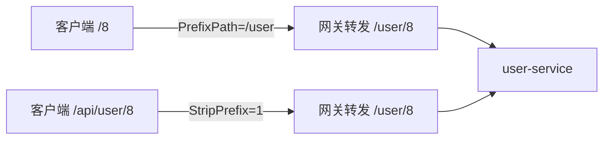

# 客户端路径和微服务路径对不上：用前缀过滤器做增减

前端访问网关的地址，和真正提供服务的微服务地址，路径往往不是一回事。比如微服务暴露的是 `/user/8`，而前端习惯在前面再套一层 `/api`。网关做转发时，就需要把多出来的那段补上去，或者把多余的去掉。这一节讲的就是 Gateway 里两个路径过滤器：`PrefixPath` 和 `StripPrefix`。

## 先给结论

- 客户端请求路径与后端服务路径不一致时，用路由过滤器在转发前调整路径，不必改造任何业务服务。
- `PrefixPath=/user` 会在请求路径前自动拼接 `/user` 再转发，适合「客户端没写前缀、后端需要前缀」的场景。
- `StripPrefix=N` 会去掉路径开头的 N 段（以斜杠分隔），`N=1` 去一段、`N=2` 去两段，适合「客户端多了前缀、后端不需要」的场景。
- 这两个过滤器都属于路由级别过滤器，写在某个 `route` 的 `filters` 下，只对当前路由生效。

## 一、为什么需要前缀处理

假设提供服务的真实地址是 `http://127.0.0.1:9091/user/8`。两种常见错位：

**第一种，客户端缺前缀。** 前端只发 `/8`，但后端所有接口都在 `/user` 下。网关若不处理，`/8` 直接转给后端会因路径不匹配而 404。这时需要网关自动补上 `/user`。

**第二种，客户端多前缀。** 前端发 `/api/user/8`，多了一个 `/api` 作为网关入口的统一前缀，但后端接口本身没有 `/api`。网关需要把 `/api` 剥掉再转发。



图上两条分支最终都收敛到后端需要的 `/user/8`，前缀处理的本质就是让「客户端看到的路径」和「后端要求的路径」各取所需。

为什么会出现这种错位？常见于前后端分离项目：前端工程把所有请求统一打到网关，并在路径最前面加 `/api`，用来区分「走网关的业务接口」与「静态资源」，而后端 Controller 的映射通常没有 `/api`。与其让每个微服务都改 `@RequestMapping` 去迁就网关，不如在网关一处统一做增减，业务代码零改动，这也是网关作为统一流量入口的价值之一。

## 二、添加前缀：PrefixPath

当客户端请求不带 `/user`，而后端需要它时，给路由加一个 `PrefixPath` 过滤器。注意此时断言的 `Path` 要写成 `/**`，因为前缀是网关补的，客户端路径里本来就没有 `/user`，用 `/user/**` 反而匹配不上。

```yaml
spring:
  cloud:
    gateway:
      routes:
        - id: user-service-route
          uri: lb://user-service
          predicates:
            - Path=/**
          filters:
            # 给所有匹配到的请求路径前加上 /user
            - PrefixPath=/user
```

配置生效后，访问 `http://127.0.0.1:10010/8`，网关会自动变成 `http://127.0.0.1:9091/user/8` 转发出去，照常拿到数据。`PrefixPath` 的值可以有多个，写多个就依次拼接多段。

过滤器与断言的先后顺序也需要清楚：请求先过 `predicates` 判断是否命中路由，命中之后、转发之前才轮到 `filters` 对请求加工。`PrefixPath` 只加工请求路径本身，不动请求参数、不动请求头，规则直观可验证：转发路径等于前缀加原路径。想确认有没有生效，看网关控制台打印的转发日志即可，目标路径里多了 `/user` 就说明过滤器已经起作用。

## 三、去除前缀：StripPrefix

当客户端请求多了 `/api` 这样的入口前缀时，用 `StripPrefix` 把它去掉。数字 `1` 表示剥掉第一段路径，`2` 表示剥掉前两段，以此类推。

```yaml
spring:
  cloud:
    gateway:
      routes:
        - id: user-service-route
          uri: lb://user-service
          predicates:
            - Path=/api/user/**
          filters:
            # 去掉路径开头的 1 段，即去掉 /api
            - StripPrefix=1
```

此时访问 `http://127.0.0.1:10010/api/user/8`，网关剥掉第一段 `/api`，实际转发到 `http://127.0.0.1:9091/user/8`。如果把值改成 `2`，则 `/api` 和 `/user` 两段都会被去掉，转发目标变成 `/8`，一般只有特殊场景才需要。

真实项目里两种写法常常并存：对外的接口统一带 `/api` 前缀，由 `StripPrefix` 剥掉；网关内部还有不对外开放的调用，则完全不做处理。不同路由各配各的过滤器，互不影响。有一点要记住：剥掉前缀之后的剩余路径，必须与后端接口映射完全一致，多一级少一级都不行，配置完成后拿真实请求对照一次转发路径最稳妥。

## 常见误区

- **加前缀时断言还写 `/user/**`**：客户端本来没带 `/user`，断言按 `/user/**` 匹配会直接落空，请求进不了这条路由。加 `PrefixPath` 时断言应放宽到 `/**`。
- **`StripPrefix` 的值数错段**：`/api/user/8` 用 `StripPrefix=1` 只去掉 `/api`，用 `2` 会把 `/user` 也去掉变成 `/8`。段数是从端口后第一个斜杠开始算的，数错了转发路径就错。
- **把路径过滤器配成默认过滤器**：`PrefixPath` 和 `StripPrefix` 是路由级过滤器，写在某个 `route` 的 `filters` 下只对这一条路由生效。想全局生效要放到 `default-filters`，但全局去前缀通常不符合真实需求。
- **以为 `StripPrefix` 改的是客户端看到的地址**：它只在网关内部转发前改写路径，客户端浏览器地址栏里的 `/api/user/8` 不会变。
- **把加前缀和去前缀当成一回事**：`PrefixPath` 是加法，`StripPrefix` 是减法，方向相反。客户端缺前缀用加法，客户端多前缀用减法，动手前先分清方向。

## 面试可能被问到的问题

1. 面试官追问：「Gateway 怎么做路径前缀的添加和去除？」
   答：用两个路由过滤器。`PrefixPath=/user` 在转发前给路径拼接前缀，`StripPrefix=N` 去掉路径开头 N 段。它们是路由级过滤器，只对所在路由生效。

2. 面试官追问：「`StripPrefix=1` 具体去掉的是哪一段？」
   答：从端口之后的第一段路径开始算，`1` 表示去掉第一段。比如 `/api/user/8` 会变成 `/user/8`。`2` 则去掉前两段变成 `/8`。

3. 面试官追问：「为什么用了 `PrefixPath` 之后断言要改成 `/**`？」
   答：因为前缀是网关补的，客户端请求里没有那段前缀。如果断言仍写 `/user/**`，客户端不带 `/user` 就匹配不到路由，请求进不来。

4. 面试官追问：「`PrefixPath` 和 `StripPrefix` 和重定向有什么区别？」
   答：它们只是网关在转发前改写内部请求路径，不会给客户端返回 3xx 重定向，浏览器地址栏不变，对前端完全透明。

5. 面试官追问：「同一条路由里同时配 `PrefixPath` 和 `StripPrefix` 会怎样？」
   答：过滤器按声明顺序依次执行，最终路径是两者叠加的结果。真实项目里很少这么配，一条路由只做一种路径调整，可读性和排错成本都更可控。

## 配套资料

- 本课真实代码与配置见课程笔记：`materials/code/01/2.springcloud/2.springcloud/day02/笔记/Spring Cloud 第二天课堂笔记.md`（第 6 节「路由前缀处理」，文中 `uri` 已统一为 `lb://user-service`）
