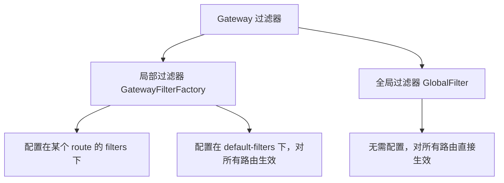
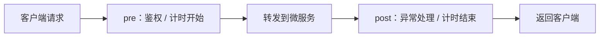

# Gateway 真正的核心在过滤器：内置几十种，分清局部与全局

前面几节其实已经在用过滤器了，添加前缀、去除前缀本质上都是 Gateway 的过滤器。网关之所以能「过滤和路由」，靠的就是这一串过滤器。这一节把过滤器的用法、类型和使用场景一次性讲清楚，后面自定义过滤器才有抓手。

## 先给结论

- Gateway 的过滤器是实现请求拦截处理的核心机制，自带几十种内置过滤器，统一实现 `GatewayFilterFactory` 接口。
- 配置内置过滤器时，把类名里的 `GatewayFilterFactory` 后缀去掉，剩下的就是配置文件里的过滤器名；后面跟的是「属性名, 属性值」。
- 过滤器分两类：局部过滤器写在某个路由的 `filters` 下只对当前路由生效；全局过滤器实现 `GlobalFilter` 接口，不需要配置就对所有路由生效。`default-filters` 是一种对所有路由生效的写法。
- 过滤器生命周期有两个时机：请求转发到服务之前（pre）和服务返回之后（post），鉴权、异常处理、统计耗时都能落在这两个时机上。

## 一、内置过滤器怎么配

Gateway 自带过滤器数量很多，例如添加请求头、添加请求参数、添加响应头、去除前缀等。它们都实现同一个接口 `GatewayFilterFactory`，类名格式固定为 `XxxGatewayFilterFactory`。配置时有一个简单规律：把后缀 `GatewayFilterFactory` 去掉，前面剩下的 `Xxx` 就是你在 `application.yml` 里写的过滤器名。

以「添加响应头」为例，对应的类是 `AddResponseHeaderGatewayFilterFactory`，配置时写 `AddResponseHeader`，后面接「头名称, 头值」：

```yaml
spring:
  cloud:
    gateway:
      # 默认过滤器：对所有路由都生效
      default-filters:
        - AddResponseHeader=X-Response-Foo, Bar
        - AddResponseHeader=abc-myname, example
      routes:
        - id: user-service-route
          uri: lb://user-service
          predicates:
            - Path=/api/user/**
          filters:
            - StripPrefix=1
```

`default-filters` 下的过滤器对所有路由生效，而 `routes` 里某个路由自己的 `filters` 只对该路由生效。两者可以并存。配完启动后用浏览器访问网关地址，打开开发者工具看响应头，就能看到 `X-Response-Foo: Bar` 已经出现在返回里。

常见的内置过滤器作用如下：

| 过滤器名 | 作用 |
|---|---|
| `AddRequestHeader` | 给所有请求添加一个请求头（名, 值） |
| `AddRequestParameter` | 给所有请求添加一个请求参数（名, 值） |
| `AddResponseHeader` | 给响应添加一个响应头（名, 值） |
| `StripPrefix` | 去除路径开头若干段前缀 |
| `PrefixPath` | 给路径添加前缀 |
| `RequestRateLimiter` | 限流 |

过滤器名字之外还有一个次序概念：多个过滤器会组成一条链，按先后顺序依次执行，顺序不同结果就可能不同。内置过滤器大多有默认次序，自定义过滤器时可以用 `Ordered` 接口或 `@Order` 注解指定次序，数字越小越靠前。现阶段先记住「链式执行」这个词，后面写自定义过滤器时会反复用到。

## 二、局部过滤器与全局过滤器

从实现和生效范围看，过滤器有两种类型。



**局部过滤器**通过 `GatewayFilterFactory` 实现，配在路由的 `filters` 里就是单路由生效，配在 `default-filters` 里就是全局生效，但实现方式仍归为局部过滤器这一类。

**全局过滤器**实现的是 `GlobalFilter` 接口，不需要在配置文件里写任何东西，工程里一注册就对所有路由生效。后面自定义权限校验过滤器就属于这一类。

## 三、过滤器的生命周期

Gateway 的过滤器在请求处理过程中有两个可介入的时机：在把请求转发到后端服务「之前」可以做预处理，在后端服务返回「之后」可以做后置处理。这点和 Spring MVC 的拦截器很像，只不过拦截器有前置、后置、完成三个点，网关过滤器主要落在前后两个时机。

结合这两个时机，过滤器能落地的典型场景有三类：

**第一，请求鉴权。** 在转发到服务之前检查请求是否携带合法凭证，没有就直接返回，不再往后走。

**第二，异常处理。** 在服务返回之后如果发生了异常，可以在过滤器里记录异常信息。

**第三，调用时长统计。** 在转发前记一个时间戳，返回后再记一个，两者相减就是本次调用耗时。



图上 pre 阶段适合做拦截和打点起点，post 阶段适合做收尾和打点终点。

实际执行时，所有生效的过滤器按次序串成一条链：请求进来沿链依次做 pre 处理，到达后端返回后沿链再做 post 处理，整个过程类似洋葱。理解了这一点，判断「为什么我的过滤器没拦到请求」就有方向了：先看它挂在哪条路由上，再看它的次序是否排在了会提前返回的过滤器之后，两个原因覆盖了绝大多数失效场景。

## 常见误区

- **把 `GatewayFilterFactory` 后缀也写进配置**：配置里只需写 `AddResponseHeader`，写上完整类名反而解析不到过滤器。
- **以为 `default-filters` 是全局过滤器的实现**：`default-filters` 只是让局部过滤器对所有路由生效，背后仍是 `GatewayFilterFactory`，真正的全局过滤器是 `GlobalFilter` 接口。
- **分不清 pre 和 post 能干什么**：pre 阶段请求还没到后端，适合拦截、鉴权、计时起点；post 阶段已经有了返回，适合异常处理、耗时统计。把鉴权放到 post 阶段就失去了拦截意义。
- **过滤器名大小写或拼写错**：`AddResponseHeader` 首字母大写且拼写固定，写错会启动报错或配置不生效。

## 面试可能被问到的问题

1. 面试官追问：「Gateway 内置过滤器怎么在配置文件里写？」
   答：内置过滤器类名都是 `XxxGatewayFilterFactory`，配置时去掉 `GatewayFilterFactory` 后缀，写 `Xxx`，后面跟「属性名, 属性值」。例如 `AddResponseHeader=X-Response-Foo, Bar`。

2. 面试官追问：「局部过滤器和全局过滤器有什么区别？」
   答：局部过滤器实现 `GatewayFilterFactory`，配在路由 `filters` 下只对当前路由生效，配在 `default-filters` 下则对所有路由生效。全局过滤器实现 `GlobalFilter`，不用配置就对所有路由生效。

3. 面试官追问：「Gateway 过滤器的生命周期有哪些时机？」
   答：主要有请求转发到服务之前的 pre 时机，和服务返回之后的 post 时机。鉴权放 pre，异常处理和耗时统计可以横跨前后两个时机。

4. 面试官追问：「`default-filters` 算局部还是全局？」
   答：它让局部过滤器（基于 `GatewayFilterFactory`）对所有路由生效，实现方式仍属于局部过滤器一类，和直接实现 `GlobalFilter` 的全局过滤器不是一回事。

## 配套资料

- 本课真实代码与配置见课程笔记：`materials/code/01/2.springcloud/2.springcloud/day02/笔记/Spring Cloud 第二天课堂笔记.md`（第 7 节「过滤器简介」与第 10 节网关完整配置中的 `default-filters` 片段）
