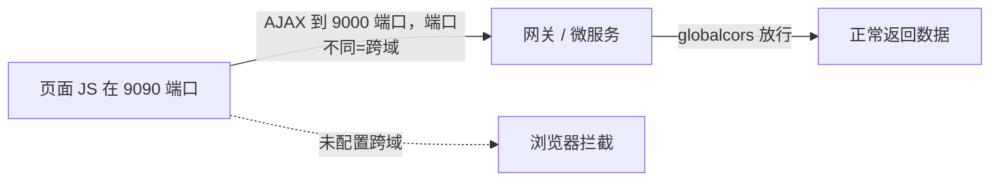
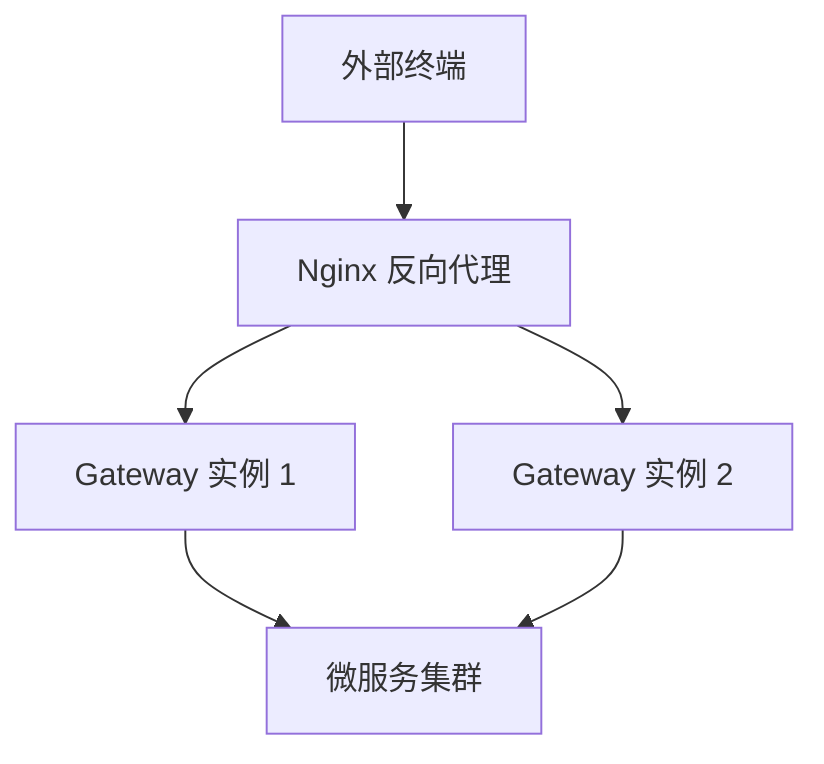

# 网关上线前还要调的三件事：超时熔断、跨域、高可用

路由和过滤器配好，网关就能跑了。但真要放到生产给终端用，还有三块绕不开：后端偶尔慢一点会不会被网关误杀、前端页面能不能跨域调它、并发上来怎么扛。这一节把 Gateway 的负载均衡与熔断参数、跨域配置、高可用方案，以及它和 Feign 的分工一次讲清。

## 先给结论

- Gateway 默认集成了 Ribbon 负载均衡和 Hystrix 熔断，但超时等参数都走默认值（如连接超时 1 秒），真实链路稍慢就容易触发超时，需要显式调大。
- 跨域发生在「前端 JS 发 AJAX 到和自身域名、IP、端口不一致的地址」时；后台服务之间互调不存在跨域，网关作为统一入口要替前端解决它。
- 网关高可用就是启动多个 Gateway 实例组成集群，外部终端通过 Nginx 等反向代理分发到多个网关，而不是只依赖 Eureka 内部负载均衡。
- Gateway 给终端请求用，Feign 给微服务之间调用用，两者职责不同，不要混用。

## 一、负载均衡与熔断参数

Gateway 底层已经把 Ribbon 和 Hystrix 集成进来了，默认情况下超时、重试这些参数都是框架给的默认值。问题在于默认值偏紧：Ribbon 的连接超时只有 1 秒，后端一旦略有抖动或慢查询，网关就判定超时、直接熔断，前端拿到的是失败而不是稍慢的成功。

所以需要把默认值改成符合业务实际的值。下面这份网关配置里，同时给了 Hystrix 的命令超时和 Ribbon 的各类超时：

```yaml
spring:
  application:
    name: api-gateway
  cloud:
    gateway:
      routes:
        - id: user-service-route
          uri: lb://user-service
          predicates:
            - Path=/api/user/**
          filters:
            - StripPrefix=1
      default-filters:
        - AddResponseHeader=X-Response-Foo, Bar
      globalcors:
        corsConfigurations:
          '[/**]':
            allowedOrigins:
              - "http://docs.spring.io"
            allowedMethods:
              - GET
server:
  port: 10010
eureka:
  client:
    service-url:
      defaultZone: http://127.0.0.1:10086/eureka
  instance:
    prefer-ip-address: true
hystrix:
  command:
    default:
      execution:
        isolation:
          thread:
            # Hystrix 命令超时，单位毫秒
            timeoutInMilliseconds: 6000
ribbon:
  ConnectTimeout: 1000
  ReadTimeout: 2000
  MaxAutoRetries: 0
  MaxAutoRetriesNextServer: 0
```

`hystrix.timeoutInMilliseconds` 控制熔断的容忍上限，`ribbon.ReadTimeout` 控制单次读超时。把这两个值按后端真实响应水位调大，能显著减少「明明后端还能返回、却被网关掐断」的误杀。

这份配置里其余几项也有讲究：`ConnectTimeout` 是建立连接的最长等待；`MaxAutoRetries` 与 `MaxAutoRetriesNextServer` 分别控制同实例重试和换实例重试的次数，排查「为什么请求打了三遍」时先看它们。另外各值要整体对齐：Hystrix 的总超时应大于 Ribbon 连接超时加读超时之和，否则熔断器会先一步把还在正常执行的请求掐断。

## 二、跨域配置

跨域的本质：当前端页面的 JS 向一个「域名、IP 或端口」和它所在页面不一致的地址发 AJAX 请求时，浏览器出于安全策略会拦截，这就是跨域。注意只有前端 JS 发起的这种请求才算，后台服务用代码去调别的服务拿数据，不存在跨域。

网关是所有微服务的统一入口，前端往往直接请求网关，自然容易跨域。Gateway 用 `globalcors` 来解决：

```yaml
spring:
  cloud:
    gateway:
      globalcors:
        corsConfigurations:
          '[/**]':
            # 允许来自该源的跨域请求；* 表示放行所有
            allowedOrigins:
              - "http://docs.spring.io"
            # 允许的请求方法，需要其它方法再追加
            allowedMethods:
              - GET
```

`[/**]` 表示对所有打到网关的请求生效；`allowedOrigins` 写允许的来源域名，全部放行可配 `*`；`allowedMethods` 控制允许的方法。这段其实是从官方文档复制而来，字段和语义都一致，配完启动不报错即说明格式正确。



图上端口不同触发跨域，配了 `globalcors` 才能拿到数据，否则被浏览器挡在门外。

## 三、高可用与 Gateway、Feign 的分工

网关自身也会成为单点，解决办法是启动多个 Gateway 实例组成集群。如果是微服务内部访问网关，因为网关也注册在 Eureka，调用方用服务名就能自动负载均衡。但多数情况下网关直面外部终端（PC 端、移动端网页），终端不会去查 Eureka，这时要靠 Nginx 之类的反向代理把请求分发到多个网关实例。



讲到这里必须分清 Gateway 和 Feign：Gateway 是整个应用的流量入口，接收所有外部请求，转发到不同微服务，适合做统一的鉴权、流量控制、日志；Feign 是微服务之间互相调用的客户端，用在服务内部通信，而不是给外部终端直接调用。一个对「外」，一个对「内」，职责分明。

## 常见误区

- **超时全用默认值**：Ribbon 连接超时 1 秒，后端稍慢就熔断，先把 `hystrix.timeoutInMilliseconds` 和 `ribbon.ReadTimeout` 调成业务合理值。
- **认为后台服务互调也要解决跨域**：跨域只存在于浏览器端 JS 的 AJAX 请求，服务端用代码发请求不受同源策略限制，不需要网关跨域配置。
- **`allowedOrigins` 配 `*` 又想限制方法**：`*` 是全部来源放行，配合具体方法仍有意义，但要清楚它放行的范围，生产环境尽量写明确来源。
- **把 Gateway 当 Feign 用**：Gateway 面向终端流量、做统一治理；服务之间调用用 Feign。让终端直连某个微服务而越过网关，会丢失统一鉴权和限流。

## 面试可能被问到的问题

1. 面试官追问：「Gateway 默认集成了哪些容错组件，为什么还要配超时？」
   答：默认集成 Ribbon 和 Hystrix，但超时等参数走默认值，连接超时仅 1 秒，后端略有延迟就会被熔断。需要按真实链路水位显式配置 `hystrix.timeoutInMilliseconds` 和 `ribbon.ReadTimeout` 等项。

2. 面试官追问：「什么情况下才会出现跨域？」
   答：只有前端页面里的 JS 向与自身域名、IP 或端口不一致的地址发 AJAX 请求时才算跨域，受浏览器同源策略约束。后台服务之间用代码互调不存在跨域。

3. 面试官追问：「Gateway 怎么解决跨域？」
   答：通过 `spring.cloud.gateway.globalcors.corsConfigurations` 配置，用 `[/**]` 匹配路径，设定 `allowedOrigins` 和 `allowedMethods` 来放行指定来源和方法。

4. 面试官追问：「Gateway 如何做高可用？」
   答：启动多个 Gateway 实例组成集群，外部终端通过 Nginx 等反向代理分发到多个网关；若仅是微服务内部访问，网关注册到 Eureka 后即可靠服务名负载均衡。

5. 面试官追问：「Gateway 和 Feign 有什么区别？」
   答：Gateway 是系统对外的统一流量入口，负责路由、鉴权、流量控制，给终端用；Feign 是微服务之间的声明式调用客户端，用在服务内部通信，不面向外部终端。

## 配套资料

- 本课真实代码与配置见课程笔记：`materials/code/01/2.springcloud/2.springcloud/day02/笔记/Spring Cloud 第二天课堂笔记.md`（第 10 节「Gateway 其它配置说明」，含完整 `application.yml`：负载均衡、熔断、跨域、路由与默认过滤器）
