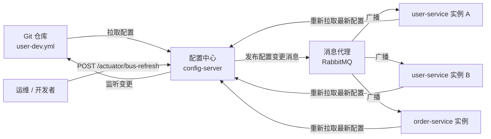
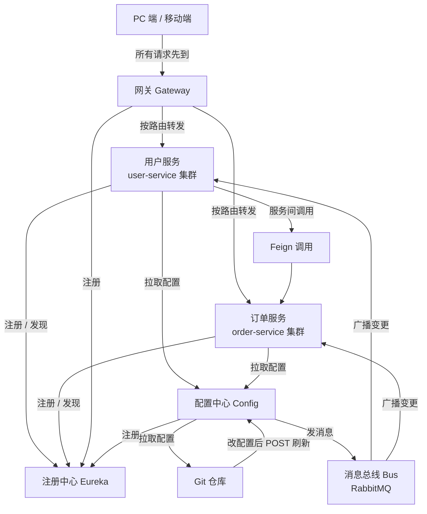
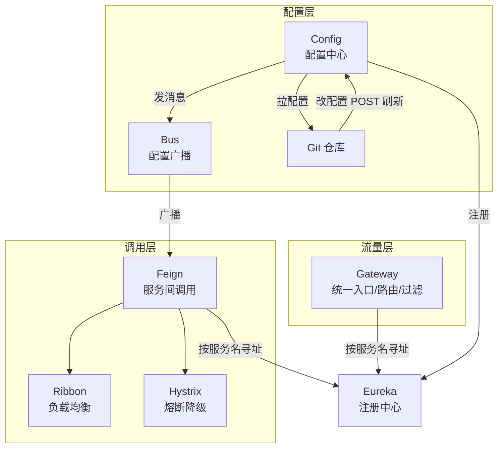

# Spring Cloud：Bus 配置热更新与 Feign、Gateway、Config 组件体系综合应用

## 先给结论

- 系列定位：Spring Cloud 收官三连，从 Config 的遗留问题出发，经 Bus 热更新，到五大组件综合应用的全景图，收在小结复盘。
- Bus 解决「改了配置要重启」：Git 改配置后向配置中心的 `/actuator/bus-refresh` 发 POST，配置中心经消息代理广播，各微服务重拉最新配置；需要动态刷新的 Bean 必须加 `@RefreshScope`。
- 两端依赖要对称：配置中心与微服务都要加 `spring-cloud-bus` 与对应 binder（RabbitMQ 或 Kafka），端点要显式暴露，刷新请求打给配置中心而非微服务。
- 综合应用一张图定角色：Eureka 是地基，所有组件注册其上互相发现；Gateway 是外部请求统一入口；Feign 管服务间调用；Config 加 Bus 管配置集中与热更新。
- 路由要用 `lb://服务名` 让网关从 Eureka 动态取地址，写死 IP 就失去负载均衡与弹性扩缩容能力。
- Gateway 与 Feign 场景不同：一个接外部流量，一个做内部调用，不要混用；两者底层都靠 Ribbon 做客户端负载均衡。
- 小结课补上稳定性底座：Hystrix 提供线程隔离、降级与熔断，`feign.hystrix.enabled` 要打开降级才生效。
- 全系列实战配置与代码出自课堂笔记的 day01、day02 两份资料，组件关系与请求链路是面试高频考点。

## 第1部分：改了配置不用重启：用 Spring Cloud Bus 给微服务做配置热更新

用 Spring Cloud Config 把配置收进 Git 仓库之后，配置确实集中了。但一个尴尬的问题随之出现：你在 Git 仓库里把某个配置项的值改了，微服务并不会自动感知，必须重启才能读到新值。一台两台还好说，几十个服务实例逐个重启，等于把「配置集中管理」省下的事又还回去了。

Spring Cloud Bus 要解决的正是这件事：让配置变更通过消息代理广播出去，所有微服务在「不重启」的前提下即时拿到最新配置。

### 一、先看现象：配置中心改了，微服务没反应
先把问题摆清楚。课程里 `user-service` 从配置中心拉取 `user-dev.yml`，其中有一段测试配置：

```yaml
test:
  name: "zhangsan"
```

`UserController` 在方法里把这份配置打印出来：

```java
package com.example.user.controller;

import com.example.user.pojo.User;
import org.springframework.beans.factory.annotation.Autowired;
import org.springframework.beans.factory.annotation.Value;
import org.springframework.web.bind.annotation.GetMapping;
import org.springframework.web.bind.annotation.PathVariable;
import org.springframework.web.bind.annotation.RestController;

@RestController
public class UserController {

    @Autowired
    private UserService userService;

    @Value("${test.name}")
    private String name;

    @GetMapping("/user/{id}")
    public User queryById(@PathVariable Long id) {
        System.out.println("配置文件中的 test.name 为：" + name);
        return userService.queryById(id);
    }
}
```

启动服务后第一次访问，控制台正常输出 `zhangsan`。这时候去 Git 仓库把 `test.name` 改成 `zhangsan2` 并提交，再次访问接口，控制台**还是** `zhangsan`。只有把 `user-service` 重启，再次访问才会变成 `zhangsan2`。

这个现象说明：配置中心只是替微服务去 Git 仓库拉了一次配置，拉完就缓存起来了，后续的仓库变更它不会主动再拉。微服务数量一多，每次改配置都要挨个重启，显然不可接受。

### 二、Spring Cloud Bus 是什么
Spring Cloud Bus 用轻量级的消息代理把分布式系统中的各个节点连起来，常用于广播配置文件的更改或服务间的监控管理。可以把它理解成一条「消息总线」：配置中心是消息的发布方，各个微服务是消息的订阅方。

它可选的消息代理由 RabbitMQ 和 Kafka 两种。课程里走的是 RabbitMQ 这条线，因为它在前面章节已经用过，启动本地 RabbitMQ 即可。

引入 Bus 之后，项目结构变成下面这样：



这张图的关键路径是「配置中心发消息 → MQ 广播 → 微服务重新拉取」。也就是说，你只需要向配置中心发一个刷新的通知，几十个实例就会自己去拉最新配置，而不是逐个重启。

### 三、动手：两端都要改
#### 1. 配置中心 config-server

先给 `config-server` 加上 Bus 与 RabbitMQ binder 两个依赖：

```xml
<dependency>
    <groupId>org.springframework.cloud</groupId>
    <artifactId>spring-cloud-bus</artifactId>
</dependency>
<dependency>
    <groupId>org.springframework.cloud</groupId>
    <artifactId>spring-cloud-stream-binder-rabbit</artifactId>
</dependency>
```

接着在 `application.yml` 里告诉它 RabbitMQ 在哪，并暴露触发消息总线的端点：

```yaml
server:
  port: 12000
spring:
  application:
    name: config-server
  cloud:
    config:
      server:
        git:
          uri: https://gitee.com/example/demo-config.git
  # 配置 RabbitMQ 信息，若与默认值一致可省略
  rabbitmq:
    host: localhost
    port: 5672
    username: guest
    password: guest
eureka:
  client:
    service-url:
      defaultZone: http://127.0.0.1:10086/eureka
management:
  endpoints:
    web:
      exposure:
        # 暴露触发消息总线的地址
        include: bus-refresh
```

`management.endpoints.web.exposure.include: bus-refresh` 这一行不能省，它决定了你能不能通过 `/actuator/bus-refresh` 去通知配置中心发消息。

#### 2. 服务提供工程 user-service

`user-service` 同样要引入那两个 Bus 依赖，以及 `spring-boot-starter-actuator`（负责暴露端点）。RabbitMQ 的连接信息也要配进 `bootstrap.yml`：

```yaml
spring:
  cloud:
    config:
      # 要与仓库中的配置文件的 application 保持一致
      name: user
      # 要与仓库中的配置文件的 profile 保持一致
      profile: dev
      # 要与仓库中的配置文件所属的分支一致
      label: master
      discovery:
        enabled: true
        # 配置中心服务名
        service-id: config-server
  # 配置 RabbitMQ 信息，若与默认值一致可省略
  rabbitmq:
    host: localhost
    port: 5672
    username: guest
    password: guest
eureka:
  client:
    service-url:
      defaultZone: http://127.0.0.1:10086/eureka
```

配置刷新要落到代码上，给需要动态刷新的 `UserController` 标上 `@RefreshScope`：

```java
package com.example.user.controller;

import org.springframework.beans.factory.annotation.Value;
import org.springframework.cloud.context.config.annotation.RefreshScope;
import org.springframework.web.bind.annotation.GetMapping;
import org.springframework.web.bind.annotation.PathVariable;
import org.springframework.web.bind.annotation.RestController;

@RestController
@RequestMapping("/user")
@RefreshScope
public class UserController {

    @Value("${test.name}")
    private String name;

    @GetMapping("/{id}")
    public String queryById(@PathVariable Long id) {
        return "当前 test.name 的值为：" + name;
    }
}
```

`@RefreshScope` 的含义是：当配置发生变更时，这个 Bean 会被销毁并重新创建，重建时从环境里读到的就是最新的配置值。

#### 3. 测试验证

启动顺序有讲究：先启动 `config-server`，等它完全起来之后，再启动 `user-service`。先访问一次接口，确认当前输出的是旧值。然后去 Git 仓库把 `test.name` 改成新值并提交。

**关键一步**：光提交还不够，你还得主动推一下。用 REST 工具向配置中心发一个 POST 请求：

```bash
curl -X POST http://127.0.0.1:12000/actuator/bus-refresh
```

返回 204 即代表通知成功。此时配置中心会向 RabbitMQ 发一条配置变更消息，`user-service` 监听到后重新去配置中心拉取最新配置。不重启服务，再次访问接口，控制台已经输出新值了。

> 注意这里用的是 POST 而不是 GET，且请求地址打在配置中心（`config-server`）上，不是打在各个微服务上。这也是比「逐个重启」省力的地方：一次请求，全集群生效。

### 四、消息代理不是必须的，但 Bus 是
Spring Cloud Bus 对消息代理的选型是开放的，RabbitMQ 和 Kafka 都支持，差别只是换一个 binder 依赖。如果你所在环境已经用了 Kafka，就引入 `spring-cloud-stream-binder-kafka`，其余配置思路完全一致。

它也不仅限于配置刷新这一种用途。因为本质是一条消息总线，凡是「要把一个事件同时通知到所有节点」的场景，比如集群状态广播、服务节点上下线通知，都可以借助它来实现。

## 第2部分：一张图串起五大组件：Spring Cloud 体系技术综合应用

学完 Eureka、Feign、Gateway、Config、Bus 之后，容易陷入「每个单独都懂，合起来不知道谁先谁后」的状态。其实这五个组件在一个典型微服务系统里各占一个位置：注册中心把服务管起来，网关把流量接进来，Feign 做服务间调用，配置中心管配置，消息总线让配置变更即时广播。把它们放进同一张图，整条请求链路就清楚了。

### 一、整体架构长什么样
把两天学的组件摆到一个系统里，请求从外到内的流转路径大致如下：



这张图最关键的一条线是「配置变更」：Git 改了配置，POST 触发配置中心，配置中心经 Bus 向消息代理发消息，用户服务和订单服务监听到后各自重新拉取。请求链路和配置链路在这里是分开的两条线，互不干扰。

### 二、请求入口：Gateway 网关
Gateway 的本质是一系列过滤器，作用是路由和过滤。外部请求不会直接打向某个微服务，而是先到网关，由网关根据路由规则转发。比如把 `/api/user/**` 转发到 `user-service`：

```yaml
server:
  port: 10010
spring:
  application:
    name: api-gateway
  cloud:
    gateway:
      routes:
        - id: user-service-route
          # lb 表示从注册中心按服务名取地址，自带负载均衡
          uri: lb://user-service
          predicates:
            - Path=/api/user/**
          filters:
            # 去掉第 1 段路径前缀 /api 后再转发
            - StripPrefix=1
eureka:
  client:
    service-url:
      defaultZone: http://127.0.0.1:10086/eureka
  instance:
    prefer-ip-address: true
```

`uri: lb://user-service` 里的 `lb` 是负载均衡前缀，网关会去 Eureka 按服务名拿到实例列表，再用负载均衡算法挑一个地址转发。路由里的过滤器还能做前缀添加/去除、鉴权、日志记录等非业务处理。

网关同时支持两类过滤器：局部过滤器只对配置了它的路由生效，全局过滤器对所有路由都生效。一个典型的全局过滤器用来做请求鉴权：

```java
package com.example.gateway.filter;

import org.springframework.cloud.gateway.filter.GlobalFilter;
import org.springframework.cloud.gateway.filter.GatewayFilterChain;
import org.springframework.core.Ordered;
import org.springframework.http.HttpStatus;
import org.springframework.stereotype.Component;
import org.springframework.util.StringUtils;
import org.springframework.web.server.ServerWebExchange;
import reactor.core.publisher.Mono;

@Component
public class MyGlobalFilter implements GlobalFilter, Ordered {

    @Override
    public Mono<Void> filter(ServerWebExchange exchange, GatewayFilterChain chain) {
        String token = exchange.getRequest().getQueryParams().getFirst("token");
        if (StringUtils.isBlank(token)) {
            // 没有 token 直接返回未授权，不再往后走
            exchange.getResponse().setStatusCode(HttpStatus.UNAUTHORIZED);
            return exchange.getResponse().setComplete();
        }
        return chain.filter(exchange);
    }

    @Override
    public int getOrder() {
        // 值越小越先执行
        return 1;
    }
}
```

### 三、服务间调用：Feign
服务之间要互相调用时，如果手写 RestTemplate，得自己按服务名去 Eureka 拿实例列表、拼 host 和 port、再发请求。Feign 把这些重复劳动收进一个接口里：

```java
package com.example.feign;

import org.springframework.cloud.openfeign.FeignClient;
import org.springframework.web.bind.annotation.GetMapping;
import org.springframework.web.bind.annotation.PathVariable;

// 声明这是一个 Feign 客户端，指向服务名为 user-service 的微服务
@FeignClient("user-service")
public interface UserClient {

    // 实际发起的请求是 http://user-service/user/{id}
    @GetMapping("/user/{id}")
    User queryById(@PathVariable Long id);
}
```

在调用方注入 `UserClient` 直接调用即可，地址拼接和基于 Ribbon 的负载均衡都由 Feign 完成。Feign 还能叠加 Hystrix 熔断、请求压缩、日志级别等配置，适合用在「服务调服务」的内部链路。

### 四、配置管理：Config 加 Bus
配置中心 `config-server` 从 Git 仓库拉取配置，供其他微服务获取，配置因此得以集中管理。微服务侧删掉本地 `application.yml`，改为用 `bootstrap.yml` 指明去哪个配置中心、拉哪份配置：

```yaml
spring:
  cloud:
    config:
      # 与仓库里的配置文件 application 名一致
      name: user
      # 与 profile 一致
      profile: dev
      # 与分支一致
      label: master
      discovery:
        enabled: true
        # 配置中心在 Eureka 里的服务名
        service-id: config-server
eureka:
  client:
    service-url:
      defaultZone: http://127.0.0.1:10086/eureka
```

Config 解决的是「配置集中」，但它本身不会把仓库变更主动推给运行中的服务。要让改配置不重启就生效，就得在 Config 之上叠加 Bus：一端在配置中心暴露 `bus-refresh` 端点并连上消息代理，另一端微服务监听消息代理，收到广播后重新拉取配置（详见本系列上一篇《改了配置不用重启》）。

### 五、注册中心：Eureka 串起全场
上面四个组件之所以能互相找到对方，靠的都是 Eureka。网关按服务名 `lb://user-service` 取地址，要从 Eureka 拿；Feign 按 `@FeignClient("user-service")` 调用，要从 Eureka 拿；配置中心 `service-id: config-server`，也要从 Eureka 拿。可以说 Eureka 是整个 Spring Cloud 体系里那根把大家串起来的线。

## 第3部分：两天学完 Spring Cloud 核心组件：Feign、Gateway、Config、Bus 复盘

两天课程把 Spring Cloud 的几块核心拼图都铺开了：服务怎么调用、流量怎么进、配置怎么管、改配置怎么不重启。这篇把前面零散的知识点收拢成一张全景图，方便回过头快速定位每个组件到底解决什么问题、什么时候该用哪个。

### 一、Feign：把服务调用变简单
在没有 Feign 之前，调用另一个服务要自己根据服务名去 Eureka 拿实例列表，再从列表里挑一个、拼出 `host:port` 并发起请求。Feign 把这些步骤收进一个接口：

```java
package com.example.feign;

import org.springframework.cloud.openfeign.FeignClient;
import org.springframework.web.bind.annotation.GetMapping;
import org.springframework.web.bind.annotation.PathVariable;

@FeignClient("user-service")
public interface UserClient {

    // 实际请求地址为 http://user-service/user/{id}
    @GetMapping("/user/{id}")
    User queryById(@PathVariable Long id);
}
```

除了解放手工拼地址，Feign 还内置了 Ribbon 负载均衡，并可在配置文件中叠加熔断、请求压缩、日志级别等能力：

```yaml
ribbon:
  ConnectTimeout: 1000
  ReadTimeout: 2000
feign:
  hystrix:
    enabled: true
  compression:
    request:
      enabled: true
      min-request-size: 2048
    response:
      enabled: true
logging:
  level:
    com.example: debug
```

### 二、Gateway：统一入口与过滤
Gateway 本身也是一个注册到 Eureka 的服务，由一系列过滤器组成，核心能力是路由和过滤。面向服务的路由写作 `lb://服务名`，网关会去注册中心动态取地址：

```yaml
spring:
  application:
    name: api-gateway
  cloud:
    gateway:
      routes:
        - id: user-service-route
          uri: lb://user-service
          predicates:
            - Path=/api/user/**
          filters:
            - StripPrefix=1
```

过滤器分两类：局部过滤器只对配置了它的路由生效，全局过滤器对所有路由都生效。常见的用法是请求鉴权、异常日志记录、调用耗时统计等。需要记住的是，Gateway 面向的是外部的一般请求，是「所有微服务的入口」；而 Feign 用在服务与服务之间的内部调用，两者应用场景不同。

### 三、Config 与 Bus：配置集中与热更新
Config 把原本散落在各工程的配置收拢到 Git 仓库，微服务通过 `bootstrap.yml` 指明去哪个配置中心、拉哪一份配置：

```yaml
spring:
  cloud:
    config:
      name: user
      profile: dev
      label: master
      discovery:
        enabled: true
        service-id: config-server
```

Config 解决了「集中管理」，但仓库改了配置，运行中的微服务不会主动重拉，必须重启。Bus 在这之上补一刀：配置中心暴露 `bus-refresh` 端点并连接消息代理（RabbitMQ 或 Kafka），当 Git 配置变更后 POST 触发该端点，配置中心向消息总线发消息，各微服务监听到后重新拉取配置，从而实现不重启生效。需要动态刷新的 Bean 上加 `@RefreshScope` 即可。

### 四、Ribbon 与 Hystrix：为调用兜底
Feign 内部的负载均衡由 Ribbon 完成：根据服务名去 Eureka 取地址列表，再按策略（默认轮询，也可随机）挑一个。Hystrix 则在调用出现问题时兜底，它做三件事：

**第一，线程隔离**：把一次远程调用放到独立线程池里执行，避免单个慢调用拖垮整个容器。

**第二，服务降级**：调用超时或失败时，立刻返回一个预设的失败结果，而不是一直等着。

**第三，服务熔断**：当失败比例超过阈值，直接「跳闸」，后续请求不再打向故障服务，过一段时间再尝试恢复。这样能防止一个服务挂掉引发连锁雪崩。

### 五、组件关系总览
把上面所有组件放进一张图，它们彼此的依赖关系就清楚了：



这张图里 Eureka 在最底层，Feign、Gateway、Config 都靠它做服务发现；配置链路（Config + Bus + Git）和调用链路（Feign + Ribbon + Hystrix）是两条相对独立的线，分别解决「配置」和「调用稳定性」两类问题。

## 常见误区

- **改了 Git 就以为自动生效**：配置中心不会主动轮询 Git，必须有人触发 `bus-refresh`，微服务才去重新拉取。没发 POST 请求，改一百次仓库也不会变。
- **把 `bus-refresh` 请求打错对象**：刷新地址是配置中心（`config-server`）的 `/actuator/bus-refresh`，不是各个微服务的地址。请求打在微服务上是收不到广播的。
- **忘了暴露端点**：没配 `management.endpoints.web.exposure.include: bus-refresh`，`/actuator/bus-refresh` 默认不对外暴露，POST 会报 404。
- **以为所有 Bean 都自动刷新**：只有打了 `@RefreshScope` 的 Bean 才会在配置变更时重建。需要动态刷新的配置项，必须显式标在对应类上。
- **两端依赖不对称**：只给 `user-service` 加 Bus 依赖、不给 `config-server` 加，配置中心没法发消息；反过来也不行。两端都要有 Bus 与 binder 依赖。
- **把 Gateway 当服务间调用工具**：Gateway 面向的是外部请求，是所有微服务的统一入口；服务之间互相调用应当用 Feign。两者职责不同，混用会让调用关系变乱。
- **路由地址写死 IP**：直接用 `uri: http://127.0.0.1:9091` 会失去负载均衡和弹性，应当用 `lb://服务名`，让网关从 Eureka 动态取地址。
- **漏了让各组件注册到 Eureka**：网关、配置中心、业务服务都要配 `eureka.client.service-url`，否则按服务名寻址时找不到对方。
- **Feign 与 Gateway 的负载均衡混淆**：Feign 内部用 Ribbon 做客户端负载均衡，Gateway 的 `lb://` 也是客户端负载均衡，但二者发生在不同环节（服务间 vs 入口转发），不要理解成两套独立的注册关系。
- **只配了熔断却没开 Hystrix**：`feign.hystrix.enabled: true` 不打开，降级逻辑不会生效，超时也只是普通超时。
- **忽视线程隔离的线程池设置**：Hystrix 默认线程池有限，高并发下若没合理设置，可能自己先成为瓶颈。

## 面试可能被问到的问题

1. 面试官追问：「Spring Cloud Bus 解决了什么问题？」
   答：它解决的是配置中心修改后微服务无法即时生效的问题。Config 把配置集中到 Git，但运行中不会主动重新拉取；Bus 借助消息代理把配置变更广播给所有微服务，让它们在不重启的情况下重新加载最新配置。

2. 面试官追问：「Spring Cloud Bus 的工作流程是怎样的？」
   答：开发者修改 Git 仓库配置后，向配置中心发送 POST `/actuator/bus-refresh`；配置中心收到后向消息代理（RabbitMQ 或 Kafka）发布一条配置变更消息；各个微服务作为消费者监听到消息，触发自身配置刷新，重新从配置中心拉取最新值。

3. 面试官追问：「为什么需要 `@RefreshScope`？」
   答：默认情况下 Bean 在启动时就把配置值注入并缓存了。加上 `@RefreshScope` 后，当配置发生变更，Spring 会销毁并重建这个 Bean，重建时从最新的环境中重新注入配置，从而实现动态刷新。

4. 面试官追问：「RabbitMQ 和 Kafka 怎么选？」
   答：Bus 对两者都支持，切换成本只是换一个 binder 依赖（`spring-cloud-stream-binder-rabbit` 或 `spring-cloud-stream-binder-kafka`）。选型取决于团队已有的消息基础设施，逻辑上都是「配置中心发消息、微服务消费消息」。

5. 面试官追问：「只改 Git 仓库配置，微服务会自己更新吗？」
   答：不会。配置中心不会主动轮询 Git，必须显式触发 `bus-refresh` 端点，配置中心才会发消息、微服务才会去重新拉取。漏掉这一步是新手最常见的困惑点。

6. 面试官追问：「`bus-refresh` 请求应该发给谁？」
   答：发给配置中心 `config-server` 的 `/actuator/bus-refresh`，由它统一向消息总线发消息，再由总线广播给所有微服务。不需要、也不应该逐个微服务去发。

7. 面试官追问：「Eureka、Gateway、Feign、Config、Bus 各自负责什么？」
   答：Eureka 是注册中心，维护服务名到地址的映射；Gateway 是外部请求统一入口，做路由和过滤；Feign 做服务间声明式调用，内置负载均衡；Config 把配置集中到 Git 仓库；Bus 借助消息代理把配置变更广播给所有微服务，实现不重启刷新。

8. 面试官追问：「Gateway 和 Feign 有什么区别？」
   答：Gateway 是面向终端请求的网关，是所有微服务的统一入口，负责路由和过滤；Feign 用在微服务与微服务之间的内部调用，按服务名发起 HTTP 请求。一个是入口流量，一个是内部调用，场景不同。

9. 面试官追问：「为什么路由地址要写成 lb://user-service 而不是具体 IP？」
   答：`lb` 前缀让网关从 Eureka 按服务名获取实例列表并做负载均衡，实例扩缩容、IP 变化都不用改配置。写死 IP 就失去了服务发现和负载均衡能力。

10. 面试官追问：「Config 和 Bus 是什么关系？」
   答：Config 解决配置集中管理，把配置放到 Git 并由配置中心分发给微服务；Bus 解决 Config 改了之后无法即时生效的问题，通过消息代理广播变更，让微服务不重启就重新拉取最新配置。Bus 是架在 Config 之上的增强。

11. 面试官追问：「一个外部请求从发起到落库，大致经过哪些组件？」
   答：请求先到 Gateway，由路由规则转发到目标微服务（如 user-service）；若该服务需要调用别的服务（如 order-service），通过 Feign 按服务名调用，地址从 Eureka 获取；服务运行所需的配置来自 Config，配置变更经 Bus 广播即时生效；全程各组件都注册在 Eureka 上互相发现。

12. 面试官追问：「全局过滤器和局部过滤器有何不同？」
   答：局部过滤器只对配置了它的特定路由生效，全局过滤器对所有路由都生效。二者都能在请求处理前后做非业务处理，比如鉴权、日志、异常处理，区别只在作用范围。

13. 面试官追问：「Spring Cloud 这两天你学了哪些组件，各自解决什么问题？」
   答：Feign 做服务间声明式调用，Gateway 做统一入口和路由过滤，Config 做配置集中管理，Bus 做配置变更的不重启广播；底层还有 Ribbon 提供负载均衡、Hystrix 提供熔断降级。它们分别覆盖调用、流量、配置、稳定性四类问题。

14. 面试官追问：「Feign 和 Gateway 的使用场景区别？」
   答：Feign 用于微服务之间的内部调用，按服务名发起 HTTP 请求；Gateway 是系统对外的统一入口，所有终端请求先到网关再路由转发。一个是内部调用，一个是外部流量入口。

15. 面试官追问：「Hystrix 的线程隔离、服务降级、服务熔断分别是什么？」
   答：线程隔离是把远程调用放到独立线程池，避免慢调用拖垮主线程；服务降级是调用失败或超时时返回预设结果；服务熔断是失败比例过高时直接跳闸，短时不再请求故障服务，之后再尝试恢复，以此防止雪崩。

16. 面试官追问：「Config 和 Bus 一定要一起用吗？」
   答：不一定。Config 单独用就能集中管理配置，只是改了 Git 配置要重启微服务才生效。若要求不重启即时生效，才需要叠加 Bus，通过消息代理广播变更。

17. 面试官追问：「Ribbon 在哪些地方被用到？」
   答：Feign 内部默认集成 Ribbon 做客户端负载均衡，Gateway 的 `lb://服务名` 路由也是基于 Ribbon 从 Eureka 取地址列表再做负载均衡。本质上都是「按服务名取实例列表，再挑一个地址」。

18. 面试官追问：「为什么这些组件都要注册到 Eureka？」
   答：因为 Feign 按服务名调用、Gateway 按 `lb://服务名` 路由、Config 按 `service-id` 寻址，全都依赖服务名到真实地址的映射，而这份映射正是由 Eureka 维护的。不注册就互相找不到。

## 配套资料

- 课程讲义与实战配置：`materials/code/01/2.springcloud/2.springcloud/day02/笔记/Spring Cloud 第二天课堂笔记.md`（第 12、13、14、15 节，含 config-server、bootstrap.yml 与 Bus 依赖配置）
- 配置中心依赖与 `application.yml` 真实片段见上述笔记第 12、15 节
- 微服务 `bootstrap.yml` 与 `@RefreshScope` 改造见上述笔记第 13、15 节及屏幕实录中的配置片段
- 课程实战笔记（含 Gateway 路由配置、Feign 客户端、过滤器代码）：`materials/code/01/2.springcloud/2.springcloud/day02/笔记/Spring Cloud 第二天课堂笔记.md`（第 1、4、8、9、10 节）
- 同系列 Spring Cloud Bus 实战：`materials/code/01/2.springcloud/2.springcloud/day02/笔记/Spring Cloud 第二天课堂笔记.md`（第 12、13、14、15 节，相关配置与代码不再重复贴出，详见同目录《改了配置不用重启》）
- 第一天基础笔记：`materials/code/01/2.springcloud/2.springcloud/day01/笔记/Spring Cloud 第一天课堂笔记.md`
- 第二天实战笔记（Feign、Gateway、Config、Bus 全量配置与代码）：`materials/code/01/2.springcloud/2.springcloud/day02/笔记/Spring Cloud 第二天课堂笔记.md`
- 第一天实战笔记（Eureka、Ribbon、Hystrix 基础）：`materials/code/01/2.springcloud/2.springcloud/day01/笔记/Spring Cloud 第一天课堂笔记.md`
- 第一天配套资料（http-demo、User.java、建表 SQL）：`materials/code/01/2.springcloud/2.springcloud/day01/资料/`
