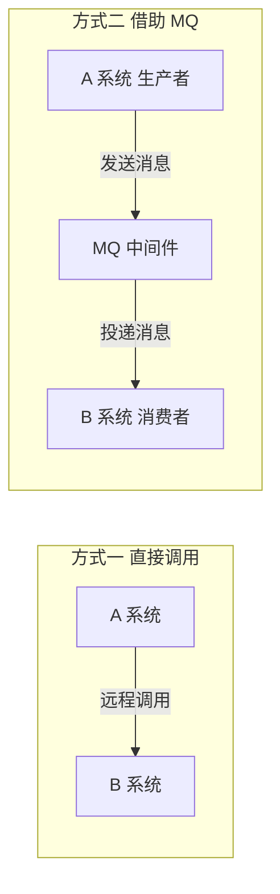
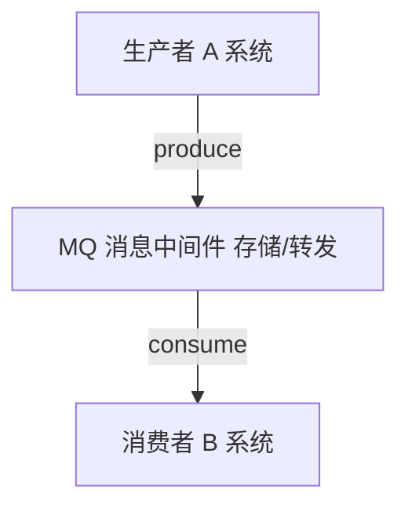

# MQ 到底是什么：消息队列与分布式通信的两种方式

这一节只解决一个问题：MQ 是什么。把定义、它在分布式系统里的角色、以及「直接调用」和「借助 MQ 间接通信」的区别讲清楚，后面的入门程序和工作模式才有落脚点。

## 先给结论

- MQ 全称 Message Queue，中文是消息队列，本质是「存储消息的中间件」，即一个用来暂存数据的容器，多用于分布式系统之间的通信。
- 分布式系统里 A、B 两个子系统通信有两种方式：A 直接远程调用 B；或者 A 先把数据发给 MQ，再由 MQ 交给 B，即借助第三方完成间接通信。
- MQ 模型里有三个角色：发送消息的一方叫生产者，接收消息的一方叫消费者，中间的 MQ 就是消息中间件。
- MQ 属于「借助第三方间接通信」那一类，它把生产者和消费者在时间、空间上解耦。

## 一、从字面理解 MQ

Message 就是消息，软件系统里那些小的数据包都可以叫消息，比如你通过接口传给下游的一条数据。Queue 是队列，广义上任何用来存储数据的容器都可以算队列。合起来，Message Queue 就是「存储消息的队列」，也就是一个专门暂存消息的中间件。它最常见的舞台，是分布式系统之间的通信。

落到具体业务里，消息的形态很日常：一条订单创建通知、一条短信发送任务、一次日志上报、一封站内信，都可以包装成消息投进队列。判断一个动作适不适合交给 MQ，主要看两点：它是否需要立刻拿到结果，以及生产方是否关心由谁、在什么时候处理它。两点都宽松，就很适合走消息队列。

## 二、分布式系统的两种通信方式

假设有 A、B 两个子系统，职责不同，但组合起来是一个大系统。它们之间要完成数据通信，有两种做法。

**第一种，直接远程调用。** A 系统直接通过网络调用 B 系统的接口，同步等待 B 返回。这是最直观的方式。

**第二种，借助第三方间接通信。** A 先把数据发给 MQ，MQ 再把数据给 B。A 和 B 不直接见面，中间隔了一个消息中间件。



图上左边是点对点直连，右边是经 MQ 中转。MQ 方案里 A 发完即可脱身，不必同步等 B，这正是异步和解耦的来源。

两种方式没有绝对优劣：要「立刻拿到返回值才能继续」的场景，比如查询余额、下单时的同步校验，直连调用更合适；而「发出去就行、结果不必立等」的场景，比如通知、日志、推送，走 MQ 更划算。真实工程里两者往往并存，按场景选择而不是一刀切，这一点先建立印象，后面学到具体工作模式时会更有体会。

## 三、生产者、消费者与中间件

在「A 发消息给 MQ，MQ 再给 B」这个模型里，三个角色定义清晰：

**第一，生产者。** 产生并发送消息的一方，对应模型里的 A 系统。它只关心把消息可靠地交给 MQ。

**第二，消费者。** 接收并消费消息的一方，对应模型里的 B 系统。它从 MQ 取消息并处理自己的业务逻辑。

**第三，消息中间件。** 中间的 MQ 本身，负责接收、存储、投递消息，是生产者和消费者之间的缓冲层。



图上生产者把消息生产到 MQ，MQ 暂存后再交给消费者，三者职责分明。

还要注意，生产者和消费者是逻辑角色而不是固定身份：同一个系统在不同链路里可以既发消息又收消息，例如订单服务把「订单已支付」发给下游，同时也消费「库存已扣减」的通知。理解角色时看的是某一次收发的方向，而不是某个服务写死的标签。

## 四、一个最小化的收发示例

为了让「生产 / 消费」不那么抽象，下面给出一个 RabbitMQ 的生产者与消费者骨架（示例，仅示意调用形态，完整可运行代码在后续入门程序章节）：

```java
// 示例：生产者骨架，示意「发消息」的调用顺序
public class ProducerDemo {
    public void send(String message) {
        // 1. 创建连接与通道
        // 2. 声明队列（不存在则创建）
        // 3. channel.basicPublish("", "queueName", null, message.getBytes());
        // 4. 关闭通道与连接
    }
}
```

```java
// 示例：消费者骨架，示意「收消息」的调用顺序
public class ConsumerDemo {
    public void receive() {
        // 1. 创建连接与通道
        // 2. 声明同一队列
        // 3. 注册回调，channel.basicConsume 中处理投递来的消息体
        // 4. 持续监听，收到即消费
    }
}
```

两段代码分别站在生产者和消费者两侧：生产者把消息送到指定队列，消费者从同一队列取走处理。中间由 MQ 负责传递，双方互不直连。

## 常见误区

- **把 MQ 当成数据库长期存储**：MQ 设计目标是中转消息，不应把重要业务数据长期堆在队列里，堆积过多会吃光资源。
- **混淆直接调用和 MQ 通信**：直连调用是同步、强依赖；MQ 是异步、解耦。该要强一致返回结果的场景，硬套 MQ 反而增加复杂度。
- **以为生产者发完就万事大吉**：消息是否真的进了队列、是否被消费，取决于确认和持久化机制，忽视这些会丢消息。
- **生产者消费者队列名不一致**：两边声明或监听的队列名称对不上，消息发到一个队列、消费在另一个队列，永远收不到。

## 面试可能被问到的问题

1. 面试官追问：「什么是 MQ，它用来干什么？」
   答：MQ 是 Message Queue 的缩写，即消息队列，是存储和转发消息的中间件，主要用于分布式系统之间的异步通信，起到解耦、异步和削峰的作用。

2. 面试官追问：「分布式系统通信有哪两种方式？」
   答：一种是 A 系统直接远程调用 B 系统；另一种是 A 先把消息发给 MQ，再由 MQ 投递给 B，借助第三方完成间接通信。MQ 属于后者。

3. 面试官追问：「MQ 模型里的生产者和消费者分别是什么？」
   答：发送消息的一方叫生产者，接收并处理消息的一方叫消费者，中间的 MQ 是负责存储和转发消息的中间件。

4. 面试官追问：「为什么引入 MQ 能解耦？」
   答：生产者只把消息交给 MQ 就完成职责，不感知下游是谁、是否在线；消费者自己从 MQ 取消息。双方不直接依赖，新增或下线消费者都不影响生产者。

## 配套资料

- 本课为概念导入，无配套源码包，文中生产者 / 消费者骨架均为按本课写法补全的示例；完整入门程序见课程 RabbitMQ 第一天代码工程（位于 `materials/code/01` 下 `3.RabbitMQ` 相关资料，如有则在对应章节补充）
