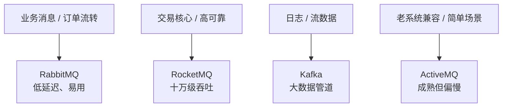

# 选型前先看清：RabbitMQ、ActiveMQ、RocketMQ、Kafka 到底差在哪

消息队列产品一大把，业界常见的有 RabbitMQ、ActiveMQ、RocketMQ、Kafka，还有 ZeroMQ、MetaMQ，甚至有人直接用 Redis 充当队列。它们不是同一个模子刻出来的，各自侧重完全不同。选错产品，轻则性能不达标，重则半夜被报警叫醒。这篇把四款主流 MQ 的关键指标拉到一起对比，帮你建立选型的第一直觉。

## 先给结论

- RabbitMQ 基于 AMQP 协议，用 Erlang 开发，单机吞吐万级、延迟微秒级，社区活跃、管理界面友好，是综合能力和易用性最均衡的一款。
- ActiveMQ 是 Apache 老牌产品，成熟度高、文档多，但性能偏弱，单机吞吐万级里最差。
- RocketMQ 是阿里巴巴开源的分布式 MQ，单机吞吐十万级，功能完备、扩展性好，经历过双十一量级考验。
- Kafka 也是 Apache 出品，面向大数据场景，单机吞吐十万级，延迟毫秒以内，擅长海量日志和流数据处理。
- 本次课程选择 RabbitMQ，因为它综合能力强劲、上手快，最适合作为学习消息队列原理的入口。

## 一、四款产品横向对比

把关键维度整理成一张表，选型时按自己的痛点对号入座：

| 维度 | RabbitMQ | ActiveMQ | RocketMQ | Kafka |
| :--- | :--- | :--- | :--- | :--- |
| 公司 / 社区 | Rabbit 公司 | Apache | 阿里巴巴 | Apache |
| 开发语言 | Erlang | Java | Java | Scala & Java |
| 协议支持 | AMQP、XMPP、SMTP、STOMP 等 | OpenWire、STOMP、REST、XMPP、AMQP | 自定义协议 | 自定义协议，社区封装了 HTTP 支持 |
| 客户端语言 | 官方支持 Erlang、Java、Ruby，社区几乎覆盖所有语言 | Java、C、C++、Python、PHP、Perl、.NET 等 | Java、C++（不成熟） | 官方支持 Java，社区有 PHP、Python 等 |
| 单机吞吐量 | 万级 | 万级（最差） | 十万级（最好） | 十万级（次之） |
| 消息延迟 | 微秒级 | 毫秒级 | 毫秒级 | 毫秒以内 |
| 功能特性 | 并发能力强、性能极好、社区活跃、管理界面丰富 | 老牌产品、成熟度高、文档较多 | MQ 功能完备、扩展性佳 | 主要面向大数据领域 |

**第一，开发语言和协议决定了它们的基因。** RabbitMQ 用 Erlang 编写，这门语言天生为高并发和分布式系统设计，所以它能把延迟压到微秒级。它主推 AMQP 这一标准协议，周边语言客户端极其丰富。ActiveMQ、RocketMQ、Kafka 主要用 Java 系语言开发，Kafka 还用了运行在 JVM 上的 Scala。

**第二，吞吐量看业务量级。** 如果你每天的消息量在千万到亿级，RabbitMQ 的万级吞吐足够用；如果是交易核心链路、需要十万级吞吐，RocketMQ 更合适；如果是日志采集、埋点上报这种动辄每天几十亿条的场景，Kafka 几乎是默认选择。

**第三，延迟是实时性的红线。** RabbitMQ 微秒级延迟在四款里最低，做业务消息通知、订单流转时对端感知最快。其余几款是毫秒级或毫秒以内，对绝大多数业务也够用，但 Kafka 的设计重心在吞吐而非极致延迟。

## 二、各自适合的场景



图里把四类典型诉求映射到对应产品：业务实时消息选 RabbitMQ，高可靠交易选 RocketMQ，大数据管道选 Kafka，遗留简单场景才考虑 ActiveMQ。

**RabbitMQ 适合绝大多数中小体量业务。** 它的管理界面开箱即用，社区文档和第三方资料极多，遇到问题很容易搜到答案。课程选择它，既是看中低延迟，也是看中学习曲线平缓。

**RocketMQ 适合电商、金融这类对可靠性和吞吐双重敏感的系统。** 它在阿里内部经历了双十一的极端流量验证，分布式架构下水平扩展方便。

**Kafka 适合大数据生态。** 它和 Flink、Spark、ELK 等组件天然契合，做日志归集、事件溯源、流计算入口非常顺手，但不太适合做业务系统之间的命令式调用。

## 三、为什么本课程聚焦 RabbitMQ

综合来看，RabbitMQ 的各项能力比较均衡：开发语言带来的高并发底子、微秒级延迟、活跃的社区、丰富的管理界面，加上 AMQP 标准协议带来的客户端通用性，让它成为「学习消息队列原理」最友好的入口。先把 RabbitMQ 的交换机、队列、绑定、工作模式吃透，再去看 RocketMQ 或 Kafka 会觉得一通百通。

## 四、动手：本地起一个 RabbitMQ 验证选型直觉

光看指标不够直观，想亲自感受 RabbitMQ 的管理界面和消息流转，用容器一行就能拉起带管理插件的实例：

```yaml
# docker-compose.yml —— 本地验证用，与课程讲解口径一致
services:
  rabbitmq:
    image: rabbitmq:3.13-management
    container_name: rabbitmq-local
    ports:
      - "5672:5672"   # 客户端通信端口
      - "15672:15672" # 管理控制台端口
    environment:
      RABBITMQ_DEFAULT_USER: "admin"
      RABBITMQ_DEFAULT_PASS: "admin"
```

启动后访问管理控制台，用前面设置的 admin 账号登录，就能实时看到交换机、队列、绑定的状态，以及消息的入队、消费、确认全过程。先动手跑通一遍，再回头看上面的对比表，选型逻辑会清晰很多。

## 常见误区

- **认为吞吐越高越好，无脑选 Kafka**：Kafka 吞吐高但偏重大数据管道，用它做业务系统的请求应答反而别扭，低延迟业务场景 RabbitMQ 更合适。
- **把 Redis 当 MQ 长期用**：Redis 做轻量队列可以应急，但它没有完善的确认、重试、死信机制，消息可靠性远不如专业 MQ。
- **只看延迟忽视协议开放度**：选 MQ 还要看客户端语言支持和协议标准，闭源或客户端稀少的产品的远期维护成本更高。
- **以为老牌一定稳妥**：ActiveMQ 虽成熟但性能偏弱，新项目用它往往不是最优解。

## 面试可能被问到的问题

1. 面试官追问：「RabbitMQ 和 Kafka 的核心区别是什么？」
   答：RabbitMQ 基于 AMQP 协议、用 Erlang 开发，延迟微秒级，面向业务消息的实时投递，管理界面完善；Kafka 面向大数据场景，吞吐十万级、延迟毫秒以内，设计重心是海量日志和流数据的持久化与回放，不适合做低延迟的业务命令调用。

2. 面试官追问：「为什么很多公司用 RocketMQ 而不是 RabbitMQ？」
   答：RocketMQ 单机吞吐可达十万级，是分布式架构、经历过电商大促验证，具备更完备的可靠性和扩展性。当业务量达到交易核心链路级别，RabbitMQ 的万级吞吐和单点瓶颈就不够用了。

3. 面试官追问：「AMQP 协议是什么，有什么意义？」
   答：AMQP 是高级消息队列协议，规定了消息中间件的角色（生产者、交换机、队列、消费者）和消息格式，类似 HTTP 之于 Web。遵循 AMQP 的 RabbitMQ 可以被各种语言的客户端按统一规范访问，不被某一实现绑定。

4. 面试官追问：「能用 Redis 做消息队列吗？」
   答：可以用 List 或 Stream 做简单队列应急，但 Redis 本身不是为消息中间件设计的，缺少消费确认、重试、死信、堆积保护等机制，消息可靠性弱，只适合对可靠性要求不高的轻量场景。

5. 面试官追问：「选型 MQ 时主要看哪些指标？」
   答：核心看吞吐量、消息延迟、协议与客户端语言支持、高可用与可靠性保障、社区活跃度，再结合业务量级（日志类还是交易类）和团队熟悉度综合判断。

## 配套资料

- 本课无配套源码包（materials/code 下未提供 MQ 相关工程），正文对比表与选型图均按课程讲解与官方公开资料整理，未引用真实工程代码。
- 可延伸查阅 RabbitMQ、RocketMQ、Kafka 官方文档的「产品定位」与「性能白皮书」章节。
