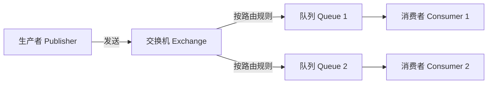
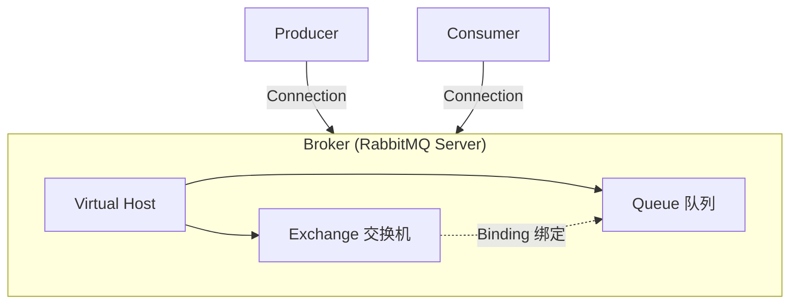

# 从 AMQP 协议到一条命令装好：RabbitMQ 是什么、怎么装

很多同学第一次接触 RabbitMQ，会被一堆名词绕晕：Broker、Virtual Host、Exchange、Channel、Connection。其实这些概念不是凭空发明的，它们来自一套叫 AMQP 的协议。先理解协议和架构，再动手安装，后面写代码才能知道每一行在和谁对话。

## 先给结论

- RabbitMQ 是基于 AMQP 协议、用 Erlang 语言开发的消息中间件，2007 年发布，是当前最主流的开源消息代理之一。
- AMQP 定义了四个角色：生产者 Publisher、交换机 Exchange、队列 Queue、消费者 Consumer；Exchange 负责按规则把消息路由到 Queue。
- RabbitMQ 服务叫 Broker，客户端通过 Connection（TCP 连接）通信，一个 Connection 里可以开多个轻量 Channel 来省资源。
- 安装分四步：装依赖环境、装 Erlang、装 RabbitMQ、启用管理插件；客户端连 5672，管理控制台走 15672。
- RabbitMQ 提供六种工作模式，本次课程重点学前五种，RPC 模式不展开。

## 一、AMQP 协议与 RabbitMQ 的关系

AMQP 是 Advanced Message Queuing Protocol（高级消息队列协议）的缩写，本质是一个网络协议，类比 HTTP 就好理解：HTTP 规定了请求和响应的数据格式，AMQP 规定了消息队列之间传输数据的格式和角色分工。只要按照 AMQP 实现，就能做出一款消息队列产品。

RabbitMQ 就是 2007 年基于 AMQP 协议实现的一款产品。它在 AMQP 的基础上把角色进一步具体化：

- **Publisher（生产者）**：发消息的一方。
- **Exchange（交换机）**：消息到达的第一站，按分发规则决定消息去哪个队列。
- **Queue（队列）**：真正存储消息的容器，等待消费者取走。
- **Consumer（消费者）**：从队列取消息并处理的的一方。



图里最关键的认知：生产者从不直接把消息扔进队列，而是先给交换机，由交换机按规则路由。这个「交换机 + 路由」的机制，是后面所有工作模式的共同基础。

## 二、RabbitMQ 的核心架构概念

把 RabbitMQ 服务端（Broker）拆开看，会多出几个工程里天天打交道的名词：

**Broker** 就是 RabbitMQ 的服务端，Producer 和 Consumer 都是客户端，通过连接和它通信。

**Connection** 是客户端与服务端之间的一条 TCP 连接。如果每发一条消息都新建 TCP 连接，资源开销极大。于是在一个 Connection 内部可以开多个 **Channel**（信道），它是轻量的、复用了底层 TCP 的连接通道，实际收发消息都用 Channel。

**Virtual Host（虚拟主机）** 是逻辑分区概念，类比 MySQL 里的数据库：一个 Broker 里可以有多个虚拟主机，互相隔离，每个虚拟主机内都有自己的 Exchange 和 Queue。不同业务系统用不同虚拟主机，权限和消息互不干扰。

**Binding（绑定）** 是 Exchange 和 Queue 之间的关联关系，绑定时可以带一个 routing key（路由键），作为消息分发的依据。



图里展示了一层隔离关系：虚拟主机包裹着交换机和队列，客户端通过连接进入 Broker，再在虚拟主机内部用信道操作资源。

## 三、六种工作模式

RabbitMQ 官方定义了六种工作模式，本次课程学习前五种：

1. 简单模式（Hello World）：一个生产者、一个消费者、一个队列。
2. Work Queues（工作队列）：一个生产者、多个消费者竞争同一队列。
3. Publish/Subscribe（发布订阅）：fanout 交换机，消息广播给所有绑定队列。
4. Routing（路由）：direct 交换机，按路由键精确匹配。
5. Topics（主题）：topic 交换机，按通配符匹配路由键。
6. RPC（远程调用）：不在本次范围。

**第一，JMS 与 AMQP 不是一回事，常被混淆。** JMS（Java Message Service）是 Java EE 规范里的一套消息客户端 API 接口，类比 JDBC 之于数据库。ActiveMQ 实现了 JMS，但 RabbitMQ 官方并未提供 JMS 实现包（社区有第三方实现）。所以面试问「AMQP 和 JMS 的区别」，一句话答：AMQP 是线级网络协议，JMS 是 Java 的 API 规范，两者不在同一层。

## 四、安装与基础配置

RabbitMQ 用 Erlang 开发，所以装它之前必须先装匹配版本的 Erlang。官网每个 RabbitMQ 版本都标注了所需 Erlang 的最小和最大版本，版本不对安装就会失败。

**第一步，装依赖环境**（CentOS 在线安装示例）：

```bash
yum install build-essential openssl openssl-devel unixODBC unixODBC-devel \
    make gcc gcc-c++ kernel-devel m4 ncurses-devel tk tc xz -y
```

**第二步，装 Erlang**（用 RPM 包，注意版本与 RabbitMQ 匹配）：

```bash
rpm -ivh erlang-18.3-1.el7.centos.x86_64.rpm
```

**第三步，装 RabbitMQ 本体及依赖 socat**：

```bash
rpm -ivh socat-1.7.3.2-5.el7.x86_64.rpm
rpm -ivh rabbitmq-server-3.6.5-1.noarch.rpm
```

**第四步，启动服务并启用管理插件**：

```bash
# 启动服务
service rabbitmq-server start
# 启用管理控制台插件
rabbitmq-plugins enable rabbitmq_management
```

安装完成后要记牢三个端口：

- **5672**：AMQP 协议端口，写 Java 代码连接服务端就用它。
- **15672**：管理控制台（Web 界面）端口，浏览器访问 `http://<服务器IP>:15672`。
- **25672**：集群通信端口，搭建集群时才会用上。

默认用户是 `guest` / `guest`，但默认只允许本机登录。若要从其他机器访问，需要在配置文件中放开 `loopback_users` 限制，并重启服务使配置生效：

```bash
service rabbitmq-server restart
```

> 说明：上面用 3.6.5 版本演示，是课程资料采用的稳定版本；生产环境建议使用官网最新的稳定版，并严格对照其 Erlang 版本要求。

## 常见误区

- **以为装 RabbitMQ 不用管 Erlang 版本**：Erlang 和 RabbitMQ 版本必须对应，装错版本会直接安装失败或运行异常。
- **把 5672 和 15672 搞混**：5672 是代码连接端口，15672 是浏览器管理端口，写代码填错端口会连不上。
- **用 guest 用户做远程生产访问**：默认 guest 仅限本机，远程连接必须新建用户并授权虚拟主机。
- **混淆 AMQP 和 JMS**：一个协议一个 API 规范，不在同一抽象层，选型时别被这两个词绕晕。

## 面试可能被问到的问题

1. 面试官追问：「RabbitMQ 里的 Exchange 和 Queue 分别干什么？」
   答：Exchange 是消息到达的第一站，负责按路由规则把消息分发到对应的 Queue；Queue 是真正存储消息的容器，消费者从 Queue 取消息。生产者发消息先到 Exchange，再到 Queue。

2. 面试官追问：「Connection 和 Channel 有什么区别？」
   答：Connection 是客户端与服务端之间的 TCP 连接，建立成本高；Channel 是建立在 Connection 内部的轻量信道，复用同一条 TCP 连接完成实际收发。一个 Connection 可开多个 Channel，避免频繁建连的消耗。

3. 面试官追问：「Virtual Host 是什么，有什么用？」
   答：Virtual Host 是 RabbitMQ 里的逻辑分区，类比数据库实例，内部包含独立的 Exchange 和 Queue。不同业务用不同虚拟主机实现隔离，并配合用户权限控制，互不干扰。

4. 面试官追问：「AMQP 和 JMS 有什么不同？」
   答：AMQP 是跨语言的线级消息协议，规定了消息格式和角色；JMS 只是 Java 提供的消息客户端 API 规范。RabbitMQ 基于 AMQP，官方未实现 JMS。两者一个是协议、一个是 API，不在一个层面。

5. 面试官追问：「RabbitMQ 默认有哪些端口，分别做什么？」
   答：5672 是 AMQP 客户端连接端口；15672 是 Web 管理控制台端口；25672 是集群通信端口。写代码连服务端用 5672，浏览器管理用 15672。

## 配套资料

- 本课无配套源码包（materials/code 下未提供 RabbitMQ 工程），正文安装命令与架构图均按课程讲解还原，未引用真实工程代码。
- 可延伸查阅 RabbitMQ 官网「Downloading and Installing」与「Erlang Version Requirements」文档，确认所装版本对应的 Erlang 要求。
