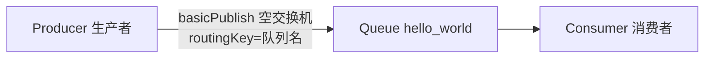
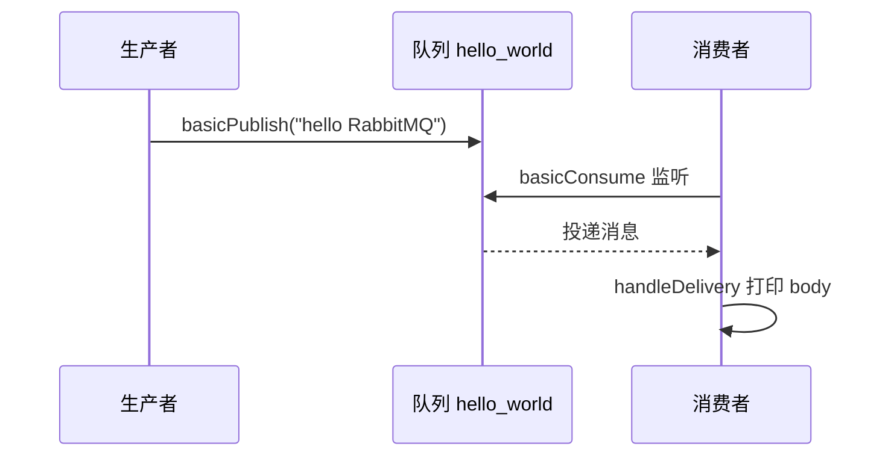

# 第一行 RabbitMQ 代码：原生 Java 客户端收发一条消息

理解架构概念之后，最快的建立体感方式就是跑通一条消息。RabbitMQ 官方提供 Java 客户端（amqp-client），不依赖任何框架，照着「建连接工厂 → 设参数 → 建连接 → 开信道 → 声明队列 → 收发」这套固定步骤写，就能在管理控制台里看到一条真实的消息。这篇把生产者和消费者两端都写完。

## 先给结论

- 原生 Java 客户端的核心依赖是 `amqp-client`，通过 `ConnectionFactory` 设置 host、port、username、password、virtual-host 后获取 `Connection`。
- 简单模式没有显式交换机，使用 RabbitMQ 内置的默认交换机，队列名就是路由键。
- 发送用 `channel.basicPublish`，接收用 `channel.basicConsume` 配合 `DefaultConsumer` 重写 `handleDelivery`。
- 生产者发完通常关闭资源；消费者是常驻监听，不要关闭连接，否则收不到后续消息。
- 声明队列 `queueDeclare` 的参数含义必须记牢：名称、是否持久化、是否独占、是否自动删除、附加参数。

## 一、引入依赖

两个 Maven 工程，一个 producer，一个 consumer，都只引一个核心依赖，并把编译版本定为 1.8：

```xml
<dependencies>
    <dependency>
        <groupId>com.rabbitmq</groupId>
        <artifactId>amqp-client</artifactId>
        <version>5.6.0</version>
    </dependency>
</dependencies>

<build>
    <plugins>
        <plugin>
            <groupId>org.apache.maven.plugins</groupId>
            <artifactId>maven-compiler-plugin</artifactId>
            <version>3.8.0</version>
            <configuration>
                <source>1.8</source>
                <target>1.8</target>
            </configuration>
        </plugin>
    </plugins>
</build>
```

## 二、生产者：六步把消息送进队列

简单模式的消息路径是「生产者 P → 队列 → 消费者 C」，没有显式交换机。代码一步一步对应架构图：



生产者的固定步骤：

```java
package com.example.producer;

import com.rabbitmq.client.Channel;
import com.rabbitmq.client.Connection;
import com.rabbitmq.client.ConnectionFactory;

public class Producer_HelloWorld {

    public static void main(String[] args) throws Exception {
        // 1. 创建连接工厂
        ConnectionFactory factory = new ConnectionFactory();
        // 2. 设置连接参数
        factory.setHost("localhost");
        factory.setPort(5672);
        factory.setVirtualHost("/");
        factory.setUsername("guest");
        factory.setPassword("guest");
        // 3. 创建连接
        Connection connection = factory.newConnection();
        // 4. 创建信道
        Channel channel = connection.createChannel();
        // 5. 声明队列（不存在则创建）
        channel.queueDeclare("hello_world", true, false, false, null);
        // 6. 发送消息
        String body = "hello RabbitMQ";
        channel.basicPublish("", "hello_world", null, body.getBytes());
        // 释放资源
        channel.close();
        connection.close();
    }
}
```

**第一，简单模式的交换机怎么处理。** 不创建交换机时，RabbitMQ 会用内置的默认交换机，它的路由规则是「路由键等于队列名」。所以 `basicPublish` 第一个参数传空字符串，`routingKey` 传队列名 `hello_world`，消息就能准确进队。

**第二，queueDeclare 五个参数必须明白。** 依次是：队列名称、是否持久化（true 表示 MQ 重启后队列还在）、是否独占连接（一般 false）、是否自动删除（无消费者时自动删，一般 false）、附加参数（无则 null）。`queueDeclare` 是幂等的：队列不存在就创建，已存在则不重复创建。

顺带分清 Connection 与 Channel 两层概念：Connection 是客户端到 RabbitMQ 的 TCP 长连接，建立成本高；Channel 是连接内部的一条虚拟信道，收发消息都通过信道完成。每条消息的收发不需要重新建连接，开多条信道就能在一条连接上并行处理多个任务，这也是后面所有工作模式共用的底层约定。

## 三、消费者：监听并取出消息

消费者的前四步和生产者完全一致（建工厂、设参数、建连接、开信道、声明队列），区别在第五步用 `basicConsume` 监听，并通过 `DefaultConsumer` 的回调 `handleDelivery` 拿到消息。

```java
package com.example.consumer;

import com.rabbitmq.client.*;
import java.io.IOException;

public class Consumer_HelloWorld {

    public static void main(String[] args) throws Exception {
        ConnectionFactory factory = new ConnectionFactory();
        factory.setHost("localhost");
        factory.setPort(5672);
        factory.setVirtualHost("/");
        factory.setUsername("guest");
        factory.setPassword("guest");
        Connection connection = factory.newConnection();
        Channel channel = connection.createChannel();

        // 声明队列（生产端已建则可省略，写上无害）
        channel.queueDeclare("hello_world", true, false, false, null);

        // 创建消费者对象
        Consumer consumer = new DefaultConsumer(channel) {
            @Override
            public void handleDelivery(String consumerTag, Envelope envelope,
                                       AMQP.BasicProperties properties, byte[] body) {
                System.out.println("consumerTag:" + consumerTag);
                System.out.println("Exchange:" + envelope.getExchange());
                System.out.println("RoutingKey:" + envelope.getRoutingKey());
                System.out.println("properties:" + properties);
                System.out.println("body:" + new String(body));
            }
        };
        // 监听队列：第二个参数 true 表示自动确认
        channel.basicConsume("hello_world", true, consumer);
    }
}
```

**第一，basicConsume 的 autoAck 参数。** 第二个参数 `true` 表示自动确认（auto acknowledge），消费者一收到消息就自动告诉 MQ「我收到了」，MQ 随即把消息从队列删掉。手动确认机制（false）是后续高级特性的重点，入门阶段先用自动确认跑通。

**第二，handleDelivery 的回调参数。** `consumerTag` 是消费者标识；`envelope` 可取到交换机名和路由键；`properties` 是消息属性（入门阶段多为空）；`body` 是真正的消息字节数组，转成字符串即可打印。

**第三，消费者不要关闭资源。** 消费者本质是个常驻监听程序，一旦 `connection.close()` 它就不再收消息。所以消费者代码里通常不写关闭逻辑，让它一直等着队列里的消息。

## 四、运行顺序与控制台验证

先跑生产者，管理控制台 Queues 页会多出一个 `hello_world` 队列，里面有一条 Ready 消息。再跑消费者，控制台立刻打印出 `body:hello RabbitMQ`，队列消息数归零。生产者和消费者各自有独立的 Connection 和 Channel，彼此并不共享。



图里说明：生产者和消费者通过队列解耦，谁先启动都行，消息在队列里缓冲。

实际操作时可以故意改变启动顺序验证这句话：先启动消费者再跑生产者，效果完全一样；生产者连发多条后消费者才启动，未消费的消息会一直停在队列里等着。反过来，两个工程都没运行就去控制台看，Queues 页里不会有 `hello_world`，因为队列是第一次被声明时才创建的，排查「队列为什么不存在」时先想到这一点。

## 常见误区

- **路由键写错导致消息进不了队列**：简单模式用默认交换机，routingKey 必须等于队列名，写错队列收不到。
- **消费者也写 connection.close()**：监听程序一关就收不到后续消息，消费者应保持常驻。
- **queueDeclare 参数乱填**：把 autoDelete 设成 true，消费者一断队列就被删，重启后配置丢失。
- **忘记持久化**：只设 durable 为 false，MQ 重启队列和里面的消息都没了，重要业务要设 true。

## 面试可能被问到的问题

1. 面试官追问：「简单模式下的交换机去哪了？」
   答：简单模式使用 RabbitMQ 内置的默认交换机，无需显式声明。它的路由规则是路由键等于队列名，所以 `basicPublish` 的交换机参数传空字符串、routingKey 传队列名即可。

2. 面试官追问：「queueDeclare 的 durable 参数有什么用？」
   答：durable 为 true 表示队列持久化，MQ 重启后队列本身依然存在（消息是否保留还取决于消息本身的投递模式）。设为 false 时 MQ 重启队列就没了。

3. 面试官追问：「为什么消费者一般不关闭连接？」
   答：消费者通过 `basicConsume` 持续监听队列，是个常驻程序。关闭连接后信道失效，无法再接收新消息，所以消费端通常不主动释放资源。

4. 面试官追问：「autoAck 为 true 有什么风险？」
   答：自动确认意味着消息一投递给消费者就被 MQ 视为成功并删除。如果消费者收到后还没处理就崩溃，这条消息就丢了。对可靠性要求高的场景应改用手动确认。

5. 面试官追问：「生产者和消费者是共用同一个 Channel 吗？」
   答：不是。它们各自建立独立的 Connection 和 Channel，彼此隔离。代码看起来相似，但运行时是两路独立连接。

## 配套资料

- 本课无配套源码包（materials/code 下未提供 RabbitMQ 工程），正文代码为按课程写法补全的可运行示例，包名统一使用 `com.example`。
- 依赖坐标对应 Maven 中央仓库 `com.rabbitmq:amqp-client:5.6.0`。
