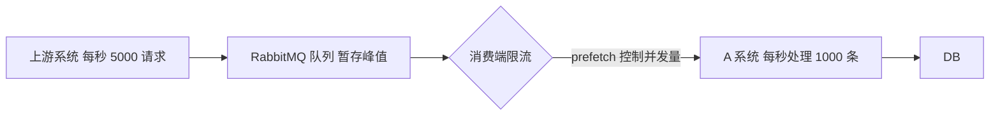

# 十万条消息一起冲过来：用 prefetch 给 RabbitMQ 消费端加上限流

秒杀开始的那一秒，五万条下单消息被生产者一股脑塞进队列。消费端刚启动，RabbitMQ 客户端不管三七二十一，把能拿到的消息全部拉到本地缓存里排队，消费者内存瞬间被打满，接着不是 OOM 就是业务处理超时，消息全部变成 `unacked` 堆在控制台上看得人头皮发麻。

还有一种更隐蔽的场景：下游系统停机维护了半小时，消息在队列里堆了几十万条，系统一恢复启动，积压的消息瞬间全灌进去，刚修好的服务立刻又被压垮。这两种情况要的都是同一件事，让消费端**一次只拿固定数量的消息**，处理完再拿下一批。这就是消费端限流。

## 先给结论

- 消费端限流生效需要两个条件同时满足：监听器容器上配 `prefetch`，确认模式必须是 `acknowledge="manual"` 手动确认。
- `prefetch` 表示消费端最多持有多少条**未确认**的消息，`prefetch="1"` 就是消费完一条并签收后才拉取下一条。
- 自动确认模式下 `prefetch` 形同虚设，消息一投递就算已确认，Broker 不会等你处理完。
- 它的底层是 AMQP 协议的 `basicQos`，Spring 把它封装成了监听器容器上的一个属性，配一行就够。
- `prefetch` 的数值要根据系统吞吐能力和单条消息的处理耗时估算，配得太大等于没配。

## 一、为什么要限流：削峰填谷的另一半

提起 MQ 的作用，常说的四个字是削峰填谷。假设有个 A 系统，它每秒最多稳定处理 1000 个请求，平时流量平稳，但做秒杀活动时上游每秒涌进来 5000 个请求。这些请求如果直接打到 A 系统，结果必然是响应超时、线程池打满、服务雪崩。

把消息队列夹在中间之后，上游的 5000 个请求先落到 MQ 里，A 系统按照自己的节奏每秒从 MQ 取 1000 条来处理。上游的峰值被队列削平，A 系统始终跑在承载范围内。



**第一，限流保护的是消费者自己。** 消息堆积在 Broker 上是安全的，队列就是为堆放消息而生的；消息被拉到消费者内存里却处理不完，才是真正的危险。

**第二，限流的前提是手动确认。** 只有消费者显式签收，Broker 才能知道这批消息处理完了，可以放行下一批。

## 二、配置：两个条件缺一不可

限流在 Spring 整合 RabbitMQ 的 XML 配置里就是监听器容器上的两个属性：

```xml
<context:component-scan base-package="com.example.listener"/>

<rabbit:listener-container connection-factory="connectionFactory"
                           acknowledge="manual"
                           prefetch="1">
    <rabbit:listener ref="qosListener" queue-names="test_queue_confirm"/>
</rabbit:listener-container>
```

`prefetch` 和 `acknowledge` 都写在 `<rabbit:listener-container>` 标签上，作用范围是这个容器里的所有消费者。容器内部可以有多个 `<rabbit:listener>`，它们共享同一套限流与确认策略。

**第一，`prefetch` 限的是未确认消息的数量。** 它约束的不是一个消费者累计消费过多少条，而是当前**已经被推送出去但还没签收**的消息最大条数。这个数字满了，Broker 就不再给这个消费者推新消息。

**第二，`acknowledge="manual"` 是硬性前提。** 自动确认模式下消息一送达客户端就被视作已确认，未确认数永远归零，限流阈值永远触不到，`prefetch` 写多大都没用。

## 三、监听器：签收才是拉取下一条的开关

监听器仍然实现 `ChannelAwareMessageListener`，从 `Message` 里取 `deliveryTag`，业务跑完再调用 `basicAck`：

```java
package com.example.listener;

import com.rabbitmq.client.Channel;
import org.springframework.amqp.core.Message;
import org.springframework.amqp.rabbit.listener.api.ChannelAwareMessageListener;
import org.springframework.stereotype.Component;

@Component
public class QosListener implements ChannelAwareMessageListener {

    @Override
    public void onMessage(Message message, Channel channel) throws Exception {
        long deliveryTag = message.getMessageProperties().getDeliveryTag();

        try {
            // 1. 接收消息
            System.out.println(new String(message.getBody()));

            // 2. 处理业务逻辑
            System.out.println("处理业务逻辑...");

            // 3. 手动签收，签收完成 Broker 才会推下一条
            channel.basicAck(deliveryTag, true);
        } catch (Exception e) {
            // 4. 业务失败时拒签，requeue 为 false，避免无限重投
            channel.basicNack(deliveryTag, true, false);
        }
    }
}
```

签收动作在这段代码里就是限流的放行信号。它的位置决定了限流的粒度：写在业务处理之后，就是严格的处理完一条再拉一条；漏写了这一行，消费者会卡在第一条消息上，后面的消息一条都进不来。

生产端用循环一次性发 10 条，方便观察消费节奏：

```java
@Test
public void testSend() {
    for (int i = 0; i < 10; i++) {
        rabbitTemplate.convertAndSend("test_exchange_confirm", "confirm", "message " + i);
    }
}
```

想让效果更直观，可以在签收前加一行 `Thread.sleep(1000)`，控制台就会变成一秒一条的节奏：

```java
// 处理业务逻辑
Thread.sleep(1000);
// 手动签收
channel.basicAck(deliveryTag, true);
```

## 四、把限流的开关拆开看

对照着跑一遍三组实验，规律就清楚了。

**第一组，`prefetch="1"` 且注释掉 `basicAck`。** 生产者发 10 条消息，消费者控制台只打印出一条 `message 0`。管理后台里 `Ready` 为 9，`Unacked` 为 1。消费者手里握着一条没签收的消息，Broker 认为额度用满了，剩下一概不发。

**第二组，把 `prefetch` 属性整个删掉，仍然不签收。** 重启消费者，10 条消息全部被拉走，`Ready` 变成 0，`Unacked` 变成 10。客户端一次性预取尽可能多的消息，本地缓存被填满，这正是消费者被打爆的典型路径。

**第三组，恢复 `prefetch="1"` 并保留 `basicAck`。** 10 条消息一条接一条被处理，`Unacked` 始终在 0 和 1 之间跳动。

三组合起来就是一句话：未确认消息数到达 `prefetch` 阈值，Broker 停发；签收一条，放行一条。

## 五、prefetch 该配多大

数值不是拍脑袋定的。设单条消息处理耗时为 T 毫秒，那么单个消费者的每秒吞吐上限约为 `prefetch / T × 1000`。单条处理 50 毫秒、目标每秒 200 条时，`prefetch` 配 10 正好。配成 1 会浪费大量等待时间，处理完一条要先走一趟网络确认才能收到下一条；配成 1000 则会在本地积压 1000 条，内存压力跟着涨。

还有一点容易漏：`prefetch` 的额度是按消费者连接计的，10 个实例各配 10，Broker 侧的全局投递量就是 100，扩容时要重新核算。

## 常见误区

- **只配 `prefetch` 不改确认模式**：`acknowledge` 还是默认的自动确认，消息一到就签收，未确认数恒为 0，限流完全不生效。
- **漏写 `basicAck` 导致消费停止**：手动模式下不签收，消费者拿到第一条消息后再也收不到新的，业务表现为队列 `Ready` 一直涨、`Unacked` 卡住不动。
- **`prefetch` 配得过大**：比如配 5000，和不限流差别不大，消费者重启瞬间依然会被积压消息冲垮。
- **把 `prefetch` 当成全局上限**：它作用于每个消费者连接，实例扩容后 Broker 侧的总投递量会成倍增长，扩容时要重新核算。

## 面试可能被问到的问题

1. 面试官追问：「RabbitMQ 的消费端限流是怎么实现的？」
   答：在 `listener-container` 上配置 `prefetch` 属性，同时把确认模式设为 `acknowledge="manual"`。`prefetch` 限制的是消费者持有的未确认消息数量，达到阈值后 Broker 停止推送，消费者每签收一条，Broker 补推一条。

2. 面试官追问：「为什么自动确认模式下限流不生效？」
   答：自动确认是消息一投递到客户端就立刻回执，Broker 那里记录的未确认数始终是 0，永远达不到 `prefetch` 设定的阈值。只有手动确认把签收动作推迟到业务处理完成之后，未确认数才会形成积压，限流才有判断依据。

3. 面试官追问：「`prefetch` 底层对应 AMQP 的哪个方法？」
   答：对应 `channel.basicQos(prefetchCount, global)`，属于 AMQP 协议里的服务质量保证机制，缩写为 QoS。`prefetchCount` 就是未确认消息的上限，`global` 表示这个限制是作用在整个 Channel 上还是单个消费者上。Spring 把它简化成了监听器容器上的 `prefetch` 属性。

4. 面试官追问：「队列里 Unacked 数量一直等于 prefetch 且不下降，是什么原因？」
   答：说明消费者拿到了消息但始终没有签收。常见原因是手动确认模式下漏写了 `channel.basicAck`，或者业务逻辑里有提前 return 的分支跳过了签收；也可能是业务被慢查询、死锁阻塞，处理根本没走完。可以结合消费者日志和线程堆栈定位。

5. 面试官追问：「消费者重启后积压的几十万条消息怎么处理？」
   答：靠消费端限流加上合理的 `prefetch` 值，让系统按自己的承载速度消费，同时可以临时扩容消费者实例数提升整体吞吐。千万不要在自动确认模式下直接启动，那会把积压消息一次性预取到客户端。

6. 面试官追问：「`prefetch` 配成 1 会有什么副作用？」
   答：吞吐会明显下降。每处理一条都要等签收的网络往返完成才能收到下一条，单条处理耗时里网络延迟的占比被放大。想要兼顾保护与性能，应该按单条处理耗时和目标吞吐估算一个大于 1 的值。

## 配套资料

- 本课无随堂代码包，示例代码见正文。文中 `listener-container` 的 `prefetch` 与 `acknowledge="manual"` 配置、`QosListener` 中 `basicAck` 的写法均按课程演示代码还原，包名统一使用 `com.example`。
- 前置课 0075 讲了 Consumer Ack 的三种确认方式，是消费端限流的前提，建议先读那一篇再回来看这篇。
