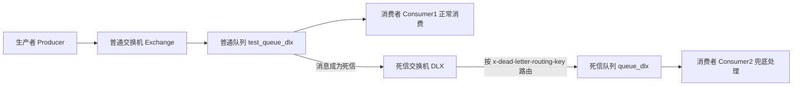
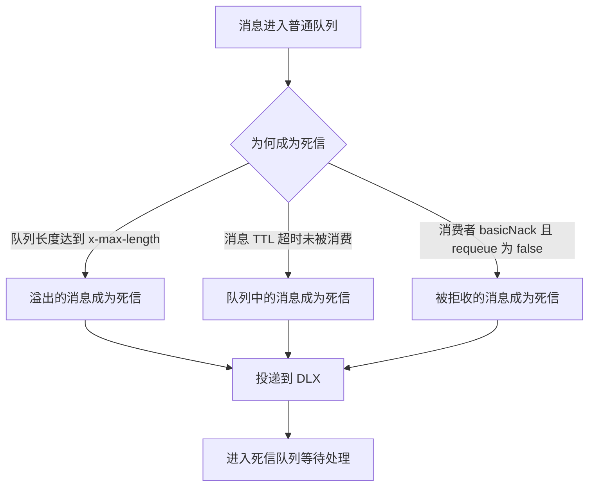
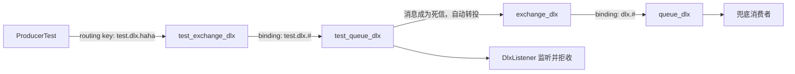
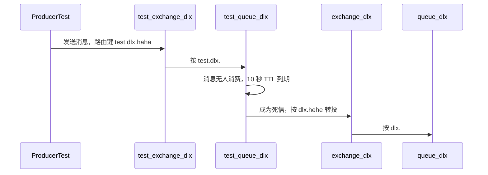

# 高级特性-死信队列：RabbitMQ DLX 的概念、触发条件与完整代码验证

## 先给结论

本系列 2 篇打通 RabbitMQ 死信队列从概念到可运行 demo：概述篇回答「死信是什么、为什么叫死信交换机、怎么绑定」，代码实现篇从零声明四样资源，把三种死信来源逐一验证，两篇连读就是一条完整的学习路径。
核心概念先立正：DLX 全称 Dead Letter Exchange，准确译名是死信交换机而不是死信队列，因为 RabbitMQ 的消息必须先经过交换机再路由到队列，消息从原队列转投出去时同样绕不过交换机这一层。
死信交换机与死信队列都是普通组件：声明类型、持久化、绑定方式和别的交换机队列完全一样，特殊的只是用途，别把它们想成特殊设施。
消息成为死信只有三种情况：队列消息长度达到 `x-max-length` 限制（被挤出去的是新来的那条）、消费者拒收且 `requeue` 为 false、消息或队列设置了过期时间且超时未被消费。
绑定靠两个参数：`x-dead-letter-exchange` 指定死信交换机名称，`x-dead-letter-routing-key` 指定转投时使用的路由键；第二个参数不能省，路由键匹配不上绑定关系消息照样被丢弃，两个键值可在管理后台 Arguments 下拉框直接点选。
队列没绑定 DLX 时死信直接被丢弃，外在表现和消息消失一模一样；死信队列本质是给消息上的一道保险，留出人工介入、定时补偿、异步重试的空间。
实验拓扑四样资源：正常交换机 `test_exchange_dlx`、正常队列 `test_queue_dlx`、死信交换机 `exchange_dlx`、死信队列 `queue_dlx`；让消息能成为死信还要在正常队列上配 `x-message-ttl` 与 `x-max-length`。
三组验证结果：过期 1 条进死信队列，长度超限溢出 10 条，消费端 catch 里 `basicNack(deliveryTag, true, false)` 拒收 1 条，第三参数必须为 false。
业务落点三个方向：超时订单关闭（与 TTL 组合就是延迟队列的实现基础）、削峰溢出保护、消费失败兜底，三种死信来源决定了它的用途不止延迟场景。

## 第1部分：被丢弃的消息去哪了：RabbitMQ 死信队列 DLX 的概念与三个触发条件

给队列设了 10 秒过期时间，发一条消息进去，10 秒后再看，队列空了，消息像水蒸气一样消失，日志里什么都查不到。或者消费者处理失败，用 `basicNack` 拒签并且 `requeue=false`，这条消息同样人间蒸发。

消息不可能真的凭空消失，它只是被 Broker 丢掉了。RabbitMQ 提供了一个兜底机制：给队列挂上一个备用交换机，凡是没被正常消费掉的消息，都会被自动转投过去，存进另一个队列里等着被处理。这套机制就是死信队列，缩写为 DLX。

### 一、为什么叫死信交换机而不是死信队列

在不少消息中间件里并没有交换机这个概念，生产者直接把消息发到队列，所以那里的对应设施叫死信队列，英文是 Dead Letter Queue。

RabbitMQ 不一样，它有一条硬性规则：消息必须先经过交换机，再由交换机按路由键路由到队列。既然交换机这一层绕不过去，那么消息从原队列转投出去时，也必须先落到某个交换机上，再由这个交换机决定去哪个队列。因此 RabbitMQ 里说的死信队列，准确说法是死信交换机，缩写 DLX。

**第一，DLX 是普通交换机。** 它同样需要声明类型、同样需要用路由键绑定队列，唯一的区别只是它是被别人用作消息转投的归宿。

**第二，死信队列也只是普通队列。** 在它后面挂一个消费者，消息就能被正常消费，和消费其他队列的方式完全一致。

整个流转过程是这样的：



图中最关键的一条边是从普通队列指向 DLX 的那条。它不需要你写代码，由 Broker 在消息满足死信条件时自动触发。这条边存在与否，决定了消息是进兜底队列还是直接消失。

### 二、消息成为死信的三种情况

这是死信队列里最常被考到的知识点，三种情况要能脱口而出。



**第一，队列消息长度到达限制。** 给队列设置 `x-max-length` 为 10，队列里已经堆了 10 条消息，第 11 条再进来就无处安放，Broker 会把它直接判为死信，转投到 DLX。注意被挤出去的是新来的那条，不是队列里原有的。

**第二，消费者拒收消息且不重回队列。** 消费端配置手动确认后，业务异常时可以在 catch 里调用下面两个方法之一拒签：

```java
// 批量拒签，multiple 为 true 时连之前未确认的消息一并处理
channel.basicNack(deliveryTag, true, false);

// 单条拒签，早期 API，没有 multiple 参数
channel.basicReject(deliveryTag, false);
```

第三个参数 `requeue` 是这里的关键。设为 true 消息会重回原队列等待再次投递；设为 false 才会在队列绑定了 DLX 的前提下转投到死信交换机，没绑定则被丢弃。

**第三，消息或队列设置了过期时间，超时未被消费。** 过期时间可以设在两个地方：队列上通过 `x-message-ttl` 统一设置，或者单条消息在发送时单独设置。无论哪种，只要到了时间还没被消费，消息就成为死信。

三种情况里，过期时间和长度限制由 Broker 自动判定，拒收由消费者代码决定。这也是死信队列最典型的三个业务落点：超时订单关闭、削峰溢出保护、消费失败兜底。

### 三、队列绑定死信交换机的两个参数

绑定不需要写代码逻辑，只需要在声明队列时附加两个参数：

| 参数名 | 作用 | 取值来源 |
|---|---|---|
| `x-dead-letter-exchange` | 指定死信交换机的名称 | 你事先声明好的那个交换机名 |
| `x-dead-letter-routing-key` | 消息转投时使用的路由键 | 死信交换机与死信队列绑定时用的路由键 |

声明形态长这样：

```xml
<rabbit:queue name="test_queue_dlx" id="test_queue_dlx">
    <rabbit:queue-arguments>
        <entry key="x-dead-letter-exchange" value="exchange_dlx"/>
        <entry key="x-dead-letter-routing-key" value="dlx.#"/>
    </rabbit:queue-arguments>
</rabbit:queue>
```

**第一，`x-dead-letter-exchange` 好理解，转投总得知道投给谁。** 它对应的就是死信交换机的名字。

**第二，`x-dead-letter-routing-key` 容易被人忽略，它的必要性来自交换机的路由规则。** 死信交换机和死信队列之间也需要用路由键绑定，比如绑定时用 `dlx.#`。那么原队列往外转投消息时，也必须给出一个能匹配上这个绑定关系的路由键，否则消息进了交换机也路由不到任何队列，还是会被丢弃。换句话说，原队列在转投这条消息时，扮演的是一次生产者的角色。

这两个参数的键值不需要死记。打开 RabbitMQ 管理后台，在新建或查看队列的 Arguments 下拉框里，系统已经把它们列在候选项中，点选即可，顺手就能看到 `x-max-length`、`x-message-ttl` 等同类参数的准确拼写。

### 四、不绑定死信交换机会怎样

这是最容易被忽略的一点：消息成为死信，和消息最终被保存下来，是两件独立的事。

如果队列只设置了过期时间却没绑定 DLX，10 秒后消息照样变成死信，但因为无处可去，Broker 直接把它丢掉，外在表现就是消息不见了。只有绑定了 DLX 且 DLX 到死信队列的路由通畅，消息才真正被留存。

反过来看，死信队列本质上是给消息上的一道保险：正常路径消费不掉的消息，不急着扔，先存到另一个地方，留出人工介入、定时补偿、异步重试的空间。

## 第2部分：从零配出一套死信队列：声明、绑定与三个触发条件的完整验证

知道了死信队列是什么，下一步是怎么把它真正跑起来。难点不在于概念，而在于声明顺序：交换机和队列要声明两套，正常队列还要在声明时就用两个参数挂到死信交换机上，参数名写错一个字母，Broker 不会报任何错，消息却悄悄全部丢掉。

这篇把生产端的 XML 声明、生产者测试方法、消费端监听器逐段拆出来，最后在管理后台上核对三组消息数量，确认三种死信情况都真的生效。

### 一、先规划命名和拓扑

动手之前把四样资源的名字定下来，后续所有配置都引用它们：

| 资源 | 名称 | 说明 |
|---|---|---|
| 正常交换机 | `test_exchange_dlx` | topic 类型，接收生产者消息 |
| 正常队列 | `test_queue_dlx` | 挂死信参数，存待消费消息 |
| 死信交换机 | `exchange_dlx` | topic 类型，接收转投消息 |
| 死信队列 | `queue_dlx` | 兜底存储，可被单独消费 |

课程里的命名习惯是正常资源带 `test_` 前缀，死信资源去掉前缀。命名本身没有强制要求，统一即可。



图中从 `test_queue_dlx` 到 `exchange_dlx` 的那条箭头由 Broker 维护，转投时使用的路由键来自队列参数 `x-dead-letter-routing-key`，取值 `dlx.hehe`，正好能被 `dlx.#` 这个绑定关系匹配上。

### 二、生产端 XML：四步声明

完整的 `spring-rabbitmq-producer.xml` 配置如下，四个步骤都用注释标好了：

```xml
<rabbit:connection-factory id="connectionFactory"
                           host="127.0.0.1"
                           port="5672"
                           username="guest"
                           password="guest"
                           virtual-host="/"/>

<rabbit:admin connection-factory="connectionFactory"/>

<!-- 1. 声明正常队列与正常交换机 -->
<rabbit:queue name="test_queue_dlx" id="test_queue_dlx">
    <rabbit:queue-arguments>
        <!-- 3. 正常队列绑定死信交换机 -->
        <entry key="x-dead-letter-exchange" value="exchange_dlx"/>
        <entry key="x-dead-letter-routing-key" value="dlx.hehe"/>
        <!-- 4. 让消息具备成为死信的条件：过期时间 10 秒 -->
        <entry key="x-message-ttl" value="10000" value-type="java.lang.Integer"/>
        <!-- 4. 队列最大长度 10，超出部分成为死信 -->
        <entry key="x-max-length" value="10" value-type="java.lang.Integer"/>
    </rabbit:queue-arguments>
</rabbit:queue>

<rabbit:topic-exchange name="test_exchange_dlx">
    <rabbit:bindings>
        <rabbit:binding pattern="test.dlx.#" queue="test_queue_dlx"/>
    </rabbit:bindings>
</rabbit:topic-exchange>

<!-- 2. 声明死信队列与死信交换机，与普通资源写法完全一样 -->
<rabbit:queue name="queue_dlx" id="queue_dlx"/>

<rabbit:topic-exchange name="exchange_dlx">
    <rabbit:bindings>
        <rabbit:binding pattern="dlx.#" queue="queue_dlx"/>
    </rabbit:bindings>
</rabbit:topic-exchange>

<rabbit:template id="rabbitTemplate" connection-factory="connectionFactory"
                 exchange="test_exchange_dlx"/>
```

**第一，顺序上先声明正常资源，再声明死信资源。** 正常队列的 `x-dead-letter-exchange` 指向的交换机必须已经存在，否则消息会被丢弃，而且没有任何异常提示。

**第二，数值型参数必须带 `value-type`。** `x-message-ttl` 和 `x-max-length` 在 Broker 里是数字类型，只写 `value="10000"` 会被当成字符串传递，Broker 拒绝这个队列声明，表现为启动即报错。`x-dead-letter-exchange` 这类字符串参数不需要写。

**第三，参数名别手敲。** 这些 key 拼写很长，容易把 `x-dead-letter-exchange` 写错字母，而且错了不报错，只表现为消息全丢。稳妥做法是在管理后台新建队列的 Arguments 下拉框里点选，或者直接复制官方文档。

**第四，路由键要能对上。** 参数里的 `dlx.hehe` 必须能被 `dlx.#` 这个绑定匹配，写成 `hehe` 就匹配不上，消息进了交换机也落不到队列。

### 三、生产者测试：过期时间与长度限制

过期时间的验证最简单，发一条消息，什么都不做，等 10 秒看它自己跑到哪去：

```java
@RunWith(SpringJUnit4ClassRunner.class)
@ContextConfiguration(locations = "classpath:spring-rabbitmq-producer.xml")
public class ProducerTest {

    @Autowired
    private RabbitTemplate rabbitTemplate;

    /**
     * 测试死信消息的三种情况：过期时间、长度限制、消息拒收
     */
    @Test
    public void testDlx() {
        // 1. 过期时间测试：消息 10 秒后未被消费，自动成为死信
        rabbitTemplate.convertAndSend("test_exchange_dlx", "test.dlx.haha",
                "我是一条消息，我会死吗");
    }
}
```

运行之后立刻去看管理后台，`test_queue_dlx` 里显示 1 条消息，10 秒后刷新，那条消息自动消失，同时 `queue_dlx` 里变成 1 条。点进 `queue_dlx` 用 Get Message 功能查看，消息体正是「我是一条消息，我会死吗」，转投链路确认打通。



长度限制的验证只需要把发送动作放进循环，一次发 20 条：

```java
@Test
public void testDlx() {
    // 2. 长度限制测试：正常队列最多存 10 条，超出部分直接进死信队列
    for (int i = 0; i < 20; i++) {
        rabbitTemplate.convertAndSend("test_exchange_dlx", "test.dlx.haha",
                "message " + i);
    }
}
```

执行完的瞬间，`test_queue_dlx` 里有 10 条，`queue_dlx` 里有 11 条，即本次溢出的 10 条加上前面过期转投的 1 条。再等 10 秒，正常队列里那 10 条也全部过期，`queue_dlx` 变成 21 条，`test_queue_dlx` 归零。

注意两者的路径差别：被长度挤出去的消息一进队列就立刻成为死信，不等过期；留在队列里的则要等到 TTL 到期才转投。两条路径最终都汇进同一个死信队列。

### 四、消费端：拒收型死信

第三种情况必须有消费者参与。监听器仍然实现 `ChannelAwareMessageListener`，监听的必须是**正常队列** `test_queue_dlx`，而不是死信队列：

```java
package com.example.listener;

import com.rabbitmq.client.Channel;
import org.springframework.amqp.core.Message;
import org.springframework.amqp.rabbit.listener.api.ChannelAwareMessageListener;
import org.springframework.stereotype.Component;

@Component
public class DlxListener implements ChannelAwareMessageListener {

    @Override
    public void onMessage(Message message, Channel channel) throws Exception {
        long deliveryTag = message.getMessageProperties().getDeliveryTag();

        try {
            System.out.println(new String(message.getBody()));
            // 模拟业务异常
            int i = 3 / 0;
            channel.basicAck(deliveryTag, true);
        } catch (Exception e) {
            System.out.println("出现异常，拒绝接收");
            // 拒签，requeue 为 false，消息才能进入死信队列
            channel.basicNack(deliveryTag, true, false);
        }
    }
}
```

消费端的监听器容器配成手动确认，并把监听器挂到正常队列上：

```xml
<context:component-scan base-package="com.example.listener"/>

<rabbit:connection-factory id="connectionFactory"
                           host="127.0.0.1"
                           port="5672"
                           username="guest"
                           password="guest"
                           virtual-host="/"/>

<rabbit:listener-container connection-factory="connectionFactory"
                           acknowledge="manual">
    <rabbit:listener ref="dlxListener" queue-names="test_queue_dlx"/>
</rabbit:listener-container>
```

启动消费者测试，等监听器容器初始化完成后，再从生产端发一条消息。消费端控制台打印出消息体和「出现异常，拒绝接收」，同时管理后台里 `queue_dlx` 的数字从 21 变成 22，`test_queue_dlx` 保持为空。

注意管理后台默认的刷新间隔是 5 秒，数字不会立刻变化，页面下方可以调整刷新频率，别因为页面没动就以为配置失败了。

### 五、收尾小结

**第一，死信交换机和死信队列与普通交换机、普通队列没有任何区别。** 声明方式、类型选择、绑定路由键的写法都一样，只是用途不同，别把它们当成需要特殊 API 的组件。

**第二，成为死信和被保存下来是两件事。** 消息成为死信后，如果队列绑定了死信交换机，它会被重新路由到死信队列；如果没绑定，就跟单纯设置了过期时间一样，消息直接消失。

**第三，三种死信情况要记牢。** 队列消息长度到达限制，超出部分成为死信；消费者拒收消息且不重回队列；原队列或消息设置了过期时间，超时未被消费。这是 RabbitMQ 面试里高频出现的一道题。

## 常见误区

- **以为死信队列是一种特殊队列**：它就是用普通方式声明出来的队列，类型、持久化、绑定方式都和别的队列一样，特殊的只是它接收的来源。
- **拒签时 `requeue` 写成 true 还指望消息进死信队列**：`requeue=true` 的语义是重回原队列，消息不会经过 DLX，只会造成反复重投。想要进死信队列必须写 false。
- **只配了交换机名没配路由键**：消息转投到 DLX 后匹配不到任何绑定关系，被 DLX 丢弃，死信队列里一条都收不到。
- **以为被丢弃的是队列里最老的消息**：长度超限时被挤出去的是新进入的那条，队列里原有的 10 条会留着，等它们自己过期或被消费。
- **在死信交换机上找死信参数**：参数只能挂在**产生**死信的那个正常队列上，挂在死信交换机或死信队列上没有任何作用。
- **数值参数漏写 `value-type`**：`x-message-ttl`、`x-max-length` 需要 `value-type="java.lang.Integer"`，写成字符串会被 Broker 拒绝，队列声明直接失败。
- **监听器监听错了队列**：监听 `queue_dlx` 只能消费已经是死信的消息，拒收路径永远触发不了，必须先监听 `test_queue_dlx` 再拒收。
- **`basicNack` 第三个参数写成 true**：消息重回原队列后被反复投递，形成死循环，永远不会进死信队列。

## 面试可能被问到的问题

1. 面试官追问：「什么是死信队列？」
   答：当一条消息因为某些原因无法被正常消费时，它就成为死信。如果队列绑定了死信交换机，这条消息会被重新发送到该交换机，再由它路由到一个专门的队列中存储。这个交换机叫 DLX，那个队列叫死信队列。如果没绑定 DLX，消息会被直接丢弃。
2. 面试官追问：「消息成为死信有哪几种情况？」
   答：三种。一是队列的消息长度达到限制，新进入的消息存不下；二是消费者拒收消息，调用 `basicNack` 或 `basicReject` 并且 `requeue` 参数为 false；三是消息或队列设置了过期时间，超时未被消费。
3. 面试官追问：「RabbitMQ 为什么叫死信交换机而不是死信队列？」
   答：因为 RabbitMQ 的模型中消息必须经过交换机才能到达队列，其他没有交换机概念的消息中间件才直接叫死信队列。RabbitMQ 里消息从原队列转出时也要先投递到一个交换机，所以这里的 DLX 全称是 Dead Letter Exchange，即死信交换机。
4. 面试官追问：「队列绑定死信交换机需要设置哪些参数？」
   答：两个。`x-dead-letter-exchange` 指定死信交换机的名称，`x-dead-letter-routing-key` 指定转投时使用的路由键。第二个参数不能省，因为死信交换机也要靠路由键才能把消息路由到死信队列，路由键不匹配消息依然会被丢弃。
5. 面试官追问：「死信队列有什么实际用途？」
   答：最常见的是做兜底和延时处理。消费失败的消息进死信队列后可以人工排查或定时重推；配合消息过期时间可以实现延迟队列，比如订单 30 分钟未支付则自动关闭，只需要让消息先进一个没人消费的队列，过期后自动落入死信队列由消费者处理。
6. 面试官追问：「死信队列的代码要怎么写？」
   答：分四步。声明正常交换机和正常队列；声明死信交换机和死信队列；在正常队列上用 `rabbit:queue-arguments` 设置 `x-dead-letter-exchange` 与 `x-dead-letter-routing-key`；再给正常队列加上 `x-message-ttl` 或 `x-max-length` 制造死信条件。拒收型死信还需要消费端监听器在 catch 里调用 `basicNack`，第三个参数为 false。
7. 面试官追问：「`x-dead-letter-routing-key` 不配会怎样？」
   答：交换机名称配了，消息能被转投到死信交换机，但因为投递时没有路由键，无法匹配死信交换机到死信队列的绑定关系，消息在交换机这一层被丢弃，死信队列一条都收不到。所以这个参数和交换机名称同样重要。
8. 面试官追问：「队列长度超限后，被挤出去的是新消息还是老消息？」
   答：是新进入队列的消息。队列已满时新消息无处存放，Broker 直接把它判为死信转投出去；队列里原有的消息不受影响，等它们自己过期或被消费时才可能成为死信。
9. 面试官追问：「生产者和消费者都在 XML 里声明队列，会不会冲突？」
   答：不会。RabbitMQ 的声明操作是幂等的，多次声明同名且参数一致的资源不会报错。但如果两处声明的参数不一致，比如一边有 TTL 一边没有，Broker 会返回资源定义不匹配的异常，所以两边的声明要保持完全一致。
10. 面试官追问：「消息 TTL 和队列 TTL 在实现上有什么区别？」
   答：队列 TTL 通过声明时的 `x-message-ttl` 参数统一设置，对整个队列所有消息生效，改它需要重新声明队列。消息 TTL 在发送时逐条指定，可以用 `MessagePostProcessor` 给 `messageProperties` 设置过期时间，粒度更细，适合不同订单有不同超时时间的场景。
11. 面试官追问：「消息进了死信队列之后还能再消费吗？」
   答：可以。死信队列就是普通队列，在它上面挂一个监听器，或者在管理后台用 Get Message 直接查看消息体，都能正常处理。生产上通常在死信队列后面接一个补偿任务，用于人工排查或定时重推。

## 配套资料

- 本课无随堂代码包，示例代码见正文。文中两个绑定参数的 XML 写法与 `basicNack`、`basicReject` 的调用形态均按课程演示还原，包名统一使用 `com.example`。
- 死信队列的完整声明、发送与消费验证在 0078 死信队列代码实现一篇中展开。
- 本课无随堂代码包，示例代码见正文。文中 `spring-rabbitmq-producer.xml` 的声明片段、`ProducerTest` 的两个测试方法、`DlxListener` 的拒收写法均按课程演示代码还原，包名统一使用 `com.example`。
- 概念与三种触发条件在 0077 死信队列概述一篇中先讲清楚，这一篇专注落地实现，两篇配合阅读。
