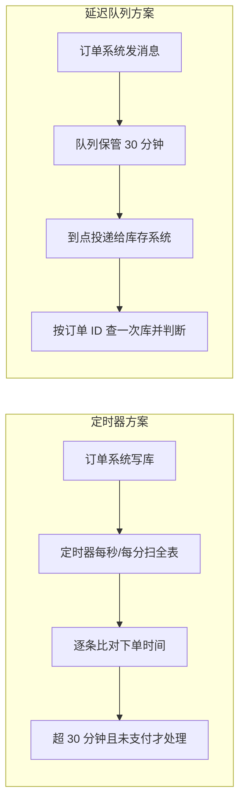
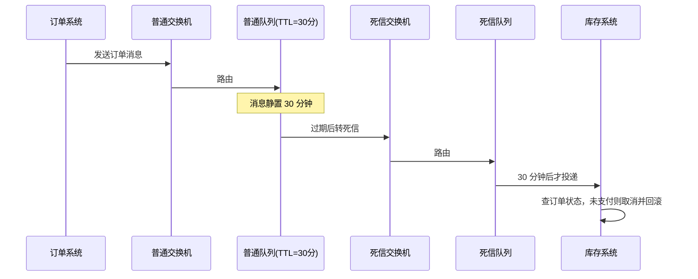
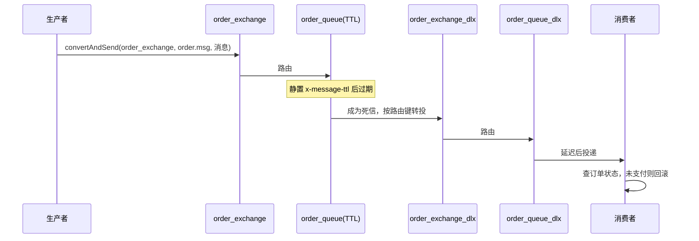

# 高级特性-延迟队列：RabbitMQ 用 TTL 与死信队列拼出延迟消息的原理与完整实现

## 先给结论

- RabbitMQ 高级特性「延迟队列」两课合并：概述课回答「为什么需要、RabbitMQ 没有原生支持怎么办」，代码实现课用 Spring AMQP 把生产者、消费者与死信链路完整跑起来，两课连读就是一条从原理到可运行 demo 的路径。
- 核心拼装公式只有三个参数：普通队列挂 `x-message-ttl` 设过期时间、`x-dead-letter-exchange` 指死信交换机、`x-dead-letter-routing-key` 定转投路由；消息在普通队列静置到过期变成死信，被死信交换机路由进死信队列，消费者从死信队列拿到的就是「到点」的消息。
- 监听对象是整套机制的头号坑：消费者必须监听死信队列，设了 TTL 的普通队列消息一进来就会被正常消费，延迟效果完全失效。
- TTL 设队列级还是消息级要分场景：队列级统一过期简单稳定，能避开队头阻塞；消息级可逐条定制延迟，但 RabbitMQ 只在队头消息过期时才投递，前面的消息没过期会挡住后面先过期的。
- 为什么不用定时任务轮询：间隔长则触发误差大，间隔短则反复扫库拖垮数据库，延迟队列把等待交给消息中间件，到点才消费一次。
- 本地验证技巧：把 TTL 从业务值临时改成 10 秒跑通流程再改回；声明写在生产者配置里，先跑生产者把交换机、队列、绑定建出来，消费者才连得上。
- 延迟之外，死信队列还能收集被拒绝、队列超长溢出的消息做隔离分析与补偿，三种死信来源决定了它不只是延迟场景的配角。
- 与普通死信队列工程对比，延迟队列工程多出来的只是给正常队列挂三个参数、消费端换监听队列，其余交换机、队列、绑定的写法完全一致，迁移成本很低。
- 配置细节两处别大意：`x-message-ttl` 的 entry 要写 `value-type="java.lang.Integer"`，不写数值类型在部分版本会解析异常；消息过期后不一定进死信队列，没配死信交换机或路由键匹配不上绑定就会直接丢弃。
- 课程环境无独立源码包，正文生产者、消费者与两份 Spring AMQP XML 按课堂屏幕实录还原，包名统一 com.example，连接地址 localhost，可直接复制运行。

## 第1部分：延迟队列：RabbitMQ 没有原生支持，却靠 TTL 加死信队列成了面试常客

下单之后 30 分钟还没付款，系统要把订单取消、库存退回；新用户注册成功 7 天之后，系统要补发一条问候短信。这类「现在发生了一件事，但要过一段时间才处理」的需求在业务里到处都是。消息队列天然是「发了就尽快消费」，要反过来让消息「憋一会儿再被拿走」，就是延迟队列要解决的问题。

### 一、什么叫延迟队列

一句话讲，延迟队列就是「消息先进队，到点才出队」。生产者把消息丢进队列，消费者不会马上收到，要等一个你事先指定的时长过去，消息才从队列里被投递出来。

拿下单场景举例：你在App里抢了一台手机，下单成功的那一刻库存已经减掉，但钱还没付。要是 30 分钟内都没付款，系统得把订单作废、库存加回去让给别人买。这个「30 分钟后再判断一次」的动作，就是延迟队列要承接的。消息在 30 分钟后才被库存系统消费，消费时再去查订单状态：付了就什么都不做，没付就取消订单、回滚库存。

### 二、为什么不用定时器

最容易想到的做法是写一段定时器代码，每隔固定间隔把订单表全量扫一遍，拿每条记录的下单时间和当前时间比对，差值超过 30 分钟再去看支付状态。这种做法能用，但很不优雅，问题出在两个方向上。

**第一，间隔定长会带来误差。** 如果定时器一分钟跑一次，那么「30 分钟未支付取消」最多会差一分钟：可能 29 分钟就取消了，也可能 31 分钟才取消，用户体验不一致。

**第二，间隔定短会压垮数据库。** 把间隔缩到一秒，误差确实小了，但每一秒都要把订单表全部记录捞出来比对一遍，对这张表的查询压力是灾难级的。

延迟队列换了个思路：订单系统下单后立刻发一条消息，由消息中间件替你保管 30 分钟，时间一到才把消息交给库存系统。库存系统收到消息后才去按订单 ID 查一次数据库、判断状态。全程只有「到点那一次」才查库，没有轮询，数据库很轻松，时间也准。

下面这张图对比了两种实现的数据流：



图里最关键的差异是：定时器方案在「等待期」里反复读库，延迟队列方案把等待交给中间件，消费端只在到期时读一次库。

### 三、RabbitMQ 怎么凑出延迟队列

RabbitMQ 没有延迟队列，但它有两个现成零件能拼出延迟效果：TTL 和死信队列。

TTL 是 Time To Live 的缩写，表示消息或队列的过期时间。给队列设了 TTL 之后，消息在队列里待够这个时长还没被消费，就会变成「死信」。死信队列（Dead Letter Queue，常配合死信交换机 DLX）专门接收这些过期、被拒绝或队列满溢出来的消息。把两者串起来，延迟效果就出来了。

机制是这样串的：订单系统发消息到一个普通交换机，交换机路由到一个「普通队列」，但这个普通队列设了 30 分钟 TTL，并且绑定了一个死信交换机（DLX）。消息在普通队列里躺满 30 分钟过期后，被死信交换机路由到它绑定的死信队列，库存系统监听的正是这个死信队列。于是库存系统在 30 分钟后才收到消息，效果等同于延迟队列。



这张时序图里最核心的一跳是「普通队列到死信交换机」：消息不是被消费者拿走，而是到点后被中间件自己转投到另一条队列，监听死信队列的消费者才有了「延迟收到」的体验。

给队列设置 TTL 和死信参数的时候，本质上就是给队列挂三个参数，RabbitMQ Management 控制台里「Add a new queue」的 Arguments 区域对应的就是它们：

```properties
# 普通队列需要附加的三个参数（键名固定，值按业务填写）
x-dead-letter-exchange=order_exchange_dlx
x-dead-letter-routing-key=dlx.order.cancel
x-message-ttl=1800000
```

`x-message-ttl` 的单位是毫秒，1800000 即 30 分钟；前两个参数告诉 RabbitMQ 消息过期后交给哪个死信交换机、用哪个路由键。

## 第2部分：把延迟队列跑起来：用 Spring AMQP 写生产者、消费者与死信链路

上一节把延迟队列的原理讲清楚了：RabbitMQ 没有原生延迟队列，用 TTL 加死信交换机（DLX）就能拼出来。原理落到代码上，其实和普通死信队列的工程差别很小，核心就是多给正常队列挂三个参数，再让消费者监听死信队列而不是正常队列。这篇把完整可跑的 Spring AMQP 工程写出来，对照着改自己的项目即可。

### 一、命名与整体结构

为了和原理一一对应，四个核心资源这样命名：

| 资源 | 名称 | 角色 |
|---|---|---|
| 正常交换机 | `order_exchange`（topic） | 接收订单消息 |
| 正常队列 | `order_queue` | 带 TTL 与死信参数，无人监听 |
| 死信交换机 | `order_exchange_dlx`（topic） | 接收过期消息并路由 |
| 死信队列 | `order_queue_dlx` | 被消费者监听，实现延迟 |

整个消息流转如下：



图里唯一要盯紧的是 `order_queue` 到 `order_exchange_dlx` 这段：它不是被消费者取走，而是消息过期后被 Broker 自己转投，延迟时长方才生效。

### 二、生产者端配置：声明四个资源并挂参数

生产者工程的 `spring-rabbitmq-producer.xml` 把四个资源全部声明出来，关键是 `order_queue` 的 `rabbit:queue-arguments`。参数键名是 RabbitMQ 固定的，照抄即可，数值型参数要带 `value-type`。

```xml
<?xml version="1.0" encoding="UTF-8"?>
<beans xmlns="http://www.springframework.org/schema/beans"
       xmlns:xsi="http://www.w3.org/2001/XMLSchema-instance"
       xmlns:rabbit="http://www.springframework.org/schema/rabbit"
       xmlns:context="http://www.springframework.org/schema/context"
       xsi:schemaLocation="http://www.springframework.org/schema/beans
           http://www.springframework.org/schema/beans/spring-beans.xsd
           http://www.springframework.org/schema/rabbit
           http://www.springframework.org/schema/rabbit/spring-rabbit.xsd
           http://www.springframework.org/schema/context
           http://www.springframework.org/schema/context/spring-context.xsd">

    <!-- 连接工厂 -->
    <rabbit:connection-factory id="connectionFactory"
        host="localhost" port="5672" username="guest" password="guest" virtual-host="/"/>

    <!-- 正常交换机与队列 -->
    <rabbit:topic-exchange name="order_exchange" id="order_exchange"/>
    <rabbit:queue name="order_queue" id="order_queue">
        <rabbit:queue-arguments>
            <entry key="x-dead-letter-exchange" value="order_exchange_dlx"/>
            <entry key="x-dead-letter-routing-key" value="dlx.order.cancel"/>
            <!-- 演示用 10 秒，业务改为 1800000（30 分钟） -->
            <entry key="x-message-ttl" value="10000" value-type="java.lang.Integer"/>
        </rabbit:queue-arguments>
    </rabbit:queue>
    <rabbit:bindings>
        <rabbit:binding exchange="order_exchange" queue="order_queue" pattern="order.msg"/>
    </rabbit:bindings>

    <!-- 死信交换机与死信队列 -->
    <rabbit:topic-exchange name="order_exchange_dlx" id="order_exchange_dlx"/>
    <rabbit:queue name="order_queue_dlx" id="order_queue_dlx"/>
    <rabbit:bindings>
        <rabbit:binding exchange="order_exchange_dlx" queue="order_queue_dlx" pattern="dlx.order.cancel"/>
    </rabbit:bindings>

    <!-- 让 RabbitTemplate 用上上面的连接工厂 -->
    <rabbit:template id="rabbitTemplate" connection-factory="connectionFactory"/>
</beans>
```

**第一，三个队列参数缺一不可。** 缺了死信交换机名称，过期消息直接被丢弃；缺了路由键，消息进了死信交换机却匹配不到绑定，同样丢弃；缺了 TTL，消息永不过期，延迟消失。

**第二，正常队列不要配任何监听器。** 一旦有人监听 `order_queue`，消息一进队就被取走，永远等不到过期，延迟链路断在这里。

### 三、生产者发送消息

发送代码极简：用 `RabbitTemplate` 往正常交换机 `order_exchange` 发，路由键 `order.msg`。消息体模拟订单信息，真正项目里是下单成功后触发这一步。

```java
package com.example;

import org.junit.Test;
import org.junit.runner.RunWith;
import org.springframework.amqp.rabbit.core.RabbitTemplate;
import org.springframework.beans.factory.annotation.Autowired;
import org.springframework.test.context.ContextConfiguration;
import org.springframework.test.context.junit4.SpringRunner;

@RunWith(SpringRunner.class)
@ContextConfiguration(locations = "classpath:spring-rabbitmq-producer.xml")
public class ProducerTest {

    @Autowired
    private RabbitTemplate rabbitTemplate;

    @Test
    public void testDelay() throws InterruptedException {
        // 下订单成功后发送订单消息，消息会先进 order_queue 等待过期
        for (int i = 1; i <= 10; i++) {
            rabbitTemplate.convertAndSend(
                    "order_exchange",
                    "order.msg",
                    "订单信息：id=" + i + ",time=" + System.currentTimeMillis());
            Thread.sleep(1000);
        }
    }
}
```

这里要注意一个实操顺序：交换机、队列和绑定关系是在生产者配置里声明的，只有生产者真正发过一次消息（或先跑一次测试方法触发声明），这些资源才会在 Broker 上创建出来。如果直接启动消费者去监听还不存在的 `order_queue_dlx`，会报队列不存在的错误。正确顺序是先跑一次生产者把资源建出来，再启动消费者。

### 四、消费者端配置与监听器

消费者工程的 `spring-rabbitmq-consumer.xml` 负责连 Broker、扫描监听器、并把监听器挂到死信队列上。手动确认模式（`acknowledge="manual"`）配合 `prefetch="1"`，方便在业务逻辑里精确控制签收。

```xml
<?xml version="1.0" encoding="UTF-8"?>
<beans xmlns="http://www.springframework.org/schema/beans"
       xmlns:xsi="http://www.w3.org/2001/XMLSchema-instance"
       xmlns:rabbit="http://www.springframework.org/schema/rabbit"
       xmlns:context="http://www.springframework.org/schema/context"
       xsi:schemaLocation="http://www.springframework.org/schema/beans
           http://www.springframework.org/schema/beans/spring-beans.xsd
           http://www.springframework.org/schema/rabbit
           http://www.springframework.org/schema/rabbit/spring-rabbit.xsd
           http://www.springframework.org/schema/context
           http://www.springframework.org/schema/context/spring-context.xsd">

    <rabbit:connection-factory id="connectionFactory"
        host="localhost" port="5672" username="guest" password="guest" virtual-host="/"/>

    <context:component-scan base-package="com.example.listener"/>

    <!-- 监听的是死信队列 order_queue_dlx，而不是正常队列 order_queue -->
    <rabbit:listener-container connection-factory="connectionFactory"
        acknowledge="manual" prefetch="1">
        <rabbit:listener ref="orderListener" queue-names="order_queue_dlx"/>
    </rabbit:listener-container>
</beans>
```

监听器实现 `ChannelAwareMessageListener`，在 `onMessage` 里先打印消息体，再模拟订单状态判断与库存回滚，最后手动 `basicAck` 签收；异常时拒绝签收让消息进入补偿流程。

```java
package com.example.listener;

import com.rabbitmq.client.Channel;
import org.springframework.amqp.core.Message;
import org.springframework.amqp.rabbit.listener.api.ChannelAwareMessageListener;
import org.springframework.stereotype.Component;

@Component("orderListener")
public class OrderListener implements ChannelAwareMessageListener {

    @Override
    public void onMessage(Message message, Channel channel) throws Exception {
        long deliveryTag = message.getMessageProperties().getDeliveryTag();
        // 收到的是延迟后的消息，证明 TTL + DLX 生效
        System.out.println(new String(message.getBody()));

        // 处理业务逻辑：真实项目中这里应调用订单服务查询数据库状态
        System.out.println("处理订单业务逻辑...");
        System.out.println("根据订单状态更新库存...");
        System.out.println("判断状态是否为未支付成功");
        System.out.println("取消订单，回滚库存...");

        // 业务处理成功后手动确认
        channel.basicAck(deliveryTag, true);
    }
}
```

监听器这一端最关键的一行是 `queue-names="order_queue_dlx"`。它监听的是死信队列，`order_queue` 过期后的消息才会到这里，于是消费动作天然被推迟了整整一个 TTL。若不小心写成 `order_queue`，消息一进队就被消费，延迟效果消失。

### 五、运行与验证

先把生产者测试跑一次，让 Broker 创建好四个资源；再启动消费者。生产者把消息发出去后，消费者的控制台不会立刻打印，要等 `x-message-ttl` 设定的 10 秒过去，死信队列才把消息投递出来，此时才能看到「订单信息：id=...」以及后续的库存回滚日志。控制台按序出现下面这样的输出，就说明链路通了：

```text
订单信息：id=1, time=1710000000000
处理订单业务逻辑...
根据订单状态更新库存...
判断状态是否为未支付成功
取消订单，回滚库存...
```

## 常见误区

- **以为 RabbitMQ 自带延迟队列**：直接去文档里找 `delayed queue` 类型往往找不到。原生要靠 TTL 加 DLX 拼，或者后续引入官方延迟消息插件（基于 `x-delayed-message` 交换机），但本课讲的是前者。
- **把 TTL 设到消息上而不是队列上**：给单条消息设 TTL 也能过期，但如果队列里前面的消息没过期、后面的消息先过期，RabbitMQ 不会提前把后面的消息投递出来，只有队头消息过期才会触发，容易产生「明明到点了却没消费」的错觉。队列级 TTL 更稳妥。
- **监听错了队列**：消费者必须监听死信队列，而不是那个设了 TTL 的普通队列。监听普通队列的话，消息一进来就被消费了，延迟效果完全失效。
- **TTL 设 30 分钟不方便调试**：本地验证时用 10 秒这种小值先跑通流程，确认延迟生效后再改回业务时长。
- **直接启动消费者报队列不存在**：交换机、队列、绑定在生产者配置里声明，要先让生产者发一次消息把资源建出来，消费者才能连上。
- **`value-type` 漏写**：`x-message-ttl` 的 value 是数值，Spring AMQP 的 `entry` 默认按字符串处理，不写 `value-type="java.lang.Integer"` 可能在部分版本解析异常，养成写上数值类型的习惯。

## 面试可能被问到的问题

1. 面试官追问：「RabbitMQ 怎么实现延迟队列？」
   答：RabbitMQ 原生没有延迟队列，常用方案是 TTL 加死信队列。给普通队列设置 `x-message-ttl` 过期时间和 `x-dead-letter-exchange` 死信交换机，消息在普通队列里过期后变成死信，被死信交换机路由到死信队列，消费者监听死信队列，就实现了到点才消费。
2. 面试官追问：「为什么不用定时任务轮询来实现？」
   答：定时轮询要么有误差，要么频繁扫库。间隔太长（如一分钟）会使触发时间偏差一分钟，间隔太短（如一秒）会反复全表扫描，拖垮数据库。延迟队列把等待交给消息中间件，到点才消费一次，精度和性能都更好。
3. 面试官追问：「TTL 设置在消息上和设置在队列上有什么区别？」
   答：队列级 TTL 对该队列所有消息统一生效，且能避免「队头阻塞」导致的延迟不准；消息级 TTL 仅对单条消息生效，但 RabbitMQ 只有在队头消息过期时才会投递，后面的消息即便先过期也要排队，容易造成延迟失效。
4. 面试官追问：「死信队列除了实现延迟，还能干什么？」
   答：消息变成死信有三种情形：消息被拒绝且不重新入队、消息过期、队列达到最大长度。死信队列因此也常用于收集消费失败的消息做隔离分析，或做消息补偿，而不只是延迟场景。
5. 面试官追问：「消费者应该监听哪个队列？」
   答：必须监听死信队列。设了 TTL 的普通队列消息一进来就会被正常消费，没有延迟效果；延迟后的消息只会出现在死信队列里，所以监听死信队列才能拿到「到点」的消息。
6. 面试官追问：「延迟队列的工程和普通死信队列工程有什么不同？」
   答：声明部分几乎一样，多出来的只是给正常队列挂 `x-message-ttl`、`x-dead-letter-exchange`、`x-dead-letter-routing-key` 三个参数；消费端监听死信队列而不是正常队列。其余交换机、队列、绑定的写法和普通死信队列一致。
7. 面试官追问：「为什么消费者要监听死信队列？」
   答：消息先进入正常队列并静置到 TTL 过期，才被 Broker 转投到死信队列。只有监听死信队列，消费者拿到的才是「过期后」的消息，延迟才生效；监听正常队列则消息一进来就被取走，没延迟可言。
8. 面试官追问：「本地怎么快速验证延迟效果？」
   答：把 `x-message-ttl` 从业务值（如 1800000 毫秒）临时改成 10000 毫秒，启动生产者和消费者，观察消费者是否在约 10 秒后才打印消息。验证通过再改回业务时长。
9. 面试官追问：「消息过期后一定会进死信队列吗？」
   答：不一定。只有正常队列配了 `x-dead-letter-exchange` 才会转投；若没配死信交换机，或者转投时的路由键匹配不到死信交换机的任何绑定，消息会被直接丢弃。三个参数齐全且绑定正确才能稳进死信队列。
10. 面试官追问：「生产者没发消息，交换机和队列会自己创建吗？」
   答：不会。声明写在生产者配置里，需要生产者真正连接 Broker 并触发声明（发一次消息或显式declare）后资源才存在。先启动消费者去监听尚未创建的队列会报错，所以要先跑生产者建资源。
11. 面试官追问：「TTL 设队列级还是消息级更合适？」
   答：所有订单超时时间一致时用队列级 `x-message-ttl`，简单稳定；若不同订单需要不同延迟（如部分 15 分钟、部分 30 分钟），则改用消息级 TTL 在发送时逐条指定，但要注意队头阻塞问题。

## 配套资料

- 本课无独立配套源码包（阶段一 `materials/code/01` 仅含 Spring Boot、Spring Cloud、k8s 工程）。文中队列参数与架构均依据本课屏幕实录的 RabbitMQ Management 参数（`x-message-ttl`、`x-dead-letter-exchange`、`x-dead-letter-routing-key`）整理，代码为按该写法补全的示例。
- 下一篇「0080-高级特性-延迟队列-代码实现」给出完整的生产者、消费者与 Spring AMQP XML 配置示例。
- 本课无独立配套源码包（阶段一 `materials/code/01` 仅含 Spring Boot、Spring Cloud、k8s 工程）。正文生产者、消费者、监听器及两份 Spring AMQP XML 均依据本课屏幕实录（`ProducerTest`、`OrderListener`、`spring-rabbitmq-producer.xml`、`spring-rabbitmq-consumer.xml`）还原，包名已统一改为 `com.example`，连接地址改为 `localhost`，代码为按该写法补全的可运行示例。
