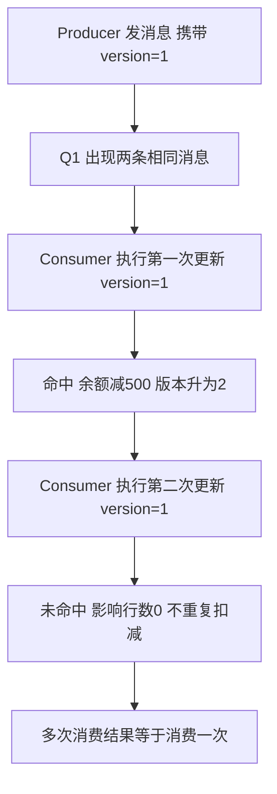

# 同一条消息消费十次只扣一次钱：用乐观锁保障 RabbitMQ 消费幂等

幂等性并不是消息队列独有的概念，调用接口时也常要求接口幂等。但在 RabbitMQ 消费场景里，幂等性直接关系资金安全：一条扣款消息因为网络闪断被发了两次，消费端绝不能扣两次钱。这一篇先讲清楚幂等性到底是什么，再用数据库乐观锁给出一套简单可靠的保障方案，它和上一篇的消息补偿机制天然互补。

## 先给结论

- 幂等性指一次和多次请求同一资源，对资源本身产生的影响相同。在 MQ 里即：消费多条相同消息，得到与消费该消息一次相同的结果。
- 金融、支付等场景必须保障消费幂等，否则重复消息会造成重复扣款、重复下单等资损。
- 一种简单方案是数据库乐观锁：消息携带版本号，消费时用 `where id = ? and version = ?` 做更新，命中才执行并把版本号加一。
- 重复消息再来时，版本号已变化，更新条件不再满足，影响行数为 0，自然不会重复扣减。它配合补偿机制，对重复投递的消息天然去重。

## 一、什么是幂等性

幂等性最直白的解释是：对同一个资源的请求，无论执行一次还是多次，资源最终的状态应当一致。在消息队列里，它的含义是消费多条相同的消息，应当得到与消费一条相同的结果。

举一个最容易被理解的例子：今天花 500 块钱买东西，买完应当发一条消息到 MQ 去扣款。由于网络闪断等各种原因，发了两条内容完全一样的消息，都是扣 500。消费端拿到这两条消息，应该只扣 500，而不是扣 1000。如果是两条还扣 1000，那十条岂不是扣 5000？所以在支付这类特殊场景里，幂等性一定要保障。

## 二、为什么会出现重复消息

重复消息的出现往往和前面的补偿机制有关。在补偿架构里，消费端如果处理到一半挂了，确认消息发不出去，消息就不会被写入消息库；回调检查服务发现消息库没有记录，就会通知 Producer 重新发送。于是 Q1 队列里就可能出现两条、甚至更多条内容相同的消息。

如果消费端不做任何幂等处理，这两条消息都会被执行，账户被减 500 又减 500，直接出问题。问题的根源在于：消费逻辑只关心「这条消息我要做什么」，却不关心「这条消息我是不是已经做过了」。

## 三、用乐观锁解决重复消费

数据库乐观锁是这里最朴素的方案，核心就是版本号。给账户表加一个 version 字段，每次更新时不仅改金额，还把版本号加一，并且用版本号作为更新条件的组成部分。

假设要扣减的账户 `id = 1`，当前余额里 money 足够，账户记录的 `version = 1`，消息里携带的也是 `version = 1`。第一次执行时，SQL 如下：

```sql
update account
set money = money - 500, version = version + 1
where id = 1 and version = 1;
```

这条语句会命中：数据库里 `id = 1` 且 `version = 1` 的记录存在，于是余额减去 500，同时版本号变成 2，影响行数为 1。

当第二条相同的消息到来，它携带的 `version` 依旧是 1（消息内容没变），再执行同一条 SQL：

```sql
update account
set money = money - 500, version = version + 1
where id = 1 and version = 1;
```

此时数据库里那条记录的 `version` 已经是 2，没有任何记录满足 `id = 1 and version = 1`，影响行数为 0，金额不再被扣减。无论再来多少条重复消息，结果都和只消费一次一样。



图里的关键点是：判断「是否已经处理过」的依据不是消息本身，而是数据库里的版本号。版本号只会在成功处理时自增，因此重复消息带来的旧版本号永远无法再命中。

## 四、Java 落地示例（按课程思路补全）

消费端在更新账户时，必须把消息里的版本号透传到 SQL 条件中。以下为按课程思路补全的标准示例，并非课程原始工程代码。

```java
package com.example.mq;

import org.springframework.amqp.rabbit.annotation.RabbitListener;
import org.springframework.stereotype.Component;

@Component
public class AccountConsumer {

    // 消费扣款消息，利用乐观锁保证幂等
    @RabbitListener(queues = "q1_order")
    public void deduct(OrderMessage message) {
        int affected = accountMapper.deduct(
                message.getAccountId(),
                message.getAmount(),
                message.getVersion());
        // affected 为 0 说明该版本已处理过，属于重复消息，直接忽略
    }
}
```

对应的 Mapper 方法把版本号写进更新条件：

```java
package com.example.mq;

import org.apache.ibatis.annotations.Update;

public interface AccountMapper {

    @Update("update account set money = money - #{amount}, version = version + 1 " +
            "where id = #{accountId} and version = #{version}")
    int deduct(Long accountId, Integer amount, Integer version);
}
```

只要消息里携带的版本号不变，重复消息执行后影响行数都是 0，业务上等同只处理一次。

## 常见误区

- **只在内存里做去重**：用 Set 记已处理 ID，服务一重启记录就清空，重复消息照样重复消费。去重必须落到数据库层。
- **认为 RabbitMQ 的 ACK 会自动去重**：broker 只负责投递，不保证幂等；网络或消费失败导致的重投，需要业务自己处理。
- **用业务字段判断「是否已处理」却忘加版本条件**：比如只判断 `status = 0` 再更新，并发下仍可能重复命中，必须用版本号等原子条件。
- **把版本号存在消息里却每次都自增**：消息是「重复」的，携带的版本号也应该是相同的旧值，才能被乐观锁拦下；若在消费端自增再写回，就失去了去重意义。

## 面试可能被问到的问题

1. 面试官追问：「什么是消息消费的幂等性？」
   答：指消费多条相同消息，得到与消费该消息一次相同的结果。比如扣款消息被重复投递，账户只应扣减一次，不能因为消息重复而重复扣钱。

2. 面试官追问：「为什么 RabbitMQ 场景会出现重复消息？」
   答：常和补偿机制相关。消费端处理中途挂掉导致确认消息没发出，回调检查服务比对消息库发现缺失，会通知 Producer 重发，于是队列里出现内容相同的多条消息。

3. 面试官追问：「乐观锁是怎么保障幂等的？」
   答：给数据加版本号，更新时条件带上 `where id = ? and version = ?`，命中才执行并把版本号加一。重复消息携带的是旧版本号，此时数据库版本已变，条件不再满足，影响行数为 0，不会重复扣减。

4. 面试官追问：「只用内存 Set 去重有什么问题？」
   答：内存去重在服务重启或集群多实例部署时会失效，记录丢失后重复消息照样被重复处理。真正可靠的去重要落到数据库层，乐观锁就是其中一种。

5. 面试官追问：「幂等性保障和消息补偿是什么关系？」
   答：补偿机制负责「消息最终一定被投递」，它会产生重复消息；幂等性负责「重复消息被消费时结果不变」。两者配合，才能既保证不丢、又保证不重。

## 配套资料

- 本课无配套源码包（`materials/code` 下未提供 RabbitMQ 工程）。文中 `account` 表的乐观锁更新 SQL（`where id = 1 and version = 1`）来自课程实录的架构讲解。
- 文中 Java 代码为按课程思路补全的标准示例，用于说明消费端如何把版本号透传进更新条件。
