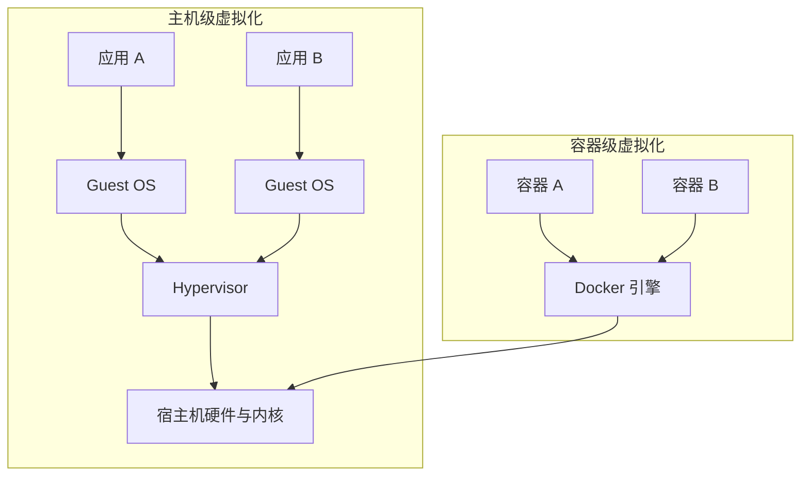
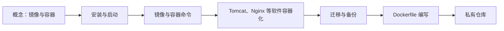

# Docker 开篇要说清的两件事：虚拟化是什么，这门课要练出哪些能力

开发机上跑得好好的服务，交到测试或者运维手上就报错，排查一圈发现是 JDK 版本不同、依赖库缺了一个、环境变量没配对。这类「在我机器上能跑」的扯皮，几乎每个团队都遇到过。

Docker 要解决的正是环境交付这件事：把应用连同它依赖的运行环境打包成一份标准件，谁拿到谁就能跑起来。这门课开篇只干两件事，
先把「虚拟化」这个概念垫稳，再把后续要练的七项能力摊开讲清楚，学的时候才知道每一步在补哪块短板。

## 先给结论

- 虚拟化分两层理解：主机级虚拟化是每台虚拟机带一个完整的客户机操作系统，容器级虚拟化是共享宿主机内核的进程隔离。
- Docker 属于后者，没有 Guest OS 这层开销，所以启动快、体积小、密度高。
- 学习目标共七项：镜像与容器概念、安装与启动、镜像与容器命令、常用软件容器化部署、迁移与备份、Dockerfile 编写、私有仓库搭建与使用。
- 学 Docker 主要就是学命令，日常操作基本都由 `docker` 这一条命令串起来。
- Dockerfile 负责把环境固化成可复现的脚本，私服负责团队内部的镜像分发，这两项是工程化的分水岭。

## 一、把虚拟化这个概念垫稳

虚拟化说白了，就是在一台物理机上虚拟出多个相互隔离的运行环境，让它们各自以为自己独占一台机器。

主机级虚拟化的做法是在宿主机之上加一层 Hypervisor，再往上跑若干个客户机操作系统，每个虚拟机里装完整的 Guest OS、内核、用户态程序。
VMware 虚拟机是这种形态的代表，隔离彻底，代价是每份 Guest OS 都要单独占用 CPU、内存和磁盘，启动按分钟计。

容器级虚拟化换了个思路：不去虚拟硬件，也不装完整操作系统，而是用 Linux 内核的 namespace 做视图隔离、cgroup 做资源限额，
让容器里的进程看起来独享文件系统、网络、进程空间，实际共享同一个宿主机内核。少了 Guest OS 这一层，容器按秒级启动，单机密度也高得多。



图里两种路子的差别一眼可见：左边的每个应用下面都压着一整套操作系统，右边的应用直接共享宿主机内核。
Docker 快的原因就在这一层被省掉了，同样的代价是隔离粒度不如虚拟机彻底，所以金融、政企类场景里两者常常配合着用。

## 二、七个目标的能力地图

把目标按学习顺序排开，能看清课程的设计逻辑：先懂概念，再装环境，接着练命令，用容器跑起真实软件，最后把环境固化成脚本并分发出去。



前三项打基础，后四项偏向交付。概念没搞清就去背命令，端口映射、目录挂载这些操作很快就会绕成一团。

## 三、逐项目标拆解

**第一，理解镜像与容器的概念。** 镜像是只读的应用模板，容器是镜像运行起来的实例，两者关系类似面向对象里的类与对象。一个镜像可以起多个容器，容器删了镜像还在。

**第二，完成 Docker 的安装与启动。** 装完要确认守护进程在跑，这是后续所有命令能执行的前提：

```bash
systemctl start docker
systemctl enable docker
docker version
```

**第三，掌握镜像与容器相关命令。** 这一部分占课程篇幅最大，日常增删查改全靠它：

```bash
docker images          # 查看本地镜像
docker ps -a           # 查看容器，含已停止的
docker pull nginx      # 拉取镜像
docker run -d -p 80:80 --name web nginx
docker logs -f web     # 跟踪容器日志
docker exec -it web bash
```

**第四，用容器布置 Tomcat、Nginx 等常用软件。** 不再在 Linux 上手工解压、改配置、配环境变量，一条 `docker run` 就能拿到一个可用实例，不要了直接删掉，宿主环境不留残渣。

**第五，掌握迁移与备份相关命令。** 把容器导出成镜像、把镜像打包成文件，换台机器再导入，本质是把运行环境当文件搬来搬去。

**第六，用 Dockerfile 编写创建容器的脚本。** 把「基于什么基础镜像、拷哪些文件、装什么依赖、跑什么命令」写进纯文本文件，一条命令重建出完全一样的环境。下面是一个按主流写法给出的示例：

```dockerfile
FROM openjdk:8-jdk-alpine
WORKDIR /app
COPY target/app.jar app.jar
EXPOSE 8080
ENTRYPOINT ["java", "-jar", "app.jar"]
```

有了它，环境交付不再是口头交代和手写文档，而是一份能进版本库的脚本。多服务场景一般会再配一个 compose 文件统一管理，
下面这份是课程资料里真实存在的编排文件节选：

```yaml
version: "3"

services:
  sailing:
    container_name: sailing
    build: .
    image: sailing:1.0-SNAPSHOT
    network_mode: "host"
    ports:
      - "56085:56085"
    restart: always
    depends_on:
      - redis
    volumes:
      - "./logs:/logs"
    environment:
      JAVA_OPTS: "-Xms256m -Xmx256m -Xmn128m"
```

`build: .` 指的就是读取当前目录的 Dockerfile，`ports` 做端口映射，`volumes` 把日志目录挂到宿主机，`depends_on` 声明启动顺序。

**第七，搭建并使用 Docker 私有仓库。** 私服是团队内部的镜像仓库，自己构建的镜像推上去，同事拉下来就能用。它解决了两件事：不必依赖公网仓库，以及内部镜像的版本与权限可控。

## 常见误区

- **把 Docker 当虚拟机学**：容器共享宿主机内核，不是完整的 Guest OS，不能用「装个系统」的思路去理解它的行为。
- **只背命令不理概念**：镜像和容器分不清，`docker run` 的端口映射、数据卷挂载很快就会搞混。
- **以为会 `docker run` 就够了**：手动敲出来的环境不可复现，真正工程化要看有没有 Dockerfile 和镜像分发流程。
- **忽略私有仓库**：单机玩镜像没感觉，一进团队协作就会缺一个统一的交付出口。

## 面试可能被问到的问题

1. 面试官追问：「容器和虚拟机有什么区别？」
   答：虚拟机在 Hypervisor 上跑完整的客户机操作系统，隔离彻底但资源开销大、启动慢；容器是进程级隔离，共享宿主机内核，没有 Guest OS 这层开销，启动快、体积小、密度高，隔离粒度相对弱一些。

2. 面试官追问：「镜像和容器是什么关系？」
   答：镜像是只读的分层模板，容器是镜像运行起来后加了可写层的实例，类似类与对象的关系。一个镜像可以启动多个容器，容器被删除不会影响底下的镜像。

3. 面试官追问：「Docker 主要解决了什么问题？」
   答：核心是解决环境不一致。把应用连同依赖打包成镜像，开发、测试、生产用同一份标准件，避免版本差异引起的故障，同时把环境搭建从手工安装变成一条命令或一份脚本。

4. 面试官追问：「Dockerfile 有什么用？」
   答：它用文本形式描述镜像的构建过程，包括基础镜像、拷贝文件、安装依赖、暴露端口和启动命令。好处是构建过程可复现、可进版本库、可自动化，不用再靠文档口口相传。

5. 面试官追问：「为什么需要私有仓库？」
   答：团队内部分发镜像需要受控的出口。私服能承载内部构建的镜像，支持版本管理与权限控制，部署机从内网拉取速度快且稳定，也不把业务镜像暴露到公网仓库。

## 配套资料

- 本课为 Docker 开篇导学，内容为学习目标与虚拟化概念，课程源码包中没有与本讲对应的工程，Dockerfile 示例为按主流写法补全。
- 文中容器编排示例节选自课程真实资料：`materials/code/10/sailing/sailing/src/main/docker/docker-compose.yml`
