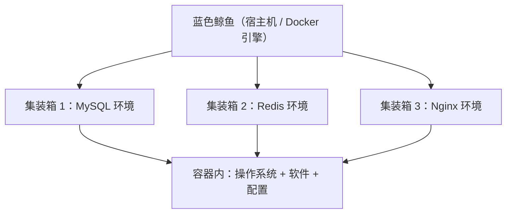

# Docker 不是又一个虚拟机，而是一艘驮着集装箱的鲸鱼

> 🔒 安全提示：文中示例的口令/密钥均为课程教学环境演示口径，生产环境的安全要求见《安全与合规须知》。

聊 Docker 之前得先认识「虚拟化」：它是一类资源管理技术，把服务器、网络、内存、存储这些实体资源抽象出来，让使用者按需取用。我们熟悉的 VMware Workstation 就是在 Windows 上虚拟出一台 Linux 甚至 Mac 主机，一台物理机上能跑多台互不相同的虚拟操作系统。Docker 广义上也属于虚拟化，但它和传统的虚拟机路线不同，它走的是「容器」这条路。

## 先给结论

- Docker 是一种容器技术，不是传统意义上的虚拟机，它共享宿主机内核，启动以秒计、资源占用小。
- 官方 Logo 是蓝色鲸鱼驮着集装箱：鲸鱼是宿主机 / 引擎，集装箱就是容器，每个集装箱里装的是一个完整可运行的环境。
- Docker 最大的现实价值是「环境一键拉起」：不想手动装 MySQL、Redis、Nginx，就直接拉镜像跑起来。
- 选择 Docker 的四点理由：上手快、职责逻辑清晰、软件生命周期高效、天然契合微服务架构。
- Docker 源自 2013 年 dotCloud 公司的内部项目，用 Go 语言实现，基于 LXC 做了易用性封装。

## 一、虚拟化与 Docker 的定位

虚拟化解决的问题是「把一份硬件资源切成多份按需分配」。技术形态很多：软件虚拟化、硬件虚拟化、内核虚拟化、网络虚拟化（VPC）、桌面虚拟化、服务虚拟化，以及最常见的虚拟机。

Docker 也是虚拟化家族的一员，但归类在「容器虚拟化」下。它和虚拟机的本质差异会在另一篇「容器与虚拟机比较」里展开，这里先记住一点：Docker 不虚拟一整套操作系统，而是把应用和它依赖的环境打包在一起，跑在宿主机的操作系统之上。

## 二、从 Logo 理解 Docker：鲸鱼与集装箱

Docker 的图标很说明问题，理解它就理解了 Docker 的设计哲学。



图里的逻辑是：鲸鱼负责运输，每个集装箱彼此隔离、各自装好一套环境，吊上船就能跑，卸下来换台机器也能跑。直接把货物（软件）堆在船板上最难打理，装进集装箱（容器）后，搬运、复制、分发都变得规整。

## 三、Docker 解决的真问题：环境搭建太烦

实际开发里最磨人的往往不是写代码，而是搭环境：Redis、MySQL、MongoDB、Nginx 这类软件，每台机器都要一步步安装配置。Docker 把这件事简化成一条命令。

```bash
# 拉取 MySQL 镜像并启动一个容器，映射 3306 端口
docker run -d -p 3306:3306 -e MYSQL_ROOT_PASSWORD=123456 mysql:8

# 拉取 Nginx 镜像并启动，映射 80 端口
docker run -d -p 80:80 nginx
```

不想用现成镜像，也可以把自己装好环境、改好配置的容器打包成镜像，发给同事直接运行，环境完全一致。这正是 Docker 让开发、测试、运维三方都受益的地方：开发阶段的环境，测试能原样拿去测，测完再原样搬到生产。

## 四、为什么选择 Docker：四点理由

**第一，上手快。** Docker 依赖「写时复制」（copy-on-write）模型，修改应用非常迅速。大多数容器启动不到 1 秒，因为去除了虚拟机管理程序（Hypervisor）的开销，单机可以跑更多容器，资源利用率更高。

**第二，职责的逻辑划分清晰。** 开发者只关心容器内跑的应用，运维只关心怎么管理容器。环境一致了，「开发环境能跑、生产环境报错」这类因环境差异引发的扯皮就大幅减少。

**第三，软件生命周期更高效。** 环境配置这种耗时工作在 Docker 化之后被省下，开发、测试、部署、上线的节奏都更快。

**第四，鼓励面向服务的架构。** 当下流行的微服务，和 Docker 几乎是绑定关系：绝大多数微服务都用 Docker 部署，Docker 可以说是为微服务而生的技术。

## 五、Docker 的来路

Docker 诞生于 2013 年初，最初是 dotCloud 公司的内部项目，用 Google 推出的 Go 语言实现。后来项目加入 Linux 基金会，遵从 Apache 2.0 许可证，代码在 GitHub 上维护。dotCloud 公司随后改名为 Docker Inc.，Red Hat 在 RHEL 6.5 中集中支持 Docker，Google 也在其 PaaS 产品中广泛使用。

技术底座上，Docker 基于 Linux 容器（LXC）做了进一步封装，让用户不必关心容器的底层管理，操作容器就像操作一个快速轻量级的虚拟机一样简单。

## 常见误区

- **Docker 就是虚拟机**：错。Docker 是容器，共享宿主机内核，不虚拟完整 Guest OS，启动速度和资源占用都远优于虚拟机。
- **拉镜像就一定能跑通业务**：错。镜像只提供环境，业务代码、数据卷挂载、端口映射仍需自己配置，否则容器起来了服务也连不上。
- **所有环境差异都能被 Docker 抹平**：错。Docker 解决的是应用运行环境的差异，宿主机内核版本、特定硬件驱动等底层差异仍需关注。
- **容器等于镜像**：错。镜像是静态模板，容器是运行实例，一个镜像可以启动多个容器。

## 面试可能被问到的问题

1. 面试官追问：「Docker 是什么，它和虚拟化是什么关系？」
   答：Docker 是一种容器技术，广义上属于虚拟化技术的一种，但它虚拟的是应用运行环境而非完整操作系统，共享宿主机内核，比传统虚拟机更轻量。

2. 面试官追问：「Docker 的 Logo 想表达什么？」
   答：蓝色鲸鱼代表宿主机 / Docker 引擎，背上的集装箱代表容器，每个容器里装有一套完整可运行的环境。寓意是环境被标准化成集装箱，方便运输、复制和分发。

3. 面试官追问：「为什么 Docker 启动这么快？」
   答：因为容器直接复用宿主机内核，不需要像虚拟机那样引导一套完整操作系统；同时借助写时复制机制，创建容器只是复制可写层，所以通常不到 1 秒即可启动。

4. 面试官追问：「Docker 和微服务有什么关系？」
   答：微服务强调服务独立部署与伸缩，Docker 容器天然轻量、隔离、启动快，非常适合把单个微服务打包成镜像独立部署，因此二者经常一起使用。

5. 面试官追问：「Docker 和 LXC 有什么区别？」
   答：LXC 是底层的 Linux 容器技术，Docker 在 LXC 之上做了易用性封装，屏蔽了容器管理的复杂细节，提供镜像、仓库、Dockerfile 等一整套工作流，让操作容器像操作轻量虚拟机一样简单。

## 配套资料

- 本课为 Docker 概念篇（「什么是 Docker」），无配套源码工程，属概念讲解章节。
- 文中 `docker run` 命令为说明 Docker「环境一键拉起」能力的示例，正式命令参数在后续镜像与容器命令章节详讲。
- Docker 起源（dotCloud、Go 语言、LXC、Apache 2.0 许可）信息来自课程画面 PPT 实录。
