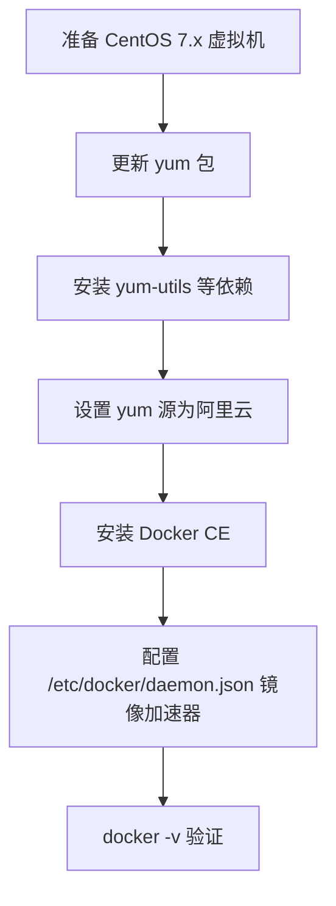

# 在 CentOS 7 上把 Docker 装起来：yum 源、社区版与镜像加速器

很多人卡在 Docker 的第一步不是命令不会敲，而是装完发现拉镜像慢得离谱，或者装到一半报一堆依赖错误。这一篇把在 CentOS 7 上安装 Docker CE 的完整步骤理清：选对系统版本、换国内 yum 源、装社区版、配镜像加速器。照着走一遍，环境就能直接用了。

## 先给结论

- Docker 官方建议装在 Ubuntu，但课程用的 CentOS 7.x 同样支持，务必用 7.x 及以上，6.x 会有依赖和补丁问题。
- 安装的是 Docker CE（社区版），这是免费的；EE（企业版）才收费，学习阶段用不到。
- 安装前必须先把 yum 源换成阿里云，否则后续拉取镜像默认连国外站点，速度极慢甚至连不上。
- 装完用 `docker -v` 验证版本，课程环境是 `18.06.1-ce`。
- 镜像加速器写在 `/etc/docker/daemon.json`，这是解决「拉镜像慢」的根本办法。

## 一、为什么是 CentOS 7，以及宿主机是什么

Docker 本身基于 Ubuntu 发布，官方文档也以 Ubuntu 为准。但课程里统一用 CentOS 7，原因很简单：学习阶段已经在用 CentOS，没必要为了 Docker 再换一套系统。CentOS 版本要选 7.x，6.x 内核较旧，很多 Docker 所需的驱动补丁不支持，装上后各种报错。

课程提供的是已经装好桌面的 CentOS 7 虚拟机镜像（.vmx 文件，双击即可挂到 VMware 启动）。启动后用 `ip addr` 查到系统 IP（例如 `192.168.184.141`），通过 SSH 工具远程连上去操作。这里要建立一个重要概念：**运行 Docker 的那台机器叫宿主机（Host）**，后面命令里反复出现的「宿主机目录」「宿主机端口」，指的就是这台 CentOS 机器本身。

安装与配置的整体流程如下：



图里最关键的是 D 和 F 两步：换源解决「装得快」，配加速器解决「拉得快」，两个都不能省。

动手前可以先确认内核版本：Docker 要求内核 3.10 以上，`uname -r` 一看便知。CentOS 7 的内核一般满足要求，但如果手里是更老的系统，先升内核再装 Docker，能省掉后续很多诡异报错。

## 二、安装步骤：逐条命令

下面这组命令是课程实录的安装流程，建议一条条执行，不要合并跳过。

```bash
# 1. 把 yum 包更新到最新
sudo yum update

# 2. 安装必要软件包。yum-utils 提供 yum-config-manager，
#    后两个是 devicemapper 存储驱动的依赖
sudo yum install -y yum-utils device-mapper-persistent-data lvm2

# 3. 设置 yum 源为阿里云（不设置则默认连国外站点）
sudo yum-config-manager --add-repo http://mirrors.aliyun.com/docker-ce/linux/centos/docker-ce.repo

# 4. 安装 Docker 社区版
sudo yum install docker-ce

# 5. 验证安装结果
docker -v
```

**第一，第 2 步的 `device-mapper-persistent-data` 和 `lvm2` 不能省。** 它们是 devicemapper 存储驱动的依赖，CentOS 7 默认用这个驱动管理镜像和容器的分层存储，缺了装完 Docker 也起不来。

**第二，第 3 步的 yum 源是安装成败的分水岭。** 课程里用的是阿里云镜像站，把 `docker-ce` 的仓库地址指到国内。如果不换源，后续 `yum install docker-ce` 会去连国外官方源，网络不通就直接失败。

**第三，第 4 步要装的是 `docker-ce` 不是 `docker`。** 从 1.13 版本起 Docker 拆成 CE（社区版，免费）和 EE（企业版，收费）两条线，学习一律装 CE。

再补两个细节：命令前面的 `sudo` 表示以管理员权限执行，普通用户操作 yum 时需要它；第 1 步的 `yum update` 在新装系统上要花几分钟，作用是把系统软件包升到最新，减少后面装 Docker 时的版本冲突。每条命令执行完留意终端输出，报错就停下来看清原因，比一路闷头跑完再回头排查轻松得多。

## 三、配置镜像加速器

装好 Docker 之后，默认拉取镜像是从 Docker Hub（国外）下载，速度很慢。解决办法是修改守护进程的配置文件 `/etc/docker/daemon.json`，把注册中心地址指向国内镜像站（课程用的是 ustc 镜像）：

```json
{
  "registry-mirrors": ["https://docker.mirrors.ustc.edu.cn"]
}
```

这个文件用 `vi /etc/docker/daemon.json` 编辑，写进去后保存退出，再重启 Docker 服务即可生效（重启命令在下一篇讲）。配好之后，所有 `docker pull` 都会先走这个加速器，下载速度会有质的提升。

加速器地址不止一家，ustc 之外还有网易云等镜像站，选一个当时可达的即可；某个加速器失效了，换一个地址重写这个文件再重启就行。配置是否生效，可以在拉镜像时观察下载速度，也可以执行 `docker info` 查看输出里 `Registry Mirrors` 一栏有没有自己的配置。

## 常见误区

- **在 CentOS 6.x 上硬装 Docker**：内核和补丁不满足要求，装上后 daemon 起不来，各种驱动报错。务必升级到 7.x。
- **漏掉换 yum 源**：直接用默认源装 `docker-ce`，连不上国外站点，安装失败或卡死。
- **把 `docker-ce` 写成 `docker`**：旧仓库里 `docker` 包指向老版本，装出来的不是社区版 CE，功能缺失。
- **以为装完就能快拉镜像**：没配 `daemon.json` 加速器，pull 仍然直连 Docker Hub，慢得无法忍受。
- **`daemon.json` 写成普通文本却不重启**：配置文件改了但守护进程没重新加载，镜像地址没生效。
- **JSON 格式写错还以为配置无效**：多余的逗号、少了引号都会让守护进程读不出配置，改完先用 `cat` 检查一遍再重启服务。

## 面试可能被问到的问题

1. 面试官追问：「Docker CE 和 EE 有什么区别？`
   答：CE 是社区版，免费，面向个人和中小团队学习使用；EE 是企业版，收费，提供官方支持、安全加固和更长周期维护。学习阶段装 CE 即可。

2. 面试官追问：「为什么安装前要把 yum 源换成阿里云？`
   答：默认 yum 源指向 Docker 官方国外仓库，国内网络访问慢甚至不通，会导致安装失败或极其缓慢。换成阿里云镜像站后，下载走国内节点，速度快且稳定。

3. 面试官追问：「`/etc/docker/daemon.json` 是干什么的？`
   答：它是 Docker 守护进程的配置文件，最常见的用途是配置 `registry-mirrors` 镜像加速器地址，让镜像拉取走国内中转，避免直连 Docker Hub 的慢速问题。

4. 面试官追问：「验证 Docker 是否安装成功用什么命令？`
   答：用 `docker -v`（或 `docker version`）查看客户端版本，能正常输出 `18.06.1-ce` 这类版本号即说明安装成功。

5. 面试官追问：「`device-mapper-persistent-data` 和 `lvm2` 是做什么的？`
   答：它们是 devicemapper 存储驱动的依赖包。CentOS 7 上 Docker 默认使用 devicemapper 管理镜像分层和容器存储，缺少这两个包守护进程无法正常初始化存储驱动。

## 配套资料

- 本课为 Docker 安装入门，阶段一 `materials/code/01/` 下无对应的 Docker 源码工程，文中所有命令与 `daemon.json` 配置均取自课程录屏实录（merged.md 画面线），已还原 ASR 误写（如 `device-Mapper` 还原为 `device-mapper`、`YAML` 还原为 `yum`、`Docker -v` 还原为 `docker -v`）。
