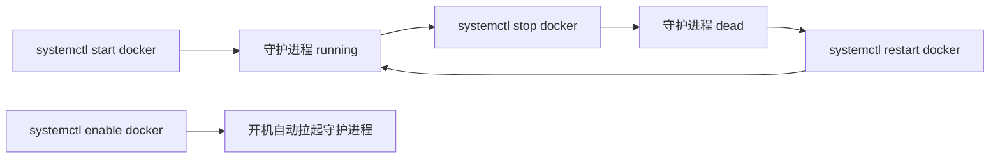

# Docker 怎么启、怎么停：systemctl 管服务，info 看状态

装好 Docker 之后，它并不是一个随开随用的命令，而是一个需要在后台常驻运行的服务。很多新手敲 `docker ps` 报「连接被拒绝」，其实不是命令错了，而是守护进程根本没启动。这一篇讲清楚 Docker 服务的启动、停止、重启、开机自启，以及如何确认它确实活着。

## 先给结论

- Docker 是 CS 架构的常驻服务，必须先启动守护进程，客户端命令才能用；没启动就敲命令会报连接错误。
- 启停服务统一用 systemd 的 `systemctl`：`start`、`stop`、`restart`、`status`、`enable`。
- 改了 `daemon.json` 这类配置后，要 `restart` 而不是只 `stop` 再 `start`，否则新配置不生效。
- `systemctl enable docker` 让 Docker 开机自动启动，服务器重启后不用手动拉起。
- `docker info` 看守护进程概要，`docker --help` 列出全部子命令，是排查和学习的入口。

## 一、先配镜像加速器，再启动服务

在启动之前，如果环境是从零搭建的，需要先确认镜像加速器已经写好。这个配置写在 `/etc/docker/daemon.json`，内容是注册中心的国内镜像地址：

```json
{
  "registry-mirrors": ["https://docker.mirrors.ustc.edu.cn"]
}
```

课程环境里这一步已经提前配好，所以你拿到的机器不用自己改。但记住：只要是全新搭的环境，就必须先完成这一步，否则后面拉镜像会慢到没法用。配置改完要重启守护进程才能加载，这就是下面 `restart` 命令存在的意义。

先把 CS 架构这件事说透：敲 `docker ps` 的是客户端，真正干活的是后台守护进程 dockerd，客户端通过本地套接字与它通信。理解了这一点，「连接被拒绝」这类报错就有了翻译：客户端在，服务端不在。服务端由 systemd 统一托管，启停它就是启停 Docker 本身，这也是下面五条命令的由来。

## 二、启动与停止：systemctl 五板斧

Docker 服务由 systemd 托管，所有启停动作都通过 `systemctl` 操作。注意命令里的服务名是 `docker`（小写），不是 `Docker`。

```bash
# 启动 Docker 服务
systemctl start docker

# 查看服务状态：active (running) 表示已启动，inactive (dead) 表示已停止
systemctl status docker

# 停止 Docker 服务
systemctl stop docker

# 重启 Docker 服务（修改配置后务必用它）
systemctl restart docker

# 设置开机自动启动
systemctl enable docker
```

`systemctl status docker` 的输出里，最关键的一行是 `Active: active (running)`。看到它就说明守护进程活着，客户端命令可以正常执行；如果显示 `inactive (dead)`，说明服务停了，敲任何 `docker` 命令都会失败。

启动、停止、重启三者的关系可以这样看：



图里 `restart` 是一条独立的便捷路径：它等价于先 `stop` 再 `start`，但用一条命令保证配置被重新加载，比手动两步更稳妥。

status 输出里还有两段值得会看：Loaded 一行显示服务单元文件路径与是否开机自启（enabled 或 disabled），正好能验证 `enable` 有没有生效；下面紧跟的进程信息能看到 dockerd 的启动命令与参数。遇到服务起不来时，status 里贴出的报错日志片段是定位问题的第一手材料。还有个小技巧：`systemctl is-active docker` 会直接输出 active 或 inactive，写自动化脚本判断状态时比肉眼读 status 方便得多。

## 三、确认服务与工作概况

服务起来之后，有两件事值得马上做：确认它能响应、看清它当前的状态。

`docker info` 输出守护进程的详细信息，包括版本、存储驱动、镜像仓库、已配置的镜像加速器等。课程环境的输出里有这些关键字段：

```bash
docker info
# Server Version: 18.06.1-ce
# Storage Driver: overlay2
# Registry: https://index.docker.io/v1/
# Registry Mirrors:
#  https://docker.mirrors.ustc.edu.cn
```

`Storage Driver: overlay2` 说明容器用的是 overlay2 联合文件系统，这是 Docker 现代版本推荐的分层存储驱动；`Registry Mirrors` 那一行则证明前面配的加速器确实生效了。

想知道 Docker 一共提供哪些命令，不用死记，直接查帮助：

```bash
docker --help
```

它会列出所有子命令并附一句说明，比如 `build`（从 Dockerfile 构建镜像）、`run`（在新容器里执行命令）、`ps`（列出容器）、`images`（列出镜像）等。后续每一篇学的都是这里的某一个子命令。

用帮助文档要养成习惯：忘了参数就 `docker 命令 --help` 往下翻，例如 `docker run --help` 能看到端口映射、数据卷挂载等选项的完整说明。命令行学习不必背文档，记住「info 看状态、help 查用法」这一对入口，比翻笔记更快也更准。

## 常见误区

- **没启动就敲 `docker ps`**：报连接错误，以为命令写错，其实是守护进程没起，先 `systemctl start docker`。
- **改了 `daemon.json` 只 `stop` 不 `restart`**：手动停了却忘了起，或者起了但配置没重载，镜像加速器不生效。
- **服务名写成 `Docker`**：Linux 下服务名区分大小写，正确是 `docker`，大写会提示找不到单元。
- **以为 `enable` 等于立即启动**：`enable` 只是设开机自启，不会把当前已停止的服务拉起来，想立刻用还得 `start`。
- **装好就以为能用**：漏了镜像加速器，后面 `pull` 直连国外，慢到怀疑人生。
- **看到 running 就以为一切正常**：active (running) 只代表进程活着，环境是否可用还要用 `docker info` 或跑一个测试容器确认，服务状态和实际可用性是两回事。

## 面试可能被问到的问题

1. 面试官追问：「敲 `docker ps` 报连接被拒绝，可能是什么原因？`
   答：最可能的是 Docker 守护进程没启动。Docker 是 CS 架构，客户端命令需要连服务端，先用 `systemctl status docker` 看状态，若是 inactive 就 `systemctl start docker` 拉起再试。

2. 面试官追问：「改了 `daemon.json` 之后为什么要 restart？`
   答：守护进程只在启动时读取配置文件，运行中修改不会自动生效。用 `systemctl restart docker` 让它重新加载配置，新加的镜像加速器等设置才会起作用。

3. 面试官追问：「`start`、`stop`、`restart` 分别做什么？`
   答：`start` 启动守护进程，`stop` 停止它，`restart` 等价于先 stop 再 start，常用于让配置改动生效。三者都由 systemd 的 `systemctl` 管理，服务名是 `docker`。

4. 面试官追问：「`enable` 和 `start` 有什么区别？`
   答：`start` 是当下把服务拉起来，`enable` 是把服务设为开机自动启动，不影响当前状态。想要服务器重启后 Docker 自动运行，用 `systemctl enable docker`。

5. 面试官追问：「`docker info` 能看到什么？`
   答：它输出守护进程的概要信息，包括服务端版本、存储驱动（如 overlay2）、镜像仓库地址、已配置的镜像加速器（Registry Mirrors）、容器与镜像数量等，是确认环境状态的首选命令。

## 配套资料

- 本课为 Docker 服务管理入门，阶段一 `materials/code/01/` 下无对应的 Docker 源码工程，文中 `systemctl` 命令与 `daemon.json` 配置、`docker info` 输出均取自课程录屏实录（merged.md 画面线），已还原 ASR 误写（如 `diamond.json` 还原为 `daemon.json`、`DAO客` 还原为 `docker`）。
