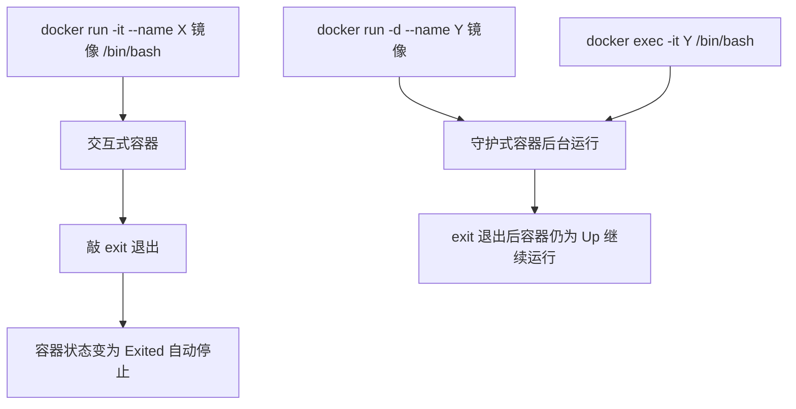

# 从镜像跑出容器：交互式与守护式两种创建方式

镜像是模板，真正干活的是容器。这一篇讲怎么用 `docker run` 把镜像变成运行中的容器，怎么用 `docker ps` 查看它们在不在跑，以及退出容器时为什么有的会停、有的不停。这是之后部署任何服务的基础动作。

## 先给结论

- `docker ps` 看正在运行的容器，`-a` 看全部（含已退出的），`-l` 看最近一个，`-f status=exited` 按状态过滤。
- `docker run -it --name 名称 镜像 /bin/bash` 是交互式创建：进去后能敲命令，敲 `exit` 退出后容器自动停止。
- `docker run -d --name 名称 镜像` 是守护式创建：后台运行，退出容器不会停，适合长期服务。
- 进守护式容器用 `docker exec -it 名称 /bin/bash`，退出后容器依然在跑。
- 容器名必须唯一，已存在（哪怕已停止）的名称不能重复用于新建。

## 一、查看容器：docker ps

刚装好 Docker 时一个容器都没有，`docker ps` 自然是空的。这条命令列出当前正在运行的容器：

```bash
# 查看运行中的容器
docker ps

# 查看所有容器（含已停止）
docker ps -a

# 查看最近创建的一个容器
docker ps -l

# 只列出已退出的容器
docker ps -f status=exited
```

`docker ps -a` 的输出包含这些列：CONTAINER ID（容器 ID）、IMAGE（基于哪个镜像）、COMMAND（启动时执行的命令）、CREATED（创建时间）、STATUS（状态，Up 表示运行中、Exited 表示已退出）、PORTS（端口映射）、NAMES（容器名）。状态那列的 `Up` 和 `Exited`，相当于一台电脑是开着还是关着。

## 二、创建与启动：docker run 的常用参数

`docker run` 是「创建并启动容器」的核心命令，它后面跟的参解决的是「以什么方式跑」：

- `-i`：运行容器，保持标准输入打开。
- `-t`：分配一个伪终端，启动后能进入容器命令行。常与 `-i` 合写为 `-it`。
- `--name`：给容器命名（双横线，需要跟值），如 `--name mycentos`。
- `-v`：目录映射，把宿主机目录挂载到容器目录，操作宿主机目录等价于操作容器目录。
- `-d`：守护式运行，容器在后台跑，创建后不自动进容器。
- `-p`：端口映射，把宿主机端口映射到容器内端口，从而从外部访问容器服务。

镜像和标签的写法：`centos:7` 冒号后是 TAG，拉的是 `latest` 时可以省略不写。

两种创建方式的整体区别如下：



图里最关键的区别在 D 和 H：交互式一退出容器就停，守护式退出容器照常跑，这正是两种模式最容易被忽视、也最容易在面试里被追着问的点。

## 三、交互式创建：进去即用，exit 即停

交互式的典型用法是进入一个 `centos` 容器里敲命令：

```bash
docker run -it --name mycentos centos:7 /bin/bash
```

`--name mycentos` 给容器起名，`centos:7` 指定用哪个镜像，`/bin/bash` 是容器启动后执行的命令（加载 CentOS 命令行）。回车后命令提示符会变成容器内部的环境，说明你已经「进到」这个容器里了，在里面可以执行 `ls` 等 Linux 命令，就像操作一台虚拟的小服务器。

这时候另开一个窗口执行 `docker ps`，能看到 `mycentos` 状态是 `Up`。在容器里敲 `exit` 退回宿主机后，再 `docker ps` 查不到它，用 `docker ps -a` 才看到它，状态是 `Exited`（相当于关机）。由此得出一个结论：**交互式容器一旦退出就自动停止**。

## 四、守护式创建：后台常驻，exec 进出

守护式创建适合跑长期服务，加 `-d` 参数：

```bash
docker run -d --name mycentos2 centos:7
```

回车后会打印一长串容器 ID，代表创建成功。此时命令行仍然在宿主机上（没有进容器），`docker ps` 能看到 `mycentos2` 是 `Up` 状态。

要进这个后台容器，用 `exec`：

```bash
docker exec -it mycentos2 /bin/bash
```

进去后照样能看目录结构，敲 `exit` 退出来。再 `docker ps` 查看，`mycentos2` 依然是 `Up`。这就是守护式和交互式的根本差别：**用 `exec` 进出，退出不会让容器停止**。

**第一，容器名必须唯一。** 即使 `mycentos` 已经退出，它的名字仍被占用，再建一个叫 `mycentos` 的会报名称重复。所以第二个容器改叫 `mycentos2`。

**第二，`-v` 和 `-p` 这里先混个眼熟。** 目录映射 `-v` 和端口映射 `-p` 是部署真实服务的关键，这一节只是创建容器不演示，后续章节会专门展开。

## 常见误区

- **以为 `docker ps` 能看所有容器**：它只列运行中的，要看已退出的必须加 `-a`。
- **交互式容器 exit 后以为还在跑**：交互式退出即停止，需用 `docker ps -a` 才能看到 Exited 状态。
- **守护式容器也用 exit 想停它**：exit 只是退出 exec 会话，容器继续运行，要停得用 `docker stop 名称`。
- **新建容器用了已存在（含已停止）的名字**：名称全局唯一，重复会报错，换个名字或先删旧的。
- **`-it` 和 `-d` 混用场景搞反**：想长期跑服务却用了交互式，一退出服务就没了。

## 面试可能被问到的问题

1. 面试官追问：「`docker run -it` 和 `docker run -d` 有什么区别？`
   答：`-it` 是交互式，创建后进入容器命令行，敲 `exit` 退出容器会自动停止；`-d` 是守护式，容器在后台运行，创建后不进容器，`exit` 也不会让它停。长期服务用 `-d`，临时调试用 `-it`。

2. 面试官追问：「怎么进一个正在后台跑的容器？`
   答：用 `docker exec -it 容器名 /bin/bash`。`exec` 是在已运行的容器里再开一个会话，退出后容器继续运行，不影响原服务。

3. 面试官追问：「`docker ps` 和 `docker ps -a` 差在哪？`
   答：`docker ps` 只列状态为 Up 的运行中容器；`-a` 列出全部容器，包括已 Exited 停止的。排查「为什么看不到我的容器」时优先用 `-a`。

4. 面试官追问：「容器名重复了会怎样？`
   答：`--name` 指定的名称在宿主机全局唯一，哪怕旧容器已停止，名字仍被占用。再建同名容器会报名称冲突，需换名或先 `docker rm` 删除旧容器。

5. 面试官追问：「交互式容器 exit 之后为什么查不到？`
   答：交互式容器随会话结束而自动停止，状态变为 Exited。此时 `docker ps`（只看运行中）自然查不到，用 `docker ps -a` 才能看到它停在列表里。

6. 面试官追问：「`-p` 和 `-v` 在 `docker run` 里分别做什么？`
   答：`-p` 是端口映射，把宿主机端口映射到容器内端口，外部通过宿主机端口访问容器服务；`-v` 是目录挂载，把宿主机目录挂到容器目录，两边操作同一份文件。两者都是部署真实应用的常用参数。

## 配套资料

- 本课为 Docker 容器创建与查看入门，阶段一 `materials/code/01/` 下无对应的 Docker 源码工程，文中 `docker ps` / `run` / `exec` 命令及示例（如 `mycentos`、`mycentos2`）均取自课程录屏实录（merged.md 画面线），已还原 ASR 误写（如 `Darker`/`Docs` 还原为 `docker`、`买森头S` 还原为 `mycentos`、`森头S` 还原为 `centos`、`杠并杠半式` 还原为 `/bin/bash`）。
