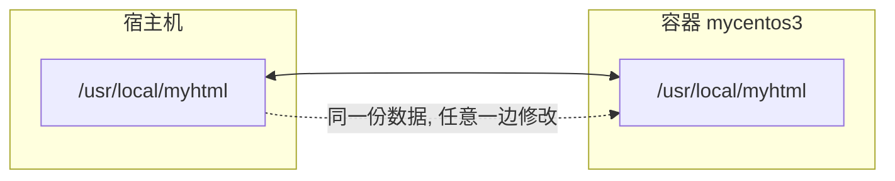
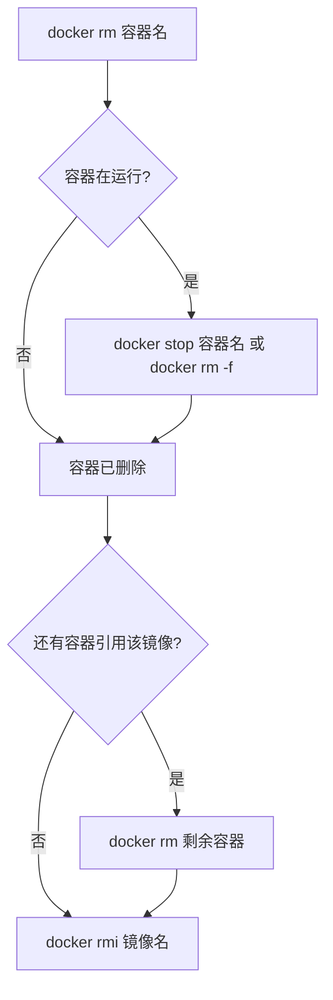

# 目录挂载、查看容器 IP 与删除容器：让宿主机和容器共享目录，并能随时清理

`docker cp` 适合一次性传文件，但真正要长期共享配置、持久化数据，靠反复拷贝就太累了。目录挂载（`-v`）让宿主机的一个目录和容器里的目录实时映射，改哪边另一边都跟着变。再配合查看容器 IP、删除容器这两条运维命令，容器的日常生命周期管理就齐了。

## 先给结论

- 创建容器时用 `-v /宿主机目录:/容器内目录` 建立挂载，两边目录互为镜像，任意一边修改对方立即可见。
- 挂载的目标目录如果宿主机上不存在，Docker 会自动创建，不用提前建好。
- 查看容器全部信息用 `docker inspect`，只看 IP 用 `--format='{{.NetworkSettings.IPAddress}}'` 过滤。
- 删除容器用 `docker rm`，但运行中的容器删不掉，必须先 `docker stop`，或者用 `docker rm -f` 强制。
- 删除镜像用 `docker rmi`，只要还有容器（哪怕已停止）引用该镜像，镜像就删不掉，得先把相关容器清掉。

## 一、目录挂载：宿主机和容器的实时共享

挂载的本质是「映射」：创建容器时通过 `-v` 把宿主机的某个目录和容器内的某个目录绑在一起，此后它们指向同一份数据。挂载命令有两种常见写法：

```bash
# 基础写法：宿主机目录:容器内目录
docker run -v /宿主机目录:/容器内目录 容器名:镜像名

# 常用写法：后台运行 + 挂载 + 命名
docker run -d -v /宿主机目录:/容器内目录 --name=容器名 镜像名
```

实际演示里，我们创建一个带挂载的容器，把宿主机的 `/usr/local/myhtml` 挂到容器里同名目录：

```bash
docker run -di --name=mycentos3 -v /usr/local/myhtml:/usr/local/myhtml centos:7
```

**第一，挂载目录不需要提前存在。** 上例里宿主机的 `/usr/local/myhtml` 原本是空的、甚至不存在，Docker 会帮你自动建好。进了容器之后 `cd /usr/local/myhtml`，初始是空的，符合预期。

**第二，验证双向同步最简单的方式是在宿主机写文件。** 在宿主机那个目录里新建一个 `test` 文件、写入 `AAA`，再 `exec` 进容器看同一个目录，会立刻看到同名文件、内容一致。反过来在容器里改，宿主机也马上能看到。这就是「实时映射」和 `docker cp` 快照拷贝的根本区别。

```bash
# 宿主机侧：在挂载目录里建文件
vi /usr/local/myhtml/test
# 写入 AAA 并保存

# 容器侧：进入容器查看同一目录
docker exec -it mycentos3 /bin/bash
cd /usr/local/myhtml
cat test
# 输出 AAA，说明挂载生效
```

挂载关系可以这么理解：



箭头是双向的，宿主机写 `test` 容器立刻可见，容器里改文件宿主机也同步，这正是配置文件、日志、上传目录最常使用挂载的原因。

## 二、查看容器 IP：docker inspect 与其过滤

容器在自定义网络里会分到 IP，排障、做服务间调用时经常要查。最直接的是 `docker inspect`，它会把容器的全部配置和状态以 JSON 形式打印出来，从 `NetworkSettings` 下的 `IPAddress` 字段就能找到。

```bash
# 查看容器全部信息（内容很多，包含网络、挂载、状态等）
docker inspect mycentos3

# 只提取 IP 地址
docker inspect --format='{{.NetworkSettings.IPAddress}}' mycentos3
```

**第一，`--format` 是按 JSON 路径逐层下钻的。** 花括号是两层嵌套 `{{ }}`，里面用点号 `.` 串起字段层级：`.NetworkSettings.IPAddress` 表示从根对象进 `NetworkSettings`，再取它的 `IPAddress`。想取别的信息，照着 inspect 输出里的字段路径换一层即可，比如看网关就是 `.NetworkSettings.Gateway`。

**第二，容器没连自定义网络时可能拿不到 IP。** 默认 `bridge` 网络下一般会有，但若容器用 `--network none` 启动，IPAddress 会是空字符串，这时要回头检查网络模式，而不是怀疑命令写错。

## 三、删除容器与镜像：清理的先后顺序

删除容器用 `rm`，但 Docker 默认不允许删正在运行的容器：

```bash
# 直接删运行中的容器会报错
docker rm mycentos3
# Error response from daemon: You cannot remove a running container ...

# 正确顺序：先停再删
docker stop mycentos3
docker rm mycentos3

# 不想分两步，可以强制删（含停止动作）
docker rm -f mycentos3
```

镜像的删除命令是 `rmi`，它和容器是两套：

```bash
# 删除镜像
docker rmi centos
```

**第一，`rm` 管容器，`rmi` 管镜像，别混。** 这是新手最易记反的一对。

**第二，有容器引用时镜像删不掉。** 只要还有容器（即便已停止）基于某镜像创建，执行 `docker rmi` 会报冲突：`container xxx is using its referenced image`。必须先把相关容器 `rm` 掉，镜像才能删。清理顺序永远是「停容器、删容器、再删镜像」。



图里这条链路的要点是：容器是镜像的实例，实例还在，镜像就卸不掉，顺序不能乱。

## 常见误区

- **把 `-v` 挂在容器已存在的非空目录上**：挂载会遮蔽容器内原目录的内容，比如把空目录挂到 Tomcat 的 `webapps` 上，原来的欢迎页会「消失」，看起来像部署失败，其实是被宿主机空目录盖住了。
- **以为 `docker cp` 和挂载是一回事**：cp 是一次性快照，挂载是实时双向同步，长期共享必须用挂载。
- **想删镜像却忘了先删容器**：报冲突时先 `docker ps -a` 把引用该镜像的容器清掉。
- **`--format` 的括号只写一层**：必须是 `{{.NetworkSettings.IPAddress}}` 两层花括号，少一层 inspect 会报模板语法错误。

## 面试可能被问到的问题

1. 面试官追问：「Docker 的目录挂载和 `docker cp` 有什么区别？」
   答：挂载（`-v`）在创建容器时建立宿主机目录与容器目录的实时映射，两边任一处修改另一处立即可见，适合配置和数据持久化；`docker cp` 是执行那一刻的单向快照拷贝，之后两边互不影响，适合临时传文件或取日志。

2. 面试官追问：「`-v` 挂载时宿主机目录不存在会怎样？」
   答：Docker 会自动创建该目录（以及必要的父目录）再完成挂载，不会报错。但要注意自动创建出来的是空目录，若挂到容器内原本有内容的目录上，原内容会被遮蔽。

3. 面试官追问：「怎么只查容器的 IP 地址？」
   答：用 `docker inspect --format='{{.NetworkSettings.IPAddress}}' 容器名`，通过 Go 模板按 JSON 路径提取。若返回空，先确认容器是否连了能分配 IP 的网络模式。

4. 面试官追问：「为什么 `docker rm` 删不掉运行中的容器？」
   答：Docker 出于安全默认禁止删除运行中的容器，避免误杀正在提供服务的实例。可以先 `docker stop` 再 `docker rm`，或者直接用 `docker rm -f` 强制（内部先发停止信号）。

5. 面试官追问：「`docker rm` 和 `docker rmi` 的区别是什么？」
   答：rm 删除的是容器（镜像的运行时实例），rmi 删除的是镜像本身。只要还有容器引用某镜像，rmi 就会冲突失败，必须先删掉相关容器才能删镜像。

6. 面试官追问：「删除镜像提示被容器占用，怎么处理？」
   答：先用 `docker ps -a` 找出引用该镜像的所有容器，把它们 `docker rm` 掉（运行中的先 stop），确认没有残留实例后，再执行 `docker rmi` 即可。

## 配套资料

- 本课为 Docker 命令行操作课，课程资料包中没有对应的 Java 工程或部署脚本，正文命令均来自课程实录（已还原术语：宿主机、目录挂载等）。
- 目录挂载的基础（`-v`）与停止/启动命令可对照同章节前序课程复习。
