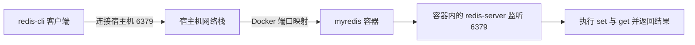

# 用 Docker 起一个 Redis，并让外部客户端连上去

本地装 Redis 的问题不在于难，而在于碎：Windows 要找移植版，Linux 要配源或者编译，端口被占、配置没改、防火墙没开，三种情况的表现都是同一个「连不上」。换台机器再装一遍，谁也不敢保证装出来的版本和行为完全一致。

用 Docker 部署 Redis，把这些变量收敛成一条 `docker run`。这篇讲的就是容器怎么起、端口怎么映射、怎么用客户端验证连接，以及应用里的 Redis 地址到底该填什么。

## 先给结论

- 起服务只需要一条命令：`docker run -d --name=myredis -p 6379:6379 redis`，课程镜像已预置，`docker pull redis` 可省。
- 容器里的 Redis 默认监听 6379，`-p` 要写成「宿主机端口:6379」，宿主机端口可以换，容器端口不能随便改。
- 外部客户端连的是**宿主机 IP 加宿主机端口**，不是容器 IP，这就是端口映射的意义。
- 验证连接用 `redis-cli -h 宿主机IP -p 端口`，不加 `-h` 默认连本机 127.0.0.1。
- 课件里出现过 `-p 8080:8080 redis` 的写法，那是笔误，容器端口必须是 6379。

## 一、从镜像到容器

Redis 镜像的用法和 Nginx、MySQL 一致，先确保本地有镜像，再基于镜像建容器。课程环境里镜像已提前下载，直接建容器即可：

```bash
# 本地已有镜像时可省略
docker pull redis

# 后台启动，命名 myredis，端口映射 6379 到 6379
docker run -d --name=myredis -p 6379:6379 redis

# 确认容器在运行
docker ps
```

**第一，`-d` 让容器在后台跑。** 不加 `-d` 的话终端会被 Redis 日志占住，关掉终端容器也就停了。

**第二，`-p 6379:6379` 是外部能连上的唯一原因。** 容器有独立网络栈，Redis 在容器里监听 6379，宿主机外面看不见。映射之后，访问宿主机 6379 的流量会被转发进容器。宿主机端口可以自由换成 16379，容器那侧保持 6379 不动。

## 二、端口映射到底转了什么

把请求路径拆开看，就明白为什么客户端填的地址是宿主机地址：



图里真正被映射的是「宿主机端口」这一跳：客户端以为自己在连一台装了 Redis 的机器，实际上那台机器上只有一条转发规则，真正的 redis-server 在容器里。

## 三、用客户端验证连接

课程演示用的是 Windows 版的 Redis 客户端包，目录里有 `redis-cli.exe` 和 `redis-server.exe` 两个程序，`cli` 是客户端，`server` 是服务端。验证连通性只需要前者：

```bash
# 不带参数，连的是本机 127.0.0.1:6379
redis-cli

# 连远程：加 -h 指定主机，-p 指定端口
redis-cli -h 192.168.164.141 -p 6379
```

连上之后敲几条命令，确认读写链路是通的：

```text
192.168.164.141:6379> set name abc
OK
192.168.164.141:6379> get name
"abc"
192.168.164.141:6379> exit
```

`set` 返回 `OK`、`get` 能取回原值，说明端口映射、容器网络、Redis 服务三处都是通的。想停掉服务用 `docker stop myredis`，再启动用 `docker start myredis`。

## 四、应用里该填哪个地址

应用连容器里的 Redis，填的是**宿主机的 IP**，因为端口映射对外暴露的是宿主机。课程源码里 Spring Boot 连接 Redis 的配置就很直观（取自真实工程，包名已做中性化处理）：

```yaml
spring:
  redis:
    host: 127.0.0.1 # redis 的主机 ip，应用与 redis 同机时填本机
    port: 6379
```

应用和 Redis 不在同一台机器上时，把 `host` 换成 Redis 所在宿主机的 IP，`port` 换成映射出去的宿主机端口。工程里操作 Redis 的 key 通常会统一构造，课程源码的工具类就是这么做的（取自真实文件）：

```java
package com.example.common.util;

public class RedisUtil {

    public static final String KEY_PREFIX = "SJ_PAY_PARAM";
    private static final String KEY_SPLIT_CHAR = ":";

    /**
     * redis 的 key 键规则定义
     * @param prefix 项目前缀
     * @param module 模块名称
     * @param func 方法名称
     * @param args 参数
     * @return key
     */
    public static String keyBuilder(String prefix, String module, String func, String... args) {
        if (prefix == null) {
            prefix = KEY_PREFIX;
        }
        StringBuilder key = new StringBuilder(prefix);
        key.append(KEY_SPLIT_CHAR).append(module).append(KEY_SPLIT_CHAR).append(func);
        for (String arg : args) {
            key.append(KEY_SPLIT_CHAR).append(arg);
        }
        return key.toString();
    }
}
```

多服务编排时更常见的写法是直接用 compose 声明，课程源码里的这份编排文件是一个真实样本：

```yaml
version: "3"

services:
  redis:
    image: redis:5.0.5
    container_name: redis
    restart: always
    network_mode: "host"
    ports:
      - "6379:6379"
    volumes:
      - ./data:/data
    command: redis-server
    tty: true

  sailing:
    container_name: sailing
    build: .
    image: sailing:1.0-SNAPSHOT
    network_mode: "host"
    ports:
      - "56085:56085"
    restart: always
    depends_on:
      - redis
```

**第一，`command: redis-server` 显式指定启动命令。** `docker run` 时不写命令，走的是镜像默认的启动指令；这里写出来是为了让意图更明确，也便于加参数。

**第二，`volumes: ./data:/data` 把数据落到宿主机。** 不加这行，容器删掉之后 Redis 里的数据跟着容器一起消失，这是新手最容易踩的坑。

**第三，`depends_on` 只保证启动顺序，不保证 Redis 已经可用。** 它只等容器进入 running 状态，不等服务 ready，应用侧仍需有重连或健康检查机制。

## 五、连不上时的排查顺序

连接失败绝大多数不是 Redis 本身的问题，而是下面三处之一：

**第一，端口没映射或映射错了。** `docker ps` 的 `PORTS` 列会显示 `0.0.0.0:6379->6379/tcp`，没有这一行就说明 `-p` 没生效。

**第二，Redis 自己绑了回环地址。** 课程资料里的 Redis 配置文件明确写着这几行：

```text
bind 127.0.0.1
protected-mode yes
port 6379
# requirepass foobared
```

`bind 127.0.0.1` 表示只接受本机连接。容器镜像的默认配置一般是允许外部访问的，但如果你挂进去一份自己的配置文件，就要确认这一行是否被改回了回环地址。`requirepass` 默认被注释掉，一旦打开，客户端连接就必须带密码。

**第三，宿主机防火墙拦了端口。** 容器和端口映射都正常，外部却连不上，先查防火墙是否放行了宿主机端口。

## 常见误区

- **容器端口写成 8080**：课件里有 `-p 8080:8080 redis` 的笔误。Redis 默认监听 6379，把容器端口写成 8080，映射过去的是一个没有服务监听的端口，连接必然被拒。
- **客户端去连容器 IP**：容器 IP 属于 Docker 内部网段，宿主机外面通常不可达。要连宿主机 IP 加映射出来的端口。
- **不加 `-h` 却以为连上了远程**：`redis-cli` 不带参数默认连 127.0.0.1。如果本机恰好也跑着 Redis，命令照样返回 `OK`，连的却不是容器里的那个实例。
- **容器删了数据也没了**：没做 `volumes` 挂载时数据存在容器可写层，`docker rm` 之后一并消失。重要数据必须挂到宿主机目录。
- **进容器手工改配置当持久化**：容器内的手工修改不会进镜像，重建容器就回到原样。改配置应该改挂载进去的配置文件，或者用 Dockerfile 固化。

## 面试可能被问到的问题

1. 面试官追问：「`docker run -p 6379:6379 redis` 里两个 6379 分别指什么？」
   答：冒号左边是宿主机端口，右边是容器端口。左边可以换成任意空闲端口，比如 `-p 16379:6379`；右边必须是容器内 Redis 实际监听的端口，默认 6379，写错就映射到空端口上了。

2. 面试官追问：「为什么客户端连 Redis 容器要连宿主机 IP，而不是容器 IP？」
   答：容器 IP 属于 Docker 创建的内部网络，一般只有宿主机和同一 Docker 网络内的容器能访问。外部客户端能触达的是宿主机，端口映射把宿主机端口的流量转发进容器，所以客户端填宿主机 IP 加宿主机端口。

3. 面试官追问：「Redis 容器删掉后数据还在吗？」
   答：默认不在。没做卷挂载时数据写在容器可写层，随容器删除一起消失。要持久化就用 `-v 宿主机目录:/data` 或 compose 里的 `volumes` 把 `/data` 挂出来，让 RDB 落到宿主机磁盘。

4. 面试官追问：「`redis-cli` 不加 `-h` 连的是谁？」
   答：连的是本机 127.0.0.1 的 6379 端口。想连远程必须显式带 `-h 主机IP`，端口不是默认时再带 `-p`。

5. 面试官追问：「compose 里写了 `depends_on`，Redis 就一定可用了吗？」
   答：不是。`depends_on` 只控制容器的启动顺序，等的是容器进入 running 状态，不等 Redis 完成初始化并开始接受连接。应用侧仍需配置连接重试或健康检查。

6. 面试官追问：「Redis 配置里的 `bind 127.0.0.1` 和 `protected-mode yes` 会带来什么影响？」
   答：`bind 127.0.0.1` 限定 Redis 只监听回环网卡，外部机器连不上，只能本机客户端访问。`protected-mode yes` 是在没有设置密码、也没有显式 bind 时的保护机制，同样拒绝外部连接。要对外提供服务，需要调整 bind 地址并设置 `requirepass`。

## 配套资料

- Redis 容器编排真实样本：`materials/code/10/sailing/sailing/src/main/docker/docker-compose.yml`（含 redis 服务的 `image`、`ports`、`volumes`、`command` 完整写法）
- 应用侧连接配置：`materials/code/01/1.spring boot/1.spring boot/SpringBoot 第一天/代码/springboot/springboot-redis/src/main/resources/application.yml`
- 客户端用法与本地安装步骤：`materials/code/10/sailing/sailing/README.md`（含 `redis-server.exe redis.windows.conf` 与 `redis-cli.exe -h 127.0.0.1 -p 6379` 的原始说明）
- Redis 配置项原文：`materials/code/01/1.spring boot/1.spring boot/SpringBoot 第一天/资料/Redis/redis.windows.conf`（`bind`、`protected-mode`、`port`、`requirepass` 均出自此文件）
- Redis key 构造工具类：`materials/code/10/代码/redis/`（`RedisUtil.java`、`RedisEnum.java`、`RedisCache.java`）
