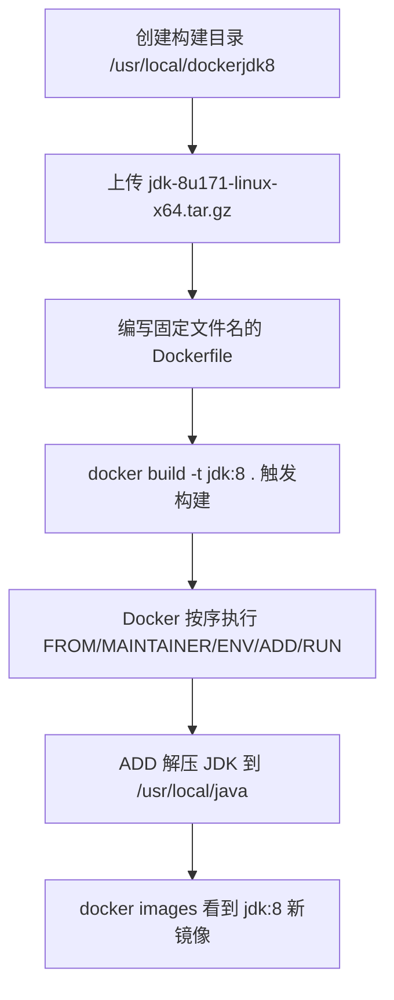

# 用 Dockerfile 把 JDK 1.8 打包成镜像：从一条 FROM 到 `docker build`

微服务部署时，最常见的诉求是「给我一个自带 JDK 的运行环境」。直接把 JDK 安装进容器再 `commit` 也能用，但那种镜像无法重复、无法版本化、换个人就做不出来。真正可维护的做法是用一份 Dockerfile 脚本描述「怎么造出这个环境」，然后让 Docker 按脚本自动构建。这篇就完整地走一遍：从建目录、写脚本，到打出一个能用的 JDK 1.8 镜像。

## 先给结论

- Dockerfile 是一个文本脚本，里面每一条指令对应镜像构建的一个步骤，Docker 会按顺序执行并生成中间层。
- 构建 JDK 镜像的核心是：选一个基础系统镜像（CentOS 7），把 JDK 压缩包 `ADD` 进容器并自动解压，再用 `ENV` 配好 `JAVA_HOME` 和 `PATH`。
- `docker build -t 镜像名 .` 的最后一个点代表「在当前目录找 Dockerfile」，Dockerfile 文件名固定、大小写固定。
- 镜像名里不要带空格，否则后续 `tag` / `push` 都容易出问题，规范写法是 `jdk:8` 这种「仓库：标签」形式。
- 构建成功后在宿主机的 `/usr/local/java` 目录下放的那个 `.tar.gz`，会被原样打进镜像，所以构建目录里必须提前备好这个压缩包。

## 一、Dockerfile 是什么，为什么要用它

Dockerfile 可以理解为「镜像的菜谱」。手工 `docker commit` 做出来的镜像，过程是不可见的、不可复现的；而 Dockerfile 把每一步写成了声明，任何人拿到同一份文件，在同一份基础环境下跑 `docker build`，就能得到一模一样的镜像。

课程里用到的 Dockerfile 常用指令并不多，理解这几个就够撑起绝大多数自定义镜像：

| 指令 | 作用 |
|---|---|
| `FROM 镜像名:标签` | 指定基础镜像，必须是第一条指令 |
| `MAINTAINER 信息` | 声明镜像的创建者，纯描述信息 |
| `ENV 键 值` | 设置环境变量，可写多条，构建期和容器运行期都生效 |
| `RUN 命令` | 在镜像里执行命令，常用来建目录、装软件，可写多条 |
| `ADD 源 目标` | 把宿主机文件拷进容器，遇到压缩包会自动解压 |
| `COPY 源 目标` | 和 `ADD` 类似，但压缩包不会自动解压 |
| `WORKDIR 路径` | 设置后续指令的工作目录 |

`ADD` 和 `COPY` 的区别是新手常问的：如果只是放一个普通文件，两者差不多；但你想把 JDK 的 `.tar.gz` 放进容器并顺手解压，`ADD` 一行就搞定，`COPY` 还需要再补一条 `RUN tar`。

## 二、编写 JDK 8 镜像的 Dockerfile

先建一个专门的构建目录，把 JDK 压缩包和 Dockerfile 放在同一层，这样 `docker build .` 时上下文才找得到压缩包：

```bash
mkdir -p /usr/local/dockerjdk8
# 把 jdk-8u171-linux-x64.tar.gz 上传 / 拷贝到这个目录下
cd /usr/local/dockerjdk8
```

然后在该目录下创建名为 `Dockerfile` 的文件（首字母大写，文件名固定），内容如下。包名、机构信息这类都按中性写法处理：

```dockerfile
# 基础镜像：CentOS 7，本地需已存在，没有会自动拉取
FROM centos:7

# 镜像创建者信息（描述性字段，可填团队标识）
MAINTAINER example-team

# 设置工作目录，后续指令默认在该目录下执行
WORKDIR /usr/local

# 在容器内创建 java 目录
RUN mkdir /usr/local/java

# 把宿主机的 JDK 压缩包加入容器并自动解压
ADD jdk-8u171-linux-x64.tar.gz /usr/local/java/

# 配置 JAVA_HOME（解压后的目录名以实际为准）
ENV JAVA_HOME /usr/local/java/jdk1.8.0_171
ENV JRE_HOME $JAVA_HOME/jre

# 配置 CLASSPATH，注意各路径之间用冒号分隔
ENV CLASSPATH $JAVA_HOME/lib/dt.jar:$JAVA_HOME/lib/tools.jar:$JRE_HOME/lib

# 把 java、jre 的 bin 加入 PATH，使任意目录都能执行 java 命令
ENV PATH $JAVA_HOME/bin:$PATH
```

这里有个细节：`ENV CLASSPATH` 那一行里，路径之间是**冒号**分隔，不是分号也不是空格。另外 `JAVA_HOME` 末尾的目录名 `jdk1.8.0_171` 必须和压缩包解压后真实出现的目录名一致，自己拿不准可以先手动解压看一眼。

## 三、构建与验证

脚本写完，执行构建。注意结尾的点：

```bash
# -t 指定镜像名和标签；最后的 . 表示使用当前目录下的 Dockerfile
docker build -t jdk:8 .
```

构建过程中你会看到 `Step 1/9`、`Step 2/9`……逐条执行，每条指令生成一层，最终打出 `Successfully tagged jdk:8:latest` 就成功了。接着用 `docker images` 验证：

```bash
docker images
# REPOSITORY   TAG       IMAGE ID       CREATED          SIZE
# jdk          8         xxxxxxxxxxxx   xx seconds ago   xxxMB
```

整条构建链路可以这么看：



图里最关键的一环是 `ADD`：它同时完成了「拷贝」和「解压」，省掉了额外的解压指令，这也是为什么构建出来的镜像里直接就有可用的 JDK 目录。

## 四、构建上下文的坑

`docker build` 后面的点不是「随便写个路径」，它定义了**构建上下文（build context）**：Docker 会把该目录下的内容打包发给守护进程，Dockerfile 里 `ADD` / `COPY` 的源路径都相对这个上下文。把压缩包放到别的目录，构建时就会报「找不到源文件」。

**第一，压缩包必须在上下文中。** 放在 `/usr/local/dockerjdk8` 之外再写 `ADD /opt/xxx.tar.gz` 是行不通的，Dockerfile 无法引用上下文之外的绝对路径。

**第二，镜像名带空格是坏习惯。** 原始写法里出现过 `docker build -t "JDK 8" .`，这种带空格的镜像名在后续 `docker tag` / `docker push` 时极易引发解析歧义，统一用 `jdk:8` 这种「仓库：标签」格式最稳妥。

## 常见误区

- **Dockerfile 文件名写错**：写成 `dockerfile.txt`、`DockerFile` 都会导致构建报错「找不到 Dockerfile」，文件名必须严格是 `Dockerfile`。
- **JAVA_HOME 目录名和实际不符**：压缩包解压后的目录名是 `jdk1.8.0_171` 而不是随便写的，写错会导致容器里 `java` 命令执行不了。
- **用 COPY 代替 ADD 又忘记解压**：`COPY` 不会自动解压 `.tar.gz`，结果容器里是一坨压缩包而不是 JDK 目录。
- **构建上下文里没有压缩包**：`ADD` 报 `no such file or directory`，本质是压缩包没放进构建目录。

## 面试可能被问到的问题

1. 面试官追问：「Dockerfile 里的 ADD 和 COPY 有什么区别？」
   答：`COPY` 只做文件拷贝，遇到压缩包不会解压；`ADD` 除了拷贝，还会在源文件是本地压缩包时自动解压，并且支持从 URL 拉取文件。放 JDK 压缩包进镜像时优先用 `ADD` 省一步解压。

2. 面试官追问：「`docker build` 后面的那个点是什么意思？」
   答：点代表构建上下文目录，Docker 会把它打包发给守护进程，Dockerfile 中的 `ADD` / `COPY` 只能引用该目录内的文件。换个说法就是「去这个目录里找 Dockerfile 和需要用到的资源」。

3. 面试官追问：「为什么推荐用 Dockerfile 而不是 docker commit 来造镜像？」
   答：Dockerfile 是声明式脚本，可版本化、可复现、可审查，任何人按同一份文件都能构建出相同镜像；`commit` 出来的镜像是黑盒，过程不可见，无法协作也无法维护。

4. 面试官追问：「ENV 和 RUN export 设置环境变量有什么不同？」
   答：`ENV` 设置的变量会固化进镜像，并且容器运行时依然有效，子进程都能读到；在 `RUN` 里 `export` 的变量只在那条指令执行期间有效，不会持久化到镜像和容器环境。

5. 面试官追问：「FROM 指令为什么必须放第一行？」
   答：Dockerfile 必须基于一个已有镜像来叠加层，后续所有指令都是在这个基础镜像之上操作，`FROM` 就是声明「地基」在哪，所以必须是第一条。前面只允许出现注释和 `ARG`。

6. 面试官追问：「镜像名 jdk:8 里的 8 是什么？」
   答：冒号后面是 tag（标签），用来区分同一仓库下的不同版本。不写标签时默认是 `latest`，但生产环境应显式写清版本号，避免 `latest` 漂移带来的不确定性。

## 配套资料

- 本课无配套源码工程（materials/code/01 下没有 Dockerfile 或 docker 相关工程）。正文所有命令与配置均取自课程实录的屏幕操作（构建目录、`docker build -t jdk:8 .`、环境变量写法），按中性写法整理，可直接在 CentOS 7 宿主机的 Docker 环境中复现。
- 同章节前置内容见本阶段的 Docker 基础命令与镜像/容器操作篇，构建出的 `jdk:8` 后续会作为微服务镜像的基础镜像使用。
