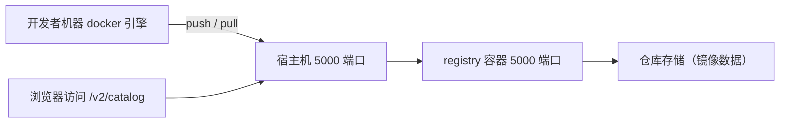

# 搭一个企业内网能用的 Docker 私有仓库：Registry 容器与 daemon.json 配置

公有仓库（如中央仓库）放的是 MySQL、Nginx 这类通用镜像，而自己写的微服务镜像显然不能往外推。企业内部往往需要一个局域网内的私有仓库，把自研应用的镜像集中存放，其他机器直接来拉取，省掉「导出文件再拷来拷去」的麻烦。这篇讲怎么用 Docker 官方提供的 Registry 镜像，在局域网里快速拉起一个私有仓库，并让 Docker 引擎信任它。

## 先给结论

- 私有仓库本身也是一个 Docker 镜像，名字叫 `registry`，把它跑成一个容器，仓库就建好了。
- 启动容器用 `docker run -di --name=registry -p 5000:5000 registry`，把容器 5000 端口映射到宿主机 5000 端口。
- 验证是否搭成功，浏览器访问 `http://宿主机IP:5000/v2/catalog`，返回 `{"repositories":[]}` 就说明仓库空载可用。
- 想让本机 Docker 能往这个仓库推镜像，必须在 `/etc/docker/daemon.json` 里加 `insecure-registries`，声明「我信任这个地址」。
- 改完 `daemon.json` 后一定要 `systemctl restart docker` 让配置生效，否则不认。

## 一、为什么要私有仓库，它和公有仓库差在哪

Docker 镜像的存储分两类。一类是公有仓库，里面是 CentOS、MySQL、Redis 这种谁都能用的通用镜像；另一类是企业自建的私有仓库，专门放我们自己开发的微服务镜像。

**第一，私有仓库解决的是「内网共享」问题。** 假设一号服务器上构建好了一个镜像，二号服务器也想用，靠 `docker save` 导出成 tar 再拷贝过去既慢又难管理。有了私有仓库，一号机器 `push` 上去，二号机器直接 `pull`，全程走局域网。

**第二，私有仓库本质上就是跑起来的一个 Registry 容器。** 它不要求你装什么额外服务，Docker 官方把仓库本身也做成了一个镜像，拉起来就是仓库。

## 二、启动 Registry 容器

课程环境里 Registry 镜像已经提前拉取好了，直接基于它创建容器：

```bash
# -d 后台运行，-i 保持标准输入打开，--name 给容器起名，
# -p 把容器 5000 端口映射到宿主机 5000 端口
docker run -di --name=registry -p 5000:5000 registry
```

执行完用 `docker ps` 确认容器已经起来。这一条命令就完成了私有仓库的搭建，比想象中简单得多。

启动后，整个私有仓库的拓扑关系是这样的：



图里最关键的是 5000 端口的映射：外部所有 `push`、`pull`、查询请求都先打到宿主机 5000，再由它转发给容器里的 Registry 服务。

## 三、验证仓库是否可用

不用命令行也能验证。直接在浏览器打开：

```text
http://192.168.184.141:5000/v2/catalog
```

如果看到返回内容是：

```json
{
  "repositories": []
}
```

说明私有仓库已经成功运行，而且目前是空的（`repositories` 是空数组）。等后面你把镜像 `push` 上来，这个数组里就会出现对应的镜像名。

## 四、让 Docker 信任私有仓库地址

光把仓库跑起来还不够。Docker 默认只信任带合法证书的 HTTPS 仓库，而内网里这个 Registry 是 HTTP 明文，直接 `push` 会被拒。解决办法是修改 Docker 引擎的配置。

编辑 `/etc/docker/daemon.json`（这个文件在装 Docker 时通常已经存在，里面可能已经有镜像加速配置）：

```bash
vi /etc/docker/daemon.json
```

在原有内容基础上追加 `insecure-registries` 字段。一个典型、完整的配置长这样：

```json
{
  "registry-mirrors": ["https://docker.mirrors.ustc.edu.cn"],
  "insecure-registries": ["192.168.184.141:5000"]
}
```

`registry-mirrors` 是镜像加速地址，用来加快从公有仓库拉取的速度；`insecure-registries` 就是告诉本机 Docker：「这个 HTTP 地址我信得过，允许往这儿推镜像」。注意 JSON 里两个字段之间要用逗号分隔，格式写错 Docker 会起不来。

**第一，IP 要写真实可达的内网地址。** 这里 `192.168.184.141` 是课程那台宿主机的实际 IP，你搭的时候换成自己机器的局域网 IP 即可。

**第二，改完必须重启 Docker 服务**，否则配置不会生效：

```bash
systemctl restart docker
```

重启后 `docker ps` 看一眼，registry 容器可能因为 Docker 重启而停了，需要 `docker start registry` 再拉起来（这一动作在镜像上传那篇会详细说明）。

## 常见误区

- **只改 daemon.json 不重启**：配置根本没生效，一 `push` 还是报 `http: server gave HTTP response to HTTPS client`。`systemctl restart docker` 是必做的一步。
- **insecure-registries 写成 https 或漏端口**：地址必须和 `push` 时用的完全一致，含端口号 `:5000`，否则 Docker 不认为这是同一个仓库。
- **daemon.json 格式错（少逗号、多逗号）**：Docker 启动会直接失败，报 `unable to configure the Docker daemon with file`。改完可以用 `docker info` 验证是否读到了配置。
- **以为 registry 容器重启后会自动起**：Docker 服务重启时容器内也可能被停，记得检查 `docker ps`，必要时 `docker start registry`。

## 面试可能被问到的问题

1. 面试官追问：「Docker 私有仓库是怎么搭建起来的？」
   答：私有仓库本身就是一个 `registry` 镜像，用 `docker run -di --name=registry -p 5000:5000 registry` 把它跑成容器即可，端口映射出来就能通过 HTTP 访问。本质是用官方镜像省去了自己部署仓库服务的成本。

2. 面试官追问：「为什么配了私有仓库还要改 daemon.json？」
   答：因为内网 Registry 一般是 HTTP 明文服务，而 Docker 默认只接受带证书的 HTTPS 仓库。`insecure-registries` 用来声明信任这个 HTTP 地址，否则 `push` 会被拒绝。

3. 面试官追问：「怎么验证私有仓库搭建成功了？」
   答：访问 `http://宿主机IP:5000/v2/catalog`，返回 `{"repositories":[]}` 就说明 Registry 服务正常且在空载可用状态，数组里将来会列出已上传的镜像名。

4. 面试官追问：「registry-mirrors 和 insecure-registries 有什么区别？」
   答：`registry-mirrors` 是配置镜像加速源，让拉取公有镜像走更快的国内节点；`insecure-registries` 是声明可信任的非 HTTPS 私有仓库地址，两者作用完全不同，可以并存于同一个 `daemon.json`。

5. 面试官追问：「改完 daemon.json 之后为什么一定要重启 Docker？」
   答：这个文件是 Docker 守护进程启动时读取的，运行中改文件不会热生效，必须 `systemctl restart docker` 重启守护进程，配置才会被重新加载。

6. 面试官追问：「私有仓库和直接用 docker save/load 传镜像比，优势在哪？」
   答：私有仓库是中心化的，多台机器随时 `pull`，版本可追溯、可集中管理；`save/load` 是点对点的文件拷贝，无法并发共享，也不便于版本控制和权限管理。

## 配套资料

- 本课无配套源码工程（materials/code/01 下没有 Docker 相关工程）。正文命令与配置均取自课程实录：Registry 容器启动、`/v2/catalog` 验证、`daemon.json` 的 `insecure-registries` 配置与 `systemctl restart docker`，可在任意装好 Docker 的 CentOS 7 宿主机上复现（IP 换成你自己的局域网地址）。
- 前置的镜像/容器基础命令见本阶段 Docker 基础篇，后续「镜像上传」与「总结」两篇会接着用这个仓库。
