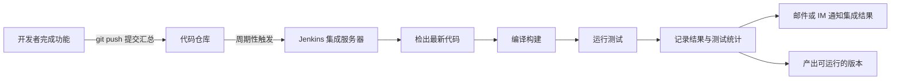

# 持续集成是什么，Jenkins 凭什么成为标配：概念、特点与容器化安装

一个项目由一个团队协作完成，每个人按分配的任务开发各自的功能，代码最终要合到一起编译、打包、部署，才能产出一个可运行的版本。传统项目把这个「合」的动作放到开发周期的最末尾，结果往往是集成阶段集中爆炸：问题攒了几个月一起冒出来。持续集成就是为了终结这种模式而生的工程实践，而 Jenkins 是业界用得最多的落地方案。

## 先给结论

- 持续集成简称 CI：把「汇总代码、检出、编译构建、运行测试、记录结果」变成周期性自动执行的常态工作，周期可能一周也可能几天。
- 三个硬条件：集成过程自动化、有专门的集成服务器、有代码托管工具支持。
- Jenkins 原名 Hudson，2011 年改为现名，开源；它本身是个「壳」，功能几乎全靠第三方插件，扩展性极强。
- 安装极简：一条 `java -jar jenkins.war` 就能跑，无需数据库；课程采用 Docker 方式，起一个容器即可。
- 装完只是开始，还要装插件、配全局工具（JDK、Maven、Git）、配代码仓库凭证，Jenkins 才能真正干活。

## 一、从「最后才集成」到「持续集成」

先说清楚「集成」这个词。团队开发时大家用 Git 这类版本控制工具把代码提交到服务器汇总，汇总之后再进行编译、打包、部署，最后产出一个可以运行的版本，这一整套动作就是集成。

传统项目把它压到最后一步做，互联网应用等不起：必须尽快拿出一个可运行的版本，哪怕是不完善的甚至有缺陷的版本。目的有两个：一是让产品尽快上市抢占窗口，二是尽早发现软件中存在的问题，问题发现得越早修复成本越低。持续集成的定义也就顺势而来：让集成工作成为常态化的、持续运行的活动，周期一周或几天，总之不会太长。它也是敏捷开发的一种实践。

持续集成有三个鲜明特点：

**第一，自动化。** 它是一个自动化的、周期性的集成测试过程，检出代码、编译构建、运行测试、结果记录、测试统计，全部自动完成，不需要人工干预。

**第二，有专门的集成服务器。** 构建工作由一台专职服务器承担，不占用开发机。

**第三，依赖代码托管工具。** 没有集中的代码仓库，自动集成无从谈起。

它带来的价值同样清楚：每次集成都会暴露代码存在的问题，团队随时能看到并修掉，软件正式发布时问题就少很多，团队提交代码的质量因此得到保证；同时任何环节自动完成，人力从重复劳动里解放出来。整条链路长这样：



图中从检出代码到通知结果全程无人值守，人只负责两头的动作：写代码提交，看报告修问题。这正是「持续」二字的含义，集成不再是一次性事件，而是循环运转的流水线。

## 二、Jenkins 是谁，为什么是它

实现持续集成最常用的工具就是 Jenkins。它的前身叫 Hudson，2011 年改名为 Jenkins，是一个开源的持续集成软件工具，官网是 jenkins-ci.org。它能实时监控集成过程中存在的错误，提供详细的日志文件和插件功能，还能用图表形象展示项目构建的进度和稳定性。

课程里列出的特点可以归纳成一张表：

| 特点 | 一句话说明 |
|---|---|
| 易安装 | 下载后直接 `java -jar jenkins.war` 运行，无需额外安装，更无需数据库 |
| 易配置 | 提供友好的图形化配置界面，点点鼠标完成设置 |
| 变更支持 | 能从代码仓库（Subversion/CVS 等）获取代码更新列表并输出到控制台 |
| 永久链接 | Web 页面地址固定不变，可直接写进任何文档引用 |
| 集成 E-Mail/RSS/IM | 一次集成完成后通过这些渠道实时告知结果，等人时可以干别的 |
| JUnit/TestNG 报告 | 以图表等形式提供详细的测试报告 |
| 支持分布式构建 | 可把集成构建任务分发到多个计算节点完成 |
| 支持第三方插件 | 生态庞大，缺什么功能装什么插件 |

这么多特点里最核心的一条是**支持第三方插件**：Jenkins 本身就是一个壳，它的所有功能几乎都是通过插件完成的，因此软件扩展性非常强。理解了这一点，后面配置环节里「装插件」成为主要工作也就顺理成章。

## 三、用 Docker 把 Jenkins 跑起来

Jenkins 官方推荐的轻量玩法之一就是容器化安装，下面命令来自课程安装文档。拉取镜像后创建并启动容器：

```bash
# 拉取 Jenkins 镜像
docker pull jenkinsci/blueocean

# 创建容器：-u root 提升容器内权限，8091 映射 Web 端口，
# 三个 -v 分别持久化 Jenkins 数据、复用宿主机 Docker 能力、挂载工作目录
docker create --name jenkins -u root -p 8091:8080 --privileged=true \
  -v jenkins-data:/var/jenkins_home \
  -v /var/run/docker.sock:/var/run/docker.sock \
  -v /home/jenkins:/home \
  docker.io/jenkinsci/blueocean

# 启动容器
docker start jenkins
```

三个挂载各有用处：`jenkins-data` 数据卷存放 Jenkins 主目录，容器删除重建后任务和配置不丢；挂载宿主机的 `docker.sock` 让 Jenkins 能直接指挥宿主机上的 Docker；`/home/jenkins` 用于放置 Maven 这类需要手动安装的工具。

启动后浏览器访问 `http://ip:8091`，初次运行会进入安装向导，一般保持默认配置一路下一步即可。中间有一步要求输入管理员密码（账户名默认 admin），在容器里取初始密码：

```bash
# 进入容器，读取初始管理员密码
docker exec -it jenkins /bin/bash
cat /var/jenkins_home/secrets/initialAdminPassword
```

把打印出来的字符串粘进页面即完成解锁。建议首次登录成功后立刻修改密码。

## 四、装完之后的三件事

一个刚装好的 Jenkins 还干不了活，按顺序做三件事。

**第一，安装常用插件。** 在插件管理页面搜索需要的插件并安装，让 Jenkins 能和其他工具集成协作。

**第二，配置全局工具。** Jenkins 做持续集成依赖 JDK 1.8、Git、Maven，进入全局工具配置逐个登记：三者都支持「自动安装」，勾选后指定版本即可；也可以把 Maven 等程序目录拷到宿主机 `/home` 下（对应挂载进容器的目录）后手动指定路径。

**第三，配置 Git 凭证。** 录入代码仓库的账号密码生成凭证，有了它 Jenkins 才能从 Git 仓库（如 Gogs）远程获取工程源码，自动拉取这一环才算打通。

至此基础设施就位：代码仓库存代码、Jenkins 跑构建、插件和全局工具补齐能力，下一环节就是把微服务的构建任务真正配置起来。

## 常见误区

- **删容器就丢配置**：没挂载 `jenkins-data` 数据卷时，容器一删，所有任务、插件、凭证全部蒸发；重装后又要解锁配一遍。
- **初始密码路径找错**：密码文件在容器内的 `/var/jenkins_home/secrets/initialAdminPassword`，到宿主机文件系统里找同名路径自然扑空。
- **以为 Jenkins 自带构建能力**：不装插件、不配 JDK/Maven/Git 全局工具就建任务，构建第一步就会失败，Jenkins 只是壳，能力全靠插件和外部工具。
- **创建容器不加 `-u root`**：容器内默认用户对 `docker.sock` 和数据卷没有足够权限，操作 Docker、安装工具时会报权限拒绝。

## 面试可能被问到的问题

1. 面试官追问：「什么是持续集成？它和传统集成方式的区别在哪？」
   答：持续集成是把代码汇总、编译构建、测试、结果记录变成周期性自动执行的常态化工作，周期一周或几天。传统项目把集成压到最后一步，问题集中爆发；持续集成让问题尽早暴露、尽早修复，并能尽快产出可运行版本。

2. 面试官追问：「落地持续集成需要哪些基础设施？」
   答：三样：自动化的集成流程（检出、构建、测试、统计无人值守）、一台专门的集成服务器、代码托管工具支撑。三者齐了才能形成周期性自动集成。

3. 面试官追问：「Jenkins 和 Hudson 是什么关系？」
   答：Jenkins 原名 Hudson，2011 年改名为 Jenkins，是一个开源的持续集成软件工具，提供图形化配置、测试报告、邮件通知、分布式构建等能力。

4. 面试官追问：「Jenkins 为什么扩展性这么强？」
   答：它本身只是一个壳，所有功能几乎都通过插件实现，需要什么能力就装什么插件，从代码仓库对接到测试报告、消息通知、分布式构建都由插件生态覆盖，核心平台保持极简。

5. 面试官追问：「用 Docker 装 Jenkins 时通常挂载哪些东西，为什么？」
   答：三处：`jenkins-data` 数据卷持久化主目录，容器重建不丢配置；宿主机 `docker.sock` 让 Jenkins 能直接操作宿主机 Docker，实现容器里构建镜像、起容器；`/home/jenkins` 挂载宿主机目录，便于手动放置 Maven 等工具。

6. 面试官追问：「Jenkins 装好后，首次使用前要做哪些配置？」
   答：三步：安装常用插件补齐集成能力；在全局工具里配置 JDK、Maven、Git（自动安装或手动指定目录）；配置 Git 仓库凭证，让 Jenkins 能从代码仓库拉取源码。三件做完才能创建真正可运行的构建任务。

## 配套资料

- Jenkins 安装文档：`materials/docs/10/Jenkins安装文档.md`（课程资料包内讲义，含 Docker 方式安装、初始密码获取、常用插件安装、JDK/Maven/Git 全局工具配置与 Git 凭证，正文第三节命令即取自该文档）。
- 本课无配套源码工程（`materials/code/01` 下没有 Jenkins 相关工程），持续集成概念与 Jenkins 特点部分按课程实录整理。
