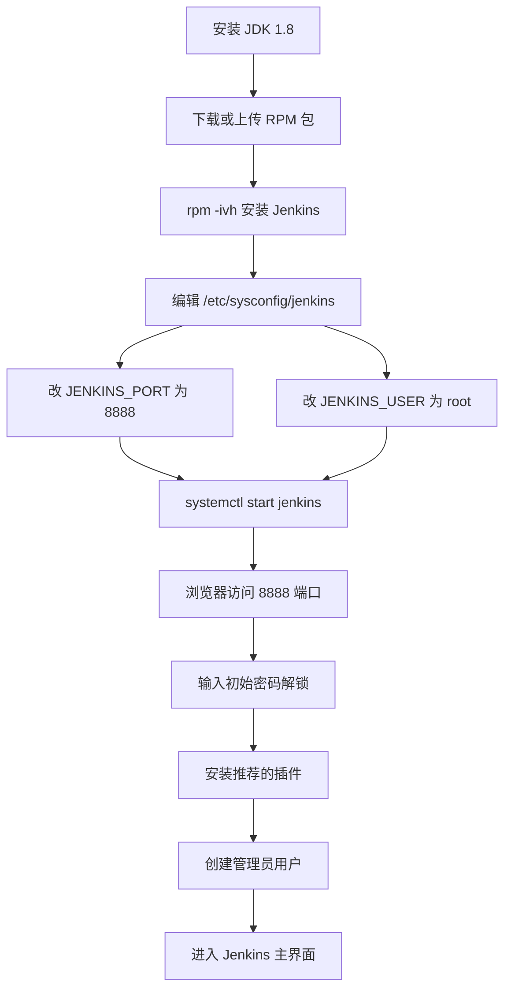

# 在 Linux 上用 RPM 包安装 Jenkins：从 rpm -ivh 到解锁主界面

持续集成的第一道门槛往往不是概念，而是安装本身：一台只有命令行的 Linux 服务器，Jenkins 到底怎么装？装完打开浏览器，页面让你输入一个「管理员密码」，这个密码在哪儿？默认端口 8080 和其他服务冲突了又该怎么办？这几个问题不解决，后面的自动化构建根本无从谈起。

本课用 RPM 包的方式在 CentOS 上把 Jenkins 完整装起来：装 JDK、装 Jenkins、改配置文件、启动服务、解锁向导，最后停在可以创建任务的主界面上。

## 先给结论

- Jenkins 本身是 Java 开发的，装 Jenkins 之前必须先装 JDK 1.8，默认安装路径是 `/usr/java/jdk1.8.0_171`。
- RPM 方式安装只涉及一条命令 `rpm -ivh jenkins-2.83.1.1.noarch.rpm`，安装包可用 `wget` 下载，也可以本地上传。
- 关键配置文件是 `/etc/sysconfig/jenkins`，最常改的是 `JENKINS_PORT`（默认 8080，课程里改成 8888）和 `JENKINS_USER`（默认 jenkins，改成 root 省去权限麻烦）。
- 改完配置要 `systemctl start jenkins` 重启服务才生效，浏览器访问 `http://服务器IP:8888` 进入解锁向导。
- 初始管理员密码在 `/var/lib/jenkins/secrets/initialAdminPassword` 文件里，向导里选「安装推荐的插件」，再创建一个管理员用户就完成安装。

## 一、前置条件：JDK 必须先就位

Jenkins 是用 Java 写的，没有 JVM 它根本起不来，所以安装顺序是固定的：先 JDK，再 Jenkins。

JDK 8 的 RPM 安装包课程资料里已经提供，把它上传到服务器后执行：

```bash
# 安装 JDK 8（包名以实际文件为准）
rpm -ivh jdk-8u171-linux-x64.rpm

# 安装完成后确认目录
ls /usr/java
# jdk1.8.0_171-amd64
```

装完之后 JDK 位于 `/usr/java/jdk1.8.0_171-amd64`，这个路径后面配置全局工具时还要用，先记下来。课程使用的虚拟机镜像里已经预装了 JDK，这一步可以直接跳过，但如果是在干净的机器上操作，它就是绕不开的第一步。

## 二、下载并安装 Jenkins

课程采用 RPM 包方式安装 Jenkins 2.83。获取安装包有两条路，效果一样：

```bash
# 方式一：在线下载
wget https://pkg.jenkins.io/redhat/jenkins-2.83.1.1.noarch.rpm

# 方式二：把本地已有的安装包上传到服务器（例如通过 SecureCRT 的 Zmodem）
rz
```

拿到安装包后执行安装：

```bash
rpm -ivh jenkins-2.83.1.1.noarch.rpm
```

`-i` 表示安装，`-v` 显示过程，`-h` 显示进度条。RPM 安装会把 Jenkins 的启动脚本注册成系统服务，同时创建 `jenkins` 用户和默认主目录 `/var/lib/jenkins`，这也是为什么装完就能用 `systemctl` 直接管理它。

## 三、改配置：端口和运行用户

安装成功不等于能用，安装文档里明确要求先改配置文件：

```bash
vi /etc/sysconfig/jenkins
```

这个文件里全是 `JENKINS_XXX` 形式的环境变量，控制着 Jenkins 服务的一切行为。几个最关键的项如下：

| 配置项 | 默认值 | 含义 |
|---|---|---|
| `JENKINS_HOME` | `/var/lib/jenkins` | 配置、构建记录、插件的工作目录 |
| `JENKINS_USER` | `jenkins` | 守护进程的运行用户 |
| `JENKINS_PORT` | `8080` | HTTP 监听端口 |
| `JENKINS_JAVA_OPTIONS` | `-Djava.awt.headless=true` | 传给 JVM 的启动参数 |
| `JENKINS_LISTEN_ADDRESS` | 空（监听所有网卡） | HTTP 绑定的 IP |

课程里只改两行。第一行把端口从 8080 改成 8888，避免和其他服务冲突：

```bash
JENKINS_PORT="8888"
```

第二行把运行用户从 `jenkins` 改成 `root`：

```bash
JENKINS_USER="root"
```

改用户这一步在学习环境里很常见：Jenkins 构建时要执行 Docker、Maven 等命令，用普通 `jenkins` 用户跑会遇到各种权限问题，直接用 `root` 可以先把流程跑通。生产环境则更推荐保留专用用户，按需授权。

改完保存退出（`:wq`），配置文件本身不会热生效，必须重启服务。

## 四、启动服务与解锁向导

```bash
systemctl start jenkins
```

服务起来之后，浏览器访问 `http://192.168.184.141:8888`（IP 换成你自己的服务器地址）。第一次打开会停在解锁页面，提示你输入管理员密码，并告诉你密码所在的文件。把文件内容打出来：

```bash
cat /var/lib/jenkins/secrets/initialAdminPassword
# 输出形如：3f9a5c1e8b7d46c2a0e1f6d8b3c5a7e9
```

把这串密码粘贴进输入框，进入下一步。向导会让你选择插件安装方式，一个「安装推荐的插件」，一个「自选插件」，课程选择前者，Jenkins 会自动下载安装 Git、Pipeline 等一批常用插件，页面上对勾表示装完，转圈的箭头表示还在下载，整个过程比较长，耐心等它结束。

插件装完是创建管理员用户的页面，填入用户名、密码、全名和邮箱，点「保存并完成」，再确认一次访问地址，就进入了 Jenkins 主界面，看到「欢迎使用 Jenkins!」和「创建一个新任务」，安装到此完成。

整个流程串起来是这样：



这条链路里最容易卡住的是第 8 步之后：浏览器打不开页面，多半是端口没改对、服务没真正启动，或者防火墙没放行，`systemctl status jenkins` 先看服务状态再排查网络。

## 常见误区

- **改完配置文件不重启服务**。`/etc/sysconfig/jenkins` 的内容只在服务启动时读取，改完端口直接刷新浏览器是看不到效果的，必须 `systemctl restart jenkins`。
- **初始密码找不到就瞎猜**。解锁页面会明确写出密码文件路径，RPM 安装的默认位置是 `/var/lib/jenkins/secrets/initialAdminPassword`，`cat` 一下就有，不需要重装。
- **用 jenkins 用户跑构建遇到权限报错就 hardcode 各种 chmod**。要么按课程做法把 `JENKINS_USER` 改成 root，要么给专用用户精确授权，逐个目录改权限会把环境越改越乱。
- **跳过 JDK 直接装 Jenkins**。服务能注册成功但启动失败，日志里抛 `JAVA_HOME` 相关错误。Jenkins 是 Java 应用，JDK 是硬前置。

## 面试可能被问到的问题

1. 面试官追问：「Jenkins 安装方式有哪些？各自适合什么场景？」
   答：常见有 RPM/YUM 包安装、WAR 包部署、Docker 镜像安装三种。RPM 适合把 Jenkins 当系统服务长期运行的物理机或虚拟机；WAR 适合已有 Tomcat 环境直接丢进去；Docker 适合容器化环境，升级回滚都方便，课程讲义里也给出了 Docker 安装的完整流程。

2. 面试官追问：「`/etc/sysconfig/jenkins` 里你最关心哪几项配置？」
   答：`JENKINS_PORT` 决定 Web 访问端口，冲突时必须改；`JENKINS_USER` 决定进程运行身份，影响构建时的文件和命令权限；`JENKINS_HOME` 决定所有配置和构建产物的存储位置，做备份迁移时指向它即可。

3. 面试官追问：「第一次启动 Jenkins 为什么要输入初始密码？」
   答：这是安全机制。Jenkins 首次启动会生成一个随机管理员密钥，只存在服务器本地的 `secrets/initialAdminPassword` 文件里，只有能登录服务器的人才拿得到，防止 Jenkins 还没配置好就被陌生人通过网络初始化接管。

4. 面试官追问：「为什么课程里把 JENKINS_USER 改成 root？生产环境也这么做吗？」
   答：学习环境里 Jenkins 要调用 Docker、Maven 等命令，用默认 jenkins 用户会碰到大量权限问题，改成 root 最省事。生产环境不建议用 root，而是保留专用用户并授予必要的 sudo 权限，遵循最小权限原则。

5. 面试官追问：「RPM 安装和直接解压 tar 包运行，Jenkins 的数据会放在哪里？」
   答：RPM 安装的数据默认在 `/var/lib/jenkins`，日志在 `/var/log/jenkins`；解压方式运行时数据目录取决于启动时指定的 `JENKINS_HOME` 环境变量，不指定则在用户目录下生成 `.jenkins`。备份和迁移 Jenkins 本质上就是备份这个主目录。

## 配套资料

- 讲义：`materials/docs/10/Jenkins安装文档.md`（含 Docker 方式安装 Jenkins、插件安装与全局工具配置的完整步骤，可与 RPM 方式的操作流程对照）
- 讲义：`materials/docs/10/万信金融-讲义-项目部署v1.0.md`（DevOps 工具链中 Jenkins 的定位与持续集成环境搭建章节）
