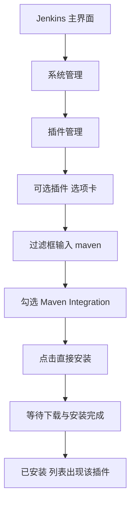

# Jenkins 插件怎么装：把 Maven Integration 补进已安装列表

装完 Jenkins 打开主界面，很多人以为万事大吉，等真去新建任务时才发现，任务类型里根本没有「构建一个 Maven 项目」这个选项。原因是向导里那一步「安装推荐的插件」只覆盖了最通用的部分，Git 这类插件已经随推荐清单装好，而 Maven 插件不在里面，需要安装之后自己动手补上。

插件是 Jenkins 的能力来源，会管理插件才算真正会用 Jenkins。这一篇以安装 Maven Integration 插件为例，把插件管理的页面结构、安装流程和卸载边界一次讲清。

## 先给结论

- 插件入口固定：左侧「系统管理」进入后再点「插件管理」，所有插件的安装、升级、卸载都在这一个页面完成。
- 插件管理页有三个选项卡：「可更新」「可选插件」「已安装」，功能分别对应升级、新装、查看现有。
- 安装 Maven 插件的操作是：切到「可选插件」，在过滤框输入 `maven`，勾选 Maven Integration，点「直接安装」。
- 安装完成的插件会立刻出现在「已安装」选项卡里，不需要重启也能用（部分插件会提示重启，按提示操作即可）。
- 不是所有插件都能卸载，Jenkins 的一些核心内置插件不提供卸载入口。

## 一、Jenkins 的能力是插件堆出来的

Jenkins 本体只提供一个调度框架和 Web 界面，连「拉 Git 代码」「跑 Maven 构建」这样的基础能力都是插件实现的。理解了这一点，很多现象就顺理成章：装完向导里推荐的插件后，「已安装」列表里已经有 Pipeline、Git、GitHub API、Docker Commons Plugin 等一批插件，这些正是持续集成最常用的骨架。

Maven 插件的角色略有不同：它不是给 Jenkins 增加某个零散功能，而是提供「构建一个 Maven 项目」这种任务类型。少了它，Jenkins 照样能跑自由风格的 shell 任务，但没法以 Maven 工程的方式配置构建目标，而下一课要配的 Maven 全局工具正是为它服务的。所以本课把它作为插件安装的标准示例。

## 二、插件管理页面的结构

从 Jenkins 主界面进入：点击左侧「系统管理」菜单，再点击「插件管理」。页面主体是三个可切换的选项卡：

| 选项卡 | 作用 | 什么时候用 |
|---|---|---|
| 可更新 | 列出有新版本的已安装插件 | 定期升级，修 bug 补安全漏洞 |
| 可选插件 | 列出所有可新装的插件，支持过滤 | 需要新能力时来这找 |
| 已安装 | 列出当前装好的插件 | 确认某插件是否就位 |

「可选插件」列表很长，默认按分类分组展示（比如 .NET Development、Git Server Plugin 等），逐页翻效率很低，顶部的过滤输入框才是正确用法：输入关键词，列表实时收缩到匹配的插件。

## 三、把 Maven Integration 装上

完整操作只花一分钟：

1. 进入「系统管理」，点击「插件管理」。
2. 切换到「可选插件」选项卡。
3. 在过滤框输入 `maven`，列表收缩出 Maven 相关插件。
4. 勾选 Maven Integration。
5. 点击页面顶部的「直接安装」按钮。

点完之后页面进入安装进度视图，每行插件前面有个对勾表示安装成功，两个转圈的箭头表示正在下载。下载速度取决于插件更新站点的网络状况，慢的时候等几分钟很正常。安装完成后，切回「已安装」选项卡，在列表里能找到 Maven Integration，它就已经生效了。

用图把这条路径画出来：



关键节点是「过滤框输入 maven」这一步：面对几千个插件，靠过滤框定位目标，是插件管理里最常用的技巧。

对插件在磁盘上的真实形态有个直观印象会有帮助，每个插件对应主目录 plugins 目录下的一个文件：

```bash
ls /var/lib/jenkins/plugins/ | head
# maven-integration.hpi
# maven-plugin.hpi
# git.hpi
# pipeline-stage-view.hpi
# ...
```

装好的插件就是一个个归档包躺在 `JENKINS_HOME/plugins` 下，备份或离线迁移环境时，把这个目录连同主目录一起带走即可。

## 四、卸载与升级的边界

插件管理不是只能装。「已安装」选项卡里，普通插件行末有卸载按钮，点掉即从列表移除；「可更新」选项卡则负责升级，勾选后安装方式与新装完全一致。

有两个边界要知道：

**第一，核心插件不给卸载入口。** Jenkins 依赖一些必备插件维持自身运行，这类插件在「已安装」列表里没有卸载按钮，界面会明确告诉你是哪些。遇到卸载不掉的插件不要反复找开关，它就是被设计成必装的。

**第二，离线环境可以上传插件包。** 服务器访问不了插件站点时，从能上网的机器下载对应插件的 `.hpi` 文件，在插件管理的「高级」页签里上传安装，效果和在线装一样。

如果更习惯命令行，Jenkins 也提供 CLI 方式安装插件（以下为示例，实际使用需要先在服务器上获取 `jenkins-cli.jar`）：

```bash
java -jar jenkins-cli.jar -s http://localhost:8888/ install-plugin maven-integration
```

图形界面能满足绝大多数场景，CLI 更多出现在批量初始化环境的脚本里。

## 常见误区

- **以为推荐插件装完就齐了**。推荐清单只覆盖通用能力，Maven Integration、SonarQube Scanner 这类专项插件都要自己补，装完记得去「已安装」里确认。
- **在「已安装」选项卡里找要新装的插件**。已安装页签只有已装的插件，要新装必须切到「可选插件」再过滤。
- **安装页面转圈就强行刷新或重启**。下载安装需要时间，刷新可能中断下载，等对勾出现再操作；确因网络卡死时再重启服务重来。
- **对着核心插件找卸载按钮**。必备插件被设计为不可卸载，界面不提供入口属正常行为。

## 面试可能被问到的问题

1. 面试官追问：「Jenkins 为什么采用插件架构？」
   答：Jenkins 本体只负责调度、凭证、界面框架等通用能力，所有具体功能如版本控制集成、构建工具、部署手段都以插件形式挂载。这样核心可以保持稳定，生态按需组合，任何团队都能只装自己用得到的部分。

2. 面试官追问：「插件管理页面的三个选项卡分别干什么用？」
   答：「可更新」用于把已装插件升级到新版本，「可选插件」列出可新装的插件并支持关键词过滤，「已安装」展示当前生效的插件清单。安装、升级、查看三类操作分别对应这三个页签。

3. 面试官追问：「Maven Integration 插件的作用是什么？不装行不行？」
   答：它提供「构建一个 Maven 项目」的任务类型，让任务能直接配置 Maven 的构建目标和 pom 路径。不装时只能用自由风格任务加 shell 命令曲线实现，配置繁琐且失去 Maven 任务的专属能力，做 Java 持续集成一般必装。

4. 面试官追问：「内网服务器访问不了插件更新站点，插件还装得上吗？」
   答：可以。在外网机器下载插件对应的 `.hpi` 文件，通过插件管理「高级」页签上传安装；也可以把整个 `JENKINS_HOME/plugins` 目录从已有环境整体拷贝过来，重启后生效。

5. 面试官追问：「怎么判断某个插件有没有装好？」
   答：安装页面出现对勾即表示成功；最可靠的确认方式是去「已安装」选项卡搜索插件名。对 Maven Integration 这类提供任务类型的插件，还可以看新建任务列表里是否出现了对应选项。

## 配套资料

- 讲义：`materials/docs/10/Jenkins安装文档.md`（其中「Jenkins 常用插件安装」章节给出插件搜索与安装的官方操作说明）
- 讲义：`materials/docs/10/万信金融-讲义-项目部署v1.0.md`（持续集成环境搭建章节说明插件与整体部署流程的关系）
