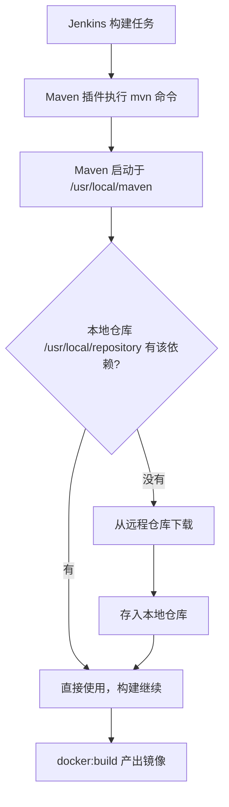

# 服务器上装 Maven 并铺好本地仓库：让 Jenkins 构建不再从零下载

Maven 插件在上一课装好了，但真到构建微服务时你会发现两件事：一是构建任务根本跑不起来，因为服务器上压根没有 Maven 可执行程序；二是即便能跑，第一次构建会卡在依赖下载上，几十分钟下不来。这两个问题的根源相同，Maven 插件只是一个调用入口，真正干活的是 Maven 软件本身，以及它背后那份存满依赖的本地仓库。

这一篇把两件事一次做完：在服务器上安装 Maven 3.5.4，再把开发机现成的本地仓库整体搬上去，为持续集成铺平道路。

## 先给结论

- Jenkins 实现持续集成靠调用 Maven 插件执行 `mvn` 命令，配合 docker-maven-plugin 一条命令就能把微服务构建成镜像部署进 Docker；但插件只是入口，服务器上必须安装 Maven 本体。
- 安装动作只有三步：上传 `apache-maven-3.5.4-bin.tar.gz`、`tar zxvf` 解压、移动到 `/usr/local/maven`。
- Maven 的配置文件是 `conf/settings.xml`，本课只改一处：`<localRepository>` 指向 `/usr/local/repository`。
- 把开发环境的本地仓库 `repository_boot` 整体上传并移动到 `/usr/local/repository`，构建时绝大多数依赖直接命中本地，不再去远程仓库下载。
- 不传本地仓库流程也能跑通，代价是每次持续集成都重新下载全部依赖，速度慢很多。

## 一、插件只是入口，Maven 软件才是执行者

把持续集成的调用链摆出来看，Maven 插件在什么位置就清楚了：Jenkins 收到构建任务后，通过 Maven 插件组装并执行一条 `mvn` 命令；命令里挂的是课程前面讲过的 docker-maven-plugin，它负责在打包之后产出 Docker 镜像。也就是说，最终一条 `mvn` 命令完成「编译、打包、做镜像」的整条流水线。

课程资料里就能找到这个插件的真实样子，某个使用它的工程 pom 配置如下：

```xml
<plugin>
    <groupId>com.spotify</groupId>
    <artifactId>docker-maven-plugin</artifactId>
    <version>0.4.11</version>
    <configuration>
        <imageName>${docker.image.prefix}/${project.artifactId}</imageName>
        <dockerDirectory>src/main/docker</dockerDirectory>
        <resources>
            <resource>
                <targetPath>/</targetPath>
                <directory>${project.build.directory}</directory>
                <include>${project.build.finalName}.jar</include>
            </resource>
        </resources>
    </configuration>
</plugin>
```

执行 `mvn clean package docker:build` 时，JVM 里跑的是 `/usr/local/maven/bin/mvn` 这个程序，插件随工程坐标从仓库取。Maven 插件只负责「发号施令」，所以服务器上必须先有一个完整的 Maven 安装。

## 二、安装 Maven 3.5.4

安装包 `apache-maven-3.5.4-bin.tar.gz` 课程资料已提供，上传到服务器后依次执行：

```bash
# 1. 解压
tar zxvf apache-maven-3.5.4-bin.tar.gz

# 2. 移动到统一安装目录
mv apache-maven-3.5.4 /usr/local/maven

# 3. 确认可用
/usr/local/maven/bin/mvn -version
# Apache Maven 3.5.4
```

Linux 服务器上装 Maven 就这么朴素：解压、挪位置。之所以选 `/usr/local/maven` 这个路径，是因为下一课配置全局工具时要填 `MAVEN_HOME`，路径短且语义清晰，出问题好排查。

## 三、配置 settings.xml 指定本地仓库

Maven 的行为由 `settings.xml` 控制，它存在两个层级：

- 用户级：`~/.m2/settings.xml`，只对当前用户生效，命令行可用 `-s` 参数指向其他文件；
- 全局级：`$MAVEN_HOME/conf/settings.xml`，对整台机器上所有 Maven 用户生效，可用 `-gs` 参数覆盖。

课程直接改全局级的配置文件，让这台服务器上所有构建共享同一份仓库配置：

```bash
vi /usr/local/maven/conf/settings.xml
```

文件里大部分内容是注释掉的示例，找到被注释的本地仓库配置段，把这一行复制到注释外面，改成目标目录：

```xml
<settings xmlns="http://maven.apache.org/SETTINGS/1.0.0"
          xmlns:xsi="http://www.w3.org/2001/XMLSchema-instance"
          xsi:schemaLocation="http://maven.apache.org/SETTINGS/1.0.0
          http://maven.apache.org/xsd/settings-1.0.0.xsd">
  <!-- 本地仓库：所有依赖 jar 的落盘位置 -->
  <localRepository>/usr/local/repository</localRepository>
  <interactiveMode>true</interactiveMode>
  <offline>false</offline>
</settings>
```

`<localRepository>` 是本次唯一要生效的配置，含义是「Maven 找依赖时先看这个目录，下载新依赖也存到这里」。`<interactiveMode>` 控制是否与用户交互，`<offline>` 置为 `false` 表示允许联网下载，这两个保持默认即可。

## 四、把本地仓库搬上服务器

配置完成时 `/usr/local/repository` 还是个不存在的空目录，如果就此开始持续集成，Maven 会把项目所有依赖从远程仓库重新下载一遍。开发机上其实早就有一份攒了很久的仓库，课程资料里叫 `repository_boot`，把这份现成的家底搬上去，第一次构建就能直接命中依赖：

```bash
# 1. 将 repository_boot 目录整体上传到服务器（SecureCRT 支持 Zmodem 目录上传，或走 SFTP）
# 2. 移动到 settings.xml 指定的本地仓库位置
mv repository_boot /usr/local/repository

# 3. 确认内容就位
ls /usr/local/repository | head
# org  commons-collections  commons-lang  ...
```

上传目录里文件数以万计，Zmodem 传输会持续不短的时间，属于正常现象。搬完之后验证一下结构：仓库根目录下是按 groupId 组织的层级目录，看到 `org`、`commons-*` 这些目录就说明内容完好。

整条依赖解析链路画出来是这样的：



这张图的关键在中间那个判断：本地仓库命中与否，直接决定构建是秒过还是长时间卡在下载。搬仓库这步做的就是把「没有」这条路的比例降到最低。

## 常见误区

- **以为装了 Maven Integration 插件就不用装 Maven 软件**。插件只是 Jenkins 发命令的入口，`mvn` 可执行文件不存在时构建直接失败，报找不到 mvn 命令。
- **把 `<localRepository>` 写错层级**。配置写在注释块里不生效，必须放在 `<settings>` 根标签的直接子级，并去掉外层注释符。
- **仓库传到了别的目录**。本地仓库位置以 `settings.xml` 里的 `<localRepository>` 为准，`repository_boot` 放在别处 Maven 根本不看，要么挪到指定位置，要么把配置改成实际目录。
- **删了远程仓库配置想完全离线**。`<offline>true</offline>` 加上一份完整本地仓库确实能离线构建，但仓库里没有的新依赖将无法获取，一般保持 `false` 让 Maven 自动兜底。

## 面试可能被问到的问题

1. 面试官追问：「Jenkins 的 Maven 插件和 Maven 本体是什么关系？」
   答：Maven 插件是 Jenkins 侧的入口，负责提供 Maven 项目任务类型并组装执行命令；真正完成编译打包的是服务器上安装的 Maven 软件。二者缺一不可，一个负责调用，一个负责执行。

2. 面试官追问：「settings.xml 的用户级和全局级配置有什么区别？」
   答：用户级在 `~/.m2/settings.xml`，只影响当前用户；全局级在 Maven 安装目录的 `conf/settings.xml`，影响这台机器上所有 Maven 使用。冲突时用户级优先，命令行还可用 `-s` 和 `-gs` 显式指定文件，CI 服务器常用全局级保证所有构建一致。

3. 面试官追问：「localRepository 配置的是什么？Maven 找不到依赖时会怎样？」
   答：它指定本地仓库目录，Maven 解析依赖时先查这里，命中直接使用；未命中才去远程仓库下载并落盘到该目录。所以预先填充本地仓库能显著缩短 CI 的首次构建时间。

4. 面试官追问：「为什么持续集成服务器要提前铺本地仓库？」
   答：CI 环境是全新的，本地仓库为空，每次构建都要下载全部依赖，既慢又给远程仓库造成压力。把开发机现成的仓库整体迁移过去后，大部分依赖直接命中，构建时间大幅下降，网络故障时构建也更稳。

5. 面试官追问：「一条 mvn 命令能把微服务部署进 Docker 吗？怎么做到的？」
   答：可以，靠 docker-maven-plugin。pom 里配置镜像名和 Dockerfile 目录后，执行 `mvn clean package docker:build`，插件会在打包完成后把 jar 连同 Dockerfile 构建成镜像。配合后续 push 和容器启动命令，整条部署链路全部由 Maven 驱动。

## 配套资料

- 代码：`materials/code/10/rocketmq-console/rocketmq-console/pom.xml`（课程资料包中真实使用 docker-maven-plugin 的工程配置，文中插件片段引自它）
- 讲义：`materials/docs/10/万信金融-讲义-项目部署v1.0.md`（持续集成环境搭建章节，说明 Maven 安装与构建流程在整体部署中的位置）
