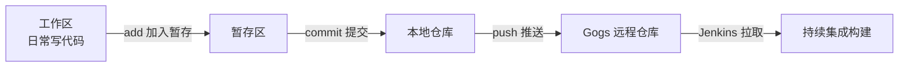

# 把 IDEA 工程推上 Gogs：关联远程、提交推送一次走通

> 🔒 安全提示：文中示例的口令/密钥均为课程教学环境演示口径，生产环境的安全要求见《安全与合规须知》。

Gogs 仓库建好、克隆地址也复制出来了，下一步就是让本机 IDEA 里那个开发中的工程「上云」。这一步的坑不在难，而在顺序：先开启版本控制集成，再关联远程地址，然后 add、commit、push 一路走完，中间还要输一次 Gogs 的账号密码。顺序错了或者漏了哪步，推送要么菜单都找不到，要么直接被远程拒绝。

## 先给结论

- 动作顺序固定：开启版本控制集成 → 关联远程仓库 → add 暂存 → commit 提交本地 → push 推送远程。
- IDEA 菜单里的 VCS → Enable Version Control Integration 选 Git，工程才会出现完整的 Git 菜单。
- 远程地址用 Gogs 仓库页「复制链接」拿到的那条，填进 Git → Repository → Remotes。
- push 时输入 Gogs 用户名密码（如 `liubei / 123456`），验证通过代码才真正落到服务器。
- 推送被拒（Push to origin/master was rejected）多半是远程已有提交历史而本地没有，先 pull 再 push。
- 工程根目录提前放好 `.gitignore`，把 `.idea/`、`target/`、`*.iml` 挡在仓库外面。

## 一、先让 IDEA 接管版本控制

工程刚建好时，IDEA 顶部菜单里并没有 Git 这一项。打开 VCS 菜单，选 Enable Version Control Integration，在弹出的下拉里选 Git 确认，Git 菜单才会出现。

这个动作在命令行里等价于工程根目录下的一次初始化：

```bash
git init
```

它做的事是生成 `.git` 目录，让 IDEA 从此能对工程执行完整的 Git 操作。课程安装文档的要求是本机安装 Git 并在 IDEA 设置里配好 Git 程序路径，这一步属于前置条件，客户端没装，后面的集成无从谈起。

## 二、关联远程仓库

本地仓库有了，还差一根「线」把它和 Gogs 上的空仓库连起来。菜单路径：Git → Repository → Remotes，点加号，把 Gogs 仓库页复制来的地址粘贴进去，确定。

命令行等价写法：

```bash
git remote add origin http://192.168.184.141:3000/liubei/tensquare.git
```

`origin` 是远程仓库的默认别名，一条本地仓库可以对应多个远程，日常推送默认都走 `origin`。地址里的账号段 `liubei`、仓库名 `tensquare` 要和 Gogs 上实际创建的保持一致，复制链接按钮给出来的就是拼好的成品，直接用最稳。

## 三、add、commit、push 三连

关联完成后就是标准的提交流程，IDEA 里三步：

```text
1. 右键工程 → Git → Add            （改动加入暂存区）
2. Git → Commit Directory          （写入提交说明，提交到本地仓库）
3. Git → Repository → Push         （本地提交推送到远程）
```

点 Push 后第一次会弹账号密码框，输入 Gogs 的用户名和密码，验证通过，推送开始。等 IDEA 右下角提示推送完成，刷新浏览器里的仓库页，能看到「2 次提交」的历史记录和工程目录，代码就真正落到了 Gogs 上。

三个动作各管一段路，画出来就是这条流水线：



值得留意的是 commit 和 push 是两回事：commit 只落到本机，断网也能做；push 才会把提交同步给服务器。本地攒了一堆 commit 而从不 push，团队和 Jenkins 看到的永远是旧代码。

## 四、push rejected：被拒绝时的正确姿势

推送时可能直接撞上一行红字：Push rejected: Push to origin/master was rejected。

原因在于远程仓库不是「全空」的。建仓库时如果初始化了 README，或者仓库页快速帮助里的命令已经执行过一次，远程 `master` 上就有提交历史；而本地仓库是白手起家，没有这段历史。Git 拒绝把两条不相干的历史直接合并推送，于是 reject。

处理办法是先把远程提交拉下来合并，再推：

```bash
git pull origin master --allow-unrelated-histories
git push -u origin master
```

`--allow-unrelated-histories` 允许合并两条没有共同祖先的历史，合并时若 README 冲突，按常规冲突处理完再推。更省事的预防办法是建仓库时什么都不初始化，让远程真正从零开始，本地首推一气呵成。

## 五、.gitignore：先把垃圾挡在外面

提交前还有一件事必须做：在工程根目录创建 `.gitignore` 文件。课程文档原文说得明确，此文件记录了在提交代码时哪些文件或目录被忽略。这套 Java 工程的标准写法：

```text
.idea/
target/
*.iml
```

`.idea/` 是 IDE 的个人配置，`target/` 是 Maven 的构建产物，`*.iml` 是工程描述文件，三者都属于「能随时再生成、对别人毫无价值」的内容。不放 `.gitignore`，它们会被 add 一网打尽提交上去，仓库体积膨胀，同事之间还可能因为 IDE 配置互相覆盖产生冲突。

## 常见误区

- **commit 之前没有 add。** 改动还停在工作区，Commit 窗口里看不到任何待提交文件，白白点了一次。IDEA 里 Add 过的文件名会变色，确认颜色再提交。
- **不写 `.gitignore` 就首次提交。** `.idea`、`target` 全进仓库，而且一旦被跟踪，事后补 `.gitignore` 也不会自动移除，得先 `git rm --cached` 再提交。
- **push rejected 后直接强推。** `git push -f` 会把远程已有提交直接抹掉，协作仓库里等于删掉别人的提交，风险极高。正确做法是先 pull 合并。
- **远程地址填错端口。** SSH 协议地址走映射出来的 `10022`，HTTP 地址走 `3000`，两条长得不像，从仓库页复制对应协议的那条，别手打。

## 面试可能被问到的问题

1. 面试官追问：「add、commit、push 各自完成了什么？」
   答：add 把工作区改动放入暂存区，决定这次提交包含哪些内容；commit 把暂存区内容固化为本地仓库的一条提交记录；push 把本地提交同步到远程仓库。三步对应 Git 的三个区域，前两步纯本地操作，push 才触网。

2. 面试官追问：「push rejected 一般是什么原因，怎么处理？」
   答：最常见是远程分支上有本地没有的提交，比如初始化的 README 或他人先推的代码，Git 为防覆盖而拒绝。先 `git pull` 把远程提交合并进来，解决冲突后再推；不相干历史需要加 `--allow-unrelated-histories`。

3. 面试官追问：「`.gitignore` 对已经被跟踪的文件生效吗？」
   答：不生效。它只拦截未跟踪的文件，已被提交的文件要先用 `git rm --cached 文件名` 从索引中移除并提交，之后 `.gitignore` 的规则才会接管。

4. 面试官追问：「IDEA 里的 Enable Version Control Integration 底层做了什么？」
   答：等价于在工程根目录执行 `git init`，生成 `.git` 目录并让 IDEA 的 VCS 机制接管工程。之后菜单里的 Add、Commit、Push 分别对应同名 Git 命令，IDEA 只是给命令行操作套了图形外壳。

5. 面试官追问：「持续集成为什么要求代码必须先提交到 Git 服务器？」
   答：Jenkins 构建的输入来自代码仓库，它只会从远程地址拉取源码，本机未推送的代码对流水线不存在。代码上库是自动集成的入口条件，也保证了构建对象是团队统一的最新版本。

## 配套资料

- 讲义：`materials/docs/10/Gogs安装文档.md`（「使用 Git 管理项目」章节：IDEA 中设置 Git 路径、从 Gogs 克隆、创建 `.gitignore`、add/commit/推送到远程仓库的完整步骤）
- 本课无配套源码工程，IDEA 菜单操作与命令取自课堂操作实录。
