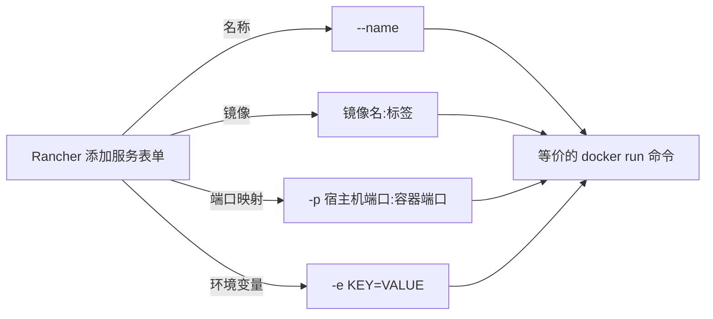

# 在 Rancher 里点出 MySQL 和 RabbitMQ：表单项与 docker run 一一对应

> 🔒 安全提示：文中示例的口令/密钥均为课程教学环境演示口径，生产环境的安全要求见《安全与合规须知》。

环境建好、主机纳管完成，Rancher 终于到了真正干活的时候：往应用里部署中间件。命令行时代部署一个 MySQL 要背 `-p`、`-e` 一长串参数，在 Rancher 里这些参数变成了一个个表单项。这一课部署 MySQL 和 RabbitMQ 两个服务，顺便把图形化部署与 docker run 的对应关系彻底对齐，以后部署任何镜像都是同一套思路。

## 先给结论

- Rancher 的「添加服务」是 docker run 的图形化翻译：名称对应 `--name`，端口映射对应 `-p`，环境变量对应 `-e`。
- MySQL 部署四要素：镜像 `centos/mysql-57-centos7`、端口映射 `33306:3306`、环境变量 `MYSQL_ROOT_PASSWORD=123456`、勾掉「创建前总是拉取镜像」。
- RabbitMQ 镜像选 `rabbitmq:management`（自带管理界面插件），需要映射 6 个端口：5671、5672、4369、15671、15672、25672。
- 本地没有的镜像，Rancher 创建时会自动去仓库拉取，首次创建偏慢是正常现象。
- 服务状态显示 Active 即部署成功，浏览器访问宿主机的 15672 端口能看到 RabbitMQ 登录页。

## 一、MySQL 部署：把 docker run 翻译成表单

操作路径：进入应用 → 添加服务。课堂环境里 MySQL 镜像 `centos/mysql-57-centos7` 已提前下载到本地，所以把「创建前总是拉取镜像」勾掉，创建时直接使用本地镜像。表单这样填：

| 表单项 | 填写值 | 对应 docker run 参数 |
|---|---|---|
| 名称 | mysql | `--name mysql` |
| 镜像 | centos/mysql-57-centos7 | 命令末尾的镜像名 |
| 端口映射 | 33306 → 3306 | `-p 33306:3306` |
| 环境变量 | MYSQL_ROOT_PASSWORD=123456 | `-e MYSQL_ROOT_PASSWORD=123456` |

翻译回命令行就是：

```bash
docker run -d --name mysql \
  -p 33306:3306 \
  -e MYSQL_ROOT_PASSWORD=123456 \
  centos/mysql-57-centos7
```

`MYSQL_ROOT_PASSWORD` 是这个镜像的必填环境变量，它决定 root 用户的初始密码，不设置容器会启动失败。点创建后，服务出现 Active 标志，表示服务创建成功。

宿主机端口选 33306 而不是 3306，是为了避开宿主机上可能已经存在的 MySQL 服务；用客户端连接时填宿主机 IP 加 33306，账号 root、密码 123456。生产环境不要用这种弱口令，这里仅为课堂演示方便。

## 二、RabbitMQ 部署：多端口的典型

RabbitMQ 的部署流程与 MySQL 一致，差别有两个：镜像本地没有、端口不止一个。镜像填 `rabbitmq:management`，`management` 标签意味着镜像里自带管理界面插件，15672 端口才有 Web 控制台可访问。因为本地没有这个镜像，Rancher 会在创建时自动下载：先拉镜像、再建容器，所以创建过程明显比 MySQL 慢；MySQL 之所以快，正是因为镜像早就存在。

端口映射按镜像的要求逐个添加，6 个端口同名映射（宿主机端口与容器端口相同）：

| 端口 | 职责 |
|---|---|
| 5672 | AMQP 协议端口，客户端收发消息走这里 |
| 5671 | AMQP 的 TLS 加密端口 |
| 4369 | 节点发现（epmd）端口 |
| 15672 | 管理界面的 HTTP 端口 |
| 15671 | 管理界面的 HTTPS 端口 |
| 25672 | 节点间集群通信端口 |

对应的命令行写法：

```bash
docker run -d --name rabbitmq \
  -p 5671:5671 -p 5672:5672 -p 4369:4369 \
  -p 15671:15671 -p 15672:15672 -p 25672:25672 \
  rabbitmq:management
```

创建完成、状态 Active 之后，浏览器访问 `http://192.168.184.144:15672/`（宿主机 IP 加管理端口），出现 RabbitMQ 的登录页就说明部署成功。

## 三、两套写法其实是一套



图形化界面没有引入任何新的运行机制，它只是把 docker run 的参数搬到了网页上，底层创建容器的始终是 Docker。把这张对应关系记住，Rancher 里部署任何镜像都可以先把命令想清楚，再照着填表单；反过来，看到别人给的 docker run 命令，也能逐项翻译成表单值。

还有一组对应关系值得知道：Rancher 里服务的查看日志、停止、删除，同样对应 `docker logs`、`docker stop`、`docker rm` 这组命令。界面与命令在生命周期每个环节都对得上，学容器管理操作时主动找一找它的命令行等价物，两边互相印证记得更牢。

## 常见误区

- **漏配 `MYSQL_ROOT_PASSWORD`。** 该镜像是强制要求的，不设环境变量容器初始化直接失败，服务状态不会变成 Active。
- **端口映射顺序写反。** 左边是宿主机端口、右边是容器端口，`33306:3306` 表示从宿主机 33306 进、转发到容器 3306，写反了外面怎么都连不上。
- **勾着「创建前总是拉取镜像」等半天。** 本地已有镜像时勾掉它即可；需要强制更新到最新镜像时再勾上。
- **等了一会儿就判定部署失败。** RabbitMQ 首次创建要现拉镜像，耗时明显偏长，等状态变成 Active 再下结论。

## 面试可能被问到的问题

1. 面试官追问：「Rancher 添加服务和直接 docker run 有什么区别？」
   答：容器层面效果一样，底层都是 Docker 创建容器。区别在管理面：Rancher 把参数表单化，创建出来的服务纳入平台统一管理，可以可视化监控状态、调整配置重建、做扩缩容；裸 docker run 的容器后续运维全靠命令行。

2. 面试官追问：「为什么 MySQL 镜像必须设置 MYSQL_ROOT_PASSWORD？」
   答：这是该官方镜像约定的初始化入口，首次启动的初始化脚本靠它给 root 设置密码。缺少这个变量初始化流程无法完成，容器会启动失败退出。生产环境还会配合更强的密码和数据卷挂载一起使用。

3. 面试官追问：「rabbitmq:management 和普通 rabbitmq 镜像有什么不同？」
   答：management 标签的镜像预装并启用了 management 插件，提供 15672 端口的 Web 管理控制台；普通镜像只有消息代理本体，要用管理界面得自行开启插件并暴露端口。

4. 面试官追问：「RabbitMQ 为什么要映射那么多端口？」
   答：不同端口承担不同职责：5672 是客户端 AMQP 通信端口，4369 用于节点发现，25672 是节点间通信，5671 与 15671 是对应的 TLS 端口，15672 是管理控制台。实际项目按需映射也可以只开 5672 和 15672，课程按镜像的标准要求全部映射。

5. 面试官追问：「Rancher 里服务状态 Active 代表什么？」
   答：代表服务容器已按配置创建并正常运行。其他常见状态有 Updating（正在按新配置更新中）和 Error 等，出现异常状态需要进服务详情查日志定位原因。

## 配套资料

- 本课无配套讲义与源码包，部署参数（镜像名、端口映射、环境变量、镜像拉取策略）与等价 docker run 命令取自课堂实录（课件「应用部署」的 MySQL 部署、RabbitMQ 部署小节），文中命令为按本课写法整理的示例。
