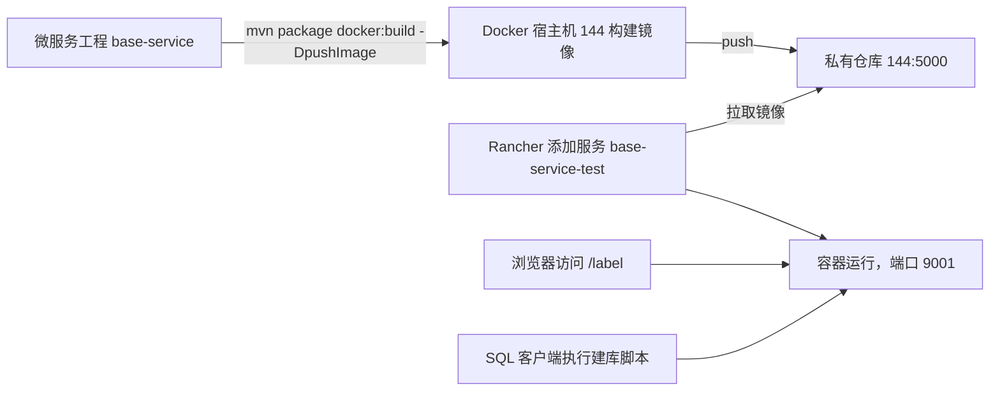

# 从 Redis 打底到微服务上线：私有仓库、远程构建与 Rancher 部署全链路

> 🔒 安全提示：文中示例的口令/密钥均为课程教学环境演示口径，生产环境的安全要求见《安全与合规须知》。

中间件都进了 Rancher，真正的主角还差一步：自己写的微服务怎么变成容器跑上去？它和 MySQL 那种「选个现成镜像」不同，镜像得自己造、自己存、自己推。这一课先用最短的篇幅把 Redis 部署收尾，主线则是走通一条完整链路：私有仓库、Docker 远程访问、工程内构建并推送镜像、初始化数据库，最后在 Rancher 里创建服务并验证接口。

## 先给结论

- Redis 部署是最简一课：添加服务、镜像 `redis`、映射 `6379:6379` 即可，客户端连上能 `set`/`get` 就算成功。
- 微服务上 Rancher 的前提链路：私有仓库负责收镜像，Docker 开 2375 远程端口，工程用 docker-maven 插件完成构建并推送。
- 构建失败最常见的原因是基础镜像缺失：插件里写了基础镜像 `jdk1.8`，宿主机上就必须先把它造出来。
- 镜像推上私有仓库后，Rancher 添加服务选中它、映射业务端口 9001，状态 Active 后浏览器直接调接口验证。
- 容器里的微服务要连数据库，所以创建服务之前要先把库和表初始化好。

## 一、Redis 部署：两分钟的事

操作照旧：进入应用 → 添加服务，名称 `redis`，镜像 `redis`，勾掉「创建前总是拉取镜像」，端口映射 `6379:6379`，点创建即可。相比 MySQL 要配环境变量、RabbitMQ 要配六个端口，Redis 暴露 6379 一个端口就够，是最省事的一个。

验证方式是拿客户端连上去读写一次。课程在 Windows 机器上准备了 Redis 客户端目录（含 `redis-cli.exe`），连接时用 `-h` 指定部署主机：

```bash
redis-cli -h 192.168.184.144
# 连接成功后读写一次：
set name abc
get name
# 返回 "abc"，读写正常，部署成功
```

## 二、微服务部署的全景图

微服务与中间件的本质区别在于镜像来源：MySQL、Redis 用官方镜像，微服务镜像是自己工程的产物。整条链路如下：



图上任何一个环节缺位，链路就断：私有仓库没搭，镜像没地方放；2375 没开，工程没法远程构建；基础镜像没造，构建第一步就失败；库没建，服务起来了接口照样报错。后面三节按顺序把这几个环节补齐。

## 三、服务器侧：私有仓库与远程访问

**第一，重建私有仓库。** 课程的服务器是重新准备的，之前章节搭的私有仓库已经不在了，先把它拉起来：

```bash
docker run -d --name=registry -p 5000:5000 registry
```

**第二，让 Docker 信任这个仓库。** 编辑 `/etc/docker/daemon.json`，把仓库地址加进 `insecure-registries`，否则推送会被拒绝：

```json
{
  "insecure-registries": ["192.168.184.144:5000"]
}
```

**第三，开放 Docker 远程访问。** 微服务工程在开发机上，构建镜像却要发生在 144 这台宿主机上，靠的是 Docker 的远程 API。编辑 `/lib/systemd/system/docker.service`，给 `ExecStart` 追加监听参数：

```ini
ExecStart=/usr/bin/dockerd -H tcp://0.0.0.0:2375 -H unix:///var/run/docker.sock
```

`0.0.0.0` 表示任意 IP 都能连；想限定来源，把它改成具体 IP 即可。配置改完依次执行：

```bash
systemctl daemon-reload
systemctl restart docker
docker start registry
```

注意 restart docker 之后，之前创建的 registry 容器不会自动跟着起来，要手动 `docker start`，Rancher 容器同理。

## 四、工程侧：插件构建并推送镜像

微服务工程（基础数据服务，模块名按业务语义记作 base-service）里已配好 docker-maven 插件，要做的是把旧环境地址改成 144：工程配置里的 `dockerhost` 属性与插件配置里的 `<dockerHost>` 都指向 `http://192.168.184.144:2375`。插件配置的核心部分如下（示例按本课写法整理）：

```xml
<plugin>
    <groupId>com.spotify</groupId>
    <artifactId>docker-maven-plugin</artifactId>
    <version>0.4.13</version>
    <configuration>
        <!-- 镜像全名：私有仓库地址/工程名:版本号 -->
        <imageName>192.168.184.144:5000/${project.artifactId}:${project.version}</imageName>
        <!-- 基础镜像：容器里要跑 jar，必须自带 JDK -->
        <baseImage>jdk1.8</baseImage>
        <!-- 容器启动命令：java -jar 跑 Spring Boot 应用 -->
        <entryPoint>["java", "-jar", "${project.build.finalName}.jar"]</entryPoint>
        <!-- 把 target 目录下打好的 jar 拷进镜像 -->
        <resources>
            <resource>
                <targetPath>/</targetPath>
                <directory>${project.build.directory}</directory>
                <include>${project.build.finalName}.jar</include>
            </resource>
        </resources>
        <!-- Docker 远程 API 地址，构建与推送都发往 144 -->
        <dockerHost>http://192.168.184.144:2375</dockerHost>
    </configuration>
</plugin>
```

一条命令完成清理、打包、构建、推送：

```bash
mvn clean package docker:build -DpushImage
```

课堂实录里这一步真翻过车：构建在第一步就报错，原因是基础镜像 `jdk1.8` 在 144 上不存在。插件声明的 `baseImage` 是 `jdk1.8`，Docker 构建时要先找到它，找不到直接失败。解决办法是回到 Dockerfile 的做法：把 JDK 压缩包和 Dockerfile 传到 144 的一个目录里，执行 `docker build -t jdk1.8 .` 把基础镜像造出来，再重新跑上面的 Maven 命令。这次构建顺利，镜像也被推送进了私有仓库，在宿主机上 `docker images` 能看到它。

## 五、初始化数据库，然后在 Rancher 里上线

镜像进了仓库，距离服务能跑还差数据。这个微服务要读写 MySQL，先用 SQL 客户端连接 144 上的 MySQL（root 密码 `123456`，端口用映射出来的宿主机端口），执行配套的建库脚本，建出业务库以及 `t_city`（城市表）、`t_label`（标签表）。

然后回到 Rancher，进入应用点添加服务：

- 名称：`base-service-test`
- 镜像：`192.168.184.144:5000/base-service:1.0-SNAPSHOT`，即私有仓库里刚推上去的那个
- 端口映射：`9001:9001`

创建后等状态变成 Active。浏览器访问 `http://192.168.184.144:9001/label`，能看到标签列表的 JSON 数据，说明微服务容器化部署成功：请求打到宿主机 9001，经端口映射进入容器，容器里的 Spring Boot 应用查询数据库并返回结果。

## 常见误区

- **基础镜像想当然。** 插件里声明了 `baseImage`，就要保证它在执行构建的宿主机上真实存在，报 `no such image` 时先查基础镜像。
- **restart docker 之后忘了手动拉起容器。** 未配置自动重启策略的容器不会随 Docker 服务一起启动，registry 和 Rancher 都要再 `docker start` 一次。
- **2375 端口裸奔。** 远程 API 无加密无认证，`0.0.0.0` 意味着任何能连到这台机器的人都能操作它的 Docker，生产环境必须限制来源网段或启用 TLS 端口。
- **服务先起、库后建。** 容器里的应用启动阶段就要连数据库，表不存在时启动校验或首次查询直接报错，建库脚本必须先执行。

## 面试可能被问到的问题

1. 面试官追问：「`mvn clean package docker:build -DpushImage` 一条命令背后发生了什么？」
   答：`clean` 清理输出目录，`package` 打出可执行 jar；`docker:build` 把 jar 与基础镜像组装成 Docker 镜像，构建请求通过 `<dockerHost>` 发给远程宿主机执行；`-DpushImage` 让构建完成后自动把镜像推送到 `<imageName>` 里指定的私有仓库。

2. 面试官追问：「为什么微服务镜像要基于 jdk1.8 这样的基础镜像？」
   答：Spring Boot 工程打成 jar 后需要 JRE 才能运行，基础镜像里装好 JDK 并配好环境变量，容器启动时执行 `java -jar` 即可。基础镜像与业务镜像分层后，多个微服务还能复用同一层 JDK，降低存储与构建开销。

3. 面试官追问：「私有仓库在这条链路里解决什么问题？」
   答：自研镜像不能推公共仓库，而镜像又要在不同机器间流转。推到内网私有仓库后，任何一台主机都能按「仓库地址/工程名：版本」拉取，Rancher 创建服务时也是从它拉镜像，它是容器化部署的标准中转站。

4. 面试官追问：「Docker 的 2375 和 2376 端口有什么区别？」
   答：2375 是远程 API 的非加密端口，2376 是 TLS 加密端口。课程演示用 2375 便于快速打通链路，生产环境应该用 2376 配证书认证，或者干脆不在节点上暴露远程端口。

5. 面试官追问：「部署微服务前为什么要先执行建库脚本？」
   答：应用的启动校验和接口调用都依赖数据库对象，表不存在时启动或首次查询就会报错。先把库表初始化好，容器化部署才能一次通过，这也是部署清单里数据库迁移排在服务上线之前的原因。

6. 面试官追问：「Rancher 添加服务时，镜像名为什么必须带仓库地址前缀？」
   答：完整镜像名 `192.168.184.144:5000/base-service:1.0-SNAPSHOT` 的第一段是仓库地址，Rancher 看到它会去对应的私有仓库拉取；不带地址前缀会被理解为去 Docker Hub 查找，名字对不上就直接拉取失败。

## 配套资料

- 本课无配套源码工程（资料目录中没有微服务部署用的工程与建库脚本），插件配置、部署参数与命令均取自课堂实录，文中 pom 与命令为按本课写法补全的示例，可套用到任意 Spring Boot 工程。
- jdk1.8 基础镜像的 Dockerfile 写法见本阶段「Dockerfile 构建 JDK 镜像」一篇；私有仓库搭建与 `insecure-registries` 配置细节见「Docker 私有仓库的搭建与配置」一篇。
