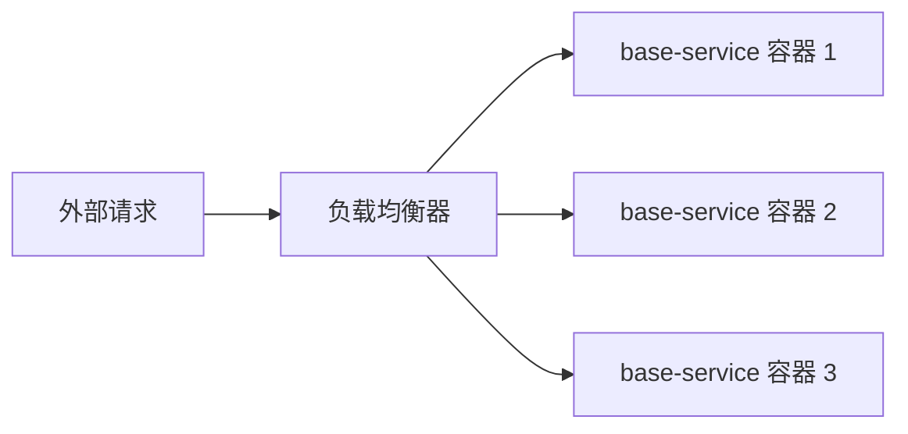

# Rancher 的弹性一手：Webhook 触发的扩容与缩容

服务跑起来只是及格线，流量一上来单个容器撑不住怎么办？Rancher 给的答案是扩容：同一个服务横向增加容器，组成集群分担压力；低峰期再缩容，把资源还回去。这一课走一遍完整的扩容：建一个不带端口映射的服务，配一个 Webhook 接收器，用 Postman 发一个 POST 请求，容器数量就从 1 变成了 3。

## 先给结论

- 扩容是增加容器数量形成集群，承载更高并发；缩容是减少容器数量，低峰期释放系统资源。
- 参与扩缩容的服务不能设端口映射：多个容器挤同一个宿主机端口必然冲突，端口要交给 Rancher 统一管理。
- 扩缩容的触发入口是 Webhook 接收器：Rancher 生成一个专属 URL，POST 一次就执行一次扩容或缩容。
- 步长决定一次触发增减几个容器，最小/最大数量划定副本数的上下限。
- Webhook 是外部系统联动 Rancher 的标准接口，监控告警、自动化脚本都能调用它。

## 一、为什么扩容之前要把端口映射去掉

课堂先把原来带 `9001` 端口映射的 `base-service-test` 删掉，重建了一个 `base-service`，镜像不变，唯一区别是不设端口映射。

原因一句话讲透：扩容之后同一个服务会有多个容器，如果每个容器都映射宿主机的 9001，第二个容器一创建端口就冲突了。去掉映射后，容器端口由 Rancher 内部管理，对外流量由负载均衡器统一接入（下一课的主题），它会把请求分发到后面的多个容器上：



有了这层结构，容器数量增减都不影响对外入口，这正是弹性伸缩的前提。

## 二、创建 Webhook 接收器

路径：API → Webhooks（Web 钩子）→ 添加接收器。表单逐项填：

| 配置项 | 填写值 | 含义 |
|---|---|---|
| 名称 | scale-base | 接收器标识 |
| 描述 | 扩缩容服务 | 备注用途 |
| 操作 | 扩容（或缩容） | 触发后执行的动作 |
| 目标服务 | 应用下的 base-service | 要扩缩的服务 |
| 步长 | 2 | 每次触发增减的容器数 |
| 最小数量 | 1 | 副本数下限 |
| 最大数量 | 100 | 副本数上限 |

创建成功后，接收器会给出一个专属 URL，形如 `http://192.168.184.135:9000/v1/webhooks/endpoint/key/...`，把它复制出来，这就是外部触发扩容的入口。

## 三、POST 一下，容器从 1 变 3

打开 Postman，新建请求，方法选 POST，地址粘贴刚才复制的 Webhook URL，点 Send。回到 Rancher 界面，`base-service` 的状态开始 Updating，更新结束后副本数停在 3：初始 1 个容器，步长是 2，一次触发加两个，正好 3 个。更新过程中副本数会逐步往上爬，拉起容器需要时间，等状态回到 Active 再看最终数量。

跳过 Postman，命令行里一个请求效果相同（示例按本课写法补全，URL 以接收器页面生成的为准）：

```bash
curl -X POST http://192.168.184.135:9000/v1/webhooks/endpoint/key/<接收器Key>
```

缩容的操作完全对称：再建一个接收器，动作单选按钮选「缩容」，其余配置不变。触发一次，副本数按步长往下减，减到最小数量为止。

Webhook 接收器这个名字听起来玄，本质就是 Rancher 对外暴露的一个 HTTP 接口：外部任何能发 HTTP 请求的东西，监控系统、定时任务、自动化脚本，都能通过 POST 这个 URL 指挥 Rancher 扩容或缩容。手动在界面上点能做的事，从此有了程序化入口。

## 常见误区

- **带着端口映射去扩容。** 第二个容器就会因为宿主机端口被占用而起不来，参与扩缩容的服务必须去掉端口映射，交给 Rancher 管理。
- **把步长当成上限。** 步长是一次触发增减的数量，上限由最大数量控制，两个参数各管各的。
- **状态一直在 Updating 就以为失败了。** 扩容要逐个拉起容器，更新需要时间，等状态回到 Active 再确认副本数。
- **只会在界面上手点扩缩容。** Webhook 的价值在程序化触发，把 URL 接到监控告警流程里，才能做到流量驱动的弹性伸缩。

## 面试可能被问到的问题

1. 面试官追问：「扩容和缩容分别解决什么问题？」
   答：扩容在访问高峰增加容器数量，让多个实例组成集群分担压力，提升整体吞吐；缩容在低峰减少实例，释放 CPU、内存等资源。两者配合让资源消耗随负载变化，兼顾成本与稳定性。

2. 面试官追问：「为什么参与扩缩容的服务不能配置端口映射？」
   答：端口映射是宿主机端口与容器端口的一对一绑定，同一服务扩出多个容器后，多个容器抢同一个宿主机端口必然冲突。去掉映射后由平台的调度与负载均衡层统一接入流量，实例数量变化不再受端口限制。

3. 面试官追问：「Rancher 的 Webhook 接收器是什么机制？」
   答：它是对外暴露的 HTTP 端点，创建时绑定了动作（扩容或缩容）、目标服务、步长和数量边界。外部系统向该 URL 发 POST 请求，Rancher 就执行一次对应操作，相当于给平台开了一个可程序化调用的运维接口。

4. 面试官追问：「步长、最小数量、最大数量怎么配合使用？」
   答：步长控制每次触发变化的幅度，最小/最大数量划定副本数的安全区间。即便外部反复误触发，副本数也不会跌破下限或突破上限，防止服务被清空或资源被耗尽。

5. 面试官追问：「这种触发式的扩缩容，和自动扩缩容差在哪？」
   答：Webhook 版依赖外部触发者判断时机，比如监控指标越线后由告警系统调接口；自动扩缩容由平台根据指标持续自动调节。课程 Kubernetes 章节的 HPA 就是后者的代表，按 CPU 利用率在上下限之间自动增减副本。

## 配套资料

- 本课无配套源码包，操作路径、接收器参数（步长 2、最小数量 1、最大数量 100）与 Postman 触发过程取自课堂实录，示例为按本课写法补全。
- 自动扩缩容的声明式写法可对照课程 Kubernetes 章节的真实示例：`materials/code/01/6.k8s-基础/k8s-基础/代码/demo4-hpa.yaml`（HPA：最小 1、最大 10、目标 CPU 利用率 50%）与 `materials/code/01/6.k8s-基础/k8s-基础/代码/demo4-deployment.yaml`（Deployment 副本声明）。
