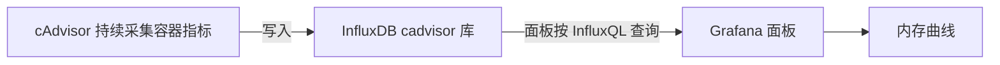

# 在 Grafana 里新增仪表盘：把容器内存画成一条实时曲线

Grafana 装好了，数据源也连上了 InfluxDB，主界面却还是一片空白。想盯基础微服务的内存占用，cAdvisor 的网页只能看「此刻」，InfluxDB 里躺着的又是一行行冰冷的数值，趋势必须靠图。这一课把内存数据做成仪表盘面板：配置一次，微服务跑起来，曲线自动往上长。

## 先给结论

- 仪表盘（Dashboard）是一张报表页，面板（Panel）是报表里的一张图；新增流程是先建仪表盘，再往里加 Graph 图表，最后编辑面板。
- 面板编辑四块内容：标题、数据源、查询、坐标轴，逐块填完保存。
- 数据源选 InfluxDB；查询按 InfluxQL 组装：FROM `memory_usage`，SELECT `mean(value)`，GROUP BY `time(30s)`。
- WHERE 条件用 `container_name` 圈定单个容器，不加条件会把所有容器的数据画进同一张图。
- 保存时给整个仪表盘命名，之后微服务运行产生的数据会自动上图。

## 一、两层结构：仪表盘与面板

Grafana 的报表体系是两层：仪表盘是一页报表，相当于一个容器；面板是报表里的每张图，一张折线图、一个仪表盘控件都算一个面板。新增仪表盘的入口在左侧菜单 Dashboards → Manage，点「+ Dashboard」，进入新建页面后在九个可视化按钮里选第一个 Graph（图表），一块空白面板就挂进来了。

点面板左上的下拉箭头，选 Edit 进入编辑界面。整个编辑页分成几个区块，逐个看：Info 区管标题和描述，Metrics 区管查什么数据，Axes 区管坐标轴，配置的本质可以用一张图概括：



关键理解：面板保存的其实是一条 InfluxQL 查询语句，每次刷新页面，Grafana 拿着这条语句按时间范围去查 InfluxDB，把结果画成图。后面所有的配置动作，都是在组装这条语句。

## 二、面板配置：从标题到查询

**标题。** Info 区的 Title 改成「基础微服务-内存监控」，Description 可选，支持 markdown 与链接，写一句面板用途即可。

**数据源。** 往下选数据源，指向前面配置好的 InfluxDB，库就是 cAdvisor 数据写入的那个 `cadvisor` 库，采集间隔按 30 秒设置。

**查询。** Metrics 选项卡里组装查询，界面上的每一行下拉都对应 InfluxQL 的一个子句，最终生成的语句长这样：

```sql
FROM "memory_usage"
SELECT mean("value")
WHERE "container_name" = 'base-service-1-a432bf7'
GROUP BY time(30s) fill(null)
FORMAT AS time series
```

逐句拆开：

- FROM `memory_usage`：cAdvisor 写进 InfluxDB 的内存指标表，指标含义见 cAdvisor 一篇。
- SELECT `mean(value)`：每个时间分片内取平均值，平滑曲线。
- WHERE `container_name = ...`：按容器名过滤。cAdvisor 把所有容器的指标写进同一张表，靠 `container_name` 标签区分实例；Rancher 拉起的容器名带随机后缀，形如 `base-service-1-a432bf7`，实际值在界面的下拉列表里选，以环境里真实的容器名为准。
- GROUP BY `time(30s) fill(null)`：30 秒一个数据点，没有数据的分片补 null。
- FORMAT AS time series：输出时序格式，这是画折线的前提。

不确定有哪些容器名时，可以先在 InfluxDB 里查标签取值再回来填：

```sql
SHOW TAG VALUES WITH KEY = "container_name"
```

**图例。** ALIAS 按命名模式控制曲线的显示名，多实例时靠它区分谁是谁。

## 三、坐标轴与保存

查询配完，图已经能出线。Axes 选项卡收尾：可以改 Y 轴的计量单位，设定 Y 轴最小值与最大值，默认情况下都是自动（auto），大多数场景保持默认即可，只在数值量级跨度很大或需要固定区间对比时才动。

全部设置完点保存，弹出 Save As 对话框，给仪表盘起名「基础微服务」，落到 General 文件夹。注意这一步命名的是整个仪表盘，面板标题「基础微服务-内存监控」早在 Info 区就定了，两层名字各管各的。

保存完回到报表页，微服务一运行，内存数据就会体现在这张报表上，曲线随时间自动延伸。

## 常见误区

- **面板一片空白先怀疑查询。** 顺序应该反过来：先确认数据源选对了库、InfluxDB 里 `memory_usage` 表确实有数据（cAdvisor 在跑、写入没断），查询语法反而是后查的。
- **不加 WHERE 条件。** 所有容器的内存曲线会叠进同一张图，只能看全机总量，分不清实例，单实例监控必须按 `container_name` 过滤。
- **把 `time(30s)` 当成采集频率。** 它是查询的分组间隔，决定折线每个点聚合多长时间的数据；采集是 cAdvisor 持续在做的事，两者不在一层。
- **面板标题和仪表盘名混为一谈。** 面板标题写在图上，仪表盘名是报表页的名字，保存对话框里改的是后者；找图找不到时先分清自己在哪一层。

## 面试可能被问到的问题

1. 面试官追问：「Grafana 的 Dashboard 和 Panel 是什么关系？」
   答：Dashboard 是一页报表，Panel 是页里的一张图。一个 Dashboard 可以放多个 Panel，每个 Panel 独立绑定数据源与查询，保存时以 Dashboard 为单位落盘，Panel 挂在它下面。

2. 面试官追问：「面板里的 memory_usage 数据从哪来？」
   答：cAdvisor 监控 Docker 主机与容器时产出的内存指标，写入 InfluxDB 的 memory_usage 表。Grafana 只读这张表并画图，自己不采集数据。

3. 面试官追问：「WHERE 里按 container_name 过滤解决什么问题？」
   答：cAdvisor 把所有容器的指标写进同一张表，靠 container_name 标签区分实例。不过滤得到的是全机汇总曲线，过滤后才能看单个微服务实例的走势，这是多实例排查的基础。

4. 面试官追问：「GROUP BY time(30s) 起什么作用？」
   答：把时序数据按 30 秒分片，每片用聚合函数（如 mean）算出一个点，折线粒度由它决定。分片越小曲线越细、查询压力越大，按展示需要权衡，配合 fill(null) 处理空分片。

5. 面试官追问：「新面板没数据，怎么排查？」
   答：沿数据流向查：cAdvisor 是否在采集并写入、InfluxDB 对应库表有没有数据、Grafana 数据源连接参数是否正确、面板查询的表名与标签值是否写对。多数问题出在数据源配置而不是查询语句。

## 配套资料

- 本课无配套源码包，操作路径、面板查询与容器名取自课堂实录，示例为按本课写法补全的可运行写法。
- `memory_usage` 表与 `cadvisor` 库的创建见「InfluxDB」「cAdvisor」两篇；数据源注册见「Grafana 的安装」一篇。
