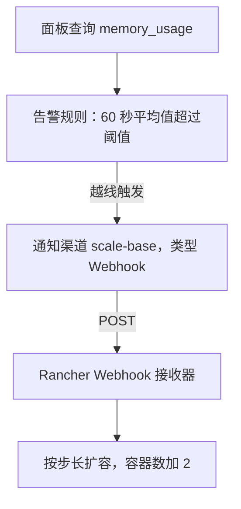

# Grafana 告警接上 Rancher：内存越线，容器自动加

上一课的内存曲线再直观也得有人盯。半夜流量涨了、内存均值越过安全线，靠人看图再手点扩容，反应永远是滞后的。Grafana 的预警通知把这件事自动化：在图表上设一条阈值线，数值越线就按指定方式发通知，通知的那头接着 Rancher 的扩容接口，容器数量自己往上加。操作分两步，先设通知渠道，再建告警规则。

## 先给结论

- 两步走：先建通知渠道（Notification Channel），回答「用什么方式通知」；再到面板上建告警（Alert），回答「什么条件触发、通知发给谁」。
- 渠道类型选 Webhook，URL 填 Rancher Webhook 接收器的地址，请求方式 POST。
- Send Test 是真执行：测试一次，Rancher 里对应服务的容器真的从 3 个变成 5 个。
- 告警条件按查询结果的 60 秒平均值与阈值比较，阈值可以直接输入，也可以在图上拖动告警线。
- 渠道的消息文本只有邮件类渠道用得上，Webhook 渠道发不出这段文字。

## 一、两个部件：渠道与规则

Grafana 的告警由两块独立配置拼成。通知渠道定义出口：邮件、Webhook 还是其他方式；告警规则挂在面板查询之上，定义触发条件与通知去向。两者的配合关系：



关键路径在渠道到接收器这一段：渠道只是个 HTTP 客户端，真正决定「做什么」的是 Rancher 侧接收器绑定的动作。渠道与规则分开配的好处是复用，多条告警规则可以共用同一个渠道。

## 二、第一步：建 Webhook 通知渠道

左侧菜单选 Alerting（告警）→ Notification channels（第二个菜单项）→ Add channel，表单逐项填：

| 配置项 | 填写值 | 含义 |
|---|---|---|
| Name | scale-base | 渠道名称，告警规则里按它引用 |
| Type | Webhook | 通知方式 |
| Url | `http://192.168.184.144:9000/v1/webhooks/endpoint/key/<接收器Key>` | Rancher 扩容接收器生成的地址 |
| Http Method | POST | Webhook 用 POST 发出 |
| Include image | 勾选 | 通知附带图表截图 |

URL 不用自己编，直接从 Rancher 的 Webhook 接收器页面复制，就是「扩容与缩容」一篇里创建的那个 scale-base 接收器给出的专属地址，以接收器页面实际生成的为准。

保存之前先点 Send Test 验证链路。测试结果值得盯一眼 Rancher 界面：应用里的容器从 3 个变成了 5 个。原因很直接，这个接收器绑定的动作是扩容、步长 2，Send Test 发出的 POST 被当成了一次真实触发。测试不是空跑，会真的动集群，生产环境上别对着在用的服务随手点。

等价的手动验证方式是一个 curl 请求（URL 以接收器页面生成的为准）：

```bash
curl -X POST http://192.168.184.144:9000/v1/webhooks/endpoint/key/<接收器Key>
```

链路通了再点 Save，渠道 scale-base 落库，列表里出现这条新渠道。

## 三、第二步：在面板上建告警规则

回到仪表盘「基础微服务」，点「基础微服务-内存监控」面板的下拉箭头 → Edit → 切到 Alert 选项卡 → Create alert。

条件区配两件事。

**第一，触发条件。** 评估对象是查询值：取 60 秒的平均值，超过设定阈值就触发。课堂演示填的 800，这是演示值，`memory_usage` 的量纲取决于采集侧定义，实际使用要按指标单位与容量规划定阈值。在输入框里敲数字时，图表上会出现一条横向告警线，位置随值变化；也可以直接在图上拖这条线，阈值跟着动，所见即所得。这条规则的底层查询可以理解成：

```sql
SELECT mean("value") FROM "memory_usage"
WHERE "container_name" = 'base-service-1-a432bf7' AND $timeFilter
GROUP BY time(60s)
```

**第二，通知去向。** 下面的 Notifications 区，点 Send to 旁的加号，选中刚建的 scale-base 渠道。再往下的消息框可以写告警说明，但只有邮件这类渠道会带上它，Webhook 渠道用不上，写了也不会出现在通知里。

编辑完保存仪表盘，备注「增加预警」，告警规则随仪表盘一起落盘。

## 四、闭环跑起来之后

链路完整后的运行状态是这样的：微服务持续写入内存指标，Grafana 持续按 60 秒窗口算平均值，某次均值越过阈值，告警触发，POST 打到 Rancher 接收器，容器数量按步长增加，内存压力摊到新实例上，曲线随后回落。全程无人参与，上一章拼装了三节的弹性伸缩，在这里收成一条自动闭环。

## 常见误区

- **把 Send Test 当成无害测试。** 它发出的就是一次真实通知，接收器绑定扩容就真扩容，课堂里容器因此从 3 个变 5 个。验证链路通了就收手。
- **照抄演示阈值。** 800 是课堂演示值，不对应任何真实量纲；换环境必须按指标单位重新标定，否则永远不触发，或者一直在触发。
- **在消息框里写关键告警信息。** Webhook 渠道不携带消息文本，告警上下文要靠接收器侧的动作定义与监控侧自己的记录，别指望这段文字能传过去。
- **改了查询忘了告警。** 告警条件挂在面板查询之上，WHERE 换了容器、聚合函数改了，条件评估的对象也跟着变，回头检查阈值是否还成立。

## 面试可能被问到的问题

1. 面试官追问：「Grafana 的通知渠道和告警规则分别解决什么问题？」
   答：渠道解决「通过什么方式通知」，一个渠道是一个出口，如邮件、Webhook；规则解决「什么时候触发、发给谁」，定义查询、聚合窗口、阈值与引用的渠道。两者解耦，多条规则可以复用同一渠道。

2. 面试官追问：「为什么通知渠道选 Webhook 而不是邮件？」
   答：邮件只到人，Webhook 到系统。把渠道指向 Rancher 的 Webhook 接收器，告警可以直接指挥编排平台扩容，实现无人值守的弹性伸缩，人这一层只需要事后看记录。

3. 面试官追问：「Send Test 都做了什么？」
   答：向渠道配置的地址真实发出一次通知，对 Webhook 渠道就是一次 POST，接收方会当作真实事件处理。它既是链路验证，也是一次真实触发，要在可控时机执行。

4. 面试官追问：「告警条件为什么用 60 秒平均值而不是瞬时值？」
   答：瞬时值抖动大，一次毛刺就可能误触发。取窗口平均能滤掉短时波动，让告警反映持续的趋势性越线。窗口越大越稳但响应越慢，60 秒是常见的小窗口取值。

5. 面试官追问：「这套 Webhook 触发扩容，和 Kubernetes 的 HPA 有什么区别？」
   答：Webhook 方案靠外部系统判断时机并主动调接口，监控、渠道、接收器每个环节都要自己接；HPA 是平台内建能力，一份声明给出副本上下限与 CPU 目标，控制器按指标自动调节，不需要外接告警。

## 配套资料

- 本课无配套源码包，渠道参数、告警配置与 Send Test 现象取自课堂实录，文中 URL 与查询为按本课写法补全的示例。
- Webhook 接收器的创建（名称、动作、步长、数量边界）见「扩容与缩容」一篇；平台内建自动扩缩容的声明式写法可对照 `materials/code/01/6.k8s-基础/k8s-基础/代码/demo4-hpa.yaml`。
