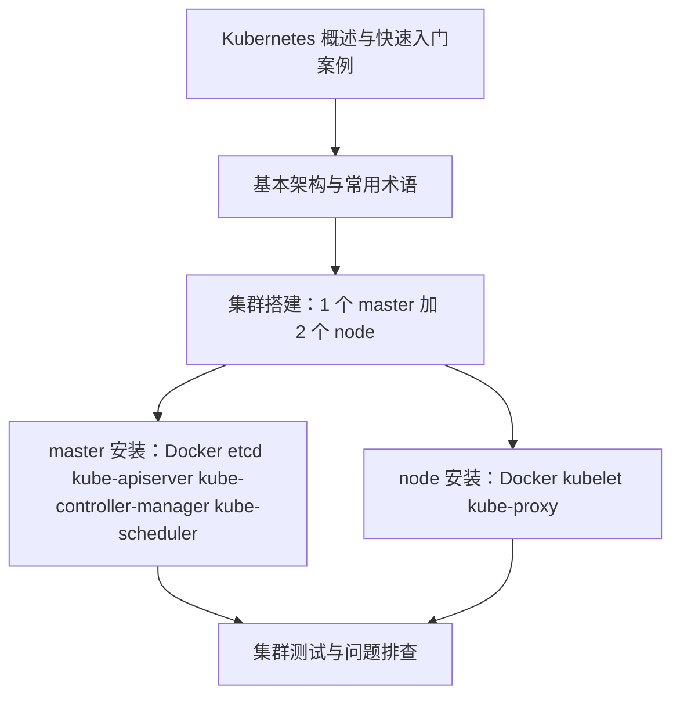
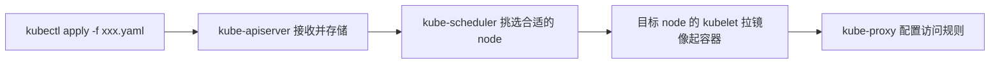

# Kubernetes 开篇：把上一章手工接的线，变成平台内建的能力

上一章收在一条自动闭环上：Grafana 内存曲线越过阈值，告警 POST 打到 Rancher 的 Webhook 接收器，容器从 3 个变成 5 个。链路能跑，但每个环节都要自己接：扩缩容要预设接收器，容器挂了要靠人发现，节点宕机要人搬服务。Kubernetes（简称 K8s）把这类事情变成平台内建能力。这门 Kubernetes 快速入门讲三大块：Kubernetes 是什么、有什么作用，配一个快速入门案例；基本架构与常用术语；用 1 个 master 节点加 2 个 node 节点演示二进制方式搭建集群。

## 先给结论

- 课程三大块：Kubernetes 概述与快速入门案例；基本架构与常用术语（master、node、pod、service）；集群搭建（1 master 加 2 node，二进制安装）与过程中的问题排查。
- Kubernetes 是容器编排平台，它不管「怎么把一个应用容器化」，管「一群容器在多主机环境下怎么排兵布阵」。
- 用法是声明式的：yaml 描述期望状态（几个副本、什么镜像、开什么端口），控制器持续把实际状态向期望状态对齐。
- 自动扩缩容内建：HPA 一份 yaml 声明副本上下限与 CPU 目标，不再需要外接 Grafana 告警与 Webhook。
- 二进制安装的组件清单：master 装 Docker、etcd、kube-apiserver、kube-controller-manager、kube-scheduler；node 装 Docker、kubelet、kube-proxy。

## 一、为什么有了 Docker 和 Rancher，还要 Kubernetes

把上一章最得意的闭环摆出来看成本：Grafana 建面板、建通知渠道、建告警规则，Rancher 建 Webhook 接收器，两边 URL 对上，才换来「内存越线自动加容器」。这条链之外还有大片空白：容器崩溃没人重启，主机宕机服务不迁移，发布新版本要重新走一遍界面部署。

Kubernetes 把这些全部内建：

| 能力 | 上一章的做法 | Kubernetes 的做法 |
|---|---|---|
| 自动扩缩容 | Grafana 告警加 Webhook 接收器 | HPA，一份 yaml |
| 故障自愈 | 无，靠人重启 | 控制器检测并重建 |
| 服务发现与负载均衡 | Rancher 负载均衡器 | Service 抽象内建 |
| 部署描述 | 界面手点 | yaml 声明，可进版本库 |

拿课程资料里的真实文件对比，上一章三个系统配合才做到的自动扩容，Kubernetes 这样写（`materials/code/01/6.k8s-基础/k8s-基础/代码/demo4-hpa.yaml`）：

```yaml
apiVersion: autoscaling/v1
kind: HorizontalPodAutoscaler
metadata:
  name: nginx-hpa
spec:
  scaleTargetRef:
    apiVersion: app/v1beta1
    kind: Deployment
    name: nginx-deployment
  minReplicas: 1
  maxReplicas: 10
  targetCPUUtilizationPercentage: 50
```

最少 1 个、最多 10 个副本，CPU 利用率以 50% 为目标自动调节：高了扩、低了缩。没有告警渠道，没有 Webhook，平台自己盯着指标干。这份 20 行的 yaml，就是「声明式编排」四个字的分量。

## 二、课程地图与四个必背术语

课程按三个台阶往上走：



术语先立四个，后面所有内容都围着它们转：

**master。** 集群的管理节点，跑 apiserver、scheduler、controller-manager 与 etcd，负责接收请求、做调度决策、维护集群状态，是集群的大脑。

**node。** 干活的机器，跑 kubelet 与 kube-proxy，接收 master 指派的任务，真正把容器跑起来。

**pod。** 最小调度单元，里面装一个或多个紧耦合的容器。容器不直接被调度，调度的对象是 pod。

**service。** 一组 pod 的稳定访问入口。pod 会生死替换、地址跟着变，service 用标签选中一组 pod，提供固定入口并做负载均衡。

## 三、快速入门的五份真实 yaml

概述之后的快速入门案例用一组小配置把概念落地，课程资料包里的这些 yaml 值得先睹为快（以下均为 `materials/code/01/6.k8s-基础/k8s-基础/代码/` 下的真实文件）。

单容器 pod（`demo1.yaml`）：

```yaml
apiVersion: v1
kind: Pod
metadata:
  name: mytomcat
  labels:
    name: mytomcat
spec:
  containers:
  - name: mytomcat
    image: 192.168.126.112:5000/docker.io/tomcat
    ports:
    - containerPort: 8080
```

多容器 pod（`demo2.yaml`）：同一个 pod 里放 tomcat 与 redis 两个容器，共享网络与存储。这就是「pod 不等于容器」的由来：需要同生共死的紧耦合进程，放进同一个 pod。

副本与入口（`demo5-rc.yaml` 加 `demo5-svc.yaml`）：ReplicationController 声明 3 个 nginx 副本，Service 用 NodePort 把 80 端口暴露到节点的 33333：

```yaml
apiVersion: v1
kind: Service
metadata:
 name: nginx
spec:
 type: NodePort
 ports:
  - port: 80
    nodePort: 33333
 selector:
   app: nginx
```

弹性伸缩（`demo4-deployment.yaml` 加 `demo4-hpa.yaml`）：Deployment 声明 nginx 应用，给容器标 `requests.cpu: 50m` 的资源请求，HPA 按前面那份配置在 1 到 10 个副本间自动调节。

环境隔离（`demo6-namespace.yaml` 加 `demo6-pod.yaml`）：一个 Namespace 几行就建出 `development` 环境，pod 指定 `namespace` 字段就能落进去。

一份 yaml 提交到集群后发生什么：



入口只有一个动作：声明。剩下的调度、拉起、组网，全是集群自己的事，这与上一章「每一步都要人推」的体感形成鲜明对比。

## 四、二进制安装：这门课最硬的部分

集群搭建采用二进制方式，不用一键脚本，为的是把每个组件亲手装一遍、看清各自的角色。master 上按 Docker → etcd → kube-apiserver → kube-controller-manager → kube-scheduler 的顺序装，其中 etcd 是集群的存储，所有状态都落在它里面；node 上装 kubelet 与 kube-proxy 再启动。装完做一次简单测试验证集群，搭建过程中出现的报错与排查也是课程内容，实际生产里这些都是绕不开的坑。

## 常见误区

- **把 Kubernetes 当成容器运行时。** 它不负责运行容器，底层仍是 Docker 这类运行时；Kubernetes 负责调度、编排与治理，分清这两层，组件职责才不会背混。
- **pod 等于容器。** pod 是一组紧耦合容器的组合，tomcat 加 redis 可以同住一个 pod，共享网络与生命周期；单容器 pod 只是常见特例。
- **Service 是一个独立部署的负载均衡软件。** 它是集群内的访问抽象与转发规则，靠标签选中后端 pod，随 pod 变化自动更新，不用单独装中间件。
- **学 Kubernetes 一上来就背 kubectl 命令。** 先建立「声明式加控制平面」的心智模型，命令只是提交声明的手段；模型不清，命令背了也用不对。

## 面试可能被问到的问题

1. 面试官追问：「Kubernetes 是什么，解决了什么问题？」
   答：容器编排平台，负责容器的自动部署、扩缩容、故障自愈、服务发现与负载均衡。容器化解决单个应用怎么跑起来，Kubernetes 解决一群容器在大规模多主机环境下怎么管好。

2. 面试官追问：「master 和 node 上各跑哪些组件？」
   答：master 跑 kube-apiserver（统一入口）、kube-scheduler（调度决策）、kube-controller-manager（控制器）与 etcd（存储）；node 跑 kubelet（管理本机容器）与 kube-proxy（访问规则）。组件之间统一经 apiserver 通信。

3. 面试官追问：「Pod 和容器是什么关系？」
   答：pod 是最小调度单元，包含一个或多个共享网络与存储的容器。单个应用常见一 pod 一容器；需要同生共死的紧耦合进程放同一个 pod。调度、伸缩、重建都以 pod 为单位，不是以容器为单位。

4. 面试官追问：「Service 解决什么问题？」
   答：pod 动态生死，IP 随时变，直接访问 pod 不可靠。Service 用标签选择器圈定一组 pod，提供稳定访问入口并在后端做负载均衡，pod 增减不影响调用方。

5. 面试官追问：「HPA 和上一章 Webhook 触发扩容的区别？」
   答：Webhook 方案靠外部监控判断时机、主动调接口，监控、渠道、接收器每个环节都要自己搭；HPA 是 Kubernetes 内建控制器，声明副本上下限与 CPU 目标后平台自动按指标调节，链路短、可靠性高，是声明式的典型体现。

## 配套资料

- 快速入门 yaml（均为课程资料包真实文件）：`materials/code/01/6.k8s-基础/k8s-基础/代码/` 下 `demo1.yaml`（单容器 Pod）、`demo2.yaml`（多容器 Pod）、`demo4-deployment.yaml`、`demo4-hpa.yaml`、`demo4-svc.yaml`（Deployment 加 HPA 加 Service）、`demo5-rc.yaml`、`demo5-svc.yaml`（RC 加 NodePort Service）、`demo6-namespace.yaml`、`demo6-pod.yaml`（Namespace）。
- 集群测试用的一对配置：`materials/code/01/6.k8s-基础/k8s-基础/资料/nginx-rc.yaml` 与 `nginx-svc.yaml`。
