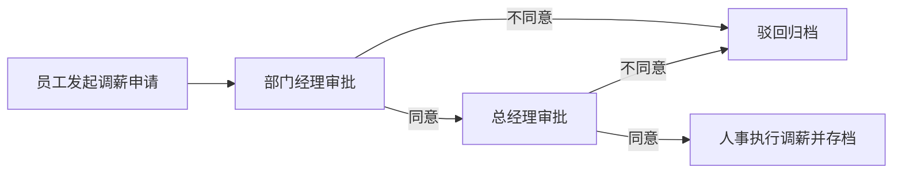

# Activiti 的用武之地：适用行业与具体应用场景盘点

判断一个项目要不要上工作流引擎，标准不是「是不是做 OA 的」，而是流程是否由多个角色接力、是否经常变。把 Activiti 这类工作流引擎适用的行业和具体应用场景摊开盘点，再落回本阶段的 SaaS-HRM 项目，调薪审批为什么天生就该交给引擎，答案会自己浮出来。

## 先给结论

- 适用行业覆盖消费品、制造业、电信服务业、银证险等金融服务业、物流服务业、物业管理、大中型进出口贸易公司、政府事业单位、科研院所、教育服务业，尤其是大的跨国企业与集团公司。
- 这些行业的共同特征：组织层级多、审批链长、流程变更频繁。
- 具体应用分五类：关键业务流程类、行政管理类、人事管理类、财务相关类、客户服务类。
- SaaS-HRM 项目的落点是行政审批，典型场景为调薪：部门经理与总经理逐级审批，通过后由人事执行。
- 判断标准与行业无关：多角色接力、步骤可枚举、流程常变的业务，都适合交给工作流引擎。

## 一、适用行业：层级越深、流程越重的行业越需要

Activiti 这类工作流引擎适用的行业名单很长：消费品行业、制造业、电信服务业、银证险等金融服务业、物流服务业、物业管理，以及大中型进出口贸易公司、政府事业单位、科研院所、教育服务业，特别是大的跨国企业和集团公司。

这些行业表面上千差万别，往里看是同一件事：组织结构层级深，一件事要按规则在多个角色之间传递。消费品行业的订单从下单到发货要过单证、仓储、财务几道关；金融服务业的一笔放款要过多级风控；政府事业单位的一纸批复要逐级签字。层级越多、参与角色越多，靠人记住「下一步该谁」就越不可靠，流程自动化的收益就越大。跨国集团之所以被单独点名，正因为它们的流程既要跨部门又要跨地域，变更还频繁。

## 二、具体应用：五类场景对照

落到具体业务上，应用场景可以归成五类：

| 类别 | 典型场景 |
|---|---|
| 关键业务流程类 | 订单处理、合同审核、供应链管理 |
| 行政管理类 | 出差申请、加班申请、请假申请、用车申请、购买申请、办公用品申请 |
| 人事管理类 | 员工培训安排、绩效考评、职位变更、档案信息管理 |
| 财务相关类 | 付款请求、收款处理、报销、出差预算 |
| 客户服务类 | 客户电话处理 |

对着这张表能看出一个规律：这些场景全都由「申请、逐级审批、归档」的骨架构成，差别只在参与角色和审批条件。订单处理里审单的是单证员和财务，请假申请里审的是经理，报销里审的是财务主管。骨架相同，意味着可以用同一套引擎、同一种流程定义语言去描述，这就是工作流引擎能通吃五类场景的原因。

## 三、落回 SaaS-HRM：调薪审批就是一条标准流程

本阶段的 SaaS 项目是人力资源管理系统，行政审批里的调薪是典型场景。调薪不是 HR 改一个数字就完事：发起人提交调薪申请后，需要部门经理审批是否同意，再由总经理审批，两层都通过才由人事执行调整并归档。



这条链路和请假审批是同一个骨架：多角色接力、按条件流转、全程留痕。用引擎实现时，流程骨架写在流程定义里，业务代码只负责发起和展示。流程定义是一份 BPMN 文件，调薪流程的骨架大致长这样（示例片段，按本课写法补全）：

```xml
<process id="salaryAdjust" name="调薪审批">
    <startEvent id="start"/>
    <userTask id="managerAudit" name="部门经理审批" activiti:assignee="lishi"/>
    <userTask id="gmAudit" name="总经理审批" activiti:assignee="wangwu"/>
    <userTask id="hrExecute" name="人事执行调薪" activiti:assignee="hr01"/>
    <endEvent id="end"/>
    <sequenceFlow sourceRef="start" targetRef="managerAudit"/>
    <sequenceFlow sourceRef="managerAudit" targetRef="gmAudit"/>
    <sequenceFlow sourceRef="gmAudit" targetRef="hrExecute"/>
    <sequenceFlow sourceRef="hrExecute" targetRef="end"/>
</process>
```

发起调薪流程的代码与请假流程没有任何区别，换个流程定义的 key 而已（示例代码，写法取自配套工程的启动流程类）：

```java
// 发起调薪审批流程实例
ProcessEngine processEngine = ProcessEngines.getDefaultProcessEngine();
RuntimeService runtimeService = processEngine.getRuntimeService();
ProcessInstance instance = runtimeService.startProcessInstanceByKey("salaryAdjust");
```

哪天公司决定调薪要加一步薪酬委员会会签，改动只是往 BPMN 文件里插一个节点再重新部署，发起代码一行不动。流程会变的业务，就该交给引擎，这个判断标准在调薪场景上体现得非常直接。

## 常见误区

- **以为工作流引擎只适合行政类 OA**：五类应用里订单处理、合同审核属于关键业务流程，付款收款属于财务核心，引擎的用武之地远不止一张请假条。
- **拿公司规模当判断标准**：小团队同样可能有变更频繁的审批链，判断依据是流程复杂度与变更频率，不是公司大小；大型集团只是收益更明显。
- **每类审批各写一套代码**：请假、用车、调薪各自硬编码一套审批逻辑，同类骨架无法复用；交给引擎后它们只是几份不同的流程定义。
- **单节点确认也上引擎**：只有一个确认动作、永不变化的简单流程，引入引擎反而增加建表与维护成本，这类场景直接用状态字段更划算。

## 面试可能被问到的问题

1. 面试官追问：「Activiti 这类工作流引擎适用于哪些行业？」
   答：消费品、制造业、电信服务业、银证险等金融服务业、物流服务业、物业管理、大中型进出口贸易公司、政府事业单位、科研院所、教育服务业，特别是组织层级深、流程跨部门跨地域的跨国企业和集团公司。

2. 面试官追问：「工作流的具体应用场景分哪几类？」
   答：关键业务流程类如订单处理、合同审核、供应链管理；行政管理类如出差、加班、请假、用车、购买申请；人事管理类如培训安排、绩效考评、职位变更、档案管理；财务相关类如付款请求、收款处理、报销、出差预算；客户服务类如客户电话处理。

3. 面试官追问：「SaaS-HRM 项目里哪些业务适合用工作流引擎实现？」
   答：行政审批类业务，典型是调薪：员工发起申请后需部门经理与总经理逐级审批，通过后由人事执行并存档，是标准的多角色接力流程。交给引擎后，审批链的调整只需修改流程定义。

4. 面试官追问：「什么样的业务不适合上工作流引擎？」
   答：流程只有一个固定环节、几乎不会变更的简单确认类业务。引擎要建一整套表、团队要学流程定义，流程简单稳定时这些成本换不来收益，用状态字段实现反而直接。

5. 面试官追问：「这些行业场景的共同点是什么？」
   答：流程由多个角色按规则接力完成，步骤可枚举且会变更。共同骨架是申请、逐级审批、归档，因此可以用同一套流程定义语言描述，由引擎统一推进和留痕。

## 配套资料

- 本章节源码工程：`materials/code/02/Activiti7-day01-基础原理与使用/Activiti7-day01-基础原理与使用/代码/activiti01/`
  （本课为概念课无对应源码，文中 BPMN 片段与发起流程示例为按本课写法补全，Java 写法参考工程内 `ActivitiStartInstance.java`）
