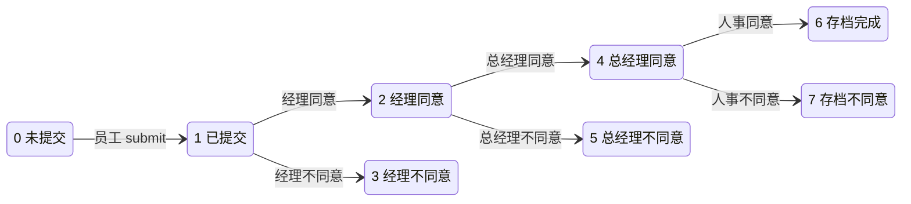

# 状态字段加条件判断：没有引擎的年代流程是怎么被硬控制的

工作流实现方式这一节，讲义里只有一句话：在没有专门的工作流引擎之前，为了实现流程控制，通常的做法是采用状态字段的值来跟踪流程的变化，不同角色的用户通过状态字段的取值来决定是否显示。这句话背后是一套当年普遍使用的工程做法，把它展开成可运行的 SQL 与代码，再解释它为什么最终让位给流程引擎，工作流引擎的价值也就有了参照物。

## 先给结论

- 传统方式 = 状态字段跟踪流程进展 + 各角色按状态取值决定自己看到什么。
- 每个环节都是同一个动作模板：按条件查询、展示待办、处理、update 状态。
- 角色的权限差异体现在查询条件上：部门经理限定部门编号，总经理掌管所有部门就只认状态。
- 流程推进对数据库而言就是一串 select 和 update，没有任何神秘成分。
- 这套做法经不起业务变更，砍掉一个审批环节就要改一片代码，这正是流程引擎要终结的局面。

## 一、方案骨架：一个状态字段扛起整条流程

请假流程的参与者还是那四位：员工、部门经理、总经理、人事存档。一张请假单表，业务字段之外加一个 `status` 字段，由它记录流程走到哪了（示例表结构，按本课写法补全）：

```sql
CREATE TABLE leave_apply (
  id       INT PRIMARY KEY AUTO_INCREMENT COMMENT '请假单编号',
  emp_no   VARCHAR(20)  COMMENT '工号',
  dept_no  VARCHAR(20)  COMMENT '部门编号',
  days     INT          COMMENT '请假天数',
  reason   VARCHAR(200) COMMENT '事由',
  status   INT NOT NULL DEFAULT 0 COMMENT '0未提交 1已提交 2经理同意 3经理不同意 4总经理同意 5总经理不同意 6存档完成 7存档不同意'
);

-- 部门经理的待办：本部门 + 已提交
SELECT * FROM leave_apply WHERE dept_no = 'D001' AND status = 1;

-- 总经理的待办：经理已同意，不限部门
SELECT * FROM leave_apply WHERE status = 2;

-- 审批动作就是对状态字段的更新
UPDATE leave_apply SET status = 2 WHERE id = 1001;
```

状态字段就是流程的唯一进度标志：0 未提交、1 已提交，经理批完置 2 或 3，总经理批完置 4 或 5，人事处理完置 6 或 7。不同角色的待办页面，无非是对这张表按不同的状态取值做查询，查到就显示，处理完就更新。

## 二、把每个环节写成代码

用一段示例代码把四个环节串起来，每一步的形状完全一致（示例代码，按本课写法补全）：

```java
/** 传统方式实现的请假流程：状态字段驱动 */
public class LeaveFlowTraditionalService {

    /** 员工提交：0 改 1 */
    public void submit(long id) {
        leaveApplyMapper.updateStatus(id, 1);
    }

    /** 部门经理审批：查本部门状态 1 的单子，批完置 2 或 3 */
    public List<LeaveApply> managerTodo(String deptNo) {
        return leaveApplyMapper.selectByDeptAndStatus(deptNo, 1);
    }
    public void managerAudit(long id, boolean agree) {
        leaveApplyMapper.updateStatus(id, agree ? 2 : 3);
    }

    /** 总经理审批：查状态 2 的单子，批完置 4 或 5 */
    public List<LeaveApply> gmTodo() {
        return leaveApplyMapper.selectByStatus(2);
    }
    public void gmAudit(long id, boolean agree) {
        leaveApplyMapper.updateStatus(id, agree ? 4 : 5);
    }

    /** 人事存档：查状态 4 的单子，处理完置 6 或 7 */
    public void hrArchive(long id, boolean agree) {
        leaveApplyMapper.updateStatus(id, agree ? 6 : 7);
    }
}
```

代码里没有出现「流程」两个字，但流程确实在跑：员工提交后，单子出现在经理的待办里；经理批完，出现在总经理的待办里；总经理批完，出现在人事的列表里。所谓流程，就是状态值在这张表里的一次次变迁。

流转全程用一张图收拢：



## 三、变更压力测试：砍掉总经理环节

业务方通知：公司规模不大，总经理审批取消，经理同意后直接人事存档。对这套代码意味着什么：

- `gmTodo` 与 `gmAudit` 两个方法整体作废，连同入口页面一起删除。
- 状态字典重新排布：4、5 两个状态不复存在，经理同意后的状态直接就是「待人事处理」。
- 人事存档的查询条件从 `status = 4` 改成 `status = 2`，库里历史数据里的 4 还要做一次订正。
- 前端各处按状态渲染的判断逻辑同步修改，漏一处就会出现「看不见的单子」。

几人日的工作量，换来的是删掉一个环节。流程每变一次，这套代码就要重写一次，业务流程变更后程序不能使用，说的就是它。变更本身不可怕，可怕的是变更成本与流程复杂度成正比。

## 四、为什么它必然让位给流程引擎

回头看这套方案的本质：流程逻辑，也就是走到哪一步、下一步谁来处理，被写死在了查询条件和 update 语句里。流程是业务方的语言，代码是程序员的实现，两者被焊在一起，业务每改一句，代码就要重改一遍。

流程引擎做的事是把「流程」从代码里抽出来变成数据：审批链路描述成流程定义，走到哪一步由引擎记录在自己的表里，业务代码只保留「发起」和「处理待办」两个动作。流程变更从改代码降级成改流程定义，这才是「以不变应万变」的真正含义。引擎具体怎么用一张表扛住任意形状的流程，下一课拆开它的内部机制。

## 常见误区

- **把状态字段方案当成错误方案**：它在引擎出现之前是成熟做法，小而稳定的流程今天依然可以这么写；它的问题只在变更成本，不在对错。
- **查询条件只写状态不写权限**：部门经理不限定部门编号会看到全公司的单子，权限边界必须写进 SQL 条件。
- **状态值含义靠口口相传**：状态字典要落进注释、文档或枚举类，否则新人接手就是一场猜谜。
- **忘掉不同意分支的后续**：经理不同意后单子是退回员工还是终止，要在设计期定清楚，否则流程记录卡死在中间状态。

## 面试可能被问到的问题

1. 面试官追问：「没有工作流引擎之前，流程控制通常怎么实现？」
   答：采用状态字段的值来跟踪流程变化，不同角色的用户通过状态字段的取值决定是否显示。每个环节按条件查询待办，处理完后 update 状态值，把流程交给下一环节。

2. 面试官追问：「部门经理和总经理的查询条件差在哪，为什么？」
   答：部门经理查状态等于 1 且部门编号等于自己所在部门，只审本部门提交的申请单；总经理掌管所有部门，不需要部门条件，直接查状态等于 2 的记录。

3. 面试官追问：「传统方式的致命缺陷是什么？」
   答：流转逻辑硬编码在代码里，业务流程一变，状态定义、查询条件、更新逻辑都要重改，原有代码基本作废，变更成本随流程复杂度增长。

4. 面试官追问：「工作流引擎在哪些点上取代了这套做法？」
   答：把审批链路抽成流程定义数据，由引擎记录流程实例的当前位置并自动推进；业务代码只保留发起流程和处理待办两个动作，流程变更只需修改并重新部署流程定义。

5. 面试官追问：「状态字段方案在今天还有使用价值吗？」
   答：有。环节固定、变更稀少的简单流程，比如两步确认，用状态字段实现最直接；引擎带来的建表、学习与维护成本，要在流程复杂且常变时才能赚回来。

## 配套资料

- 本章节源码工程：`materials/code/02/Activiti7-day01-基础原理与使用/Activiti7-day01-基础原理与使用/代码/activiti01/`
  （本课为概念课无对应源码，文中表结构、SQL 与 Java 示例为按本课写法补全）
