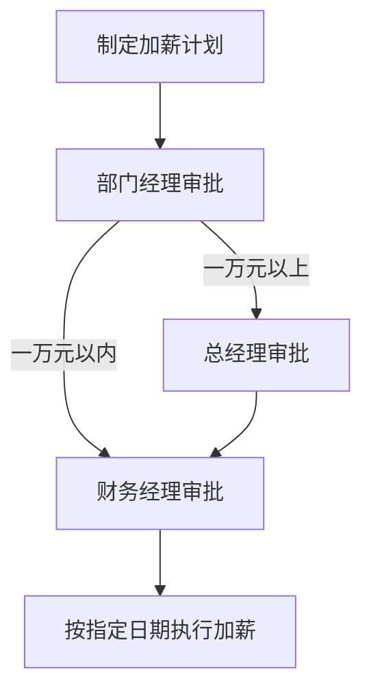

# BPM 管流程优化，BPMN 定画图标准：两个名词彻底分清

介绍 Activiti 时冒出了两个长得几乎一样的缩写：BPM 和 BPMN。分不清它们，流程建模就只是「画图」这件事；分清了才知道，一个在管企业流程怎么设计才高效，另一个在规定流程图怎么画才通用。这一篇把两个概念掰开，顺带说清引入工作流引擎之前必须掂量的成本问题。

## 先给结论

- BPM 是 Business Process Management，业务流程管理：以规范化构造端到端的业务流程为中心，以持续提高组织业务绩效为目的的系统化方法，EMBA、MBA 课程里都有它。
- BPM 管两件事：让流程可监控，让流程持续被优化，优化直接对应缩短流程周期、节约运作成本。
- 节点少不等于流程优：把医院交费和取药合并到一个窗口，节点少了，岗位要求却高了，招人和培训成本反而上去了。
- BPMN 是 Business Process Model and Notation，业务流程模型和符号，由 BPMI 这类规范组织制定，2011 年发布的 BPMN 2.0 是最终版本，Activiti 就用 BPMN 2.0 建模和执行。
- 引入引擎有成本：Activiti7 会生成 25 张 `act_` 开头的表，公司软件的规模决定是否适合用它。

## 一、BPM：业务流程管理到底管什么

流程的形状直接决定公司的运转效率。两个加薪流程一对比就看得出来：流程一是固定链路，制定加薪计划、部门经理审批、总经理审批、财务经理审批，四个环节一个不落全要走完；流程二加了一道金额判断，本次加薪在一万元以内时部门经理审完直接进财务经理，超过一万元才需要总经理再批。大多数普通调薪都落在一万元以内，对多数员工来说流程只有三个节点：



带金额分支的流程二周期明显更短，总经理只处理真正需要他拍板的那部分单子，这就是流程优化带来的效率。BPM 管的就是这类事：**其一，流程可监控。** 公司里类似加薪这样的流程成百上千，每条走到哪、卡在哪，要能随时看到。**其二，流程持续优化。** 执行的流程越繁琐，办事效率越低，成本浪费越大；不断裁剪和调整流程，就是在节约成本、缩短周期。

## 二、流程优化的边界：节点不是越少越好

医院看病的例子能防止把「优化」理解成「砍节点」。常规流程是挂号、看病、交费、取药四步；有一种合并方案把交费和取药并成一个窗口，流程只剩三步，看起来更优。真细想就会发现代价：合并后的窗口人员既要懂财务收费，又要懂药学，中医处方里一味药多少克这类专业判断全压给同一个人，岗位知识要求极高。

这样的岗位不好招聘、不好培训，人员扩展困难，最终花在人力上的成本反而更高。极端一点想，一个诊所把挂号、看病、交费、取药全压给一个大夫，节点最少，但它就是个小作坊，没法规模化复制。结论是流程设计要在效率与岗位专业度、人力成本之间找平衡，BPM 是一门需要认真学的管理学问，不是简单的节点减法。

## 三、BPM 软件：把管理方法落成 IT 工具

BPM 的理念落到软件上就是 BPM 软件：根据企业业务环境的变化，推进人与人之间、人与系统之间、系统与系统之间整合与调整的综合方法与解决方案，通常以 Internet 方式实现信息传递、数据同步、业务监控和企业业务流程的持续升级优化。凡是业务流程存在的地方都可以用它管理，企业人事办公、采购流程、公文审批、财务管理都是典型领域。工作流引擎 Activiti 就属于这一类工具里负责流程自动化的核心部件。

## 四、BPMN：把流程画成大家都认识的样子

理念要落地，第一步还是把流程画出来，而画图这件事由 BPMN 规范管。BPMN 全称 Business Process Model and Notation，业务流程模型和符号，由专门的规范组织 BPMI 制定，该组织的工作后来并入对象管理组织 OMG，2011 年发布的 BPMN 2.0 被确定为最终版本。规范提供了一整套标准符号：开始、结束用什么样的圆圈，用户任务用什么样的矩形，审批分支用什么样的菱形，全都定死了。

标准符号的好处是跨工具通用，Eclipse 的设计器插件、IDEA 里的流程设计器、Activiti 自带的建模工具，画的都是同一套符号。Activiti 正是基于 BPMN 2.0 进行流程建模和流程执行管理的，前面看过的 `holiday.bpmn` 文件里，元素全部来自这套规范：

```xml
<!-- BPMN 2.0 的核心元素节选：事件、任务、连线 -->
<startEvent id="start" name="开始"/>
<userTask id="fillForm" name="填写请假单"/>
<sequenceFlow id="flow1" sourceRef="start" targetRef="fillForm"/>
```

课堂里的加薪流程二带金额分支，在 BPMN 2.0 里对应的元素是排他网关（示例，按 BPMN 2.0 规范写法补全）：

```xml
<!-- 排他网关：多条出线按条件走其中一条 -->
<exclusiveGateway id="moneyGateway" name="金额判断"/>
<sequenceFlow id="toGm" sourceRef="moneyGateway" targetRef="gmAudit">
    <conditionExpression xsi:type="tFormalExpression">${money >= 10000}</conditionExpression>
</sequenceFlow>
<sequenceFlow id="toFinance" sourceRef="moneyGateway" targetRef="financeAudit">
    <conditionExpression xsi:type="tFormalExpression">${money &lt; 10000}</conditionExpression>
</sequenceFlow>
```

**引入引擎之前要掂量的成本也在这里。** 一旦开始用 Activiti7，引擎内部会生成 25 张表；很多中小规模的项目全部业务表加起来都没有 25 张。所以公司开发的软件要具有一定规模、流程确实复杂多变，引入工作流引擎才划算，规模是选型时必须过的那道成本关。

## 常见误区

- **把 BPM 和 BPMN 混为一谈**：BPM 是业务流程管理的系统化方法，管监控和优化；BPMN 是流程模型和符号的规范，管怎么画。一个属于管理领域，一个属于建模标准。
- **以为流程节点越少效率越高**：医院交费取药合并的反例说明，节点合并会把多个岗位的专业要求压到一个人身上，招聘、培训、容错成本都可能反噬效率。
- **以为 BPMN 是 Activiti 的私有格式**：它是跨厂商的公开规范，Eclipse、IDEA 的设计器都遵循；Activiti 只是 BPMN 2.0 的一个实现者。
- **忽视引擎的表规模成本**：25 张 `act_` 表是真实的运维对象，小项目盲目引入引擎，复杂度可能超过它省下来的开发量。

## 面试可能被问到的问题

1. 面试官追问：「BPM 是什么？」
   答：Business Process Management，业务流程管理，一种规范化构造端到端业务流程、以持续提高组织业务绩效为目的的系统化方法。它关注流程可监控与持续优化，目标是缩短流程周期、节约运作资本，EMBA、MBA 课程中包含这部分内容。

2. 面试官追问：「BPMN 和 BPM 什么关系？」
   答：BPM 是管理方法，BPMN 是把业务流程画成标准图形符号的建模规范，全称 Business Process Model and Notation，2011 年的 BPMN 2.0 是最终版本。BPM 的理念靠 BPMN 规范的图来落地表达，Activiti 这类引擎再按 BPMN 2.0 执行。

3. 面试官追问：「流程优化是不是节点越少越好？」
   答：不是。合并节点会把多个岗位的专业能力集中到一个环节，医院把交费取药合并后，窗口人员必须同时具备财务和药学知识，人员招聘和培训难度加大，成本上升。优化要权衡周期、岗位专业度与人力成本。

4. 面试官追问：「BPMN 2.0 里表达条件分支用什么元素？」
   答：排他网关 exclusiveGateway，多条出线各带一个 conditionExpression，按条件只走其中一条，例如加薪金额一万元以内走财务经理、以上加走总经理审批的分支。

5. 面试官追问：「引入 Activiti 前要考虑什么？」
   答：主要考虑规模成本。Activiti7 内部生成 25 张 act_ 表，5.x 时代也有 23、24 张，公司软件要具备一定规模、流程复杂多变，引入引擎的收益才能覆盖这套表结构和学习成本；小项目用状态字段硬编码反而更轻。

## 配套资料

- 本课源码工程：`materials/code/02/Activiti7-day01-基础原理与使用/Activiti7-day01-基础原理与使用/代码/activiti01/`
  （含 `src/main/resources/activiti.cfg.xml` 等；工程内的流程元素写法可与文中 BPMN 2.0 节选对照）
- BPMN 符号与网关示例为按 BPMN 2.0 规范和本课写法补全的示例代码，工程内无独立流程文件
