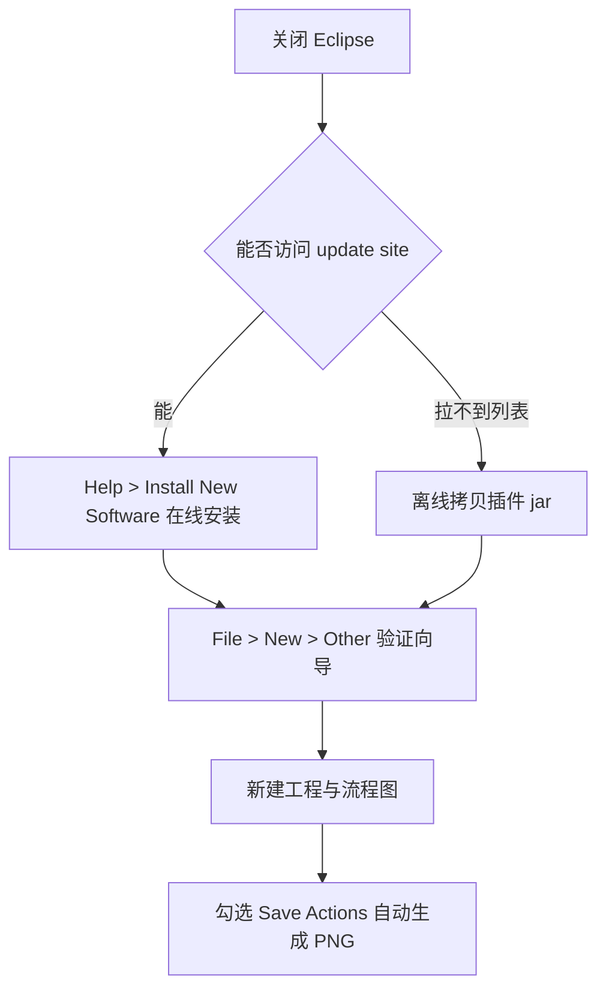

# Eclipse 安装 Activiti 流程设计器：在线装不上就走离线，装完画出第一张流程图

没装设计器插件的 Eclipse 里，`bpmn` 就是一段裸 XML，想画一张请假流程图只能手写节点坐标。插件安装本身又是这门课的高频翻车点：在线站点经常连不上，列表半天拉不下来。这里把在线与离线两种装法都摆出来，再走完从验证安装、画出第一张图到保存自动出 PNG 的完整闭环。

## 先给结论

- 两条安装路：在线安装走 update site，离线安装直接把插件 jar 拷进 Eclipse 安装目录；在线站点不稳定，失败率高，离线最稳。
- 离线拷贝规则：features 类 jar 放安装目录的 `features` 文件夹，plugins 类 jar 放 `plugins` 文件夹，拷贝前先关闭 Eclipse，拷完重启生效。
- 验证方式：`File > New > Other` 打开新建向导，列表里出现 `ActivitiProject` 与 `ActivitiDiagram` 即安装成功。
- `bpmn` 文件本质是 XML，插件读取节点信息渲染成图；勾选 Save Actions 后，每次保存自动生成并更新同名 PNG。
- 建模产物是跨工具的：今天用 Eclipse 画的图，换 IDEA 或不装任何插件的环境都能部署。

## 一、安装：在线与离线两条路



这张图在讲安装与验证的主路径，两条安装路最终都汇合到同一个验证动作上。图里最关键的判断是分支点：update site 拉不到列表就别反复重试，直接切离线。

**方式一，在线安装。** 菜单 `Help > Install New Software` 打开安装面板，点 `Add` 弹出仓库对话框，Name 自定义（比如 `activiti-designer`），Location 填官方设计器更新站点：

```text
http://www.activiti.org/designer/update/
```

确定后等待可用软件列表加载，勾选设计器项，按向导下一步完成安装。可以勾上「只显示最新版本」「隐藏已安装项」让列表干净一点。这个站点常年时好时坏，多数人卡在加载列表这一步，等不出来就直接走方式二。

**方式二，离线拷贝安装，推荐。** 找到资料里的流程设计器 Eclipse 压缩包，解压后得到两部分内容：`features` 目录下两个 jar，`plugins` 目录下若干 jar。把对应内容拷进 Eclipse 安装目录（`eclipse.exe` 所在目录）的同名文件夹即可，拷贝前务必关闭 Eclipse。命令示意（示例命令，按本课拷贝步骤补全）：

```bash
# 关闭 Eclipse 后执行；ECLIPSE_HOME 换成本机安装目录
ECLIPSE_HOME=/opt/eclipse        # Windows 下形如 D:/tools/eclipse
unzip -o activiti-designer-eclipse.zip -d designer

# features 下两个包拷进 Eclipse 的 features 目录
cp designer/features/org.activiti.designer.feature_5.18.0.201508180939.jar "$ECLIPSE_HOME/features/"
cp designer/features/org.eclipse.graphiti.feature_0.11.4.v2015011492.jar "$ECLIPSE_HOME/features/"

# plugins 下的全部 jar 拷进 Eclipse 的 plugins 目录
cp designer/plugins/*.jar "$ECLIPSE_HOME/plugins/"
```

两个 features 包分别是设计器本体 `org.activiti.designer.feature_5.18.0.201508180939.jar` 和它依赖的图形框架 `org.eclipse.graphiti.feature_0.11.4.v2015011492.jar`，缺一不可。如果目录里已有同名文件（之前装过），直接覆盖替换。拷完重启 Eclipse。

**验证。** `File > New > Other` 打开新建向导，能看到 `ActivitiDiagram`（Activiti 流程图）和 `ActivitiProject`（Activiti 工程）两个向导项，就说明插件已经生效。

## 二、画出第一张请假流程图

向导里新建一个 Activiti 工程，然后在工程上右键新建 `ActivitiDiagram`，命名为 `holiday`。接下来用面板里的元素搭一条最简审批链：

- 拖入 `start event` 开始节点，流程从这里进入；
- 点中节点，边缘出现快捷图标，选 `new user task`，节点与连线一次生成，命名为 `填写请假单`；
- 依样再建 `部门经理审批`、`总经理审批`，拖动节点时会出现对齐辅助线，贴线即可对齐；
- 收尾放一个 `end event` 结束节点，流程到这里终止。

Eclipse 版设计器的顺手之处就在「点边缘图标直接生成下一个任务」，节点、连线、命名一气呵成，不用手动拉线。

## 三、bpmn 文件到底是什么

画完之后用文本编辑器打开 `holiday.bpmn`，看到的全是 XML。插件做的事是把 XML 里的节点定义和图形信息（宽度、高度、x 与 y 坐标）解析出来，渲染成看到的框图。下面是屏幕实录的文件内容节选，图上的每个节点与连线都对应这里的标签：

```xml
<?xml version="1.0" encoding="UTF-8"?>
<bpmn:definitions xmlns:xsi="http://www.w3.org/2001/XMLSchema-instance"
                  xmlns="http://www.omg.org/spec/BPMN/2.0/MODEL"
                  xmlns:activiti="http://activiti.org/bpmn"
                  xmlns:bpmn="http://www.omg.org/spec/BPMN/2.0">
  <bpmn:process id="MyProcess" name="My process" isExecutable="true">
    <bpmn:startEvent id="startEvent1" name="Start"/>
    <bpmn:userTask id="userTask1" name="填写请假单"/>
    <bpmn:userTask id="userTask2" name="领导审批"/>
    <bpmn:endEvent id="endEvent1" name="End"/>
    <bpmn:sequenceFlow id="flow1" sourceRef="startEvent1" targetRef="userTask1"/>
    <bpmn:sequenceFlow id="flow2" sourceRef="userTask1" targetRef="userTask2"/>
    <bpmn:sequenceFlow id="flow3" sourceRef="userTask2" targetRef="endEvent1"/>
  </bpmn:process>
</bpmn:definitions>
```

看懂这层关系，插件就祛魅了：它不是流程图的存储格式，只是 XML 的编辑器与渲染器。换任何一款符合 BPMN 2.0 规范的工具打开，读到的都是同一份节点定义。

## 四、保存时自动生成 PNG

给没装插件的同事看流程图，或者部署流程定义时附带图片资源，都需要一张图片。设计器提供了保存即出图的能力，位置在 `Window > Preferences > Activiti > Save Actions`，勾选这一项：

```text
Create process definition image when saving the diagram
```

意思是保存流程图时创建流程定义图片。点 `Apply and Close` 生效，之后每次 `Ctrl+S`，同目录下自动生成同名 `holiday.png`；节点拖动过再保存，PNG 同步更新。这个开关的实用价值在于：脱离了 Eclipse 和插件的环境里，`bpmn` 用系统图片查看器是打不开的，PNG 是唯一能直接看的图。部署流程定义时 `bpmn` 与 `png` 一起作为资源交给引擎，用的就是这份产物。

## 常见误区

- **在线装不上就反复重试**：update site 是境外服务，网络不通时重试没有意义，直接离线拷 jar，两分钟解决。
- **jar 拷错层**：features 包必须进 `features` 目录，plugins 包必须进 `plugins` 目录，混放或平铺到安装根目录都不会生效。
- **拷完不重启**：Eclipse 启动时扫描插件目录，不重启新建向导里不会出现 Activiti 向导项。
- **以为 PNG 要手工截图**：勾上 Save Actions 的创建图片选项，保存即生成、改动即更新。
- **把 bpmn 文件当图片发给别人**：对方打开只会看到 XML；先保存出 PNG 再发。

## 面试可能被问到的问题

1. 面试官追问：「Eclipse 离线安装插件是什么原理？」
   答：Eclipse 启动时按目录约定扫描插件：`features` 存功能包定义，`plugins` 存实际 jar。把插件的 feature 包与 plugin 包分别拷入这两个目录再重启，相当于手工完成了安装器的落盘动作，效果与在线安装一致。

2. 面试官追问：「bpmn 文件和流程图图片是什么关系？」
   答：bpmn 是源文件，本质是符合 BPMN 2.0 规范的 XML，记录节点定义与图形坐标；png 是插件按坐标渲染出来的视图，供人查看。引擎部署消费的是 bpmn，png 作为说明性资源可一并入库。

3. 面试官追问：「部署流程定义时为什么 bpmn 和 png 一起提交？」
   答：流程定义入库后，控制台和业务页面查看流程图需要图片资源，部署时一并传入可以保证图与定义版本一致，避免运行时找不到对应的展示图。

4. 面试官追问：「在线 update site 安装是什么机制？」
   答：update site 是一个托管插件元数据与 jar 的站点，安装器先拉取特性列表，用户勾选后按依赖解析、下载并落盘到 features 与 plugins 目录；网络不通时这一步会卡在列表加载。

5. 面试官追问：「插件拷好了，新建向导里却看不到 ActivitiDiagram，怎么排查？」
   答：按顺序检查三点：是否重启过 Eclipse；jar 是否拷进了正确的 features 与 plugins 目录，文件名是否完整；Eclipse 版本与插件版本是否兼容。多数情况是没重启或拷错目录。

## 配套资料

- 插件安装包本课无配套资料目录，update site 地址、jar 文件名与拷贝步骤按课程实际操作记录整理，bash 命令为按本课写法补全的示例
- 画出的 `bpmn` 与 `png` 可放到课程工程里部署运行：`materials/code/02/Activiti7-day01-基础原理与使用/Activiti7-day01-基础原理与使用/代码/activiti01/`
  （含 `pom.xml`、`src/main/resources/activiti.cfg.xml` 及部署、启动、任务查询等示例类）
