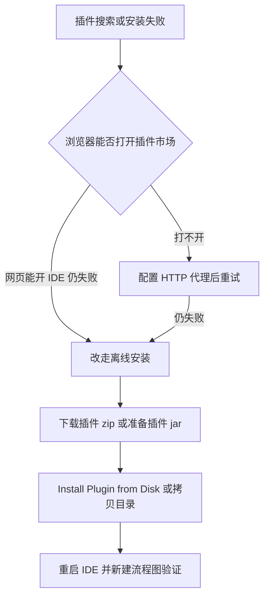

# 流程设计器装不上怎么排查：代理配置与离线安装

按前两篇的步骤装插件，最常见的中途翻车是：IDEA 的 Plugins 搜索框输入 actiBPM，结果区只显示 Nothing to show；或者列表终于出来了，点 `Install` 后进度条停在原地，超时报错。Eclipse 侧对应的现象是 update site 的可用软件列表一直加载不出来。这些现象的根因大多相同：插件仓库是境外服务，直连质量不稳定。与其反复重试，不如按工程思路把网络问题定位清楚，然后要么配代理在线装，要么干脆离线装。

## 先给结论

- 排查起点不在 IDE 里：先用浏览器直接访问插件市场网页，打不开就说明是网络问题，IDE 内怎么重试都没用。
- IDEA 在线修复路径：`Settings > Appearance & Behavior > System Settings > HTTP Proxy` 配置手动代理，用 `Check connection` 验证后再装。
- 最稳的是离线安装：在能联网的机器上从插件市场网页下载插件 zip，`Plugins` 面板齿轮菜单里 `Install Plugin from Disk` 直接装，全程不依赖本机网络。
- Eclipse 离线两条路：jar 按 `features` 与 `plugins` 目录拷贝，或统一放进 `dropins` 目录让启动时扫描加载。
- 同一类问题在 Maven 拉坐标时同样会出现：pom 里补官方仓库解决 Beta 版构件，`settings.xml` 配镜像解决中央仓库慢的问题，注意 `mirrorOf` 别写成通配。

## 一、先把问题定位准

安装失败分三类，处理方式完全不同：

**第一类，搜索不到。** 搜索框输入 actiBPM 后结果区 Nothing to show。这是市场列表请求失败，典型网络问题。

**第二类，下载中断。** 插件能搜到，`Install` 之后下载超时或报错。同样是网络问题，只是卡在文件下载阶段。

**第三类，装完不生效。** 安装显示成功，新建向导里却没有目标文件类型。这不是网络问题，去查插件与 IDE 版本的兼容性、是否重启过。

前两类的判断办法很简单，把 IDE 放一边，直接在浏览器打开插件市场搜索页，看能否正常加载插件详情。命令行验证更精确（示例命令）：

```bash
# 验证 IDEA 插件市场连通性，5 秒连不上即视为直连不通
curl -I --connect-timeout 5 https://plugins.jetbrains.com

# Eclipse 设计器 update site 同理
curl -I --connect-timeout 5 http://www.activiti.org/designer/update/
```

浏览器能打开而 IDE 里不行，多半是 IDE 没有跟随系统代理设置，这是接下来配代理要解决的场景。



这张图在讲排查决策：代理是修复在线安装的手段，离线安装是兜底手段，两条路都终结于重启后的新建向导验证。图里最关键的分叉是浏览器验证，它把「网络问题」和「版本兼容问题」分开，避免在错误方向上耗时间。

## 二、IDEA 配置代理走在线安装

入口在 `File > Settings > Appearance & Behavior > System Settings > HTTP Proxy`。选择 `Manual proxy configuration`，协议选 HTTP，填代理服务器地址与端口，公司内网环境的代理端口常见是 8080。填完不要直接确定，先点 `Check connection`，在弹出的地址框里输入插件市场地址验证，返回成功再保存。

代理只影响 IDE 自身的联网请求，配置生效后再回到 `Plugins` 面板搜索 actiBPM，列表能出来、`Install` 能走完，就回到正常的安装流程。这个思路同样适用于 Eclipse：`Window > Preferences > General > Network Connections` 里把代理方案设为 Manual 并填好 HTTP 项，update site 的列表加载走的就是它。

## 三、离线安装：不依赖网络的兜底方案

**IDEA 侧。** 在任意一台能联网的机器上打开插件市场网页，搜到 actiBPM，进入版本页下载与 IDE 版本匹配的 zip 包。回到目标机器，`Settings > Plugins` 面板右上角齿轮菜单选 `Install Plugin from Disk`（旧版 IDEA 是面板下方的 `Install plugin from disk` 按钮），选中下载好的 zip，重启生效。注意 zip 不需要解压，安装器自己处理。zip 的版本要与 IDE 匹配，拿新版 IDE 的插件包装到老版 IDE 上，常见的结果是装完列表里有、功能不生效。

**Eclipse 侧。** 除了前一篇讲的按 `features` 与 `plugins` 目录拷贝，还有更省心的 `dropins` 目录方式：在 dropins 下按插件名建目录，放入内容即可（示例命令，按本课写法补全）：

```bash
# dropins 离线安装：Eclipse 启动时自动扫描该目录并加载
ECLIPSE_HOME=/opt/eclipse
unzip -o activiti-designer-eclipse.zip -d designer

mkdir -p "$ECLIPSE_HOME/dropins/activiti-designer"
cp -r designer/features "$ECLIPSE_HOME/dropins/activiti-designer/"
cp -r designer/plugins  "$ECLIPSE_HOME/dropins/activiti-designer/"
```

dropins 方式的好处是插件内容集中在一个子目录，卸载或重装就是增删这个目录，不污染 Eclipse 自带的 features 与 plugins。无论哪种方式，操作前先关闭 IDE，完成后重启。

## 四、同类问题在构建侧的解法

插件装好了，下一步 Maven 拉 Activiti 的依赖还会遇到一样的网络问题。两个层面分开处理：

**Beta 版构件缺失**，靠 pom 里的官方仓库解决。课程工程 `activiti01` 的真实做法是补一段 `repositories`，指向官方发布仓库 `https://artifacts.alfresco.com/nexus/content/repositories/activiti-releases/`，这个配置在环境介绍一篇里已经引用过。

**中央仓库慢**，靠镜像加速解决。在 Maven 的 `settings.xml` 里给中央仓库配一个国内镜像（示例配置）：

```xml
<!-- settings.xml 镜像示例：只镜像 central，不劫持 pom 里声明的官方仓库 -->
<mirror>
    <id>maven-mirror</id>
    <mirrorOf>central</mirrorOf>
    <name>central repository mirror</name>
    <url>https://maven.aliyun.com/repository/public</url>
</mirror>
```

`mirrorOf` 写成 `central` 是有意为之：只加速中央仓库的请求。如果图省事写成 `*`，pom 里声明的官方仓库也会被劫持到镜像上，而镜像上恰恰没有 Beta 期的部分构件，构建反而失败。这也是很多人配完镜像后「越配越下载不到」的原因。

## 常见误区

- **反复点 `Install` 祈祷成功**：网络不通时重试没有任何增益，定位到网络问题后要么配代理、要么离线装，二选一。
- **离线 zip 解压后再装**：`Install Plugin from Disk` 直接选 zip 包即可，解压反而不认。
- **zip 版本与 IDE 不匹配**：下载时选与自己 IDE 版本对应的插件版本，装完无效多半栽在这里。
- **Eclipse 把 jar 平铺到安装根目录**：jar 必须进 `features` 与 `plugins` 对应目录，或走 `dropins` 目录，放错位置不加载。
- **配代理不验证**：不点 `Check connection` 就保存，代理填错也感知不到，回到插件面板继续浪费时间。
- **`mirrorOf` 配成通配**：把官方仓库一起镜像掉，Beta 版构件拉取失败，问题从插件市场转移到了 Maven。

## 面试可能被问到的问题

1. 面试官追问：「IDEA 插件离线安装的完整步骤是什么？」
   答：在联网机器上从插件市场网页下载与 IDE 版本匹配的插件 zip；目标机器打开 `Settings > Plugins`，通过齿轮菜单的 `Install Plugin from Disk` 选中 zip；确认后重启 IDE，用插件提供的功能（如新建 Bpmn 文件）验证生效。

2. 面试官追问：「Eclipse 的 dropins 目录和 features 与 plugins 目录两种离线方式有什么区别？」
   答：直接拷贝 features 与 plugins 是模拟安装器的落盘结果，插件内容与自带插件混在一起，卸载要手工清理；dropins 是扩展目录，启动时扫描加载，每个插件独立子目录，增删目录即可装卸，管理更干净。

3. 面试官追问：「Maven 里 `mirrorOf` 是什么含义？配成 `*` 会怎样？」
   答：mirrorOf 声明镜像接管哪些仓库的请求。配成 `*` 会把所有仓库包括 pom 里声明的远程仓库都重定向到镜像，镜像上不存在的构件将直接拉取失败；正确做法是只镜像 `central`，让特殊仓库保持直连。

4. 面试官追问：「完全无外网的内网环境，如何给团队分发 IDE 插件和依赖？」
   答：插件在外网机器下载 zip 后用 Install Plugin from Disk 或 dropins 分发安装；Maven 依赖在内网搭私服代理仓库，settings.xml 统一指向私服，由私服负责外网同步与缓存。

5. 面试官追问：「代理配置完成后，怎么确认它真的生效了？」
   答：IDEA 里用 HTTP Proxy 设置页的 `Check connection` 指定目标地址验证连通；命令行用 `curl -I --connect-timeout` 直测目标站点；最终以插件面板能正常加载列表并完成下载为准。

## 配套资料

- 官方仓库写法出处：`materials/code/02/Activiti7-day01-基础原理与使用/Activiti7-day01-基础原理与使用/代码/activiti01/pom.xml`
  （`repositories` 段指向官方发布仓库，解决 Beta1 构件拉取问题）
- 最小配置参照：`materials/code/02/Activiti7-day01-基础原理与使用/Activiti7-day01-基础原理与使用/素材/`
  （含 `pom.xml`、`activiti.cfg.xml`、`log4j.properties`）
- 插件 zip 与代理软件本课无配套资料，离线安装步骤、代理配置与镜像示例为按本课写法补全
