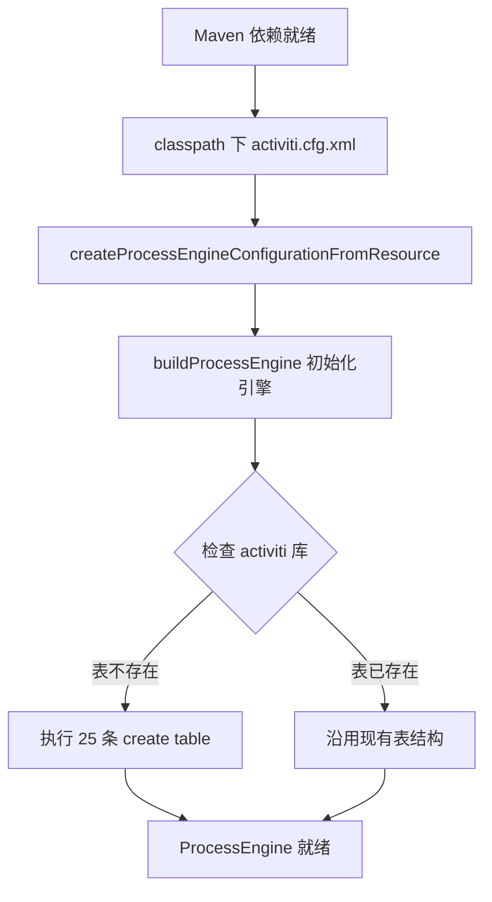

# 两行 Java 代码，让 Activiti 自动建出 25 张表

Activiti7 全套 25 张表，没有谁会手写 25 条 create table。引擎把建表脚本内置在自己身体里，只要把 ProcessEngine 完整地拉起来一次，表就全部生成。这一篇把「拉起来」这件事拆开看：Maven 工程要引哪些坐标、resources 下放哪两个文件、测试类里两行核心代码怎么写，以及控制台里那一片 create table 日志到底是什么。

## 先给结论

- 建表不需要执行任何 SQL：创建 ProcessEngineConfiguration、调用 buildProcessEngine() 两步，25 张表自动生成。
- 前提是两件事：pom 依赖引全，classpath 下有配置文件 activiti.cfg.xml（引擎默认读取的名字）。
- 配置文件核心是两个 bean：dbcp 数据源 + StandaloneProcessEngineConfiguration，后者把 databaseSchemaUpdate 设为 true，含义是「表不存在就创建」。
- 建表动作只发生在引擎初始化时，ProcessEngine 在项目运行期间保持一份，不要反复初始化。

## 一、工程与依赖：pom 里都引了什么

新建 Maven 工程 `activiti01`，把依赖一次配齐（包名已改为中性的 `com.example`）：

```xml
<groupId>com.example</groupId>
<artifactId>activiti01</artifactId>
<version>1.0-SNAPSHOT</version>

<properties>
    <slf4j.version>1.6.6</slf4j.version>
    <log4j.version>1.2.12</log4j.version>
</properties>

<dependencies>
    <!-- Activiti 引擎本体 -->
    <dependency>
        <groupId>org.activiti</groupId>
        <artifactId>activiti-engine</artifactId>
        <version>7.0.0.Beta1</version>
    </dependency>
    <!-- Activiti 与 Spring 整合 -->
    <dependency>
        <groupId>org.activiti</groupId>
        <artifactId>activiti-spring</artifactId>
        <version>7.0.0.Beta1</version>
    </dependency>
    <!-- BPMN 模型、转换、布局三件套 -->
    <dependency>
        <groupId>org.activiti</groupId>
        <artifactId>activiti-bpmn-model</artifactId>
        <version>7.0.0.Beta1</version>
    </dependency>
    <!-- 其余：activiti-bpmn-converter、activiti-json-converter、
         activiti-bpmn-layout、activiti-cloud-services-api，
         以及 mysql-connector-java 5.1.40、junit 4.12、log4j + slf4j、
         mybatis 3.4.5、commons-dbcp 1.4 -->
</dependencies>
```

几组依赖各管一摊：引擎与 Spring 整合是核心；BPMN 模型、转换、布局支撑流程文件解析；MySQL 驱动连库；junit 跑测试；log4j 与 slf4j 负责日志；MyBatis 是引擎内部用来读写那 25 张表的持久层组件；commons-dbcp 提供数据源实现。7.0.0.Beta1 这个版本挂在 Activiti 官方仓库上，pom 里还要补一段仓库声明：

```xml
<repositories>
    <repository>
        <id>alfresco</id>
        <name>Activiti Releases</name>
        <url>https://artifacts.alfresco.com/nexus/content/repositories/activiti-releases/</url>
    </repository>
</repositories>
```

这段仓库声明不是可选项：7.0.0.Beta1 这类里程碑版本没有发布到 Maven 中央仓库，缺了这段配置，依赖下载阶段就会直接报「找不到版本」。中央仓库里能拉到的只有早期 5.x、6.x 系列，pom 不配仓库地址，工程连编译这一关都过不去。

## 二、resources 下两个文件

**一个是 log4j.properties。** 引擎运行过程日志非常多，建表是建在日志里的，没有这份配置，建表过程对你是静默的。

**另一个是 activiti.cfg.xml。** 这是 Activiti 约定的默认配置文件名，引擎单独运行时就按这个名字找配置。文件本体是一个 Spring beans 格式的 XML，写两个 bean（取自课程工程源文件）：

```xml
<!-- 数据源：dbcp 连接池，四要素加可选的池参数 -->
<bean id="dataSource" class="org.apache.commons.dbcp.BasicDataSource">
    <property name="driverClassName" value="com.mysql.jdbc.Driver" />
    <property name="url" value="jdbc:mysql://localhost:3306/activiti" />
    <property name="username" value="root" />
    <property name="password" value="root" />
</bean>

<!-- 引擎单独运行（不依赖 Spring 容器）的配置对象
     默认约定：bean 的 id 必须是 processEngineConfiguration -->
<bean id="processEngineConfiguration"
      class="org.activiti.engine.impl.cfg.StandaloneProcessEngineConfiguration">
    <!-- 注入数据源 -->
    <property name="dataSource" ref="dataSource"/>
    <!-- 是否生成表结构：true 表示表不存在时自动创建 -->
    <property name="databaseSchemaUpdate" value="true"/>
</bean>
```

ProcessEngineConfiguration 有多种启动形态，`StandaloneProcessEngineConfiguration` 对应单独启动方式，也就是不挂在 Spring 容器里、引擎自己管理一切。数据源也可以再配 `maxActive`、`maxIdle` 控制池内最大连接与空闲连接，不配就走默认值。

`databaseSchemaUpdate` 还有两个常用取值：false 是默认值，引擎启动时既不检查也不建表，适合表结构已经稳定的阶段；create-drop 会在启动时先删掉旧表再重建，一般只在临时验证场景里用，用完表就没了。日常开发选 true 最省心，首次运行把表建出来，之后每次启动只做存在性检查，不会动已有数据。

## 三、两行代码把表建出来

测试类放在 `com.example.test` 包下，核心逻辑两个步骤（包名已改为 `com.example`）：

```java
package com.example.test;

import org.activiti.engine.ProcessEngine;
import org.activiti.engine.ProcessEngineConfiguration;
import org.junit.Test;

/** 测试 Activiti 所需要的 25 张表的生成 */
public class ActivitiTest {

    @Test
    public void testGenTable() {
        // 1. 从 classpath 的 activiti.cfg.xml 创建配置对象
        ProcessEngineConfiguration configuration = ProcessEngineConfiguration
                .createProcessEngineConfigurationFromResource("activiti.cfg.xml");
        // 2. 通过配置对象构建流程引擎，建表就发生在这里
        ProcessEngine processEngine = configuration.buildProcessEngine();
        // 3. 输出确认引擎创建成功
        System.out.println(processEngine);
    }
}
```

`createProcessEngineConfigurationFromResource` 从方法名就能读出含义：从资源文件创建配置对象；`buildProcessEngine` 把引擎拉起来，初始化过程中检查库里缺不缺表，缺就建。

课程工程里还保留了一个更短的写法：

```java
// 条件：配置文件名必须是 activiti.cfg.xml，且 bean 的 id 是 processEngineConfiguration
ProcessEngine processEngine = ProcessEngines.getDefaultProcessEngine();
System.out.println(processEngine);
```

它内部做的仍是同一件事：去 classpath 找 `activiti.cfg.xml`，按默认 bean id 拿配置，构建引擎。两个写法是显式与快捷的关系。取舍上也有讲究：显式写法把文件名、bean id 都亮在代码里，出了问题顺着代码就能排查；快捷写法少两行代码，但前提是命名约定必须严格守住。多人协作时建议统一用显式写法，把约定变成看得见的代码，省掉「文件名到底对不对」这类低级排查。

整条链路画出来是这样的：



图里最值得盯的是分叉处：`databaseSchemaUpdate=true` 的语义就是这条分支判断，表缺失走建表分支，表齐了直接复用，跑多少遍测试都不会重复建。

## 四、控制台里发生了什么

运行测试，绿条通过。往上翻日志，能看到一条接一条的 create table、create index、alter table。数下来 create table 正好 25 条，这些语句拼起来就是一份完整的建表脚本，复制到 MySQL 里手工执行也能得到同样的表，引擎只是替你执行了一遍。create index 与 alter table 也不是噪音：前者给外键、关联字段补索引，后者给已存在的表补列，引擎把「建新表」和「补齐旧表」统一成了一套脚本。回到客户端刷新 `activiti` 库，25 张 `act_` 前缀的表全部到位。

建表这件事从此有了两个入口：让引擎代劳，或者从日志里抠出脚本手工执行（应急）。表的命名规则与五类分法，下一篇文章展开。

## 常见误区

- **没建库就跑测试**：引擎只建表不建库，库不存在直接连接失败，建库是前置步骤。
- **databaseSchemaUpdate 没配 true**：不配这个属性，测试照样绿，但一张表都不会建，库里空空如也。
- **配置文件名随手起**：显式传名的写法按传入名找文件；`ProcessEngines.getDefaultProcessEngine()` 只认 `activiti.cfg.xml` 这个名字。
- **依赖缺项**：少了 commons-dbcp，配置文件里 `BasicDataSource` 直接标红；少了 MyBatis，引擎初始化阶段就找不到持久层。

## 面试可能被问到的问题

1. 面试官追问：「Activiti 的 25 张表是怎么创建出来的？」
   答：引擎内置了各数据库的建表脚本，ProcessEngine 初始化时按 databaseSchemaUpdate 策略执行，表不存在就自动创建，全程不需要手写 SQL。

2. 面试官追问：「createProcessEngineConfigurationFromResource 的作用是什么？」
   答：从 classpath 按传入的文件名加载引擎配置，返回 ProcessEngineConfiguration 对象；单参数版按默认 bean id processEngineConfiguration 读取，双参数版可以显式指定 bean id。

3. 面试官追问：「databaseSchemaUpdate=true 是什么含义？」
   答：初始化时检查表结构，不存在就创建，存在就沿用，保证引擎需要的表随时可用，且不会重复建表。

4. 面试官追问：「建表时机与 ProcessEngine 的创建次数有什么关系？」
   答：建表发生在引擎初始化阶段，ProcessEngine 全项目保持一份即可，重复创建只会重复做建表检查与配置解析，白白消耗资源。

5. 面试官追问：「pom 里为什么要引 MyBatis？」
   答：Activiti 内部用 MyBatis 封装对 25 张表的 SQL 操作，它是引擎的持久层组件，不是可选项，缺了它引擎无法工作。

6. 面试官追问：「测试跑绿了但库里一张表都没有，怎么排查？」
   答：按顺序查三处：activiti.cfg.xml 里 databaseSchemaUpdate 是否为 true；数据源 URL 指向的库是否存在、账号密码是否正确；代码加载的配置文件名与实际文件名是否一致。三处都对，建表日志里一定能看到 create table。

## 配套资料

- 课程工程：`materials/code/02/Activiti7-day01-基础原理与使用/Activiti7-day01-基础原理与使用/代码/activiti01/`
  （含 `pom.xml`、`ActivitiTest.java`、`src/main/resources/activiti.cfg.xml`、`log4j.properties`，文中包名已统一改为 `com.example`）
- 依赖清单素材：同目录 `素材/pom.xml`、`素材/activiti.cfg.xml`
