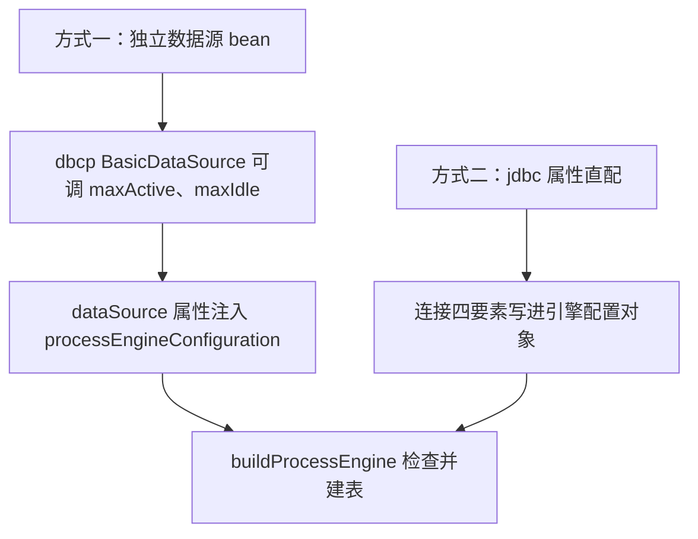

# 省掉 dataSource bean：activiti.cfg.xml 的第二种建表配置

上一篇的配置里有两个 bean，一个数据源，一个引擎配置对象。有的场景你并不想要独立数据源：本地演示、临时单测，少一个 bean 就少一份配置。Activiti 支持把连接信息直接写进 processEngineConfiguration，但属性名必须跟着换，照抄数据源的属性名是这块最容易翻车的地方。

## 先给结论

- 第二种写法：删掉 dataSource bean，把 `jdbcDriver`、`jdbcUrl`、`jdbcUsername`、`jdbcPassword` 四个属性直接挂到 processEngineConfiguration 上。
- 属性名不是照搬 `driverClassName`、`url`、`username`、`password`，要改成带 jdbc 前缀的名字，原样照抄会注入失败。
- 两种写法引擎行为完全一致，25 张表照样生成。
- 正式工程更推荐第一种：数据源独立成 bean，连接池参数可调、可复用，引擎只管引用。

## 一、第二种写法的完整配置

课程素材文件里两种写法都留着（素材原文里第一种启用、第二种注释保留），把第二种展开就是：

```xml
<bean id="processEngineConfiguration"
      class="org.activiti.engine.impl.cfg.StandaloneProcessEngineConfiguration">
    <!-- 不再注入 dataSource，直接给连接四要素 -->
    <property name="jdbcDriver" value="com.mysql.jdbc.Driver"/>
    <property name="jdbcUrl" value="jdbc:mysql://localhost:3306/activiti"/>
    <property name="jdbcUsername" value="root"/>
    <property name="jdbcPassword" value="root"/>
    <property name="databaseSchemaUpdate" value="true"/>
</bean>
```

对比熟悉的第一种写法：

```xml
<bean id="dataSource" class="org.apache.commons.dbcp.BasicDataSource">
    <property name="driverClassName" value="com.mysql.jdbc.Driver" />
    <property name="url" value="jdbc:mysql://localhost:3306/activiti" />
    <property name="username" value="root" />
    <property name="password" value="root" />
</bean>

<bean id="processEngineConfiguration"
      class="org.activiti.engine.impl.cfg.StandaloneProcessEngineConfiguration">
    <property name="dataSource" ref="dataSource"/>
    <property name="databaseSchemaUpdate" value="true"/>
</bean>
```

差别一目了然：第一种是「引数据源」，引擎配置对象通过 ref 引用独立 bean；第二种是「自带连接信息」，四个 jdbc 属性直接写在引擎配置对象上，dataSource bean 整个删掉。

改配置时还有一个中间态要提防：dataSource 的 ref 与 jdbc 属性同时挂在 processEngineConfiguration 上（迁移配置写到一半最容易留成这样）。此时引擎发现 dataSource 属性有值就直接用它，jdbc 四项被忽略，程序能跑，但两套连接信息并存，后来者根本分不清哪套在生效。迁移就迁移到底，旧 bean 与旧 ref 删干净。

## 二、属性名为什么要改名

`ProcessEngineConfiguration` 类自身就带连接属性，对应的 setter 是 `setJdbcDriver`、`setJdbcUrl`、`setJdbcUsername`、`setJdbcPassword`。Spring 的 property 注入按 setter 名匹配，写 `url`、`username` 这些名字，引擎配置对象上根本没有对应方法，注入直接失败。在 IDEA 里把光标悬停到 property 上，补全提示列出的就是 `jdbcUrl`、`jdbcUsername`、`jdbcPassword` 这一族名字，照提示写不会错。

一句话记牢：driverClassName、url、username、password 是 BasicDataSource 的属性名，jdbcDriver、jdbcUrl、jdbcUsername、jdbcPassword 是引擎配置对象的属性名，两套名字不通用。
引擎留这两套入口各有用意：独立数据源便于跟连接池、Spring 容器集成，是工程化的路子；jdbc 直配让引擎脱离容器也能最小化运行，拉起即用，是演示与单测的路子。知道各自服务的场景，就不会纠结「哪套才是标准答案」。

## 三、实测：换配置不换代码

验证流程与上一版完全一样，Java 测试代码一个字不用动，还是创建配置、构建引擎两步。先重置数据库：

```sql
drop database activiti;
create database activiti;
```

再运行 `testGenTable`，测试通过，回到客户端刷新库，25 张 `act_` 前缀的表全部到位。变化的只有 `activiti.cfg.xml` 里的配置项，连接从「引用数据源」换成「属性直配」，建表结果与第一种方式没有任何区别。



这张图把两种配置方式汇到同一个终点。解读要点：无论连接信息从哪个入口进来，引擎初始化后的行为一致，databaseSchemaUpdate 的建表策略也不受影响。

还有一个验证小技巧：建表日志里同样会出现 25 条 create table，把日志条数与库里表数对上，就能确认引擎走的确实是新配置。反过来，如果日志里的连接地址与 jdbcUrl 写的对不上，多半是旧的 activiti.cfg.xml 还在生效，先检查 classpath 下有没有残留两份同名配置，资源加载顺序不同也会让改动看起来「不生效」。

## 四、两种方式怎么选

方式一的好处在于数据源是一个独立的 bean：连接池上限 `maxActive`、空闲连接 `maxIdle` 都能精细调整（素材示例里配了 maxActive 3、maxIdle 1，不配也有默认值）；将来项目其他模块需要连同一个库，复用这个数据源即可；引擎只持有引用，职责干净。这也是更推荐的方式，正式项目与 Spring 整合场景基本都走它。

方式二的定位是轻量：少一个 bean，写演示、跑单测省事，代价是连接参数没有池化管理，扩展性差。两类场景分清，配置就不纠结了。真到生产环境，数据源这一层往往还会换成更稳的连接池并由容器统一管理，那时引擎需要的只是一个 ref 引用，方式一的价值进一步放大。

还有一点容易被忽略：无论哪种方式，连接信息都跟着配置文件走。换环境时改的是 activiti.cfg.xml，Java 代码一行不动；但把这份文件放进版本库前要做脱敏，账号密码不要原样提交，团队协作里更常见的做法是把连接配置外置出来按环境分发，避免库里真实数据被一次误提交带走。

## 常见误区

- **属性名照抄数据源的**：把 `driverClassName`、`url`、`username`、`password` 原样塞进 processEngineConfiguration，Spring 按名字找 setter 找不到，注入失败。必须换成 jdbc 前缀那套名字。
- **以为去掉 dataSource 就不用引 MySQL 驱动**：驱动依赖与配置方式无关，pom 里的 mysql-connector-java 照旧要有。
- **以为两种方式建出的表不一样**：表结构完全一致，配置只决定连接从哪来，不改变建表策略与结果。
- **jdbcUrl 的库名写错**：方式二里库名信息从 url 挪到 jdbcUrl，与实际建的库必须一致，否则连接失败。

## 面试可能被问到的问题

1. 面试官追问：「不配独立数据源，Activiti 怎么连数据库？」
   答：把 jdbcDriver、jdbcUrl、jdbcUsername、jdbcPassword 四个属性直接配在 processEngineConfiguration 上，引擎内部自建连接，效果与注入数据源一致。

2. 面试官追问：「为什么属性名是 jdbcUrl 而不是 url？」
   答：这些属性对应 ProcessEngineConfiguration 自己的 setJdbcUrl 等 setter，Spring property 注入按名字匹配；url 是 BasicDataSource 的属性名，两套名字不能混用，混了就注入失败。

3. 面试官追问：「两种配置方式如何取舍？」
   答：正式工程推荐独立数据源 bean，连接池参数可调、可复用、可统一管理；jdbc 属性直配少一个 bean，适合演示与快速单测。

4. 面试官追问：「databaseSchemaUpdate 在第二种写法里还生效吗？」
   答：生效。它与连接方式无关，单独决定建表策略，两种写法里都设为 true 即可自动建出 25 张表。

5. 面试官追问：「dataSource 注入与 jdbc 属性同时存在会怎样？」
   答：引擎发现 dataSource 属性有值就直接使用它，jdbc 四项被忽略，程序能跑但配置语义混乱，实际项目里应只保留一种写法。

## 配套资料

- 课程工程：`materials/code/02/Activiti7-day01-基础原理与使用/Activiti7-day01-基础原理与使用/代码/activiti01/`
  （`src/main/resources/activiti.cfg.xml` 中保留了第二种写法的注释段，文中包名已统一改为 `com.example`）
- 配置素材：同目录 `素材/activiti.cfg.xml`（含 maxActive、maxIdle 连接池参数示例）
