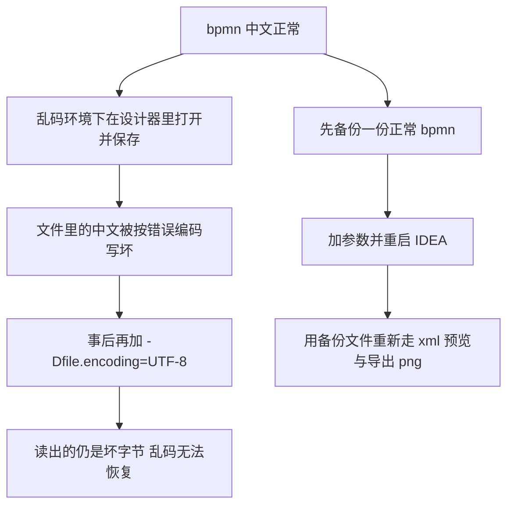

# 导出的流程 png 中文变乱码：给 IDEA 补一行 VM 编码参数

照上一篇导出 png，打开一看，节点名全成了方块和问号，「填写请假申请单」一个汉字都不剩。bpmn 本身是好的，坏在 IDEA 进程的编码上。这一步把乱码的成因、修法和那个救不回来的坑一次说清。

## 先给结论

- 乱码根因：IDEA 启动时 JVM 默认编码不是 UTF-8，设计器渲染与导出中文时按错误编码翻译，出图即乱码。
- 修法：在 IDEA 安装目录 `bin` 下的 `idea64.exe.vmoptions` 末尾加一行 `-Dfile.encoding=UTF-8`，行首行尾不留空格，然后重启 IDEA。
- 动手前先备份一份中文正常的 bpmn：如果文件已经在乱码状态下被保存过，里面的中文是真坏了，改编码救不回来。
- 修完的验证路径：重启，打开 xml 预览设计器确认中文正常，再走 Export to file 重新导出 png。

## 一、乱码从哪来

png 上的文字不是从图片文件里读出来的，而是设计器按当前 JVM 的默认编码把 bpmn 里的中文画上去的。`-Dfile.encoding` 这个 VM 参数决定 JVM 默认的字符编码，IDEA 安装后它跟随系统区域设置，中文 Windows 上的老版本常见 GBK。设计器导出图片时按 GBK 去翻译 UTF-8 的字节，汉字自然变成乱码。所以修复点不在流程文件，而在 IDEA 进程的启动参数上。

GBK 与 UTF-8 的差异放大了这个问题：同一个汉字在 GBK 里占两个字节，在 UTF-8 里占三个字节，两套编码互相翻译必然对不上号。UTF-8 的文件按 GBK 解读，常见结果是问号与方块；反向错配则会见到「锟斤拷」这类著名乱码。看到这类字符基本可以断定是编码不一致，而不是文件损坏，排查方向也就定下来了。

## 二、改 vmoptions 的具体操作

操作目标文件是 IDEA 安装目录 `bin` 下的 `idea64.exe.vmoptions`，64 位系统就改 64 位对应的这一份。定位方式：桌面右键 IDEA 图标看属性，打开文件所在位置，进入 `bin` 目录（课程环境里是 `D:\idea\Install\IDEA 2017.1.5\bin` 这类路径，实际以本机安装位置为准）。用编辑器打开，在文件最后一行追加参数：

```bash
-Xms128m
-Xmx750m
-XX:MaxPermSize=350m
-Dfile.encoding=UTF-8
```

两个硬要求：这一行加在文件末尾，行首不要缩进空格，行尾也不要带多余空格；改完必须完全退出并重启 IDEA，JVM 参数只在进程启动时读取一次，不重启等于没改。

新版 IDEA 的等价入口是菜单 Help 里的 Edit Custom VM Options，它写的是用户目录下的那份副本，效果相同，属于同一件事的两个入口。

顺带分清两处编码设置：Settings 里的 File Encodings 管的是「文件以什么编码保存」，vmoptions 里的 file.encoding 管的是「进程按什么编码读写与渲染」。这里的问题出在设计器渲染出图，必须改后者；把前者也统一成 UTF-8 属于顺手加固，能让新建文件从一开始就不带隐患，两处都查一遍才算把编码环境理干净。

## 三、救不回来的坑：先备份再调参

编码参数只影响读写时怎么翻译字节，已经按错误编码写到磁盘上的字节不会自己复原。最坏的时间线是这样的：



图上两条岔路就是错误与正确两种结局。有同学在乱码出现后才补参数，回来重新打开发现还是乱码，以为参数没生效，其实文件在第一次保存时就已经损坏。正确顺序是：先拷贝一份中文正常的 bpmn 存好，再加参数、重启，用备份文件覆盖工作目录里的坏文件，重新执行改名 xml、设计器预览、Export to file 的完整流程，这次出图就是正常中文。

覆盖文件之后还有两道轻量验证：在设计器里打开 xml 副本，节点名显示正常，说明编码链路已通；再导出 png 双击查看，图片里的中文完好，这个坑才算真正填完。以后遇到任何工具的中文乱码，都可以套用同一套排查顺序：先确认文件字节是否完好，再查进程默认编码，最后看保存环节，方向对了问题通常十分钟内就能收尾。

## 常见误区

- **改完参数不重启 IDEA。** vmoptions 只在启动时读取，不重启永远不生效，还会误判成参数写错。
- **对着已损坏的文件反复调编码。** 坏字节不会因编码参数变更而复原，唯一出路是用早先的备份覆盖。
- **参数行前带了空格或改错了文件。** 32 位与 64 位各有自己的 vmoptions，日常用 64 位启动就要改 64 位那份；行首空格可能导致参数解析异常。
- **只怀疑流程文件。** bpmn 是 UTF-8 文本，内容本身没问题，乱码出在渲染它的进程上，方向错了怎么查都查不到点子上。

## 面试可能被问到的问题

1. 面试官追问：「-Dfile.encoding 决定什么？」
   答：它设定 JVM 的默认字符编码，影响没有显式指定编码的读写行为，比如文件读写、控制台输出、字体渲染等场景。工具类进程出现中文乱码时，先查它的默认编码，再查文件本身的编码。

2. 面试官追问：「参数加了乱码还在，为什么？」
   答：两种可能。一是进程没有重启，参数未加载；二是文件里的中文在乱码状态下被写坏过，磁盘上已经是坏字节，改参数只能保证以后不再写坏，救不回已坏的内容，只能换用备份文件。

3. 面试官追问：「vmoptions 文件什么时候生效？」
   答：JVM 启动时读取一次，修改后必须完全退出并重新启动 IDEA，不存在热生效。新版 IDEA 通过 Help 菜单的 Edit Custom VM Options 修改用户级副本，重启同样必要。

4. 面试官追问：「bpmn 文件本身应该用什么编码保存？」
   答：UTF-8，文件头声明 encoding 为 UTF-8。工程统一 UTF-8 后，文件、数据库、IDE、导出图片各环节编码一致，乱码问题从源头上消失。

## 配套资料

- 本课是工具配置问题，无对应源码文件；课程工程在
  `materials/code/02/Activiti7-day02-工作流使用/代码/代码/`
  （含 `ActivitiDeployment.java`、`activiti.cfg.xml`，包名已改为 `com.example`）
- 文中 vmoptions 内容为按本课实录整理的示例，具体路径以本机 IDEA 安装目录为准。
