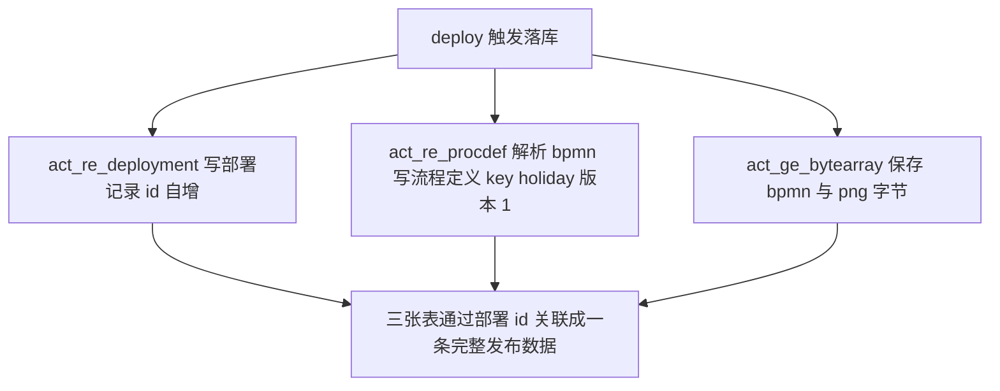
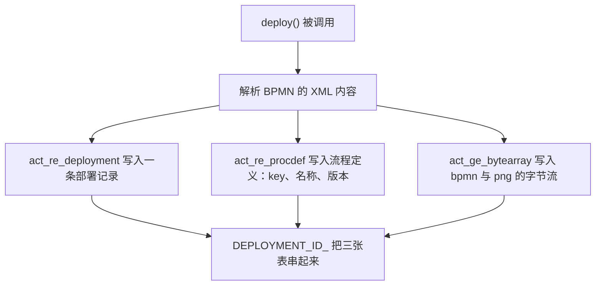
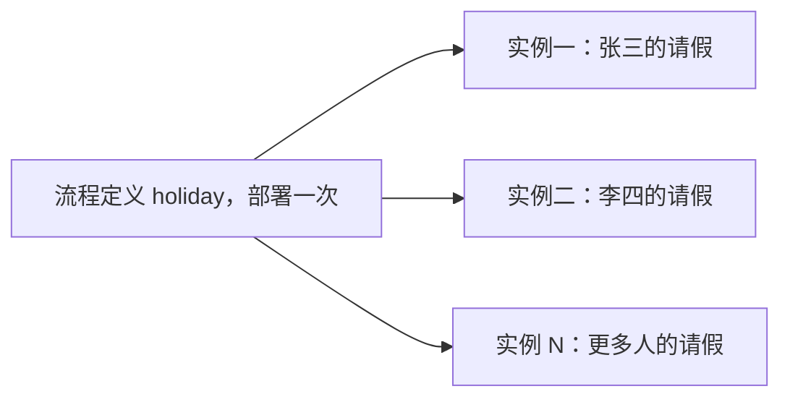

# Activiti 实现流程定义部署与实例启动：DeploymentBuilder、三张表落库与 key 启动

## 先给结论

- 三篇内容完成从流程定义部署到流程实例启动的最小闭环：部署步骤及实现、部署内部过程的三张表分析、启动流程实例的步骤与 key 来源。
- 部署四步：创建 ProcessEngine、取 RepositoryService、createDeployment 链式添加资源、deploy 落库；addClasspathResource 先加 bpmn 再加 png，name 给部署起名，deploy 真正写库。
- 一次部署写三张表：act_re_deployment 存部署记录、act_re_procdef 存流程定义、act_ge_bytearray 存 bpmn 与 png 的字节流；部署 id 是数据库自增生成，不是代码设置的。
- BPMN 本质是一份 XML，与 PNG 一起按二进制进 act_ge_bytearray；process id 即流程定义 key，写在 act_re_procdef 的 KEY_ 字段，是启动实例的入口。
- act_ge_property 在建表时就带引擎版本等属性，与本次部署无关；RepositoryService 的价值在于封装三张表的写入，没有它这些记录就得手写 SQL 自己维护。
- 流程定义与流程实例是类与对象的关系：一套定义可启动多个实例；启动用 RuntimeService 的 startProcessInstanceByKey，前提是定义已完成部署。
- key 两个现成来路：BPMN 里 process 元素的 id，或部署后 act_re_procdef 的 KEY_ 字段；启动返回 ProcessInstance，定义 ID 形如 holiday:1:4，实例 ID 是新主键。
- getDefaultProcessEngine 生效依赖两个默认条件：配置文件叫 activiti.cfg.xml、bean id 叫 processEngineConfiguration；刚启动时 deploymentId 与 activityId 为 null 属正常现象。

## 第1部分：把流程定义部署进 Activiti：一条 DeploymentBuilder 链与三张表的变化

`holiday.bpmn` 和 `holiday.png` 都躺在工程里了，但 Activiti 运行时读的是数据库里的表，不是硬盘上的文件。流程定义部署就是把这两个文件写进引擎数据库的动作，也是画好的图真正「上岗」前的最后一步。写成代码只有十来行，背后牵动三张表。

### 一、部署代码逐行拆解

课程工程 `ActivitiDeployment` 的部署方法（包名已改为 `com.example`）：

```java
package com.example.activiti;

import org.activiti.engine.ProcessEngine;
import org.activiti.engine.ProcessEngines;
import org.activiti.engine.RepositoryService;
import org.activiti.engine.repository.Deployment;

public class ActivitiDeployment {

    public static void main(String[] args) {
        //1.创建 ProcessEngine 对象
        ProcessEngine processEngine = ProcessEngines.getDefaultProcessEngine();

        //2.得到 RepositoryService 实例
        RepositoryService repositoryService = processEngine.getRepositoryService();

        //3.进行部署
        Deployment deployment = repositoryService.createDeployment()
                .addClasspathResource("diagram/holiday.bpmn")  //添加 bpmn 资源
                .addClasspathResource("diagram/holiday.png")   //添加 png 资源
                .name("请假申请单流程")
                .deploy();

        //4.输出部署的一些信息
        System.out.println(deployment.getName());
        System.out.println(deployment.getId());
    }
}
```

按四步对号。第一步建引擎，走默认方式，`activiti.cfg.xml` 与 bean id 两个默认条件必须满足。第二步从引擎取 RepositoryService，它是资源管理类，部署与流程定义查询都归它管；文件写库的 DAO 和 Service 引擎内部都备好了，程序员只管把资源名报给它。第三步是核心：`createDeployment()` 返回一个 DeploymentBuilder 构建器，`addClasspathResource` 每调一次往链上挂一个 classpath 下的资源，路径相对 `src/main/resources` 根，所以写 `diagram/holiday.bpmn`，不能写盘符开头的绝对路径；`name` 给这次部署起名，方便在部署表里认出来；`deploy()` 触发真正落库，前面几段只是攒参数，不调 `deploy()` 数据库里什么都不会发生。第四步输出验证，控制台打印：

```bash
请假申请单流程
1
```

`getName()` 输出部署名，`getId()` 输出 `1`。这个 id 不是代码设的，`DeploymentBuilder` 上没有设 id 的方法，它来自部署表主键的数据库自增。

### 二、数据库里发生了什么

部署完成后刷新库，三张表各多出记录：

| 表 | 存什么 | 本次部署后 |
|---|---|---|
| `act_re_deployment` | 部署记录 | 一条，`ID_` 为 1，`NAME_` 为「请假申请单流程」 |
| `act_re_procdef` | 流程定义 | 一条，`KEY_` 为 holiday，`VERSION_` 为 1 |
| `act_ge_bytearray` | 资源字节 | 两条，bpmn 与 png 的内容各占一行 |

三张表在落库时的写入关系与关联字段如下：



关联线是查资源时的关键：流程定义表靠部署 id 挂到部署记录，资源表同样带部署 id，要取某个流程定义的 png，顺着这条线就能定位到字节内容。同一个 key 再部署一次不会覆盖旧版，`act_re_procdef` 会多出一条 `VERSION_` 为 2 的记录，新旧版本并存，已在途的流程实例继续按旧版本走。

流程定义记录的主键也值得看一眼：形如 holiday:1:1，三段分别是流程 key、版本号与部署 id。引擎用这种拼串写法把三样信息压进一个字段，用的时候反着拆开即可。以后按 id 查流程定义或查流程图资源，传的就是这串拼出来的值，看到它就能立刻读出这是哪个流程的第几版、来自哪次部署。

### 三、另一种入口：zip 包部署

工程里同一份代码还保留了 zip 的写法，把流程文件打成压缩包一次性部署：

```java
//把 bpmn 与 png 打成 holidayBPMN.zip 放到 resources 下
InputStream is = ActivitiDeployment.class.getClassLoader()
        .getResourceAsStream("diagram/holidayBPMN.zip");
ZipInputStream zipInputStream = new ZipInputStream(is);

Deployment deployment = repositoryService.createDeployment()
        .addZipInputStream(zipInputStream)
        .name("请假申请单流程")
        .deploy();
```

效果与逐个 `addClasspathResource` 一致，包里的每个文件都会进资源表。差别只在工程组织：流程定义多了以后，打包上传比一个个报文件名省事，工程注释里那句「zip 文件更便于上传」说的就是这个场景。

打包有个小讲究：把 bpmn 与 png 两个文件直接选中压缩，让压缩包第一层就是文件本身，不要带着外层文件夹一起压。zip 部署按压缩包内的路径登记资源名，多一层目录，资源名里就多一截前缀，后续按名字找资源时容易对不上号。

## 第2部分：流程定义部署的内部过程：Activiti 到底往哪三张表写了数据

流程定义部署的代码只有几行，跑完控制台也只打印一个部署名称和一个 ID。可打开数据库里 Activiti 的 25 张表，到底哪几张多了记录、各自存了什么，多数人是含糊的；部署一旦出问题，排查也就无从下手。

就把 `deploy()` 执行之后数据库里发生的事拆开看：哪三张表被写入、每张表记什么、BPMN 文件和 PNG 图片去了哪里、key 为什么是后面一切操作的入口。

### 分析思路：对比部署前后的表数据

25 张表在初始状态下绝大多数是空表。这给了我们一个干净的观察方法：把 `activiti` 库删掉重建，跑一次部署代码，再看哪些表从空变成了有数据，多出来的记录就是这次部署的「工作成果」。

```sql
drop database activiti;
create database activiti;
```

重建后先跑一次引擎初始化，25 张表全部建出来，此时除 `act_ge_property`（存引擎 schema 版本、主键生成策略等属性）之外几乎全是空表。执行一次部署再刷新，哪些表多了记录一目了然：`act_re_deployment` 多一条部署记录，`act_re_procdef` 多一条流程定义记录，`act_ge_bytearray` 多两条资源记录。`act_re_model` 依然是空的，只有用模型设计器保存模型时它才会有数据。

部署代码本身很简短：

```java
public class ActivitiDeployment {
    public static void main(String[] args) {
        //1.创建ProcessEngine对象
        ProcessEngine processEngine = ProcessEngines.getDefaultProcessEngine();
        //2.得到RepositoryService实例
        RepositoryService repositoryService = processEngine.getRepositoryService();
        //3.进行部署
        Deployment deployment = repositoryService.createDeployment()
                .addClasspathResource("diagram/holiday.bpmn")  //添加bpmn资源
                .addClasspathResource("diagram/holiday.png")
                .name("请假申请单流程")
                .deploy();
        //4.输出部署的一些信息
        System.out.println(deployment.getName());
        System.out.println(deployment.getId());
    }
}
```

工程里还留了一份打成 zip 上传的写法，思路一样，只是把两个资源换成一个压缩流，更贴近真实场景里「把做好的流程打包上传到服务器」的用法：

```java
//把 classpath 里的 zip 转成 ZipInputStream 再部署
InputStream is = ActivitiDeployment.class.getClassLoader()
        .getResourceAsStream("diagram/holidayBPMN.zip");
ZipInputStream zipInputStream = new ZipInputStream(is);
Deployment deployment = repositoryService.createDeployment()
        .addZipInputStream(zipInputStream)
        .name("请假申请单流程")
        .deploy();
```

### 三张表各记了什么

| 表名 | 记录什么 | 关键字段 |
|---|---|---|
| `act_re_deployment` | 部署信息，一次 `deploy()` 一条 | ID_、NAME_ |
| `act_re_procdef` | 流程定义信息，每个流程定义一条 | KEY_、NAME_、VERSION_、DEPLOYMENT_ID_ |
| `act_ge_bytearray` | 部署资源，bpmn 与 png 各一条 | NAME_ 文件名、BYTES_ 二进制内容 |

**第一张表 `act_re_deployment` 只负责记录「这次发布」本身。** 部署名称（这里是「请假申请单流程」）、部署时间、部署 ID。它是三张表里的「发票」，本次发布的资源都挂在它名下。

**第二张表 `act_re_procdef` 负责记录「发布出去的是什么」。** 请假流程的 key、名称、版本号都在这条记录里。key 尤其关键：请假流程有请假的 key，调薪流程有调薪的 key，调岗流程有调岗的 key，它是唯一识别不同流程的关键字，启动实例时全靠它。同一个 key 部署多次，VERSION_ 会自动加一，形成 `holiday:1:4`、`holiday:2:5` 这样的版本序列。

**第三张表 `act_ge_bytearray` 负责把文件原样存下来。** 在 IDE 里 BPMN 画出来是图形，本质上是一份 XML。用数据库工具打开这条记录的 BYTES_ 字段，能直接看到 `<bpmn:sequenceFlow>`、`<bpmn:userTask>` 这些元素，PNG 同样以字节流的形式躺在旁边。引擎运行期需要图的时候（比如生成流程图），就从这张表里取。



图里最关键的线索是 DEPLOYMENT_ID_：一次部署产生一个部署 ID，流程定义记录和两条资源记录都带着这个 ID，凭它能把一次发布的全部信息拼回原样。

### 为什么说 RepositoryService 值得用

没有 `RepositoryService` 提供的这组方法，要让这三张表有数据，就得自己解析 XML、自己维护主键、自己拼 INSERT，工作量不小还容易写错。Activiti 的价值正在这里：学习阶段要记的表多、概念多，换来的是运行期的表操作全部由引擎接管。反过来说，想把这套引擎驾驭好，25 张表各自的作用、每一步操作影响哪几张表，都得有个大概的印象，否则出了数据问题就只能干瞪眼。

## 第3部分：让流程真正跑起来：启动流程实例的步骤与 key 的来源

部署完成后，BPMN 和 PNG 已经躺进了数据库，但流程还只是一张「图纸」。张三要请假，得让这套定义真正转起来，这一步叫启动流程实例。启动的 API 只有一行 `startProcessInstanceByKey`，可 key 从哪里来、启动之后控制台打出来的几个 ID 各是什么意思，是这一节要说透的事。

### 先分清两个名词：流程定义与流程实例

**流程定义，是画出来的那张 BPMN 图。** 它规定了请假流程有哪些节点、先填单还是先审批，本身是静态的，部署后存进 `act_re_procdef` 与 `act_ge_bytearray`。把三个名词串起来：画图得到流程定义，执行部署把定义送进数据库，启动实例让定义跑起来。

**流程实例，是定义的一次真实运行。** 类比 Java：流程定义好比一个类，流程实例好比根据这个类 new 出来的对象，实例就是对象。一个类可以创建多个实例，一套流程定义同样对应多个流程实例。公司十个人走的是同一套请假流程，张三请假跑的是张三的实例，过两天李四请假跑的就是李四的实例，图纸是同一张，运行轨迹各是各的。



### 启动流程实例的四步套路

真实工程里的启动类只有十几行，四步走完：拿引擎、拿 RuntimeService、按 key 启动、输出信息。

```java
package com.example.activiti;

import org.activiti.engine.ProcessEngine;
import org.activiti.engine.ProcessEngines;
import org.activiti.engine.RuntimeService;
import org.activiti.engine.runtime.ProcessInstance;

/**
 * 启动流程实例：前提是先已经完成流程定义的部署工作
 */
public class ActivitiStartInstance {
    public static void main(String[] args) {
        //1.得到ProcessEngine对象
        ProcessEngine processEngine = ProcessEngines.getDefaultProcessEngine();
        //2.得到RuntimeService对象
        RuntimeService runtimeService = processEngine.getRuntimeService();
        //3.创建流程实例，流程定义的key需要知道 holiday
        ProcessInstance processInstance = runtimeService.startProcessInstanceByKey("holiday");
        //4.输出实例的相关信息
        System.out.println("流程部署ID" + processInstance.getDeploymentId());      //null
        System.out.println("流程定义ID" + processInstance.getProcessDefinitionId()); //holiday:1:4
        System.out.println("流程实例ID" + processInstance.getId());                 //2501
        System.out.println("活动ID" + processInstance.getActivityId());            //null
    }
}
```

**为什么走 `RuntimeService`？** 部署动的是静态的「仓库」（Repository），启动动的是运行时的数据（Runtime），引擎按职责拆出了不同的 Service：`RepositoryService` 管流程定义的存取，`RuntimeService` 管流程实例的启动与推进。启动实例会生成一堆运行时记录，自然归后者管。

**为什么按 key 启动而不是按 ID？** `RuntimeService` 同时提供了 `startProcessInstanceById`，但部署 ID 只对应某一次发布，key 才是业务侧的唯一标识，按 key 启动会自动选中该 key 的最高版本定义，生产上更常用。`ProcessInstance` 对象上除了这几个 ID，还能取 businessKey、流程名称等，后续接业务系统时会用到。

### key 忘了去哪查

key 不需要背，两个地方随时能查：

- 打开 BPMN 源文件，`<process id="holiday" ...>` 里的 id 就是 key，每个流程都有自己唯一的 id；
- 看部署后的 `act_re_procdef` 表，KEY_ 字段直接写着 holiday。

```sql
-- 部署后核对流程定义的 key 与版本
SELECT ID_, KEY_, NAME_, VERSION_ FROM act_re_procdef;
-- 启动后核对流程实例
SELECT ID_, PROC_INST_ID_, PROC_DEF_ID_ FROM act_hi_procinst;
```

后续代码统一用 `holiday` 这个 key 启动。key 的命名习惯上沿用 BPMN 里的 id，全小写、不带空格。要注意 key 一旦投入使用就不要再改：改 key 等于换了一套全新的流程定义，旧 key 下的历史数据不会自动迁移过去，按新 key 查不到旧的审批记录，改名前想清楚。

### 启动后控制台四个值怎么读


### 启动后控制台四个值怎么读

| 输出项 | 本例的值 | 说明 |
|---|---|---|
| 流程部署ID | null | 实例不直接挂部署 ID，经流程定义间接关联 |
| 流程定义ID | holiday:1:4 | 格式是 `key:版本:定义主键` |
| 流程实例ID | 2501 | 本次启动新产生的主键 |
| 活动ID | null | 实例对象刚返回时未指向具体活动 |

`holiday:1:4` 正好对应 `act_re_procdef` 里的那条记录：key 是 holiday，第一次部署版本号为 1，定义主键是 4。流程实例 ID 2501 则是这次启动新产生的，去 `act_hi_procinst` 里查，ID_ 与 PROC_INST_ID_ 都是 2501。启动实例背后的 7 张表写入，单独放在下一篇过程分析里展开。

两个 null 的原因也顺带补全：部署 ID 这一档信息挂在流程定义上，实例经定义间接关联，接口不直接给；活动 ID 要等实例推进到具体节点才有意义，启动方法返回的那一刻实例刚离开开始节点，还没有停稳。想知道当前停在哪个节点，去 act_ru_execution 或 act_ru_task 里看，后面的任务查询会演示这条路径。

## 常见误区

- **资源路径写成文件系统绝对路径。** `addClasspathResource` 的参照物是 classpath 根，写 `D:\...` 找不到文件，运行时直接抛找不到资源的异常。
- **攒完参数忘调 `deploy()`。** 构建器模式攒的只是参数，不调 deploy 不会落库，表里查不到记录，还以为部署成功了。
- **以为重复部署会覆盖。** 同 key 部署是加版本不是覆盖，`act_re_procdef` 按版本区分；想下线旧版本要用暂停或删除操作，不是再部署一遍。
- **png 没部署就担心流程图。** 引擎能按 bpmn 坐标自动生成流程图，png 缺席不影响运行，只是展示退回自动生成版。
- **以为部署只影响一张表**：只看到 `act_re_deployment` 多了一条记录就认为完事。流程定义信息和资源文件分别在另外两张表里，清理部署时三处都要动。
- **把 `act_ge_property` 当部署产物**：这张表建库时就有引擎版本等数据，属于引擎自身属性，与业务部署无关。
- **以为 PNG 是可选装饰**：图片也进 `act_ge_bytearray`。部署时只传 bpmn 不传 png，运行期取图就是空。
- **以为 BPMN 在库里还是「图」**：库里存的是 XML 字节流，图形只是设计器的呈现方式，排查数据问题时直接按 XML 读。
- **没部署就启动**：`startProcessInstanceByKey` 找不到对应定义会直接抛异常，启动的前置条件永远是部署已完成。
- **把流程定义 ID 当实例 ID 用**：`holiday:1:4` 标识的是「哪一套流程的哪个版本」，`getId()` 返回的 2501 才是这一次运行。
- **拿着部署 ID 去按 ID 启动**：`startProcessInstanceById` 接收的是流程定义 ID，不是部署 ID，两者不是一回事。
- **看到两个 null 就以为出错了**：实例对象在启动方法返回那一刻，部署 ID 与活动 ID 就是 null，是设计如此。

## 面试可能被问到的问题

1. 面试官追问：「一次流程定义部署会写哪些表？」
   答：至少三张。act_re_deployment 写部署记录，act_re_procdef 写解析出的流程定义，act_ge_bytearray 存 bpmn 与 png 的字节内容。三张表靠部署 id 关联，构成一条完整的发布数据。

2. 面试官追问：「Deployment 的 id 是怎么来的，能自己指定吗？」
   答：不能指定。id 由部署表主键自增生成，部署方法返回的 Deployment 对象里可以读到。构建器上可设置的是 name 与 category 这类元信息。

3. 面试官追问：「同一个流程定义部署多次会怎样？」
   答：act_re_procdef 里出现同 key 的多个版本，VERSION_ 递增。启动实例默认取最高版本，已运行的旧实例不受影响，这也是流程灰度升级的基础。

4. 面试官追问：「addClasspathResource 与 addZipInputStream 两种部署怎么选？」
   答：文件少直接逐个加资源，直观可控；文件多或要整体上传时打 zip 包用流部署，一次进去一批。两者落库结果没有区别。

5. 面试官追问：「为什么部署用 RepositoryService 而不是 RuntimeService？」
   答：RepositoryService 是资源管理类，管流程的静态定义与发布包，部署属于静态资源的写入；RuntimeService 管运行时状态，负责启动实例与推进流程。职责按资源域划分，部署发生在流程运行之前。

6. 面试官追问：「getDefaultProcessEngine() 在这里依赖什么条件？」
   答：classpath 下存在 activiti.cfg.xml，且其中引擎配置 bean 的 id 为 processEngineConfiguration。两个默认约定缺一个就取不到引擎，此时要改用显式构建配置对象的方式。

7. 面试官追问：「流程定义部署会影响哪几张表？」
   答：三张。act_re_deployment 记录部署信息，act_re_procdef 记录流程定义的 key、名称、版本，act_ge_bytearray 以二进制形式存放 BPMN 文件与 PNG 图片。act_ge_property 在建表时就有引擎版本数据，不算部署产物。

8. 面试官追问：「流程定义的 key 从哪里来，有什么用？」
   答：key 来自 BPMN 文件里 process 元素的 id，部署后存进 act_re_procdef 的 KEY_ 字段。它是流程定义的唯一业务标识，启动实例用 startProcessInstanceByKey，同一个 key 重复部署会自动递增版本号。

9. 面试官追问：「BPMN 文件在数据库里怎么存的？」
   答：BPMN 本质是 XML，部署时与 PNG 一起按二进制写进 act_ge_bytearray 的 BYTES_ 字段，各一条记录，NAME_ 记文件名，通过 DEPLOYMENT_ID_ 关联到本次部署。

10. 面试官追问：「同一个流程修改后再次部署，运行中的旧实例会受影响吗？」
   答：不会。再次部署会在 act_re_procdef 生成新版本记录，VERSION_ 加一。已经在跑的旧实例继续按旧版本定义执行，新启动的实例默认使用最高版本。

11. 面试官追问：「RepositoryService 在部署里承担什么角色？」
   答：它是流程定义存储操作的入口，createDeployment() 构建部署对象，addClasspathResource 或 addZipInputStream 添加资源，deploy() 统一落库，内部封装了对这三张表的全部写入。

12. 面试官追问：「流程定义和流程实例是什么关系？」
   答：类比 Java 的类与对象。流程定义是 BPMN 描述的静态模板，部署后存库；流程实例是按定义发起的一次真实运行。一套定义可以启动任意多个实例，每个实例有独立的 ID 和运行轨迹。

13. 面试官追问：「startProcessInstanceByKey 的 key 从哪里来？」
   答：来自 BPMN 文件中 process 元素的 id，部署后写入 act_re_procdef 的 KEY_ 字段。忘了可以查表或重新打开 BPMN 源文件确认，同一个 key 存在多个版本时，按 key 启动自动取最高版本。

14. 面试官追问：「为什么启动实例用 RuntimeService 而不是 RepositoryService？」
   答：两个 Service 按职责划分，RepositoryService 面向流程定义这类静态资源的存取，RuntimeService 面向运行时数据的启动与流转。启动实例是产生运行时数据的动作，所以走 RuntimeService。

15. 面试官追问：「启动后流程实例 ID 是什么，存在哪？」
   答：是引擎生成的主键，例如 2501。运行时存在 act_ru_execution，历史上存进 act_hi_procinst，表里 ID_ 与 PROC_INST_ID_ 相同，说明这是实例自身的执行记录。

16. 面试官追问：「按 key 启动和按 ID 启动有什么区别？」
   答：key 是业务标识，按 key 启动自动匹配当前最高版本的定义；定义 ID 是 `key:版本:主键` 格式的精确标识，能指定具体版本。常规业务用 key，回归特定版本时用 ID。

## 配套资料

- 部署代码工程：`materials/code/02/Activiti7-day02-工作流使用/代码/代码/`
  （含 `ActivitiDeployment.java`、`ActivitiStartInstance.java`、`pom.xml`，文中包名已统一改为 `com.example`）
- 引擎配置：`materials/code/02/Activiti7-day02-工作流使用/代码/代码/src/main/resources/activiti.cfg.xml`
  （dbcp 数据源加 `StandaloneProcessEngineConfiguration`，`databaseSchemaUpdate` 为 true）
- 资料包中未含 bpmn 与 png 文件，部署示例按工程内真实代码整理，工程同时保留了 zip 部署版本。
- 部署代码：`materials/code/02/Activiti7-day02-工作流使用/Activiti7-day02-工作流使用/代码/代码/src/main/java/` 下的 `ActivitiDeployment.java`
  （含 classpath 资源部署与 zip 流部署两种写法，文中包名已统一改为 `com.example`）
- 引擎配置：`materials/code/02/Activiti7-day02-工作流使用/Activiti7-day02-工作流使用/代码/代码/src/main/resources/activiti.cfg.xml`
  （数据源与 `databaseSchemaUpdate=true` 建表开关）
- 启动实例代码：`materials/code/02/Activiti7-day02-工作流使用/Activiti7-day02-工作流使用/代码/代码/src/main/java/` 下的 `ActivitiStartInstance.java`
  （类头注释列出了启动影响的 7 张表，文中包名已按规范改为 `com.example`，代码注释保留了实际输出值）
- 部署前置代码：同目录 `ActivitiDeployment.java`（启动前必须先完成部署）
