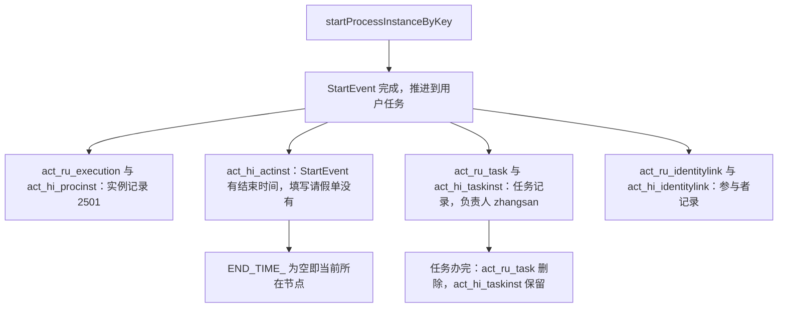

# 启动实例的内部过程：四张 history 表与三张 runtime 表各写了什么

`startProcessInstanceByKey` 跑完，控制台只是几行输出，真正的工作发生在数据库：引擎要把「流程走到哪了」「现在谁该干什么」一次性落进表里。启动一次实例到底影响哪几张表、每条记录长什么样，是排查流程卡住、审批丢失的基本功。

## 先给结论

- 启动一次流程实例写的是 7 张表：4 张 `act_hi_` 前缀的历史表，加 3 张 `act_ru_` 前缀的运行时表。
- `act_hi_actinst` 是活动流水账：StartEvent 已完成、带 END_TIME_，当前节点「填写请假单」END_TIME_ 为空，代表还没办完。
- `act_ru_task` 是「此刻该谁干活」的唯一事实来源，任务办理完成后这条记录会被删除。
- `act_ru_execution` 在单例流程里只有一条记录，ID_ 与 PROC_INST_ID_ 相同；出现并行分支才会派生出 ID_ 各异的子执行记录。
- 两张 identitylink 表记参与者，`act_hi_procinst` 与 `act_ru_execution` 记实例本身。

## 7 张表先摆出来

流程启动那一刻，引擎按「历史」与「运行时」两条线写表：

| 表 | 线 | 记了什么 |
|---|---|---|
| act_hi_procinst | history | 流程实例历史，本例一条，ID_ 2501 |
| act_hi_actinst | history | 活动实例，每经过一个节点记一条 |
| act_hi_taskinst | history | 任务实例历史，任务一创建就写 |
| act_hi_identitylink | history | 参与者历史 |
| act_ru_execution | runtime | 执行记录，实例级与分支级都在这里 |
| act_ru_task | runtime | 当前待办任务，办完即删 |
| act_ru_identitylink | runtime | 当前参与者 |

记忆方法：`hi` 是 history，`ru` 是 runtime。历史表只往前记账，运行时表描述「此刻」的状态。排查一个流程为什么卡住，`act_ru_task` 与 `act_ru_execution` 是第一现场；复盘一个流程走没走对，`act_hi_actinst` 是完整流水。

## 逐表看记录长什么样

**`act_hi_actinst`：活动的流水账。** 启动实例后里面已有两条记录。一条是 StartEvent，END_TIME_ 有值，说明开始节点已经走完；另一条是用户任务「填写请假单」，END_TIME_ 是空的，说明这个活动正在等人执行，张三还没把单子填完。等任务办理完成，这条记录的 END_TIME_ 才会被补上。判断流程停在哪个节点，看哪条记录缺 END_TIME_ 就行。

**`act_hi_procinst` 与 `act_ru_execution`：实例本身。** 两边都能查到 ID_ 为 2501 的记录，且 PROC_INST_ID_ 也是 2501。ID_ 与 PROC_INST_ID_ 相等，说明这是实例自身的执行线，还没有派生分支。执行表里同时带着 ACT_ID_（当前所在活动）与开始时间。

**`act_hi_taskinst` 与 `act_ru_task`：任务的两面。** 任务「填写请假单」创建时，历史表先落一条任务实例，开始时间有值、完成时间为空；运行时表同时挂一条待办任务，负责人 ASSIGNEE_ 是 zhangsan。区别在生命周期：任务办理完成，`act_ru_task` 里的记录被删除，`act_hi_taskinst` 里的记录永远保留。

**两张 identitylink：参与者信息。** 记录这次运行、这个任务的参与人，zhangsan 作为办理人写在里面。后续做「我参与的流程」这类查询，数据就来自这两张表。

```java
//启动后输出，注释是本例的实际值
System.out.println("流程定义ID" + processInstance.getProcessDefinitionId()); //holiday:1:4
System.out.println("流程实例ID" + processInstance.getId());                  //2501
```

```sql
-- 实例级执行记录：单例时 ID_ 与 PROC_INST_ID_ 相同
SELECT ID_, PROC_INST_ID_, ACT_ID_ FROM act_ru_execution;
-- 当前待办任务：办理完成后该行消失
SELECT ID_, NAME_, ASSIGNEE_, PROC_INST_ID_ FROM act_ru_task;
```



图里两条主线最值得盯：一条看节点推进（`act_hi_actinst` 的 END_TIME_），一条看待办任务（`act_ru_task` 的增与删）。

## 单例执行与分支执行

`act_ru_execution` 单独存在，是因为流程不总是直线。请假这种没有网关的流程是单例执行：执行表里只有实例自身一条记录，ID_ 与 PROC_INST_ID_ 相同。一旦流程图里出现并行网关，主线之外会为每个分支各插一条子执行记录，它们的 ID_ 各不相同，PROC_INST_ID_ 却都指向同一个实例。引擎靠这套父子结构追踪「每条线各自走到哪了」，所有分支汇聚时，子执行记录被收敛掉。

判断一个流程是不是多分支，看 `act_ru_execution` 里同一个 PROC_INST_ID_ 下有几条不同 ID_ 的记录即可。

## 拿着 ID 反查表

启动代码输出的流程定义 ID `holiday:1:4` 能在 `act_re_procdef` 找到完全一致的记录；流程实例 ID 2501 在 `act_ru_execution` 与 `act_hi_procinst` 两边都能查到。这套反查在做数据订正时非常实用：拿到一个实例 ID，先查 execution 看状态，再查 task 看待办，最后查 actinst 复盘轨迹。

## 常见误区

- **以为启动只写运行时表**：历史表在启动那一刻就开始记了，StartEvent 的完成时间、任务实例的创建时间都是启动时写入，不是等流程结束才补。
- **把 `act_ru_task` 当流水账**：运行时任务表是「此刻的待办」，办完即删，想查历史去 `act_hi_taskinst`。
- **看到多条 execution 就以为出了 bug**：并行网关下每个分支一条执行记录，PROC_INST_ID_ 相同、ID_ 不同，这是正常结构。
- **用 END_TIME_ 判断任务是否创建**：END_TIME_ 为空只说明活动或任务还没完成，创建时间要看任务行的 CREATE_TIME_。

## 面试可能被问到的问题

1. 面试官追问：「启动一个流程实例会影响哪些表？」
   答：7 张。历史表 act_hi_procinst、act_hi_actinst、act_hi_taskinst、act_hi_identitylink 加运行时表 act_ru_execution、act_ru_task、act_ru_identitylink。历史表记流水，运行时表记当前状态。

2. 面试官追问：「怎么判断一个流程实例当前停在哪个节点？」
   答：查 act_hi_actinst 里 END_TIME_ 为空的活动记录，或直接查 act_ru_task，当前待办任务的 NAME_ 与节点标识就是流程所在位置。

3. 面试官追问：「act_ru_execution 里 ID_ 和 PROC_INST_ID_ 什么时候不相等？」
   答：单例流程只有实例自身一条执行记录，两者相等；并行网关产生分支后，每个分支是一条子执行记录，ID_ 独立而 PROC_INST_ID_ 指向所属实例，分支汇合后子记录被删除。

4. 面试官追问：「任务办理完成后，任务数据去哪了？」
   答：act_ru_task 中的待办记录被删除，act_hi_taskinst 中的历史记录保留并补上完成时间。查待办走运行时表，查历史走历史表。

5. 面试官追问：「identitylink 表是干什么的？」
   答：记录流程与任务的参与者关系，办理人、候选人都写入其中，运行时与历史各一张。做「我参与的流程」「我处理过的任务」这类查询时直接从这两张表取数。

## 配套资料

- 启动实例代码：`materials/code/02/Activiti7-day02-工作流使用/Activiti7-day02-工作流使用/代码/代码/src/main/java/` 下的 `ActivitiStartInstance.java`
  （类头注释列出了这 7 张表，文中包名已按规范改为 `com.example`）
- 部署代码：同目录 `ActivitiDeployment.java`（构造启动的前置数据）
