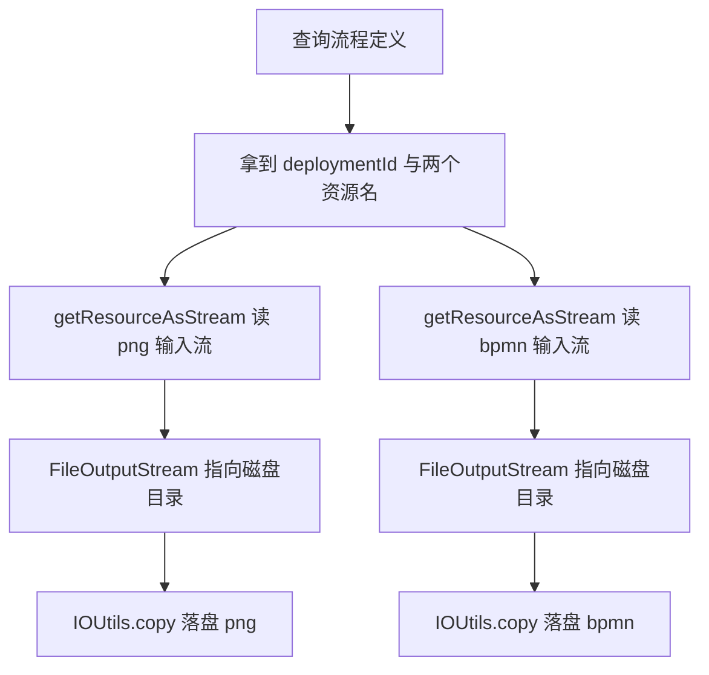

# 把流程图从数据库里捞出来：bpmn 与 png 资源文件保存的需求与方案

部署完成之后，`holiday.bpmn` 和 `holiday.png` 这两个文件在工程目录里怎么样不重要了，它们已经作为字节流存进了 `act_ge_bytearray` 表。麻烦随之而来：用户在页面上点开「请假流程」，想看看这套流程到底有几个步骤、现在卡在哪一步，靠什么展示？靠 png 流程图。可服务器磁盘上并没有这个文件，它只活在数据库里。所以需要一项能力：把库里的 bpmn 与 png 读出来，还原成磁盘上的真文件，或者直接写进响应流。

## 先给结论

- 资源文件的存放地是 `act_ge_bytearray`，`BYTES_` 字段存字节流，按部署 ID 与资源名称两个字段定位一条记录。
- 读回三件套：查流程定义拿部署 ID，用 `getResourceAsStream(deploymentId, resourceName)` 拿输入流，再用输出流落盘。
- 资源名称不用手拼：`getResourceName()` 给 bpmn 文件名，`getDiagramResourceName()` 给 png 文件名；想知道一个部署下全部资源名，用 `getDeploymentResourceNames(deploymentId)`。
- 输入流到输出流的拷贝推荐 `commons-io` 的 `IOUtils.copy`，一行顶一段缓冲区循环。
- 不走 API 也能做，用 JDBC 读 BLOB、CLOB 类型字段自己转流，这正是 API 背后的原理，两条路线都值得搞懂。

## 一、需求与真实场景

需求用课程的原话表述就是两条：**第一，从 `act_ge_bytearray` 表中读取两个资源文件**，bpmn 与 png；**第二，把两个资源文件保存到指定的磁盘目录**，比如课程指定的资料目录，保存完打开文件检查内容是否完整。

这个需求不是练习题，它有真实的业务出口。用户想查看请假流程具体有哪些步骤要走，三步还是五步，页面上就得展示流程图，而 png 里画的正是执行步骤。流程跟踪、审批进度展示这类功能，图的来源都是库里这两条 bytearray 记录。文件从数据库流向页面，中间必须有读取与落盘（或直接写响应）这一环。

## 二、两条技术路线

**第一，用 Activiti 的 API，这是首选，最简单。** 引擎对「按部署 ID 加资源名称取流」做了现成封装，调用方拿到 `InputStream` 之后只关心往哪儿写，不必关心字节存在哪张表哪个字段。

**第二，从原理层面动手，用 JDBC 读 BLOB、CLOB 字段。** `act_ge_bytearray` 的 `BYTES_` 字段在 MySQL 里就是二进制大对象，JDBC 的 `getBlob` 配合 `getBinaryStream` 一样能读出输入流，剩下的活与路线一完全相同：输入流、输出流的转换。这条路线考的是 IO 基本功，也解释了 API 并没有魔法，内部做的同样是这件事。

两个路线共用的最后一段，是把输入流写到输出流。一边读一边写的手写循环可行，但缓冲区大小、异常处理、流的关闭都容易写漏，工程上更倾向用工具包，`commons-io` 就是为这种场景准备的，`IOUtils.copy(in, out)` 一行完成拷贝。课程工程里因此引入了依赖（真实 `pom.xml` 片段）：

```xml
<!--文件读写操作-->
<dependency>
    <groupId>commons-io</groupId>
    <artifactId>commons-io</artifactId>
    <version>2.0</version>
</dependency>
```

## 三、API 路线的关键调用链

资料包里已经给出了完整实现类 `QueryBpmnFile`，它的骨架如下（包名已改为 `com.example`，输出目录换成中性写法）：

```java
//1.得到ProcessEngine对象
ProcessEngine processEngine = ProcessEngines.getDefaultProcessEngine();

//2.得到RepositoryService对象
RepositoryService repositoryService = processEngine.getRepositoryService();

//3.设置查询条件，查询出流程定义
ProcessDefinition processDefinition = repositoryService.createProcessDefinitionQuery()
        .processDefinitionKey("holiday")
        .singleResult();

//4.通过流程定义信息，得到部署ID
String deploymentId = processDefinition.getDeploymentId();

//5.按部署ID与资源名称读取资源，得到输入流
//getResourceAsStream()参数：第一个是部署id，第二个是资源名称
//getDiagramResourceName() 得到png图片资源名称，getResourceName() 得到bpmn文件名称
InputStream pngIs = repositoryService
        .getResourceAsStream(deploymentId, processDefinition.getDiagramResourceName());
InputStream bpmnIs = repositoryService
        .getResourceAsStream(deploymentId, processDefinition.getResourceName());

//6.构建输出流，指向磁盘目录
OutputStream pngOs = new FileOutputStream("d:/export/" + processDefinition.getDiagramResourceName());
OutputStream bpmnOs = new FileOutputStream("d:/export/" + processDefinition.getResourceName());

//7.输入流，输出流的转换，commons-io 提供
IOUtils.copy(pngIs, pngOs);
IOUtils.copy(bpmnIs, bpmnOs);

//8.关闭流
pngOs.close();
bpmnOs.close();
pngIs.close();
bpmnIs.close();
```

这条调用链一次部署执行两遍读写，png 与 bpmn 各一遍，结构完全对称：



图上每条路径都是同构的四步：定位、取流、落盘、关流。最值得留意的是资源名的来源，它从 `ProcessDefinition` 对象上取，而不是自己拼字符串，引擎部署时按什么名存，这里就按什么名取，天然一致。若只知道部署 ID 而还没查定义，`repositoryService.getDeploymentResourceNames(deploymentId)` 会返回该部署下全部资源名称的集合，先列名再逐个取流，同样是标准用法。

## 常见误区

- **资源名自己手工拼接**：zip 部署时资源名可能带目录前缀，手工拼的名称与库里的 `NAME_` 对不上就读不到。用 `getResourceName()` 与 `getDiagramResourceName()` 取，或用 `getDeploymentResourceNames` 列出真实名称。
- **拿流程定义 ID 当部署 ID 传给 `getResourceAsStream`**：第一个参数必须是部署 ID，传错引擎按部署定位不到资源记录，流里自然没有内容。
- **输出目录不存在就直接建 `FileOutputStream`**：目录缺失会抛 `FileNotFoundException`，落盘前先确认目录存在。
- **只关输出流不关输入流**：两个流都要关，更稳妥的写法是 try-with-resources，让资源自动释放。

## 面试可能被问到的问题

1. 面试官追问：「流程的 bpmn 和 png 文件存在哪？」
   答：存在 act_ge_bytearray 表，文件内容以字节流放在 BYTES_ 字段，NAME_ 字段记录资源名称，通过 DEPLOYMENT_ID_ 关联到部署。一次部署带两个文件就是两条记录。

2. 面试官追问：「怎么把部署时的流程图读回来？」
   答：先查流程定义拿到部署 ID 与资源名，再用 repositoryService.getResourceAsStream(deploymentId, resourceName) 拿输入流，通过 IOUtils.copy 写入输出流落盘或直接写进 HTTP 响应。

3. 面试官追问：「不借助 Activiti API 能读到这两个文件吗？」
   答：能。资源就是数据库里的 BLOB 字段，用 JDBC 的 getBlob 配合 getBinaryStream 读出输入流再转输出流即可，API 内部做的也是同样的流转换，两者只是封装层级不同。

4. 面试官追问：「commons-io 在这里解决了什么问题？」
   答：IO 拷贝的样板代码。手写循环要处理缓冲区、读写边界与异常，IOUtils.copy 一行完成带缓冲的拷贝，减少出错面，工程里通常常备这个依赖。

5. 面试官追问：「只知道部署 ID 时怎么知道里面有哪些资源？」
   答：调 repositoryService.getDeploymentResourceNames(deploymentId)，返回该部署下全部资源名称的集合，再按名称逐个 getResourceAsStream 取内容。

## 配套资料

- 完整实现类：`materials/code/02/Activiti7-day03-进阶1/Activiti7-day03-进阶1/代码/更新到第三天/代码/src/main/java/` 下的 `QueryBpmnFile.java`（类注释含需求、技术方案与真实应用场景三段，文中包名已改为 `com.example`，输出目录示例改为中性路径）
- `commons-io` 依赖：同目录 `pom.xml`（版本 2.0，注释「文件读写操作」）
- 数据源与引擎配置：同目录 `src/main/resources/activiti.cfg.xml`
- `getDeploymentResourceNames` 的用法为按 Activiti 7 官方 RepositoryService 接口补充的说明，课程实现采用从 `ProcessDefinition` 取资源名的方式
