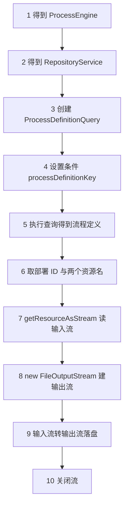

# 十步拆解：把 Activiti 库里的 bpmn 与 png 资源文件保存到磁盘

技术方案定了走 Activiti 的 API 路线，动手之前还得把步骤拆开。这件事听着只有「读表、存文件」两个动作，展开其实是十个步骤，分布在引擎、查询器、IO 三层。不先拆清楚就开工，最常见的窘境是拿着 RuntimeService 到处找读资源的方法：入口根本不在那里。

## 先给结论

- 全程十步，按「拿引擎 → 拿 RepositoryService → 建查询器 → 设条件 → 查流程定义 → 取部署 ID → 读输入流 → 建输出流 → 流转换 → 关流」推进。
- 真正的新知识只有第七步 `getResourceAsStream`，其余九步都是流程定义查询与 IO 的旧知识。
- 资源读取入口是 RepositoryService：bpmn 与 png 存在 `act_ge_bytearray`，这张表随部署写入，属于部署域，与运行时无关。
- 部署 ID 从流程定义对象上取，`processDefinition.getDeploymentId()`，不必去运行时表里翻。
- 第七步之后是纯 IO 基本功：输出流指向目标目录，拷贝交给工具包，最后成对关流。

## 一、步骤全景：十步分四段

课程实现类 `QueryBpmFile` 的 main 方法里，注释就是按步骤编号写的，十个步骤按职责可以归成四段：

| 段落 | 步骤 | 做什么 |
|---|---|---|
| 备引擎 | 1～2 | 得到 `ProcessEngine`，再得到 `RepositoryService` |
| 查定义 | 3～6 | 建查询器、设条件、执行查询、取部署 ID |
| 取流 | 7～8 | 按部署 ID 与资源名读输入流，再建输出流 |
| 落盘 | 9～10 | 输入流转输出流写文件，关闭流 |



图上的关键路径是 2 到 7：`act_ge_bytearray` 的数据是部署动作写进去的，所以读它的 Service 是管部署域的 RepositoryService。部署当时影响了 `act_re_deployment` 与 `act_ge_bytearray` 两张表，现在要读 bytearray 表，自然回到同一个 Service 找方法。

## 二、前六步：全是熟面孔

**第一，引擎与 Service 是固定开场。** `ProcessEngines.getDefaultProcessEngine()` 拿引擎，`getRepositoryService()` 拿服务对象，这两行从第一天写到现在，没有任何新东西。

**第二，查流程定义的套路前面已经写过。** 建查询器、设条件、执行查询、输出信息，这正是之前 `QueryProcessDefinition` 里完整演练过的代码：

```java
//4.设置条件，并查询出当前的所有流程定义   查询条件：流程定义的key=holiday
List<ProcessDefinition> list = processDefinitionQuery.processDefinitionKey("holiday")
        .orderByProcessDefinitionVersion()
        .desc().list();
//5.输出流程定义信息
for (ProcessDefinition processDefinition : list) {
    System.out.println("流程定义ID：" + processDefinition.getId());
    System.out.println("流程部署的ID:" + processDefinition.getDeploymentId());
}
```

当时输出信息是为了看清字段，这里多走一步：把 `getDeploymentId()` 的返回值存进 `String deploymentId` 变量，供第七步当参数。

**第三，部署 ID 并不是只有这一个来源。** 早期写启动流程实例的代码时，部署相关的信息是从 RuntimeService 那条线带出来的；现在直接从流程定义对象上取，路径更短，也不用先启动实例。查询出来的 `ProcessDefinition` 本身就携带 bpmn 与 png 两个资源文件的信息，这正是选它当跳板的原因。

## 三、第七步：唯一的新知识

前六步都在为一个方法调用做准备：

```java
//7.通过 repositoryService 的方法，读取图片信息及 bpmn 文件信息（输入流）
//getResourceAsStream() 参数说明：第一个参数部署 id，第二个参数代表资源名称
InputStream pngIs = repositoryService
        .getResourceAsStream(deploymentId, processDefinition.getDiagramResourceName());
```

**第一，方法名直译就是「把资源当流取出来」。** 引擎拿着部署 ID 去定位部署，再拿资源名在该部署的资源记录里找到对应那条，把 `BYTES_` 字段的字节包装成 `InputStream` 返回。库里存的是字节，方法还你一个流，两边严丝合缝。

**第二，资源名不用自己拼。** png 图片的名字用 `getDiagramResourceName()` 取，bpmn 文件的名字用 `getResourceName()` 取，两个方法都在流程定义对象上。引擎部署时按什么名字存的，这里就按什么名字取，天然一致，绕开了一切拼串错误。

**第三，一次部署要读两遍。** png 与 bpmn 各调一次，参数只有资源名不同，结构完全对称。

## 四、后三步：IO 基本功收尾

拿到输入流，剩下的就是标准文件写出：第八步对每个目标文件 `new FileOutputStream(目录 + 文件名)` 建输出流；第九步做输入流到输出流的转换，把流里的字节直接写进指定目录下的文件；第十步把输出流、输入流成对关闭。这三步与 Activiti 再无关系，考的是 IO 基本功，工具包的用法与关流的细节在实现代码里逐行展开。

## 常见误区

- **拿流程定义 ID 当部署 ID 用**：两者格式与含义都不同，传错后引擎定位不到资源，流里没有内容。部署 ID 老老实实用 `getDeploymentId()` 取。
- **绕开 API 直接查 `act_ge_bytearray`**：用 JDBC 读 BLOB 是原理层的备选路线，不是首选。API 已经封装了定位与转流的细节，先走正门。
- **以为读资源要用 RuntimeService**：运行时服务管的是实例与任务，资源属于部署域，找 RepositoryService。
- **把第七步之后的流转换也当成引擎的活**：引擎的职责到返回 `InputStream` 为止，落盘写文件是调用方自己的事。

## 面试可能被问到的问题

1. 面试官追问：「为什么读取资源文件用的是 RepositoryService 而不是 RuntimeService？」
   答：bpmn 与 png 是部署时写入 act_ge_bytearray 的，资源生命周期跟部署走，归部署域管。RepositoryService 面向部署与流程定义，RuntimeService 面向运行中的实例，读资源自然找前者。

2. 面试官追问：「为什么要先查流程定义，直接查资源表不行吗？」
   答：API 层面资源的定位键是部署 ID 加资源名，流程定义对象恰好同时携带这两个值，是最短的正门。直接查表是 JDBC 原理路线，能做但要多处理 BLOB 转流的细节。

3. 面试官追问：「`getResourceAsStream` 的两个参数分别是什么？」
   答：第一个是部署 ID，用来锁定是哪一次部署；第二个是资源名称，在该部署的资源记录里精确到具体文件。png 与 bpmn 各调一次，只换第二个参数。

4. 面试官追问：「部署 ID 还能从哪些地方拿到？」
   答：流程定义对象的 `getDeploymentId()` 最直接；启动实例返回的 ProcessInstance 携带流程定义 ID，可以再反查定义拿部署 ID；部署接口本身的返回值 Deployment 也带 ID。

5. 面试官追问：「拿到输入流之后为什么不自己写循环拷贝？」
   答：手写循环要处理缓冲区大小、读写边界与异常，容易漏。commons-io 的 IOUtils.copy 一行完成带缓冲的拷贝，出错面小，工程上通常常备这个依赖。

## 配套资料

- 步骤注释与完整实现：`materials/code/02/Activiti7-day03-进阶1/Activiti7-day03-进阶1/代码/更新到第三天/代码/src/main/java/` 下的 `QueryBpmnFile.java`（类内注释按 1～10 编号，与文中步骤一一对应，包名已改为 `com.example`）
- 流程定义查询对照：同目录下的 `QueryProcessDefinition.java`、`DeleteProcessDefinition.java`（后者的类注释列出了部署影响的三张表）
- 引擎与数据源配置：同目录 `src/main/resources/activiti.cfg.xml`
